# Problemas comuns na emissão de notas

Em **Vendas > Notas Fiscais**, no ERP da Olist, você consulta o motivo quando uma nota fica com problema e entende avisos que impedem imprimir DANFEs, lançar contas, inutilizar numeração ou seguir com a nota.

O painel da nota pendente ou rejeitada mostra os erros devolvidos pela SEFAZ. As situações abaixo são as que a própria tela explica.

## Importante
- A justificativa de cancelamento, da carta de correção e do modo de contingência precisa ter no mínimo 15 caracteres.
- A carta de correção mais recente substitui a anterior.
- Não envie notas fora da sequência de numeração.
- Defensivos agrícolas e guia de trânsito não podem constar na mesma nota.
- **Cancelar NFe**, **Carta de correção** e **Download do XML da NFe** aparecem na nota emitida, não na pendente.

## Instruções
### Consultar a rejeição da nota

1. Acesse **Vendas > Notas Fiscais**.
2. Abra a nota pendente ou rejeitada e o painel de rejeição, quando ele existir.
3. Leia os erros retornados pela SEFAZ. O painel traz o envio de email, com **Enviar** e **Cancelar**. Feche sem usar **Enviar** para sair sem reenviar a nota.

O menu da linha, **Outras opções** e o painel de rejeição não trazem a ação Corrigir com IA.

### Nota pendente sem cancelar, carta de correção ou XML

1. Na lista, abra o menu de ações da nota pendente.

   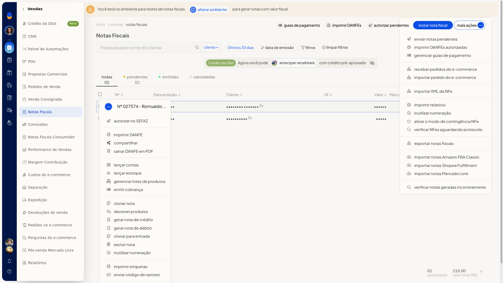

2. Abra **Outras opções**. Nessa nota, o menu não oferece XML, **Cancelar NFe** nem carta de correção.

   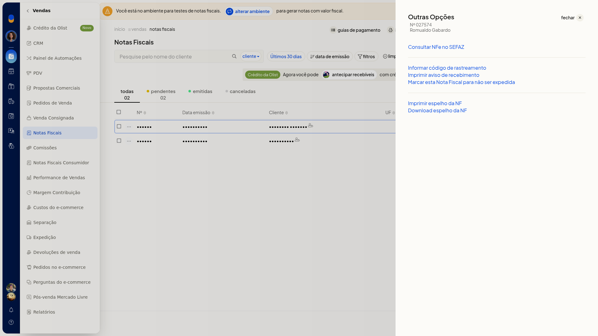

3. Na nota emitida, use o menu da linha para **Carta de correção** e **Cancelar NFe**. O XML fica em **Outras opções > Download do XML da NFe**.

   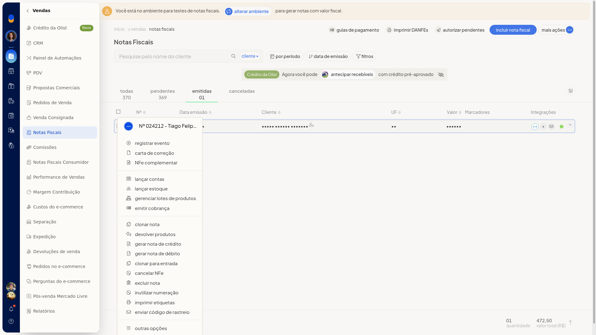

   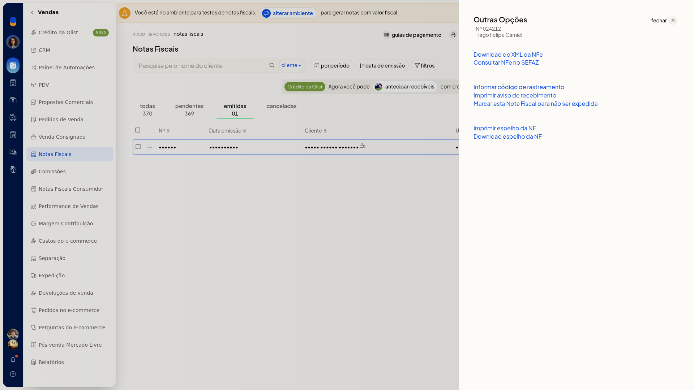

### Impressão em lote sem nota autorizada

1. Em **Vendas > Notas Fiscais**, clique em **Imprimir DANFEs** ou abra **Mais ações > Imprimir DANFEs autorizadas**.
2. Se não houver nota autorizada, leia o aviso **Não há notas autorizadas para imprimir DANFEs** e feche. Nenhuma DANFE é impressa e você permanece na lista.

   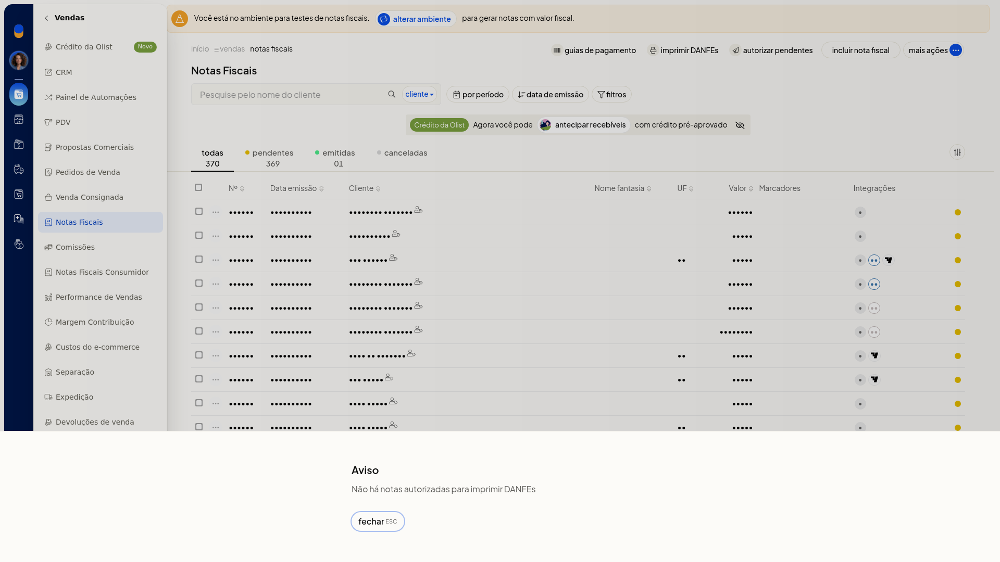

### Lançar contas sem parcelas

1. No menu da linha, escolha **Lançar contas**. A opção aparece na nota pendente e na emitida.
2. Se não houver parcelas, leia o aviso **Não existem parcelas cadastradas**. O financeiro não pode ser integrado. Feche o aviso. Nenhuma conta é lançada.

   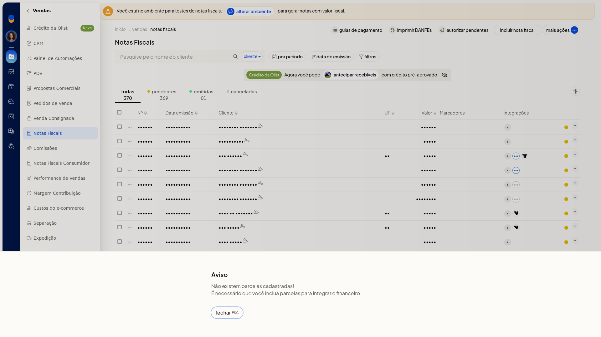

### Inutilizar numeração sem o serviço em execução

1. Em **Vendas > Notas Fiscais**, abra **Mais ações** e escolha **Inutilizar numeração**. A mesma opção aparece no menu da linha da nota pendente e da emitida.
2. Se a tela informar que o **Tiny NFe** não está em execução, não há formulário para preencher enquanto o serviço não estiver em execução. A consulta pode abrir com **Nenhum registro encontrado**. Feche sem inutilizar número.

   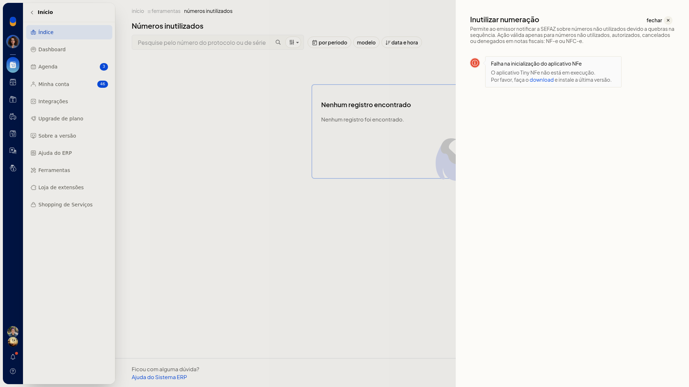

A inutilização não é instalada em **Início > Loja de extensões**. A busca por Inutilização de NFe ou por inutilizar mostra **Sua pesquisa não retornou resultados**. Em **Minhas extensões**, a busca por Inutilização também não retorna item. O caminho é **Vendas > Notas Fiscais > Mais ações > Inutilizar numeração**.

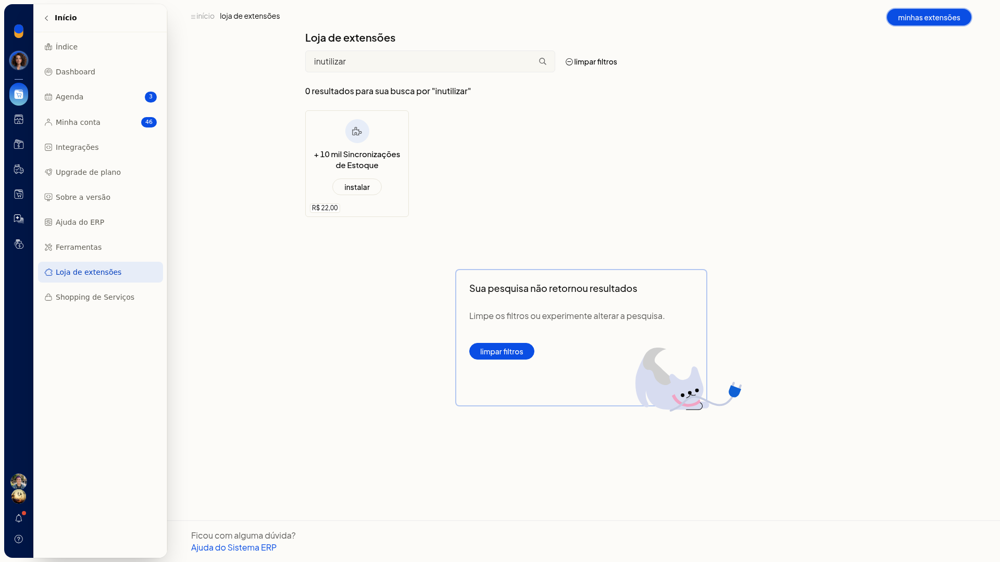

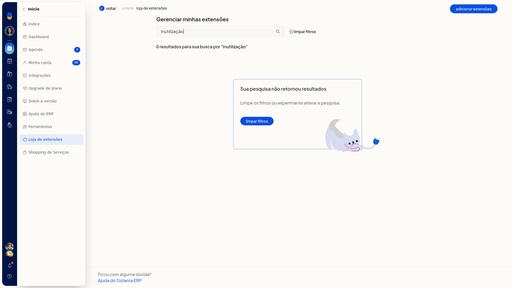

### Excluir nota e quebra de numeração

1. No menu da linha de uma nota pendente, escolha **Excluir nota**.
2. Leia o aviso: só notas pendentes podem ser excluídas, e excluir nota pendente ou rejeitada quebra a numeração. O diálogo traz o link para inutilizar numeração, **excluir nota** e **cancelar**. Clique em **cancelar** para manter a nota.

   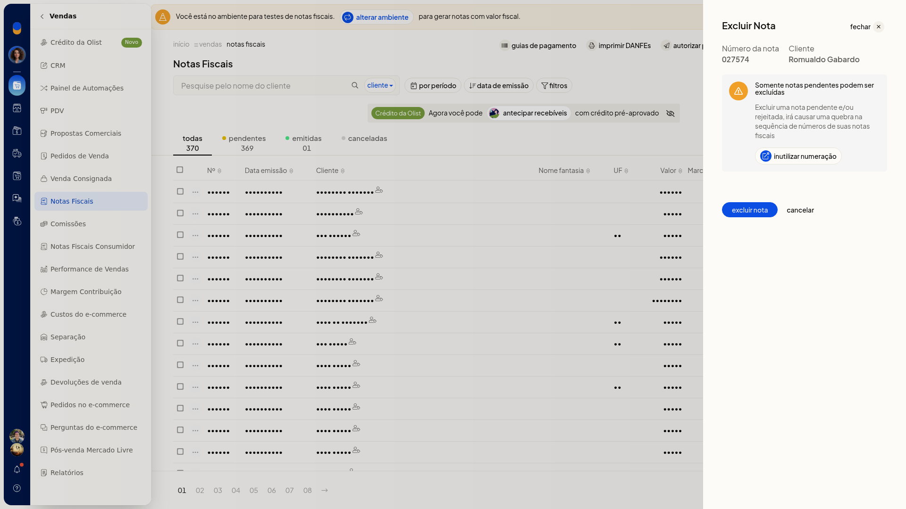

### Número fora da sequência

1. Em **Vendas > Notas Fiscais**, clique em **Incluir nota fiscal**.
2. Mantenha o **Número** preenchido pelo sistema. Se você alterar o número, leia o aviso de que não é permitido enviar notas fora da sequência. Clique em **Cancelar** para dispensar o aviso.

   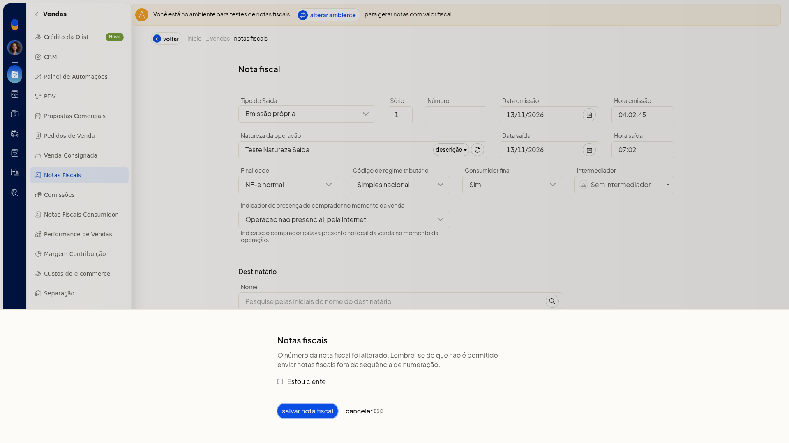

### Preview da DANFE sem valor fiscal

1. Na linha da nota, abra o menu de ações e escolha **Imprimir DANFE**.
2. No preview, confira o aviso de documento sem valor fiscal antes de usar **Imprimir**. Clique em **Fechar** se não for imprimir.

   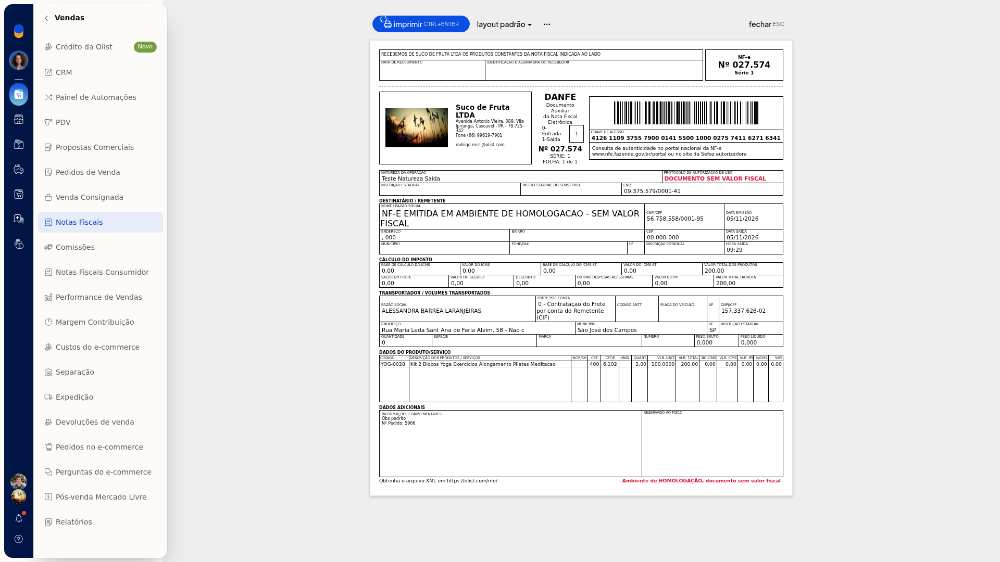

## Resultado
Você vê o motivo devolvido pela SEFAZ e permanece na lista quando fecha os avisos de DANFE, parcelas, exclusão ou sequência. A inutilização só segue na tela de notas, com o **Tiny NFe** em execução.

## Informações adicionais
- A busca NFe em **Minhas extensões** não mostra inutilização.

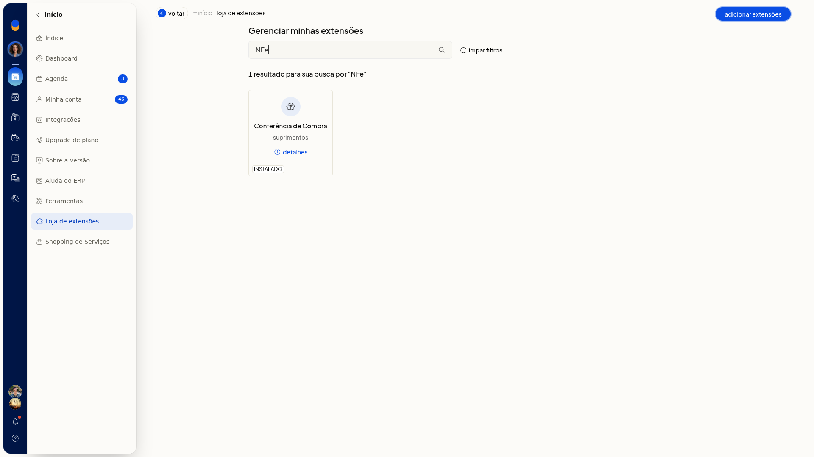
