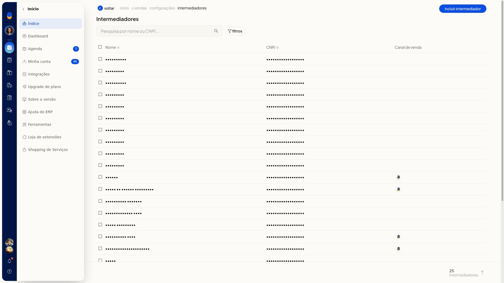
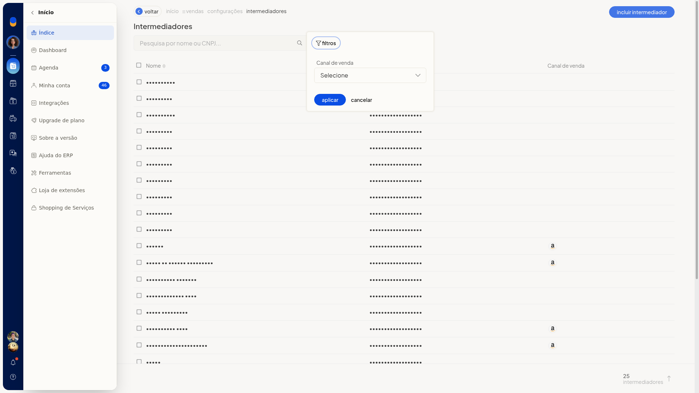
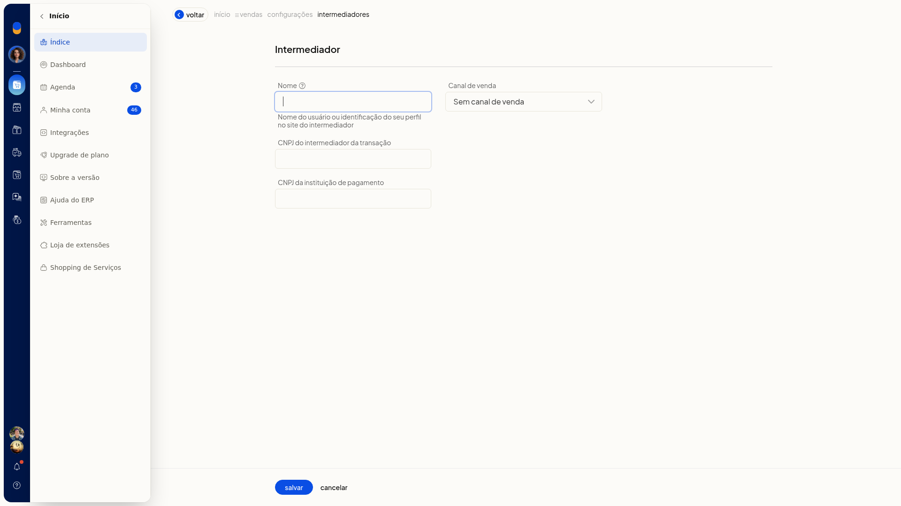
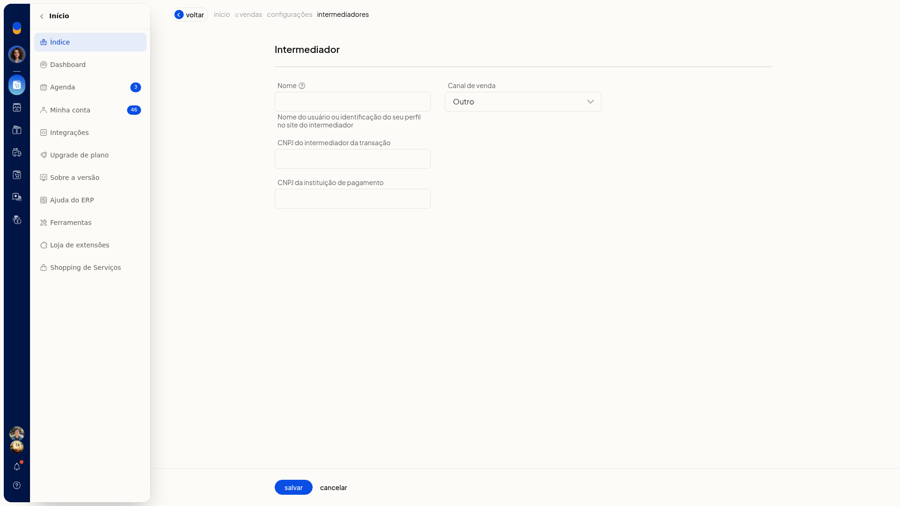
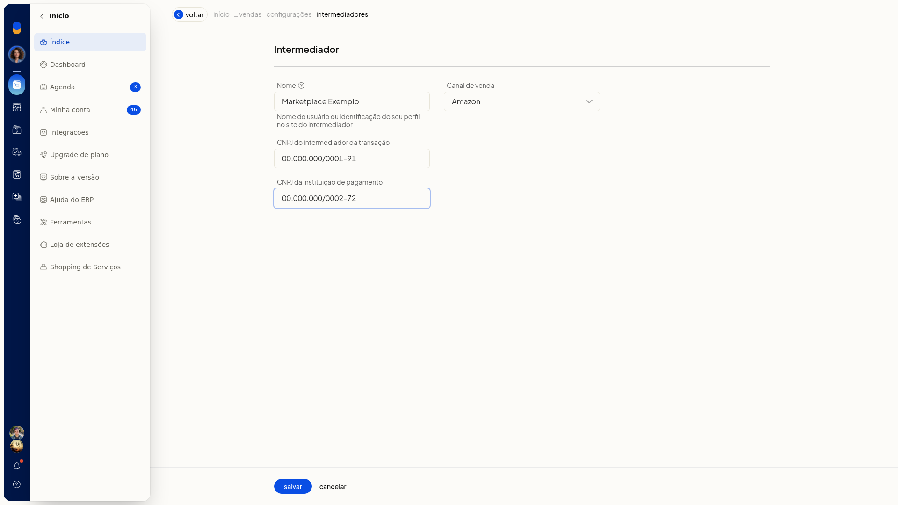

# Cadastro de intermediadores

O cadastro de intermediadores no ERP da Olist registra o intermediador de uma venda para as notas fiscais. Você informa a identificação do perfil no site do intermediador, o canal de venda e os CNPJs do intermediador da transação e da instituição de pagamento.

Na mesma tela, você consulta quem já está cadastrado, busca por nome ou CNPJ e filtra a lista pelo canal de venda. O atalho fica em **Configurações > Configurações ERP**, na aba **Notas Fiscais**, seção **Notas fiscais de venda**.

## Pré-requisitos
- A nota fiscal eletrônica precisa estar disponível na conta.
- Tenha a identificação do perfil no site do intermediador, o canal de venda e os CNPJs pedidos no formulário.
- Se a opção não aparecer para você, peça acesso ao administrador da conta.

## Importante
- **Cancelar** volta à lista **Intermediadores** sem gravar o que foi digitado.
- A opção **Outro** em **Canal de venda** não abre outro campo.

## Instruções
1. No menu lateral do ERP, clique em **Configurações**.
2. Clique em **Configurações ERP**.
3. Abra a aba **Notas Fiscais**.
4. Na seção **Notas fiscais de venda**, clique em **Cadastro de intermediadores**.

   

5. Na lista **Intermediadores**, confira as colunas **Nome**, **CNPJ** e **Canal de venda**.
6. Para localizar um cadastro, busque por nome ou CNPJ.

   

7. Para filtrar, clique em **filtros**.
8. Selecione o **Canal de venda**. O valor inicial é **Selecione**.
9. Clique em **Aplicar**.

   

10. Clique em **Incluir intermediador**.

   

11. Preencha **Nome** com a identificação do perfil no site do intermediador. O campo não é obrigatório.
12. Selecione o **Canal de venda**. O valor inicial do novo cadastro é **Sem canal de venda**. O campo não é obrigatório.
13. Se escolher **Outro**, continue nos campos já exibidos. Nenhum campo extra aparece.

   

14. Preencha **CNPJ do intermediador da transação**. O campo não é obrigatório.
15. Preencha **CNPJ da instituição de pagamento**. O campo não é obrigatório.

   

16. Clique em **Salvar** para concluir o cadastro. Para sair sem gravar, clique em **Cancelar**.

## Informações adicionais
### Endereço e município dependem do SPED Fiscal

Endereço e município do intermediador e da instituição de pagamento só aparecem se a empresa tiver o SPED Fiscal.
