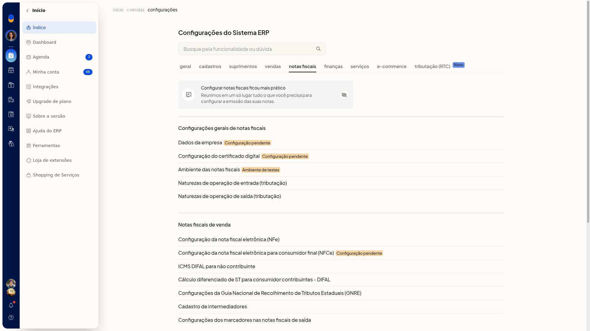
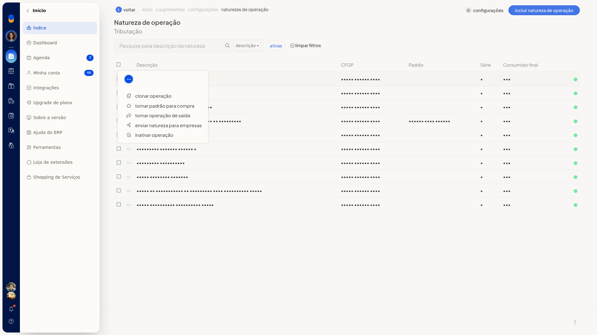
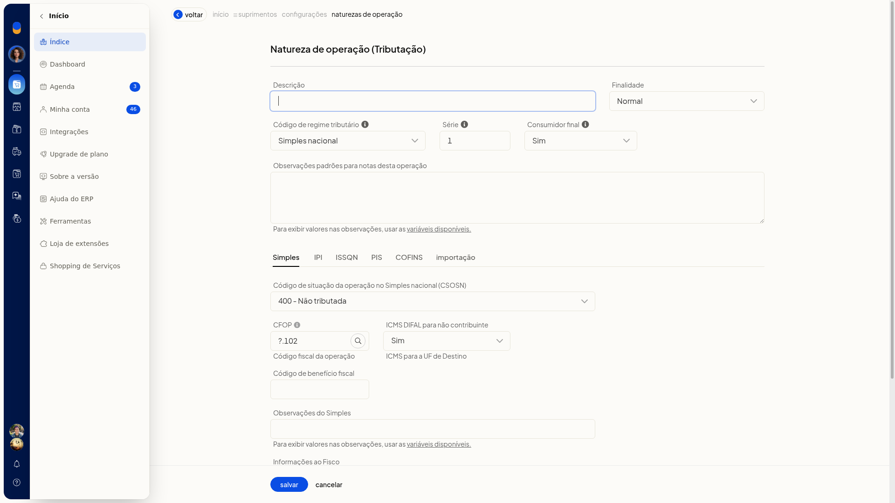

# Definir a natureza de operação padrão para compra

Na lista de naturezas de operação de entrada do ERP da Olist, você define qual regra de compra fica como padrão. A coluna **Padrão** mostra essa marcação, e cada linha tem a ação **tornar padrão para compra**.

A natureza de operação de entrada define como o ERP trata a tributação, o CFOP, o estoque e o preço das notas fiscais de compra.

## Pré-requisitos
- A empresa precisa ter nota de entrada.
- Se a opção não aparecer para você, peça acesso ao administrador da conta.

## Instruções
1. Acesse **Configurações > Configurações ERP**, abra a aba **Notas Fiscais** e clique em **Naturezas de operação de entrada (tributação)**.
2. Na lista, pesquise pela descrição, filtre as naturezas ativas ou limpe os filtros. A grade mostra **Descrição**, **CFOP**, **Padrão**, **Série** e **Consumidor final**.

   

3. Na linha da natureza que deve valer para compra, clique em **tornar padrão para compra**.

   

   
