# Naturezas de operação de entrada

## Pré-requisitos
- A empresa precisa ter nota de entrada. Para abrir a tela, ela também precisa ter NF-e, notas fiscais, nota de entrada ou NFC-e.
- Se a opção não aparecer para você, peça acesso ao administrador da conta.
- Tenha em mãos o código de regime tributário da empresa, o CFOP, a situação tributária (CST ou CSOSN) e as alíquotas da operação de entrada.

## Importante
- O **Código de regime tributário** do cabeçalho define a aba de ICMS: **Simples nacional** exibe a aba **Simples**; **Regime normal** oculta a aba **Simples** e exibe a aba **ICMS**.
- Em **Adicionar exceção**, o botão **próximo** tenta gravar o cadastro. Sem uma regra válida, a tela informa que não foi possível salvar o cadastro e que uma regra de exceção válida deve ser informada. Nesse caso, o cadastro não é gravado.
- **Cancelar** no painel de exceção fecha o painel sem gravar a natureza.
- Se em **Preço considerado** você escolher **Preço de custo**, confirme que esse preço será usado nas notas.

## Instruções
1. Acesse **Configurações > Configurações ERP**. Na aba **Notas Fiscais**, abra **Naturezas de operação de entrada (tributação)**.
2. Pesquise pela descrição, filtre as naturezas ativas ou limpe os filtros. A grade mostra **Descrição**, **CFOP**, **Padrão**, **Série** e **Consumidor final**.

   

3. Na linha da natureza, acione a ação desejada: **clonar operação**, **tornar padrão para compra**, **tornar operação de saída**, **enviar natureza para empresas** ou **inativar operação**.

   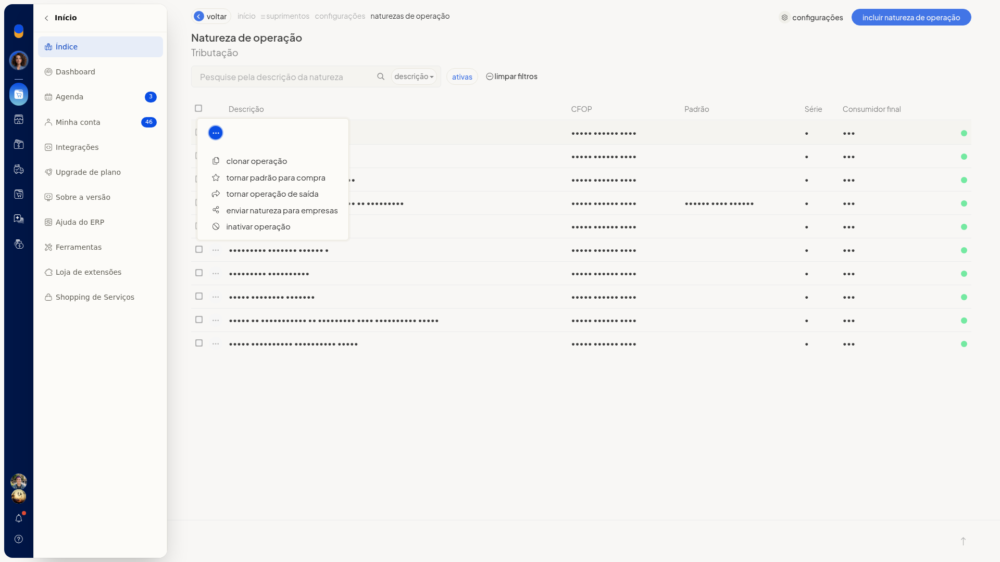

4. Clique em **Incluir natureza de operação**.

   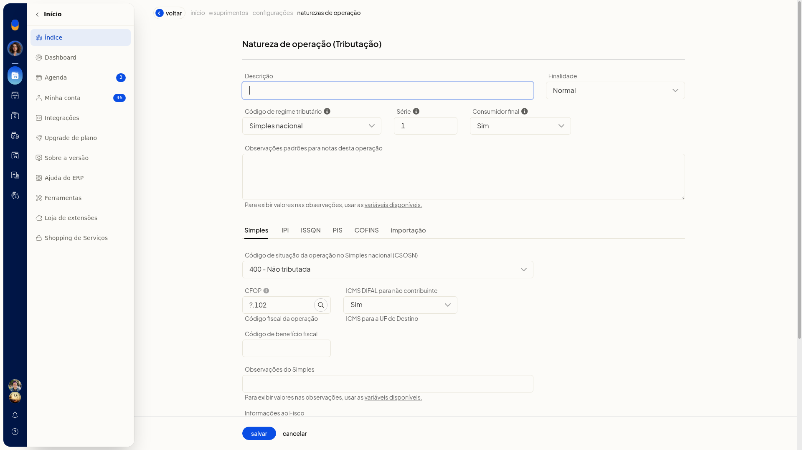

5. Preencha o cabeçalho:
 - **Descrição**
 - **Finalidade**: Normal, Devolução, Bonificação ou Remessa
 - **Código de regime tributário**: Simples nacional, Simples nacional - excesso de sublimite de receita bruta, Regime normal ou Microempreendedor Individual (MEI)
 - **Série**
 - **Consumidor final**: Sim ou Não
 - **Observações padrões para notas desta operação**: texto livre. No link **variáveis disponíveis**, copie os marcadores e inclua os colchetes.
6. Se o regime for **Simples nacional**, abra a aba **Simples** e informe:
 - **CSOSN**: 101, 102, 103, 201, 202, 203, 300, 400, 500 ou 900. A opção 400 aparece como Não tributada.
 - **CFOP**. Use **Pesquisar** ao lado do campo, se precisar localizar o código.
 - **ICMS DIFAL para não contribuinte**: Sim ou Não. O texto de ajuda indica ICMS para a UF de Destino.
 - **Código de benefício fiscal**, observações e **Informações ao Fisco**. No link **variáveis disponíveis** de cada campo, use os marcadores entre colchetes.

   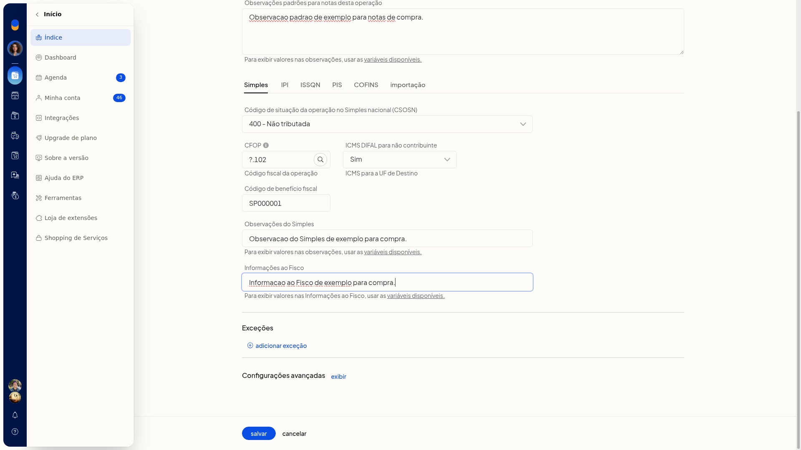

7. Se o regime for **Regime normal**, abra a aba **ICMS** e escolha a **Situação tributária**:
 - 00 Tributada integralmente
 - 10 Tributada e com cobrança do ICMS por ST
 - 20 Com redução de base de cálculo
 - 30 Isenta ou não tributada e com cobrança do ICMS por ST
 - 40 Isenta
 - 41 Não tributada
 - 50 Suspensão
 - 51 Diferimento
 - 60 ICMS cobrado anteriormente por ST
 - 90 Outras

   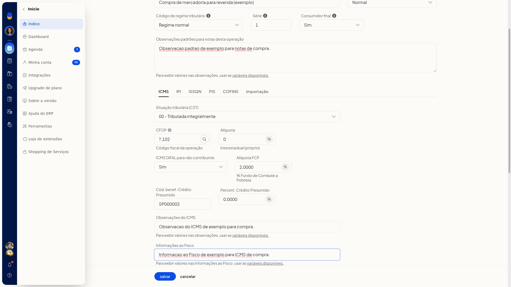

8. Complete os campos que a situação tributária exibe:
 - No CST 10, preencha a substituição tributária: **Alíquota ICMS-ST** (percentual no estado de destino, com vírgula), **Base de Cálculo ICMS-ST** (use valor diferente de 100 só se houver redução), **MVA / IVA**, **Alíquota FCP ICMS-ST**, **Alíquota PIS** e **Alíquota COFINS** sobre a substituição tributária.
 - No CST 20, informe **Base** (percentual com vírgula), **Calcular ICMS Desonerado** (Sim ou Não) e **Motivo da desoneração**.
 - No CST 51, informe **Percentual de Diferimento**, **Alíquota FCP**, **Percentual FCP Diferido** e **Cód. benef. Redução BC**, quando o campo aparecer.
 - No CST 60, informe **Alíquota ICMS efetivo** e **Base ICMS efetivo**. Marque **Obter ICMS-ST retido anteriormente a partir de nota fiscal de compra** se quiser buscar o ICMS-ST retido da nota de compra.
 - Informe também **CFOP**, **Alíquota** (percentual do ICMS próprio, com vírgula; na substituição tributária o rótulo complementar é Interestadual (próprio)), **ICMS DIFAL para não contribuinte**, **Código de benefício fiscal**, **Cód. benef. Crédito Presumido**, **Percent. Crédito Presumido** (formato 0,0000), **Observações do ICMS** e **Informações ao Fisco**.

   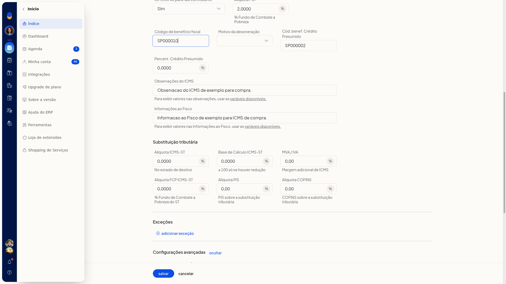

   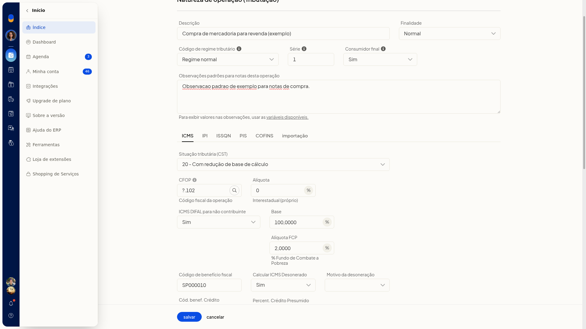

   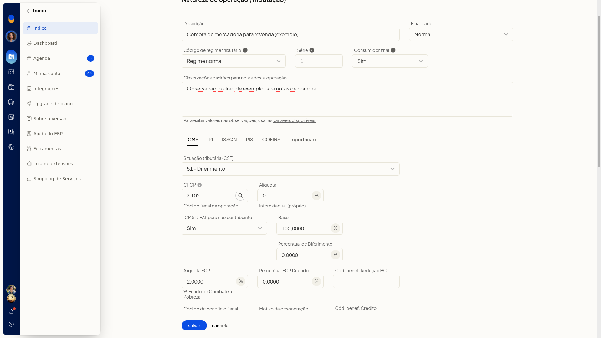

   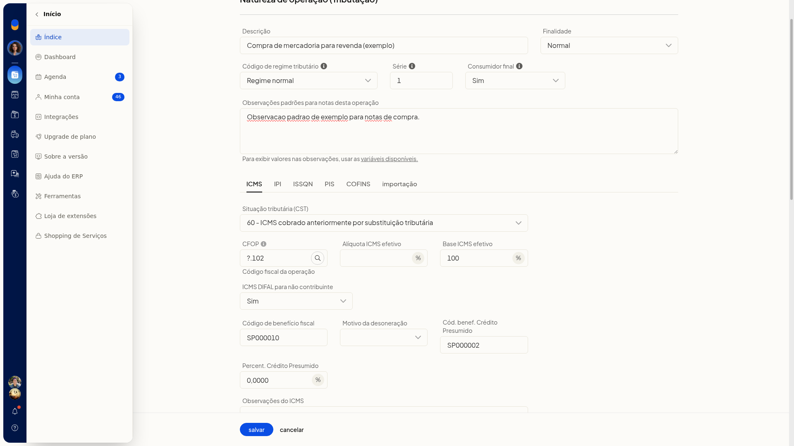

   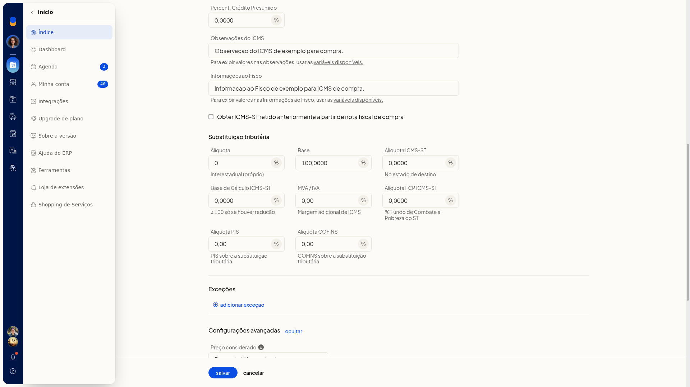

9. Nas observações do ICMS, use com colchetes: [VALOR_BASE_ICMS], [VALOR_BASE_DIFERIMENTO], [VALOR_DIFERIMENTO], [VALOR_CREDITO_ICMS], [ICMS_PRESUMIDO], [ALIQUOTA_CREDITO_ICMS], [VALOR_ICMS_DESONERADO], [NUMERO_CUPOM] e [DATA_CUPOM]. Em **Informações ao Fisco** do ICMS, use os mesmos marcadores, exceto [NUMERO_CUPOM] e [DATA_CUPOM]. Abra **variáveis disponíveis** para ver a lista na própria página.

   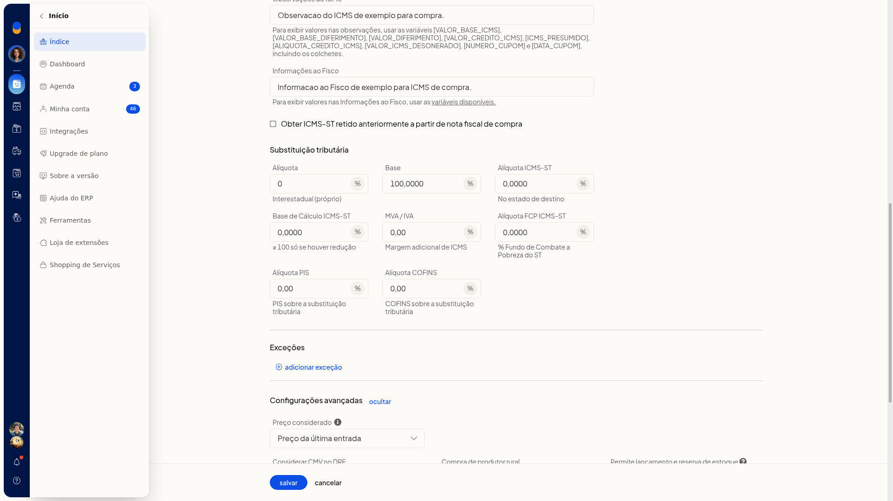

   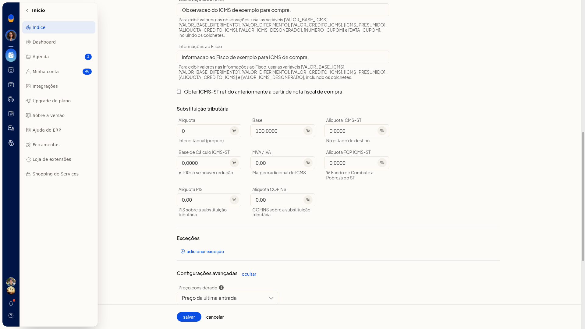

10. Preencha a aba **IPI**: **Situação tributária do IPI** (00 Entrada com recuperação de crédito, 01 Entrada tributada alíquota zero, 02 Entrada isenta, 03 Entrada não-tributada, 04 Entrada imune, 05 Entrada com suspensão, 49 Outras entradas ou Não destacar IPI), **Alíquota do IPI**, **Código de enquadramento**, observações e **Informações ao Fisco**.

   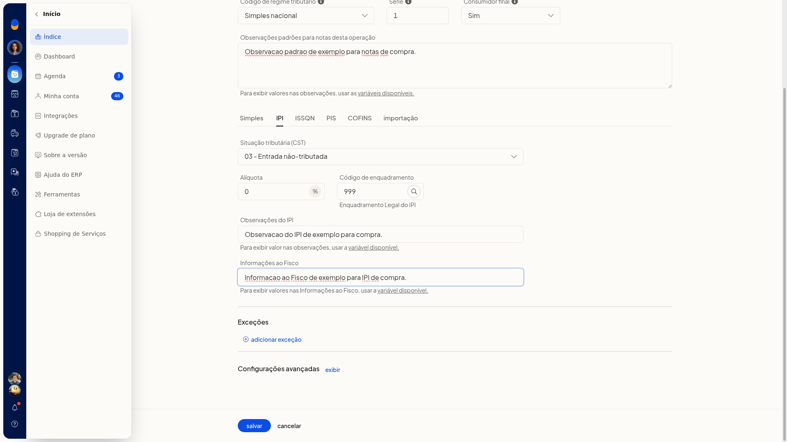

11. Preencha a aba **ISSQN**: situação (tributado, isento ou outra situação), **Alíquota do ISSQN**, **Base do ISSQN**, **Descontar ISS** (Sim ou Não; o texto de ajuda indica que o desconto entra no total da nota), observações e **Informações ao Fisco**.

   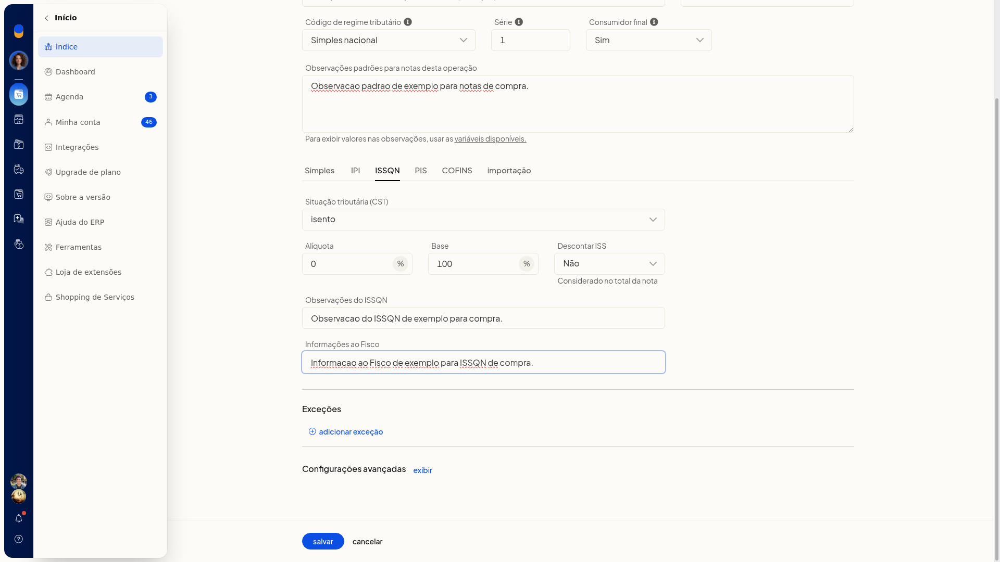

12. Preencha a aba **PIS**: **Situação tributária do PIS** (01 a 09, 49, 50 a 56, 60 a 67 e 70 a 73), **Alíquota PIS**, **Base do PIS**, observações e **Informações ao Fisco**.

   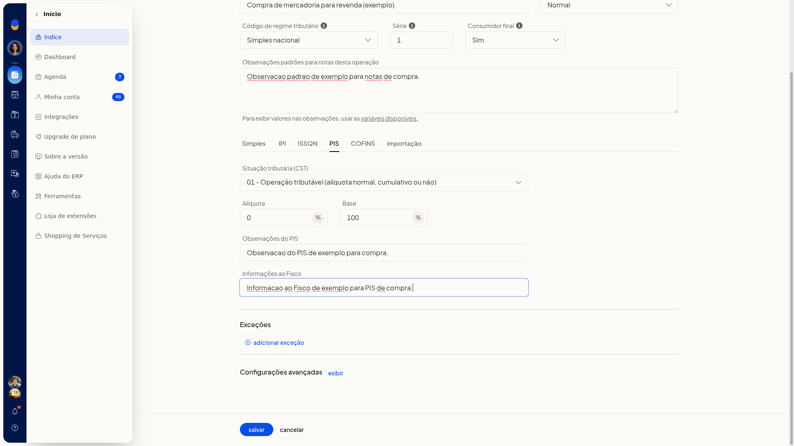

13. Preencha a aba **COFINS** com a mesma faixa de situações do PIS, **Alíquota COFINS**, **Base do COFINS**, observações e **Informações ao Fisco**.

   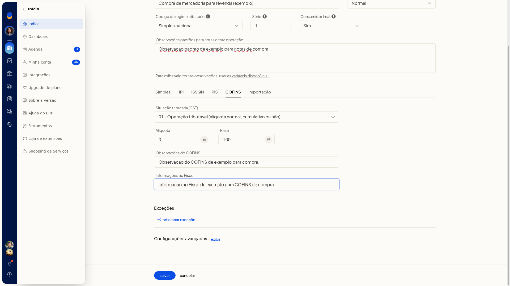

14. Preencha a aba **Importação**: **Situação da Importação** (Tributado ou Não tributado), **Alíquota da Importação**, observações e **Informações ao Fisco**. Em cada aba, o link **variáveis disponíveis** lista os marcadores daquela aba. Inclua os colchetes.

   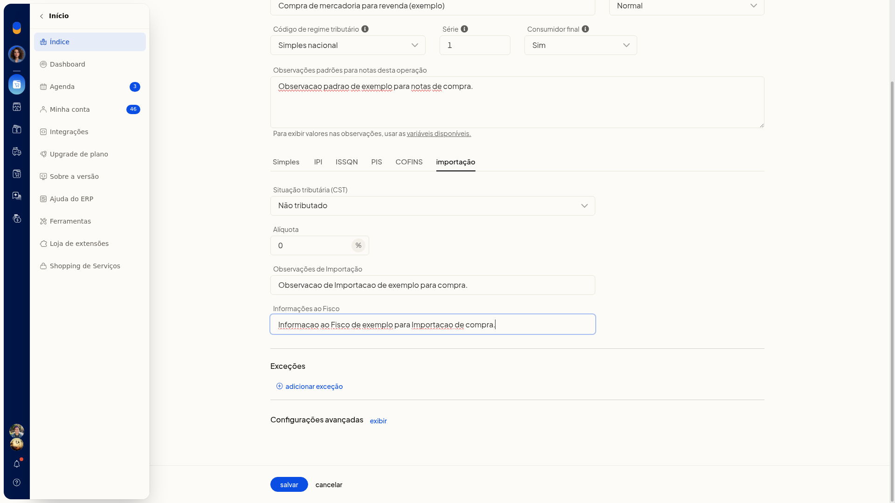

15. Para uma regra por estado, produto, origem ou NCM, clique em **Adicionar exceção**. Informe a regra antes de clicar em **próximo**:
 - **UF da exceção**: de AC a TO, EX ou **Qualquer estado**
 - **Origem da exceção**: **Qualquer origem** ou os códigos 0 a 8
 - produto: clique em **Adicionar** e informe o SKU na linha
 - NCM: clique em **Adicionar** e informe o NCM na linha

   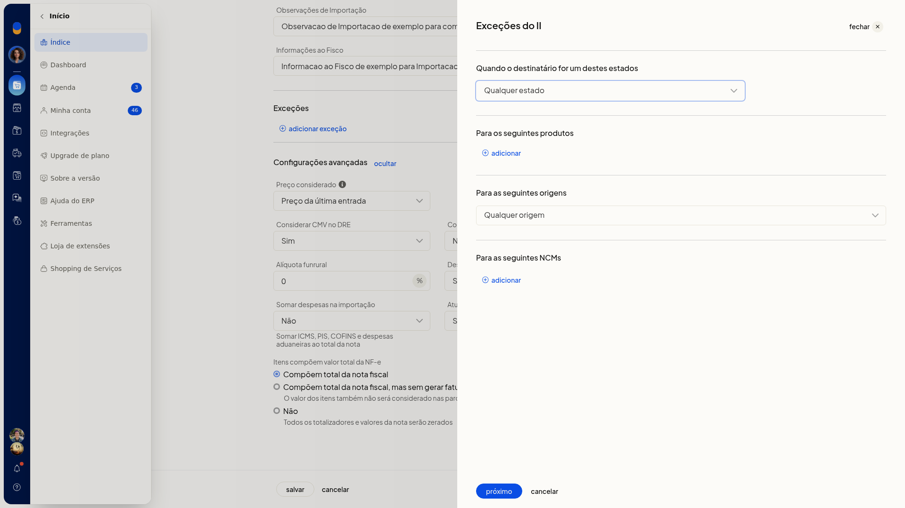

   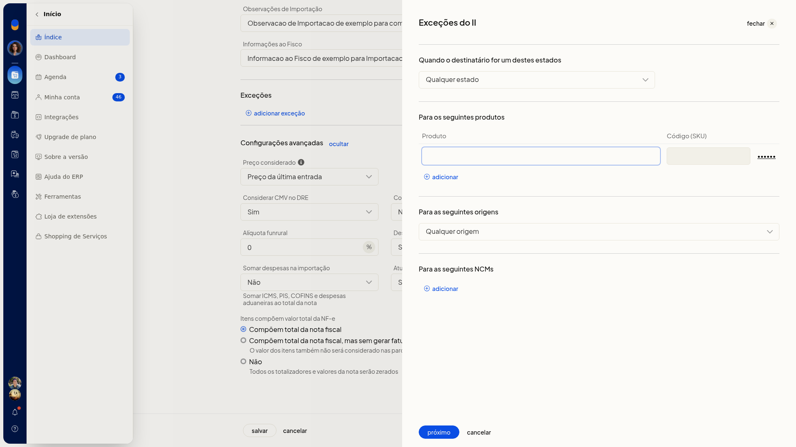

   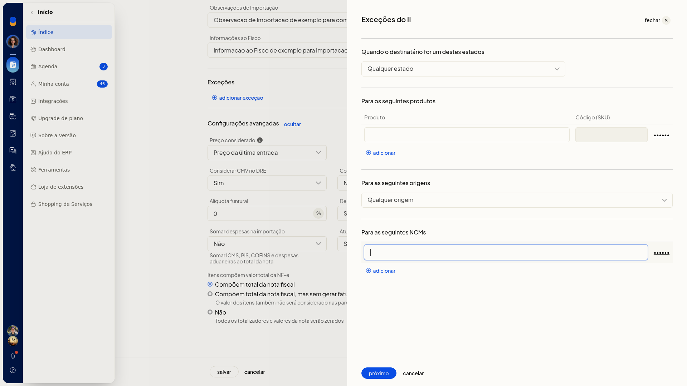

16. Só clique em **próximo** depois de informar uma regra válida. Sem regra válida, o cadastro não é gravado e a tela permanece no aviso.

   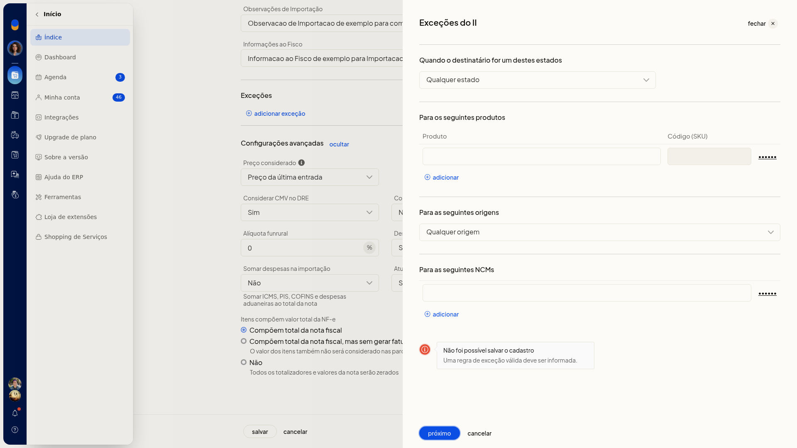

17. Abra **Configurações avançadas** e defina:
 - **Preço considerado**: Preço de custo ou Preço da última entrada. Com Preço de custo, confirme que esse preço será usado nas notas.
 - **Considerar CMV no DRE**: Sim ou Não
 - **Compra de produtor rural**: Sim ou Não
 - **Permite lançamento e reserva de estoque**: Sim ou Não
 - **Alíquota funrural**
 - **Descontar funrural do total faturado**: Sim ou Não
 - **Redução da Base de Cálculo do ICMS-ST**: Padrão ou Antes de somar o IPI
 - **Somar despesas na importação**: Sim ou Não. O texto de ajuda indica somar ICMS, PIS, COFINS e despesas aduaneiras ao total da nota.
 - **Atualizar preço de última compra do produto**: Sim ou Não
 - **Descontar desoneração do total da nota fiscal**: Sim ou Não
 - **Itens compõem valor total da NF-e**: Compõem total da nota fiscal; Compõem total da nota fiscal, mas sem gerar faturas no XML da NFe (o valor dos itens também não entra nas parcelas); ou Não (todos os totalizadores e valores da nota serão zerados)

   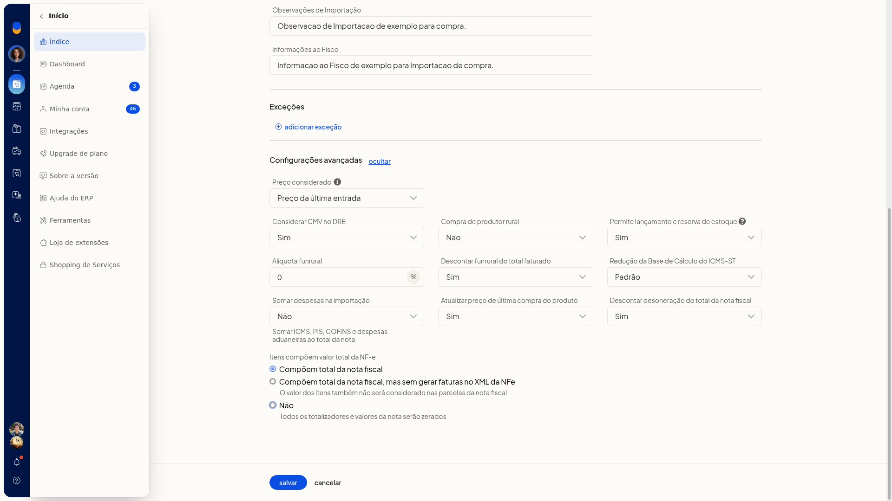

18. Clique em **Salvar** para gravar a natureza.
