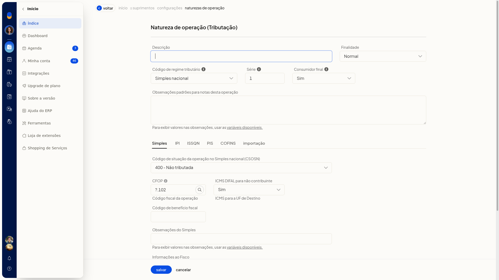
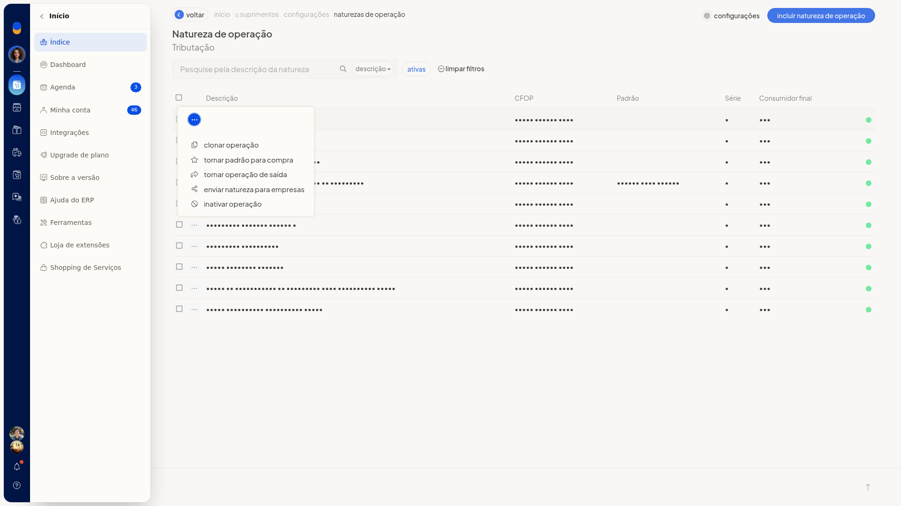

# Transformar uma natureza de entrada em operação de saída

No ERP da Olist, a natureza de operação de entrada define como o sistema trata a tributação, o CFOP, o estoque e o preço das notas fiscais de compra. Na lista dessas naturezas, você transforma uma natureza de entrada em operação de saída pela ação da linha.

## Pré-requisitos
- Para abrir a tela, a empresa precisa ter NF-e, notas fiscais, nota de entrada ou NFC-e.
- A natureza de saída exige que a empresa tenha NF-e, notas fiscais ou nota de entrada.
- Se a opção não aparecer para você, peça acesso ao administrador da conta.

## Instruções
1. Acesse **Configurações > Configurações ERP**.
2. Na aba **Notas Fiscais**, abra **Naturezas de operação de entrada (tributação)**.
3. Localize a natureza na lista. Se precisar, pesquise pela descrição, filtre as ativas ou clique em **limpar filtros**. A grade mostra **Descrição**, **CFOP**, **Padrão**, **Série** e **Consumidor final**.

   

   

4. Na linha da natureza, clique em **tornar operação de saída**.

   
