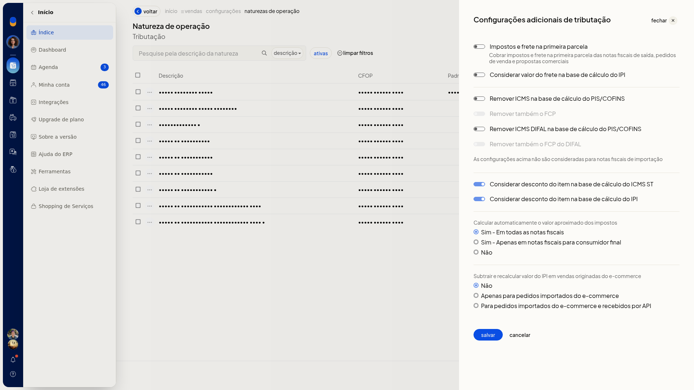
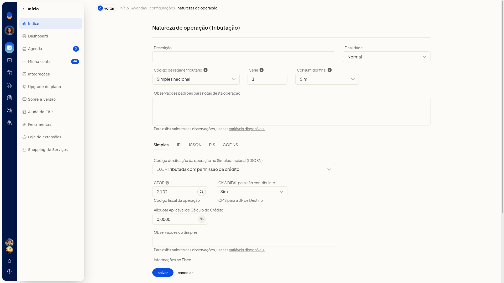

# Natureza de operação: bases de cálculo (ICMS, IPI, PIS/COFINS) e crédito do Simples

## Importante
- **Cancelar** em **Configurações adicionais de tributação** fecha a tela e volta à lista sem gravar a alteração.
- A **Alíquota Aplicável de Cálculo do Crédito** aparece quando o **CSOSN** é **101**.
- Trocar o **CRT** de **Simples nacional** para **Regime normal** substitui o **CSOSN** pelo **CST de ICMS**.

## Instruções
### Em configurações adicionais de tributação

1. Acesse **Configurações > Configurações ERP**.
2. Abra a aba **Notas Fiscais**.

   

3. Clique em **Naturezas de operação de saída (tributação)**.
4. Na lista, clique em **Configurações**.
5. Em **Configurações adicionais de tributação**, marque ou desmarque as bases:

   - **Impostos e frete na primeira parcela**: cobra impostos e frete na primeira parcela das notas fiscais de saída, pedidos de venda e propostas comerciais.
   - **Considerar valor do frete na base de cálculo do IPI**
   - **Remover ICMS na base de cálculo do PIS/COFINS**
   - **Remover também o FCP**
   - **Remover ICMS DIFAL na base de cálculo do PIS/COFINS**
   - **Remover também o FCP do DIFAL**
   - **Considerar desconto do item na base de cálculo do ICMS ST**
   - **Considerar desconto do item na base de cálculo do IPI**

   

6. Em **Calcular automaticamente o valor aproximado dos impostos**, selecione **Sim - Em todas as notas fiscais**, **Sim - Apenas em notas fiscais para consumidor final** ou **Não**.
7. Em **Subtrair e recalcular valor do IPI em vendas originadas do e-commerce**, selecione **Não**, **Apenas para pedidos importados do e-commerce** ou **Para pedidos importados do e-commerce e recebidos por API**.
8. Clique em **Salvar**.

### Crédito do Simples na natureza

1. Acesse **Configurações > Configurações ERP**.
2. Abra a aba **Notas Fiscais**.
3. Clique em **Naturezas de operação de saída (tributação)**.
4. Abra a inclusão de uma nova natureza.
5. Mantenha o **CRT** em **Simples nacional**.
6. Em **CSOSN**, selecione **101**.
7. Informe a **Alíquota Aplicável de Cálculo do Crédito** no formato 0,0000.

   

8. Para a base do ICMS-ST, abra as opções avançadas e, em **Redução BC ICMS-ST**, selecione **Padrão** ou **Antes de somar o IPI**.
9. Clique em **Salvar**.
