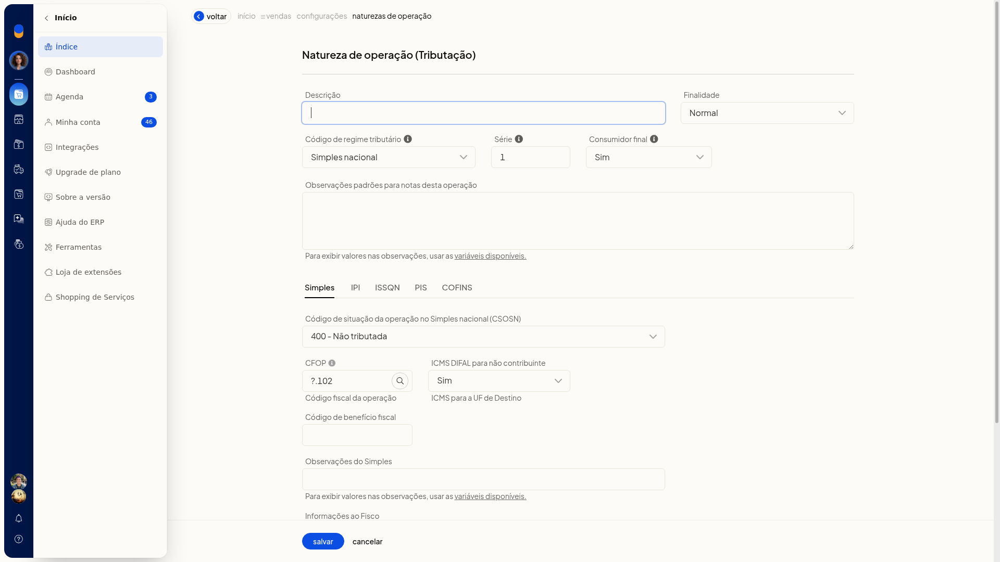
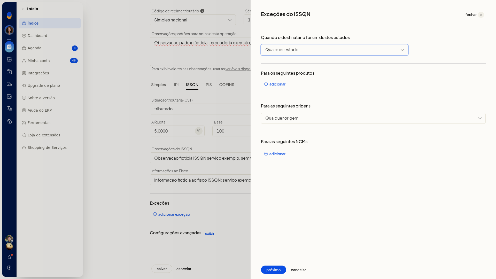
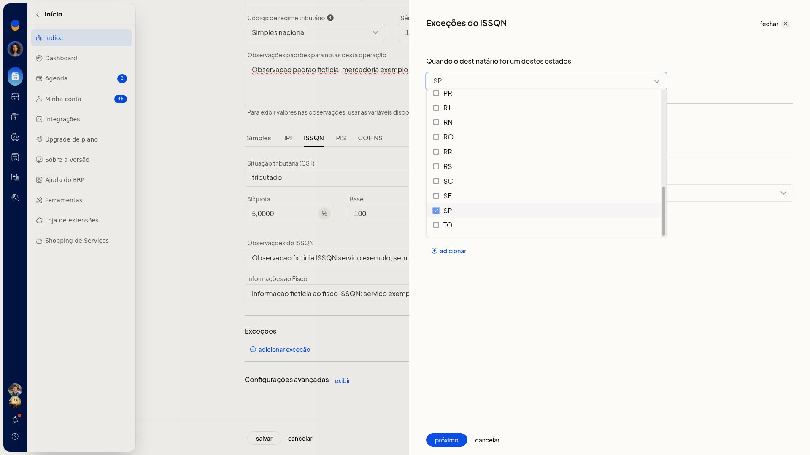
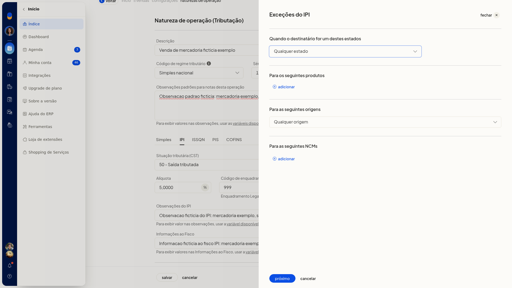
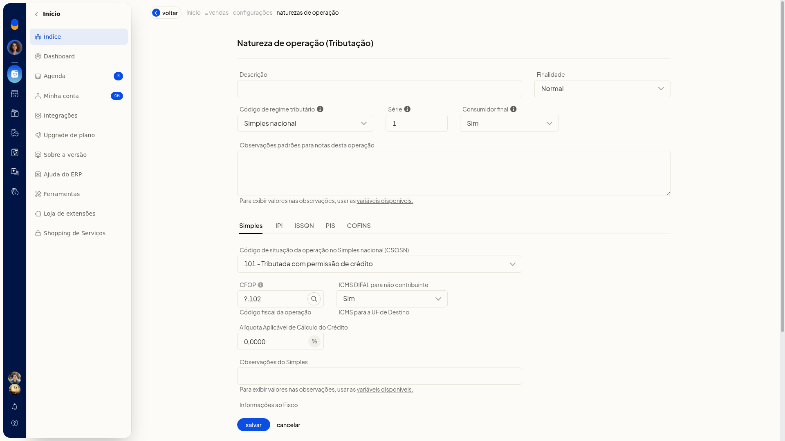
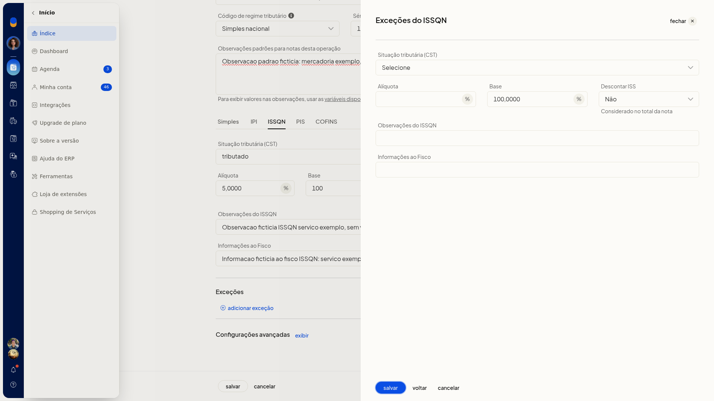
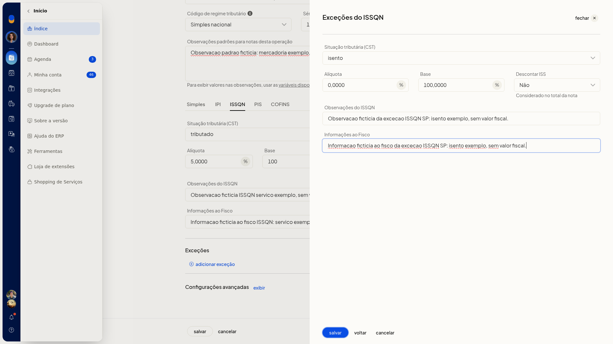
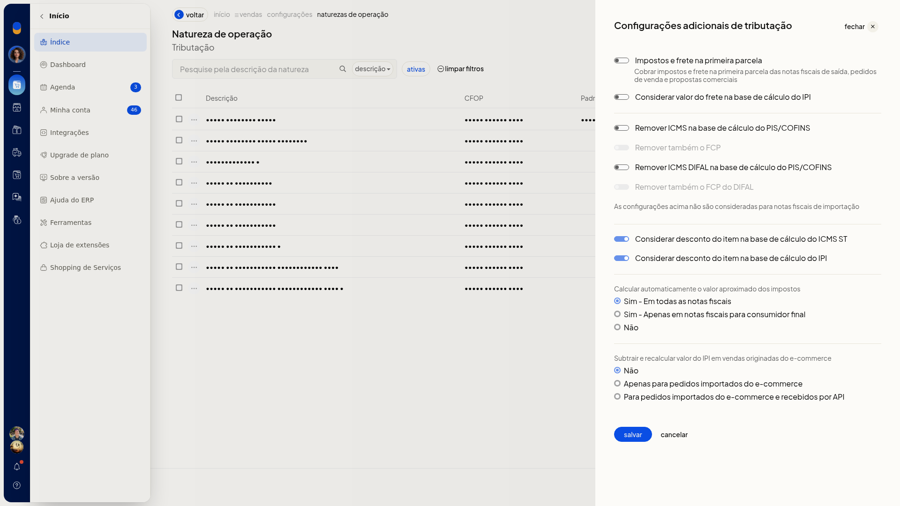

# Natureza de operação: regras de exceção e ICMS ST

## Importante
- Para avançar no assistente da exceção, marque ao menos uma UF ou informe um produto, uma origem ou um NCM.
- No **Regime normal**, o **CST** **10** trata a substituição tributária.

## Instruções
### Incluir uma regra de exceção

1. Acesse **Configurações > Configurações ERP**.
2. Abra a aba **Notas Fiscais**.

   
3. Clique em **Naturezas de operação de saída (tributação)**.

   

   
4. Abra o formulário da natureza.

   
5. Na aba do imposto, abra a inclusão de uma exceção. As abas são **ICMS**, **IPI**, **PIS**, **COFINS** e **ISSQN**.

   

6. No filtro, marque uma ou mais UFs, de **AC** a **TO**, ou **EX**. Ou informe o produto, a origem ou o NCM. A origem vai de 0 a 8.

   

   

7. Clique em **Avançar**.

   
8. Informe a situação, a alíquota, a base e as observações. No ISSQN, informe também **Descontar ISS**, com **Sim** ou **Não**. A ajuda desse campo indica que o valor é considerado no total da nota.

   

   

9. Clique em **Cancelar** se não for manter a exceção. A tela volta à aba do imposto e a lista de exceções fica sem a nova linha.

### Definir a substituição tributária do ICMS

1. No formulário da natureza, selecione em **CRT** a opção **Regime normal** quando a operação usar esse regime. Os códigos de ICMS passam a ser o **CST**.
2. Selecione o **CST** **10** para a substituição tributária.
3. Abra as opções avançadas.
4. Em **Redução BC ICMS-ST**, selecione **Padrão** ou **Antes de somar o IPI**.

### Revisar o desconto do item na base do ICMS ST

1. Na lista de naturezas de operação de saída, clique em **Configurações**.
2. Em **Configurações adicionais de tributação**, revise **Considerar desconto do item na base de cálculo do ICMS ST**.

   

3. Clique em **Salvar** para gravar a revisão ou em **Cancelar** para fechar sem gravar e voltar à lista.

## Resultado
Ao cancelar a exceção, a aba do imposto permanece sem a nova linha. Em **Configurações adicionais de tributação**, **Cancelar** retorna à lista de naturezas sem gravar a alteração.

## Informações adicionais
- A inclusão da exceção fica na aba do imposto da natureza: **ICMS**, **IPI**, **PIS**, **COFINS** ou **ISSQN**.
- O filtro da exceção aceita UF, produto, origem ou NCM. As UFs vão de **AC** a **TO**, além de **EX**. A origem vai de 0 a 8.
- Trocar o **CRT** de **Simples nacional** para **Regime normal** substitui o **CSOSN** pelo **CST** de ICMS.
