# Naturezas de operação de saída

## Importante
- Defina antes o regime da operação: **Simples nacional**, excesso de sublimite, **Regime normal** ou **MEI**.
- Para criar uma exceção, informe ao menos uma UF, um produto, uma origem ou um NCM. Sem um desses filtros, o assistente não avança.
- Com desoneração de ICMS sem motivo, informe o motivo da desoneração ou deixe **Calcular ICMS Desonerado** como **Não**.

## Instruções
### Cadastro pela tela

1. Acesse **Configurações > Configurações ERP**.
2. Abra a aba **Notas Fiscais**.

   

3. Clique em **Naturezas de operação de saída (tributação)**. A lista mostra **Descrição**, **CFOP**, **Padrão**, **Série** e **Consumidor final**. Busque por descrição ou CFOP e use o filtro de naturezas ativas. O menu da linha mostra **Clonar operação**, **Tornar padrão para NFC-e**, **Tornar operação de entrada**, **Enviar natureza para empresas** e **Inativar operação**. Ao selecionar uma linha, a lista mostra **Enviar naturezas para empresas** e **Excluir naturezas de operação**.

   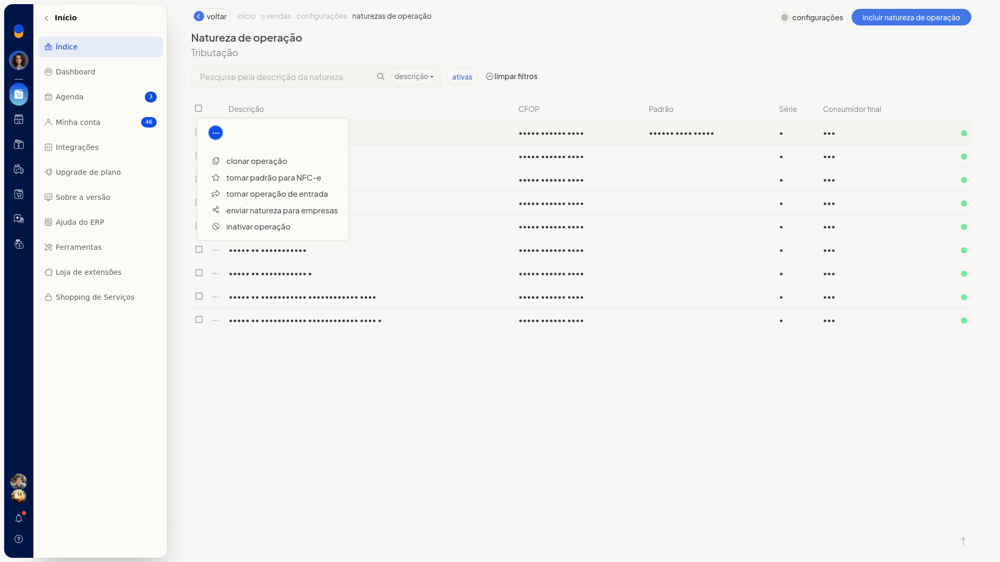

   

4. Abra a inclusão de uma nova natureza. O formulário inicia com **Finalidade** **Normal**, **CRT** **Simples nacional**, **Consumidor final** **Sim** e, na tributação do Simples, **CSOSN** **400**.

   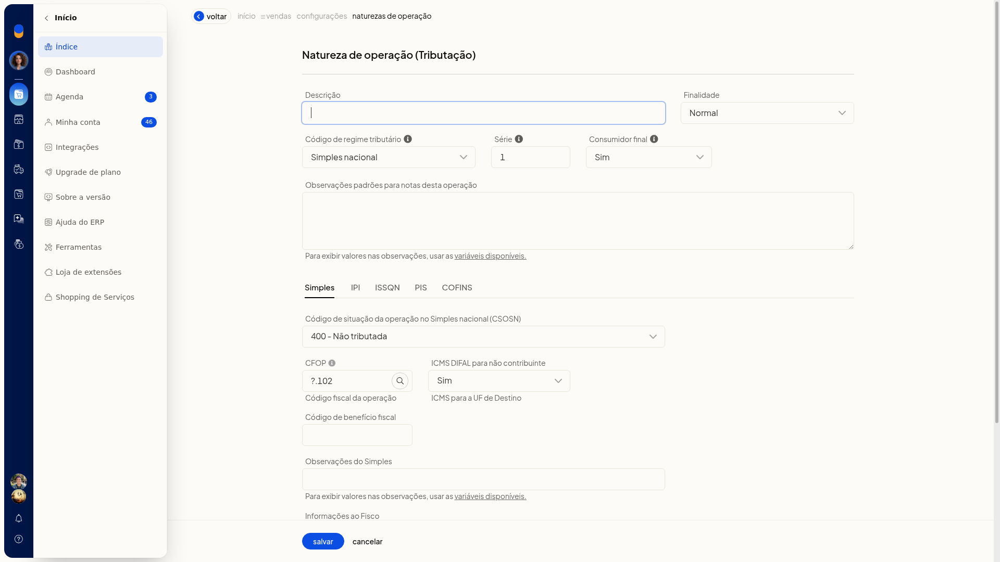

5. Informe a **Descrição** e revise **Finalidade**, **CRT**, **Série** e **Consumidor final**. Nenhum campo do formulário é obrigatório.
6. Preencha o **CFOP** e as **Observações**. Nas observações há variáveis disponíveis. Preencha também **Benefício fiscal** e os textos de observação e fisco, se forem usar.

#### Dados gerais

- **Descrição**
- **Finalidade**: **Normal**, **Devolução**, **Bonificação** ou **Remessa**
- **CRT**: **Simples nacional**, excesso de sublimite, **Regime normal** ou **MEI**
- **Série**
- **Consumidor final**: **Sim** ou **Não**
- **CFOP**
- **Observações**
- **Benefício fiscal**

7. No Simples Nacional, escolha o **CSOSN** entre **101**, **102**, **103**, **201**, **202**, **203**, **300**, **400**, **500** e **900**. No **CSOSN** **101**, preencha **Alíquota Aplicável de Cálculo do Crédito** no formato 0,0000. Revise **DIFAL não contribuinte** (**Sim** ou **Não**): ICMS para a UF de destino.

   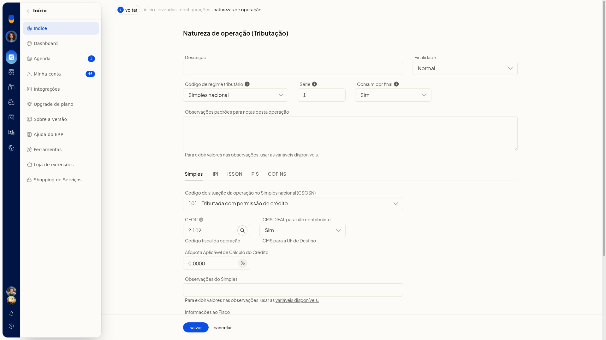

8. Se a operação for de **Regime normal**, troque o **CRT**. Os códigos passam a ser **CST de ICMS**: **00**, **10**, **20**, **30**, **40**, **41**, **50**, **51**, **60**, **70** e **90**. O **CST** **10** trata substituição tributária. Os motivos de desoneração são **1** e de **3** a **12**.
9. Abra as opções avançadas e revise os parâmetros abaixo. Em **Preço considerado**, a seleção inicial é **Preço de venda ou promocional**; há alternativa de custo. Em **ZFM**, a seleção inicial é **Não**, com alternativas de desoneração para todos ou só origem nacional. Em **Redução BC ICMS-ST**, use **Padrão** ou **Antes de somar o IPI**. Na composição dos itens no total da NF-e, a opção selecionada é **Compõem total da nota fiscal**.

#### Opções avançadas

- **Preço considerado**
- **Enviar expedição**: **Sim** ou **Não**
- **Receita DRE**: **Sim** ou **Não**
- **CMV DRE**: **Sim** ou **Não**
- **Compra produtor rural**: **Sim** ou **Não**
- lançamento ou reserva de estoque
- **Alíquota funrural**
- **Descontar funrural**: **Sim** ou **Não**
- **ZFM**
- **Redução BC ICMS-ST**
- **Descontar desoneração**: **Sim** ou **Não**
- composição dos itens no total da NF-e

10. Nas abas de IPI, PIS, COFINS e ISSQN, escolha a situação tributária, a alíquota e a base.
11. Clique em **Salvar**. A natureza fica com finalidade, regime, série, consumidor final e impostos definidos.

#### IPI, PIS, COFINS e ISSQN

- **CST do IPI**: ao abrir a aba, o valor é **50**
- **CST do PIS** e **CST do COFINS**: **01** a **09**, **49**, **50** a **56**, **60** a **67** e **70** a **73**
- **CST do ISSQN**: **tributado**, **isento** ou **outra situação**
- **Alíquota do ISSQN**: formato 0,0000
- **Base de cálculo do ISSQN**: formato 0,0000
- **Descontar ISS**: **Sim** ou **Não**. Considerado no total da nota

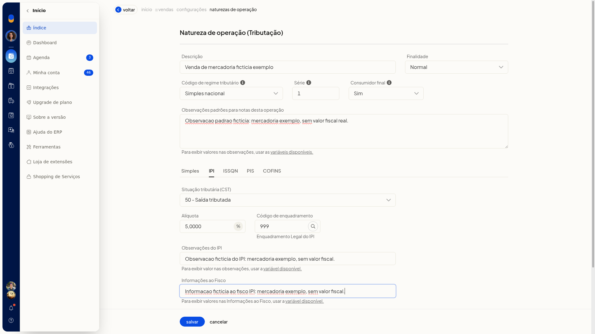

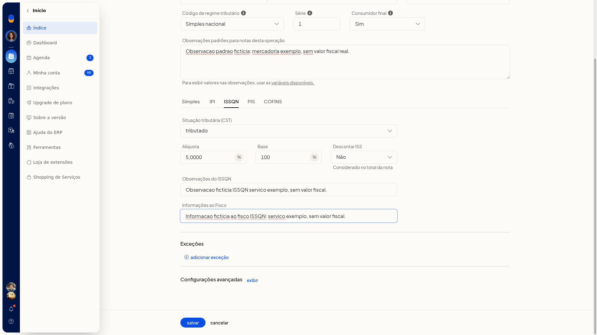

### Regras de exceção pela tela

1. No formulário da natureza, na aba do imposto (ICMS, IPI, PIS, COFINS ou ISSQN), abra a inclusão de uma exceção.
2. No filtro, marque ao menos uma UF (AC a TO, além de EX) ou informe produto, origem (**0** a **8**) ou NCM.

   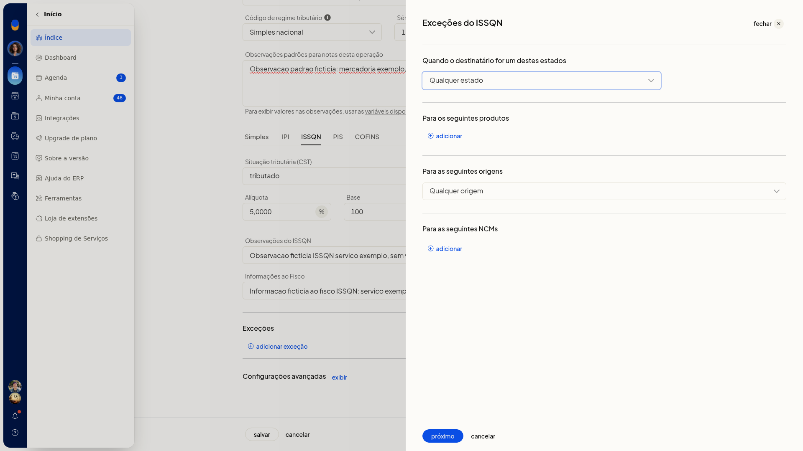

   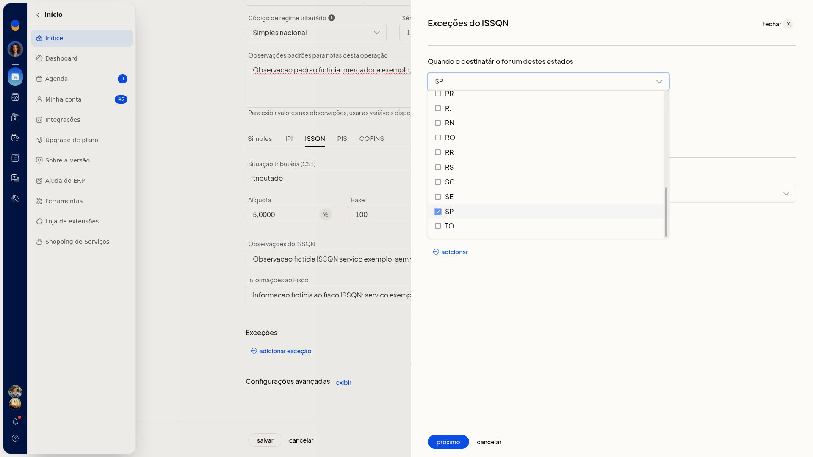

   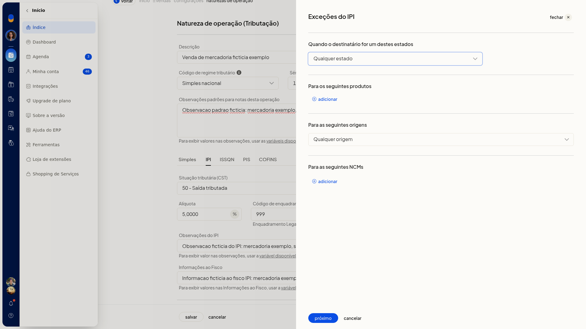

3. No passo do imposto, informe situação, alíquota, base e observações. No ISSQN, use **Descontar ISS** (**Sim** ou **Não**) e, se precisar, as observações da exceção e as informações ao fisco. Para descartar, clique em **Cancelar**: você volta à aba do imposto e a lista de exceções permanece sem a nova linha.

   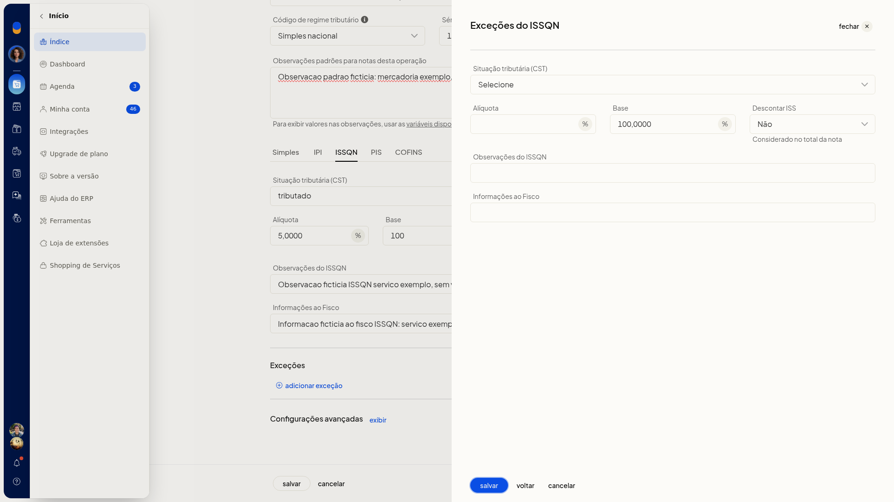

   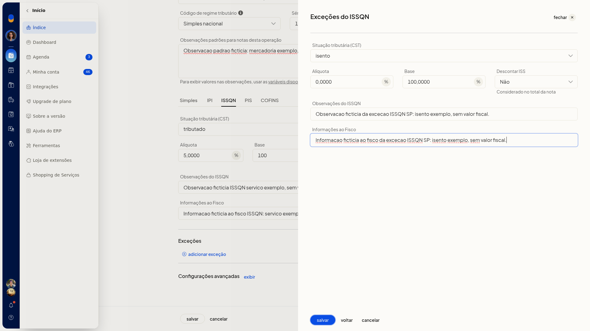

### Bases de cálculo em Configurações adicionais de tributação

1. Na lista de naturezas de operação de saída, clique em **Configurações**.
2. Revise as bases, o frete, o desconto e o valor aproximado dos impostos.

   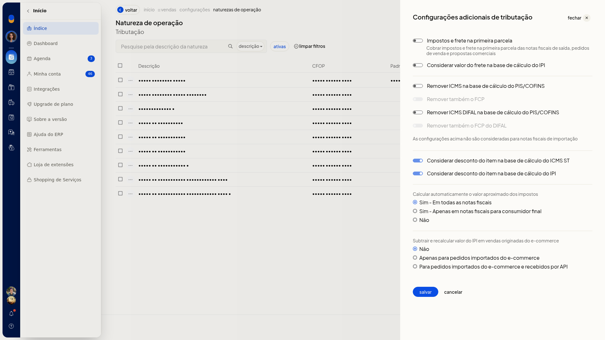

3. Clique em **Salvar** para gravar a revisão. **Cancelar** fecha a tela e retorna à lista sem gravar a alteração.

#### Opções da tela

- **Impostos e frete na primeira parcela**: cobra impostos e frete na primeira parcela das notas fiscais de saída, pedidos de venda e propostas comerciais
- **Considerar valor do frete na base de cálculo do IPI**
- **Remover ICMS na base de cálculo do PIS/COFINS**
- **Remover também o FCP**
- **Remover ICMS DIFAL na base de cálculo do PIS/COFINS**
- **Remover também o FCP do DIFAL**
- **Considerar desconto do item na base de cálculo do ICMS ST**
- **Considerar desconto do item na base de cálculo do IPI**
- **Calcular automaticamente o valor aproximado dos impostos**: **Sim - Em todas as notas fiscais**, **Sim - Apenas em notas fiscais para consumidor final** ou **Não**
- **Subtrair e recalcular valor do IPI em vendas originadas do e-commerce**: **Não**, **Apenas para pedidos importados do e-commerce** ou **Para pedidos importados do e-commerce e recebidos por API**
- **Natureza de operação Tributação**

## Informações adicionais
- Trocar o **CRT** de **Simples nacional** para **Regime normal** substitui o **CSOSN** pelo **CST de ICMS**.
- O **CSOSN** **101** exibe **Alíquota Aplicável de Cálculo do Crédito**.
- **Cancelar** uma exceção preenchida volta à aba do imposto sem adicionar a linha.
