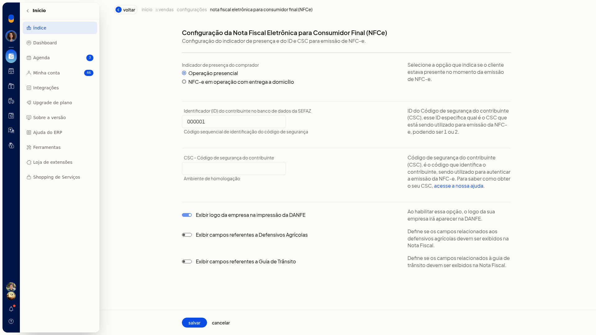
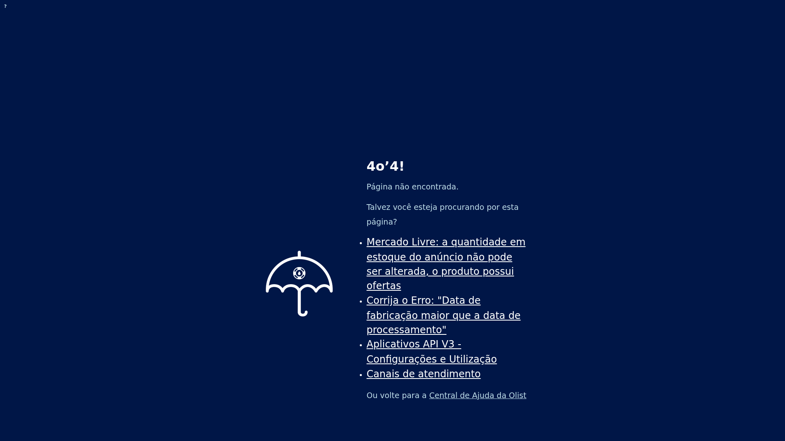
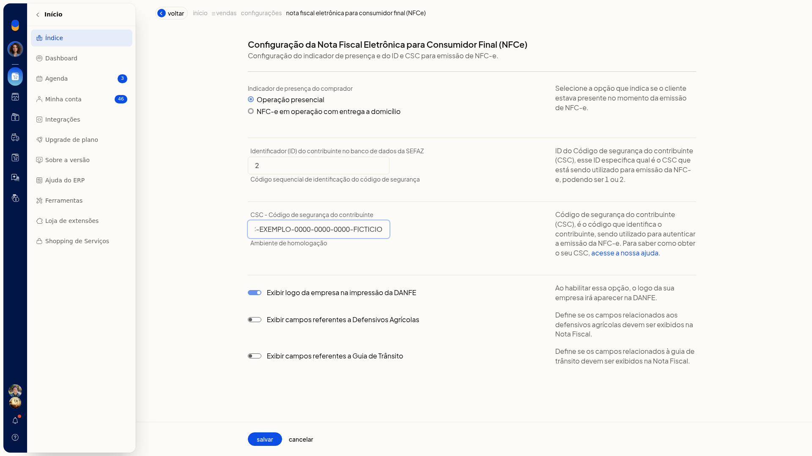

# Configurar a NFC-e (inclui PAF-NFC-e em SC)

## Pré-requisitos
- Tenha o identificador (ID) do CSC e o código CSC do contribuinte do ambiente de homologação.
- Se a empresa é de Santa Catarina, a extensão PAF-NFC-e precisa estar instalada para continuar a configuração.
- Se a opção não aparecer para você, peça acesso ao administrador da conta.

## Importante
- Nenhum campo desta tela é obrigatório.
- O ID pode ser 1 ou 2 e indica qual CSC será usado.
- O CSC desta tela é o do **Ambiente de homologação**. Não há outro campo de CSC na mesma tela.
- Esta tela não instala a extensão PAF-NFC-e.

## Instruções
1. Acesse **Configurações > Configurações ERP**.
2. Na tela **Configurações do Sistema ERP**, abra a aba **Notas Fiscais**.

   

3. Abra **Configuração da nota fiscal eletrônica para consumidor final (NFCe)**. O item pode aparecer com o aviso **Configuração pendente**.
4. Em **Indicador de presença do comprador**, selecione **Operação presencial** ou **NFC-e em operação com entrega a domicílio**, conforme o cliente estava ou não presente no momento da emissão. A opção de entrega a domicílio não abre outros campos nesta tela.

   

   

5. Preencha **Identificador (ID) do contribuinte no banco de dados da SEFAZ** com 1 ou 2.
6. Preencha **CSC - Código de segurança do contribuinte** com o CSC do **Ambiente de homologação**.

   
7. Se quiser, ajuste as opções de exibição. Cada uma descreve o efeito ao lado:
 - **Exibir logo da empresa na impressão da DANFE**: o logo da empresa na impressão da DANFE
 - **Exibir campos referentes a Defensivos Agrícolas**: os campos de defensivos agrícolas na nota
 - **Exibir campos referentes a Guia de Trânsito**: os campos da guia de trânsito na nota

   

8. Revise os dados e clique em **Salvar**.

## Informações adicionais
- O aviso **Configuração pendente** aparece quando as configurações iniciais da nota fiscal ainda não foram concluídas.
- O aviso para instalar a extensão PAF-NFC-e só aparece para empresas de Santa Catarina, e somente depois que as configurações iniciais da nota fiscal foram concluídas.
