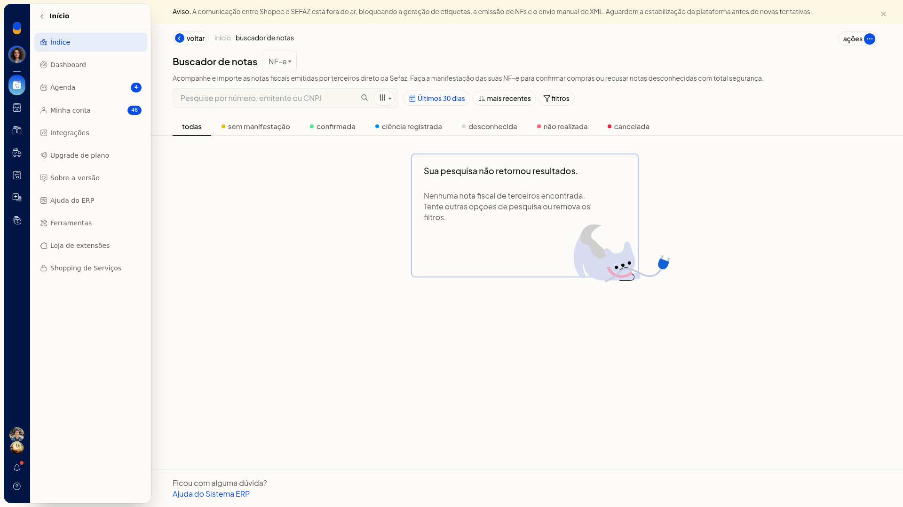
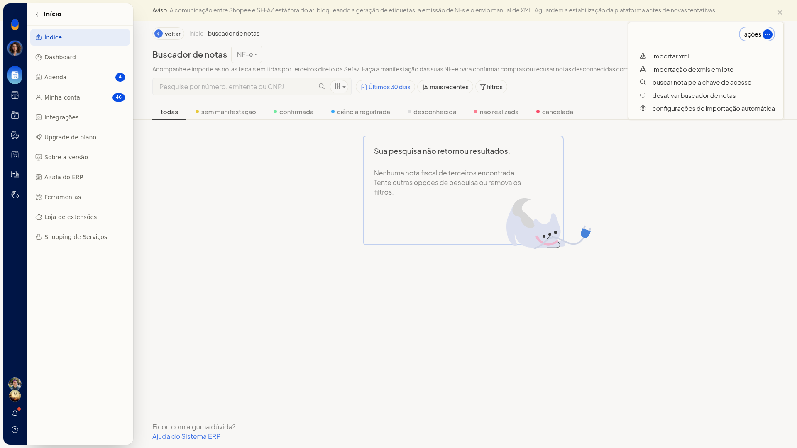

# Configurar a importação automática de NF-e e CT-e

A importação automática define quais NF-e de fornecedores e quais CT-e de prestadores entram no ERP da Olist, e qual manifestação padrão vale para a NF-e. Você limita o escopo a todos ou a CNPJs escolhidos e registra CNPJs que ficam de fora da importação automática.

## Importante
Se **Buscador de notas** não aparecer para você, peça acesso ao administrador da conta.

## Como acessar
**Suprimentos > Notas de Entrada > Buscador de notas > Ações > Configurações de importação automática**

## Pré-requisitos
- Certificado digital armazenado. Sem ele, o **Buscador de notas** não aparece.

## Grupos de configuração
### NF-e

Escolha o escopo da importação automática:

- **Todos os fornecedores**: a importação automática considera os fornecedores nesse escopo.
- **Escolher individualmente**: só os CNPJs listados são importados. Ao editar cada fornecedor, você pode refinar por NCM ou CFOP.

Em **Manifestação padrão**, escolha **Ciente da operação** ou **Operação confirmada**. Essa opção existe só na configuração automática de NF-e.

Na lista de exceções, os CNPJs informados não têm a NF-e importada automaticamente. Use **Adicionar CNPJ** para incluir o CNPJ da exceção ou do fornecedor.

### CT-e

Escolha o escopo da importação automática:

- **Todos os prestadores**
- **Escolher individualmente**

Use **Adicionar CNPJ** para informar o prestador nesse escopo individual. A aba CT-e não tem manifestação padrão.
