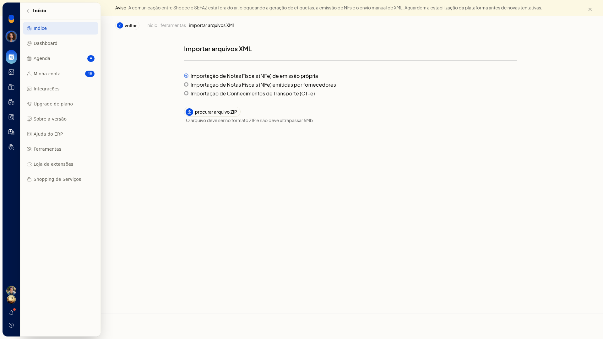
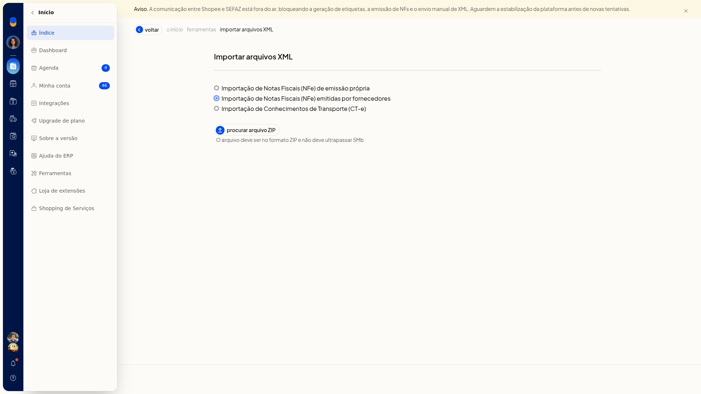
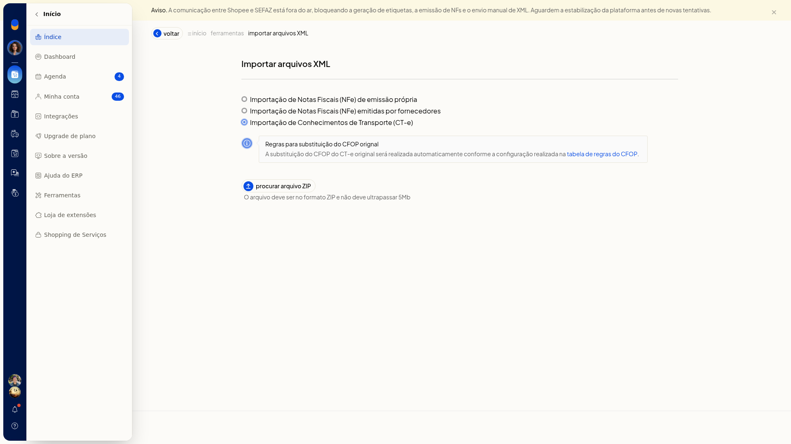
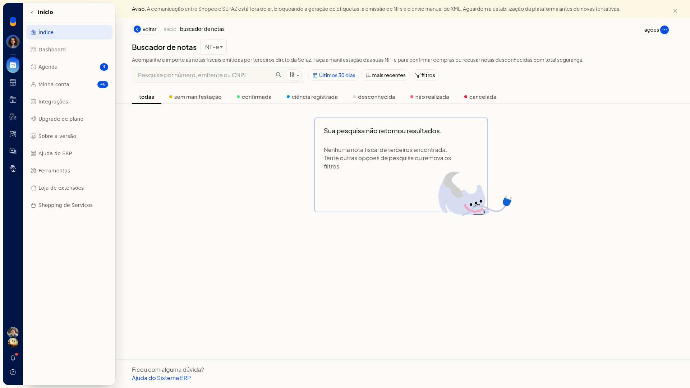
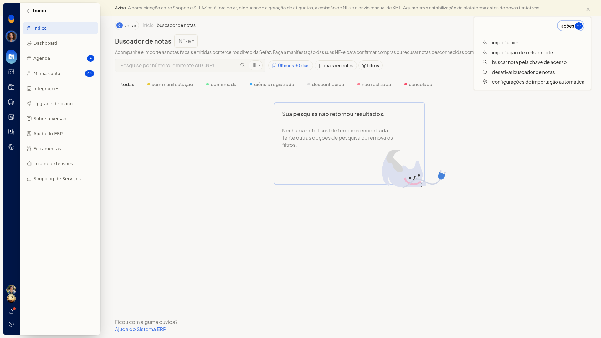

# Importar XML de notas (manual, em lote e pela SEFAZ)

No ERP da Olist, você importa o XML de NF-e e de CT-e recebidos de terceiros para registrar a nota de entrada. Dá para enviar os arquivos na hora, incluir um ZIP em lote ou localizar a NF-e no **Buscador de notas**, que acompanha as notas disponíveis na Sefaz e permite iniciar a importação.

A importação manual também aceita NF-e e CT-e no mesmo envio, com marcadores opcionais. No CT-e, você escolhe se o CFOP permanece o do arquivo ou se segue a tabela de regras.

## Pré-requisitos
- Tenha o XML da NF-e ou do CT-e. Na importação em lote, o arquivo é um ZIP de até 5Mb.
- A **Importação de XMLs em lote** e o **Buscador de notas** só aparecem com o certificado digital da empresa armazenado.
- Se o **Buscador de notas** não aparecer, peça acesso ao administrador da conta.

## Importante
- A importação manual aceita até 50 XMLs.
- **Marcadores** é opcional na importação manual.
- Sem regra na tabela de CFOP, o CFOP do CT-e iniciado em 5 passa a 1 e o iniciado em 6 passa a 2.

## Instruções
### Importar o XML manualmente

1. Acesse **Suprimentos > Notas de Entrada**.
2. Clique em **Importar XML**. O mesmo comando está em **Mais ações > Importar XML** e em **Buscador de notas > Ações > Importar XML**.
3. Escolha a aba **NF-e**, **CT-e** ou **Ambos**.
4. Selecione os XMLs e, se quiser, informe **Marcadores**.
5. Em **CT-e**, escolha **Utilizar o CFOP presente no arquivo XML** ou **Substituir CFOP conforme tabela de regras de CFOP**. Na aba **Ambos**, a tela reúne o tratamento da NF-e e a escolha de CFOP do CT-e.

Para montar a substituição, abra a tabela de regras de CFOP a partir dessa opção. Informe **CFOP de saída** e **CFOP equivalente de entrada**. A tela usa o exemplo 5.102 e 1.102. Inclua a regra na linha e clique em **Salvar**.

### Importar XMLs em lote

1. Acesse **Suprimentos > Notas de Entrada**.
2. Abra **Mais ações** e clique em **Importação de XMLs em lote**. O mesmo item está em **Buscador de notas > Ações**.
3. Clique em **Incluir arquivo para importação**.
4. Escolha **NFe emissão própria**, **Importação de Notas Fiscais (NFe) emitidas por fornecedores** ou **Importação de Conhecimentos de Transporte (CT-e)**.

   

   

   

5. Selecione o ZIP de até 5Mb. Em **Importação de Conhecimentos de Transporte (CT-e)**, a substituição de CFOP segue a tabela de regras do CFOP.

A lista do lote mostra **Incluir arquivo para importação** e as colunas **Tipo**, **Nome do arquivo**, **Data**, **Data prevista**, **Marcadores**, **Notas importadas** e **Situação**.

### Importar pelo Buscador de notas

1. Acesse **Suprimentos > Notas de Entrada**.
2. Clique em **Buscador de notas**. A tela acompanha e importa notas emitidas por terceiros direto da Sefaz. A manifestação serve para confirmar compras ou recusar notas desconhecidas.
3. Pesquise por número, emitente ou CNPJ. Ajuste o período em **Últimos 30 dias**, a ordenação para as mais recentes e os filtros.
4. Use as abas **Todas**, **Sem manifestação**, **Confirmada**, **Ciência registrada**, **Desconhecida**, **Não realizada** e **Cancelada**.

   

Nos filtros, a origem pode ser **Notas na Sefaz**, **Notas importadas** ou **Todas**. Em notas ignoradas, as opções são **Não exibir**, **Exibir notas ignoradas** e **Exibir apenas notas ignoradas**.

5. Abra **Ações** e clique em **Importar XML** ou em **Importação de XMLs em lote** para seguir com o arquivo da nota localizada.

   

Para buscar uma NF-e específica:

1. No **Buscador de notas**, abra **Ações** e clique em **Buscar nota pela chave de acesso**.
2. Em **Chave de Acesso**, informe a chave da NF-e.
3. Clique em **Continuar**.

### Configurar a importação automática

1. No **Buscador de notas**, abra **Ações** e clique em **Configurações de importação automática**.
2. Em NF-e, escolha **Todos os fornecedores** ou **Escolher individualmente**. No escopo individual, só os CNPJs listados são importados. Cada fornecedor pode ser refinado por NCM ou CFOP ao editá-lo.
3. Defina a manifestação padrão entre **Ciente da operação** e **Operação confirmada**.
4. Use **Adicionar CNPJ** na lista de exceções. Os CNPJs informados não têm a NF-e importada automaticamente.
5. Em CT-e, escolha **Todos os prestadores** ou **Escolher individualmente**. Essa aba não tem manifestação padrão.

## Informações adicionais
- Quando a pesquisa do **Buscador de notas** não encontra notas, a tela informa que a pesquisa não retornou resultados e que nenhuma nota fiscal de terceiros foi encontrada.
- A situação da manifestação no buscador aparece nas abas **Sem manifestação**, **Confirmada**, **Ciência registrada**, **Desconhecida**, **Não realizada** e **Cancelada**.
