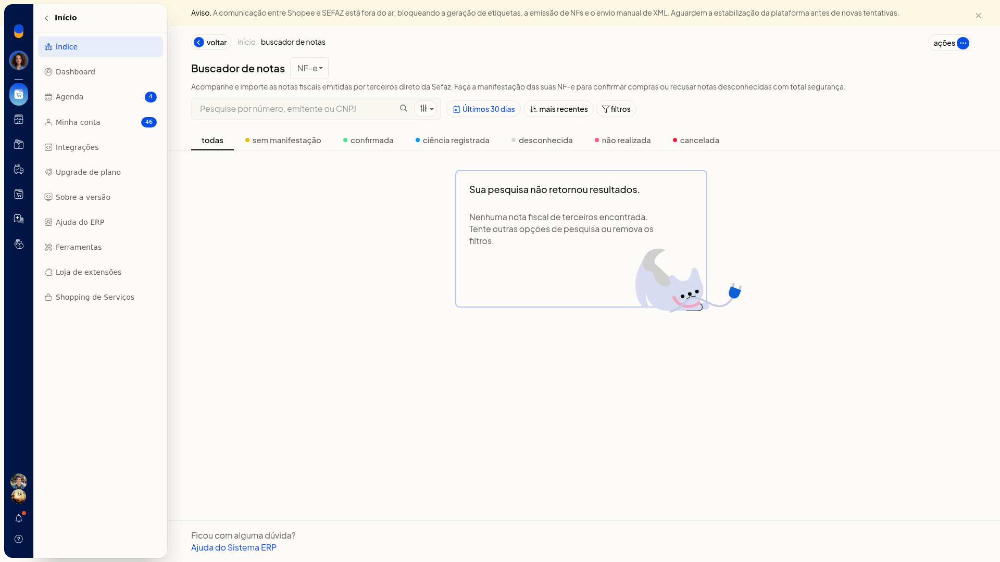
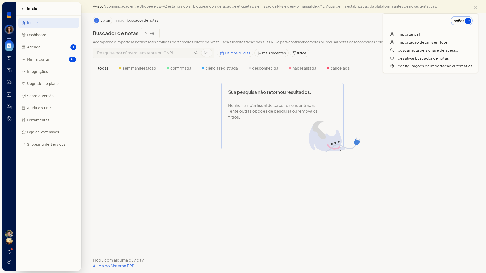

# Manifestar notas, buscador de notas e eventos de entrada

## Pré-requisitos
- O **Buscador de notas** só aparece com o certificado digital armazenado no servidor.
- Se o **Buscador de notas** não aparecer para você, peça acesso ao administrador da conta.

## Importante
- A manifestação padrão vale só para a importação automática de NF-e: **Ciente da operação** ou **Operação confirmada**. Na configuração de CT-e não há essa escolha.
- Em **Escolher individualmente**, só os CNPJs listados são importados. Cada fornecedor pode ser refinado por NCM ou CFOP ao editá-lo.
- Os CNPJs da lista de exceções não têm a NF-e importada automaticamente.

## Instruções
### Acompanhar a manifestação no buscador

1. Acesse **Suprimentos > Notas de Entrada**.
2. Clique em **Buscador de notas**.
3. Confira o seletor **NF-e** e pesquise no campo **Pesquise por número, emitente ou CNPJ**.
4. Ajuste o período em **Últimos 30 dias** e a ordenação em **mais recentes**.

   

5. Abra **filtros** e escolha a origem: **Notas na Sefaz**, **Notas importadas** ou **Todas**.
6. Em notas ignoradas, escolha **Não exibir**, **Exibir notas ignoradas** ou **Exibir apenas notas ignoradas**.
7. Use as abas **Todas**, **Sem manifestação**, **Confirmada**, **Ciência registrada**, **Desconhecida**, **Não realizada** e **Cancelada** para ver a situação da manifestação.

### Buscar nota pela chave de acesso

1. No **Buscador de notas**, clique em **Ações**.

   

2. Clique em **Buscar nota pela chave de acesso**.
3. No campo **Chave de Acesso**, informe a chave da NF-e.
4. Clique em **Continuar**.

### Configurar a manifestação da importação automática

1. No **Buscador de notas**, clique em **Ações**.
2. Clique em **Configurações de importação automática**.
3. Em NF-e, escolha **Todos os fornecedores** ou **Escolher individualmente**.
4. Defina a manifestação padrão entre **Ciente da operação** e **Operação confirmada**.
5. Para excluir um CNPJ da importação automática, use **Adicionar CNPJ** na lista de exceções.
6. Em CT-e, escolha **Todos os prestadores** ou **Escolher individualmente**.

## Resultado
O **Buscador de notas** mostra as abas de situação da manifestação das NF-e de terceiros. Se a pesquisa não achar notas, a tela informa que a pesquisa não retornou resultados e que nenhuma nota fiscal de terceiros foi encontrada.

## Informações adicionais
### O menu Ações reúne outras entradas do buscador

O menu **Ações** também traz **Importar XML**, **Importação de XMLs em lote** e **Desativar buscador de notas**.
