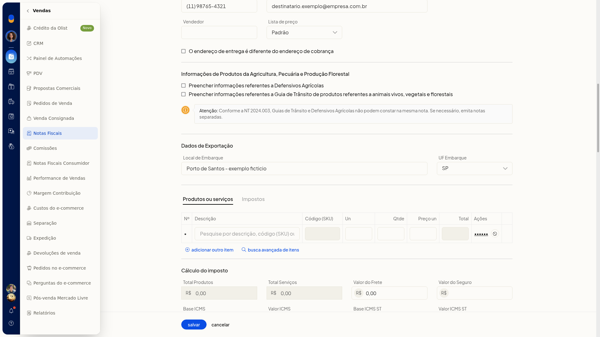

# Nota fiscal de exportação

No ERP da Olist, a exportação é um **Tipo de Saída** da nota fiscal. Ao escolher essa opção, você preenche os **Dados de Exportação** com o local e a UF de embarque.

## Pré-requisitos
- Tenha o local de embarque e a UF de embarque.

## Importante
- A exportação não fica no campo **Finalidade** da nota. Ela é escolhida em **Tipo de Saída**.

## Instruções
1. Acesse **Vendas > Notas Fiscais**.
2. Clique em **incluir nota fiscal**.
3. Em **Tipo de Saída**, selecione **E Exportação**. As opções desse campo são **N emissão própria**, **E Exportação**, **T terceiros** e **X XML**.
4. Preencha **Local de Embarque** e **UF Embarque**. A seção **Dados de Exportação** passa a ser exibida com esses campos. Exemplo de preenchimento: **Porto de Santos - exemplo ficticio** e **SP**.

   
