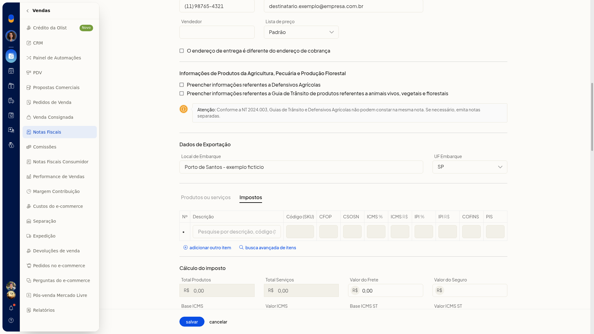
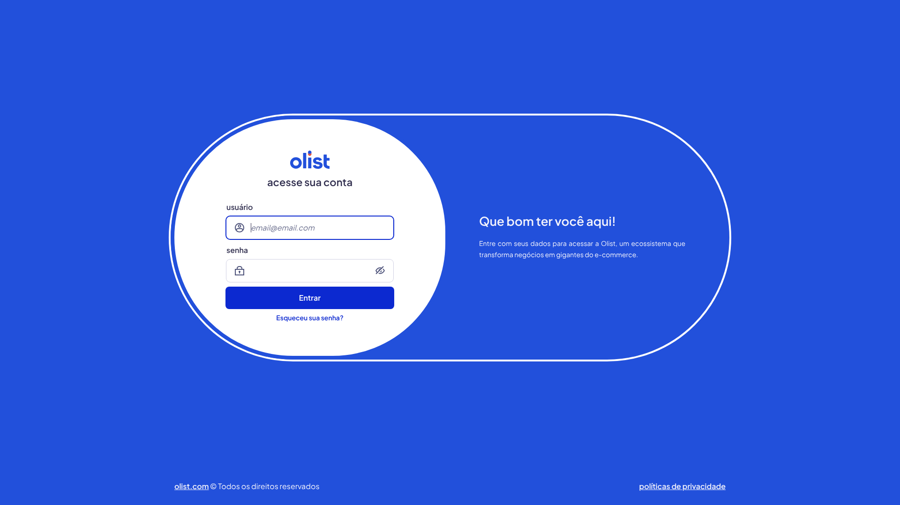

# Nota fiscal mista (produto e serviço)

## Importante
- O controle **Produtos ou serviços** abre os impostos do item, não um formulário de serviço.
- O menu **mais** do item não inclui ação de serviço.

## Instruções
1. Acesse **Vendas > Notas Fiscais**.
2. Clique em **incluir nota fiscal**.
3. Na área de itens, confira os dados de produto: produto, código, unidade, quantidade e preço unitário.
4. Clique em **Produtos ou serviços** para abrir os impostos do item.

   

5. Nos totais da nota, confira **Total Serviços** e **Valor ISSQN**. Na mesma área também aparecem **IPI Devolvido**, **Funrural**, **FCP** e **IBS/CBS**.

   

## Resultado
A nota exibe, na mesma tela, os totais de serviço ao lado dos tributos de produto.

## Informações adicionais
- A aba **Impostos** do item mostra as colunas **CFOP**, **CSOSN**, **ICMS**, **IPI**, **COFINS** e **PIS**.
- **Total Serviços** e **Valor ISSQN** podem aparecer preenchidos nos totais, como 150,00 e 15,00.
