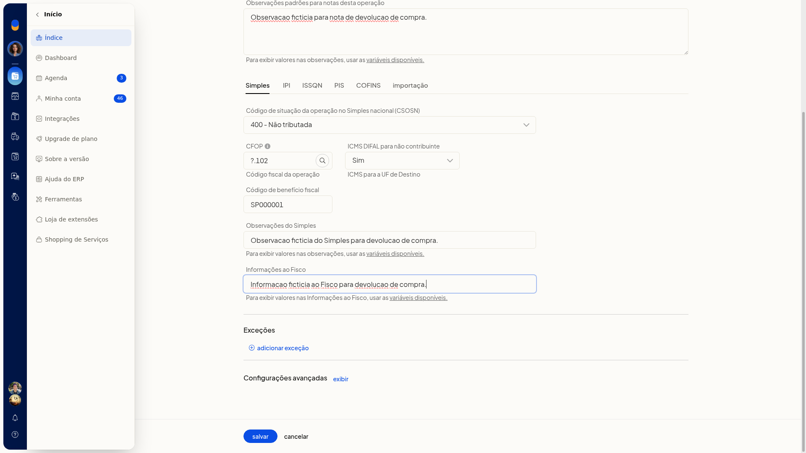
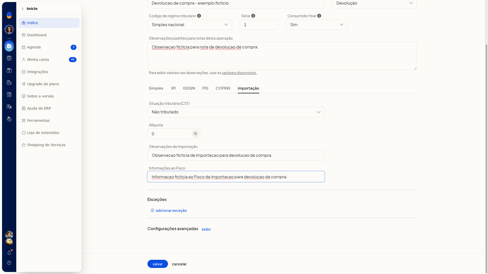
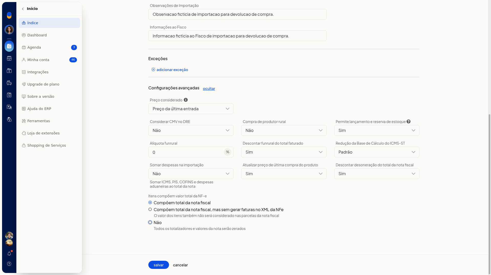

# Notas de devolução (venda e compra)

No ERP da Olist, a devolução usa a finalidade **Devolução**. Na devolução de venda, você marca essa finalidade na natureza de operação de saída e escolhe a mesma opção ao incluir a nota fiscal. Na devolução de compra, a finalidade fica na natureza de operação de entrada.

## Pré-requisitos
- Para a devolução de venda, use uma natureza de operação de saída.
- Para a devolução de compra, use uma natureza de operação de entrada.

## Importante
- Na nota, a **Finalidade** inclui **4 Devolução**. As outras opções vistas são **1 normal**, **2 NF-e complementar**, **3 ajuste**, **6 débito**, **7 cupom**, **9 chave** e **10 pagamento antecipado**.
- **Bonificação**, **Remessa** e **Retorno** não aparecem na **Finalidade** da nota.
- Na natureza de saída e na de entrada, a **Finalidade** lista **Normal**, **Devolução**, **Bonificação** e **Remessa**. **Retorno** não aparece nessa lista.

## Instruções
### Configurar a natureza de saída

1. Acesse **Configurações > Configurações ERP > Notas Fiscais > Naturezas de operação de saída (tributação)**.
2. Abra a inclusão ou a edição de uma natureza de operação de saída.
3. No campo **Finalidade**, selecione **Devolução**. A finalidade **Devolução** fica selecionada na natureza de saída.

### Incluir a nota de devolução de venda

1. Acesse **Vendas > Notas Fiscais**.
2. Clique em **incluir nota fiscal**.
3. No campo **Finalidade**, selecione **4 Devolução**. Use a natureza de saída com **Finalidade** **Devolução**, em **Configurações > Configurações ERP > Notas Fiscais > Naturezas de operação de saída (tributação)**. A inclusão da nota oferece a finalidade **Devolução**.

### Configurar a natureza de entrada

1. Acesse **Configurações > Configurações ERP > Notas Fiscais > Naturezas de operação de entrada**.
2. Abra **incluir natureza**.
3. No campo **Finalidade**, selecione **Devolução**.
4. Preencha o restante da natureza.

   

5. Abra a aba **Importação**. Nela aparecem **CST** **Não tributado** e alíquota **0**.

   

6. Abra as opções avançadas. A tela mostra **Preço** (última entrada ou custo), **CMV**, **Estoque**, **Funrural**, **Descontar funrural**, redução da BC de ICMS-ST (**Padrão** ou **Antes de somar o IPI**), somar despesas de importação, **Atualizar última compra**, descontar desoneração e itens que compõem o total. A natureza de entrada de devolução fica preenchida na tela, com a aba de importação e as regras avançadas de preço, estoque e ICMS-ST.

   
