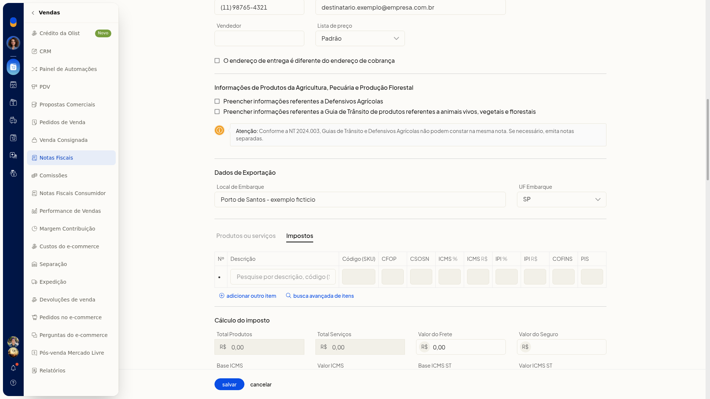

# Produtos e notas com combustíveis (ANP)

Na inclusão da nota fiscal do ERP da Olist não há campo de código ANP, combustível, GLP ou temperatura. Você confere os tributos do item na aba de impostos, sem dados de combustível.

## Importante
- A inclusão da nota não exibe campo de código ANP, combustível, GLP ou temperatura.
- O menu **mais** do item não oferece ação de ANP.

## Instruções
1. Acesse **Vendas > Notas Fiscais**.
2. Clique em **incluir nota fiscal**.
3. Na área de itens, abra **Produtos ou serviços**. Esse controle abre os impostos do item.
4. Na aba **Impostos**, confira as colunas **CFOP**, **CSOSN**, **ICMS**, **IPI**, **COFINS** e **PIS**. Não há campos de ANP nessa aba.

   
