# Checklist e primeira NF-e

No ambiente de testes do ERP da Olist, você confere se a emissão está pronta para faturar e monta a primeira NF-e de saída. Dá para incluir a nota em **Vendas > Notas Fiscais** ou gerar a nota a partir de um pedido de venda, e deixar o lote pendente pronto para autorização em homologação.

## Pré-requisitos
- Para gerar a nota a partir do pedido, é preciso ter um pedido de venda já existente.

## Importante
- A lista avisa que a conta está no ambiente para testes de notas fiscais. O link **alterar ambiente** é o caminho mostrado para gerar notas com valor fiscal.
- Notas rejeitadas precisam ser corrigidas antes de serem reenviadas.
- No painel do lote, só serão enviadas notas emitidas após 13/10/2026.
- Para autorizar ou enviar o lote, a tela acessa um dispositivo de segurança antes de mostrar o painel.

## Instruções
### Conferir a configuração para faturar

1. Na página inicial, no **Guia inicial**, abra **Configure a emissão da nota fiscal** e acione **configurar para faturar**.

   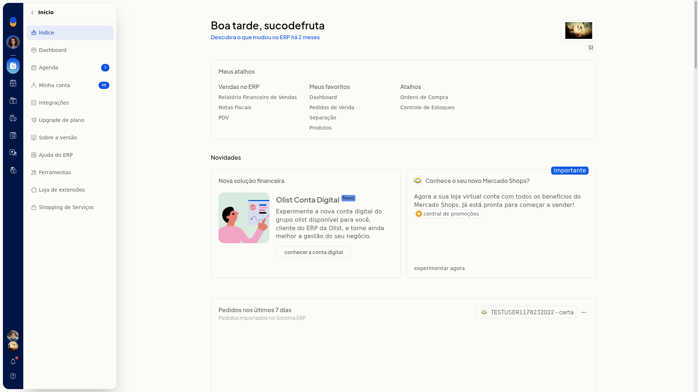

2. Na tela de configuração concluída, leia que já é possível emitir as notas fiscais e escolha **Revisar as configurações** ou **Ir para tela de Notas Fiscais**.

   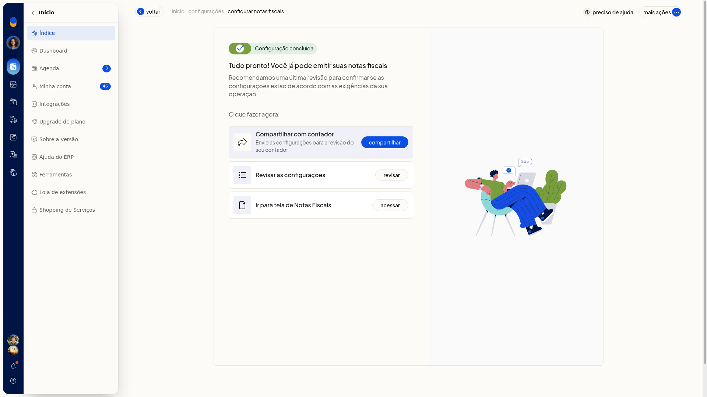

3. Em **Revisar as configurações**, confira **Ambiente das notas fiscais** em ambiente de testes, as pendências de **Dados da empresa**, **certificado digital** e **NFCe**, e as seções de NFe, naturezas, DIFAL, GNRE, intermediadores, marcadores, entrada e serviço. A configuração para faturar fica concluída no ambiente de testes, e você pode seguir para **Notas Fiscais**.

   

   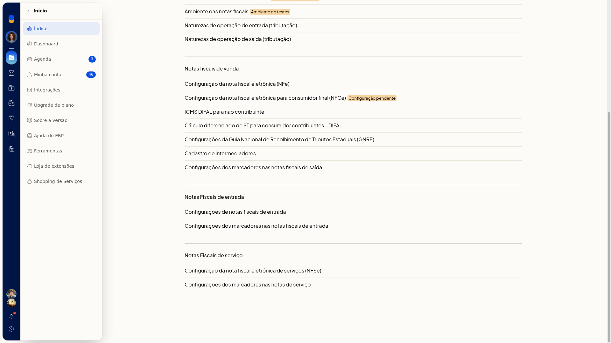

### Incluir a NF-e pela tela

1. Acesse **Vendas > Notas Fiscais** e confira o aviso de ambiente para testes de notas fiscais.

   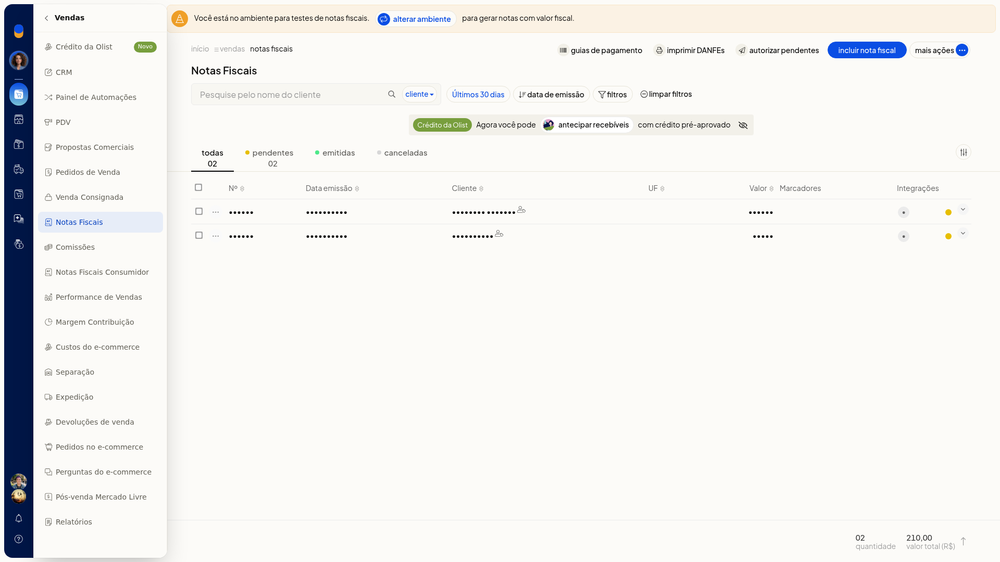

   

2. Clique em **Incluir nota fiscal**.
3. Confira os dados já trazidos da nota. Nenhum dos campos abaixo é obrigatório.

#### Dados da nota

- **Tipo de Saída**
- **Série**
- Número e datas
- Natureza
- **Finalidade**
- **CRT**
- **Consumidor final**
- **Cálculo automático de imposto**

#### Destinatário

Preencha com dados fictícios.

- **Tipo de pessoa**
- **Contribuinte**
- **Nome**
- **CPF**, no formato de CPF
- **CEP**, no formato de CEP
- **Endereço**
- **Número**
- **Bairro**
- **Cidade**
- **UF**
- **Fone**, no formato de telefone
- **E-mail**

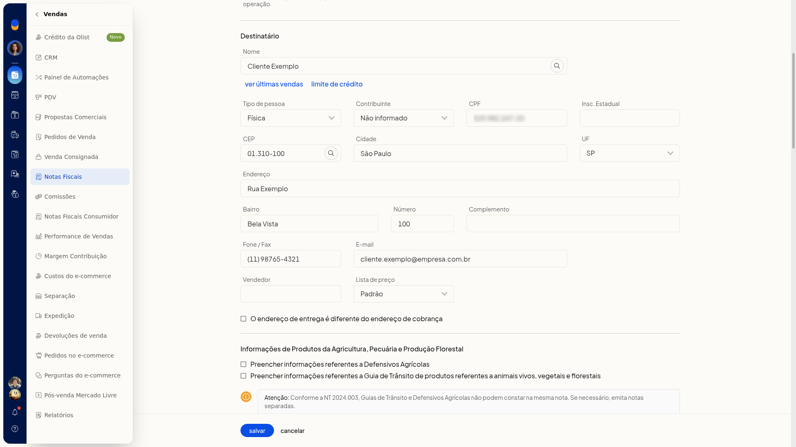

4. Confira o preenchimento. **Salvar** grava a inclusão da NF-e de saída no ambiente de testes. **Cancelar** descarta a inclusão.

### Gerar a NF-e a partir do pedido de venda

1. Acesse **Vendas > Pedidos de Venda**.

   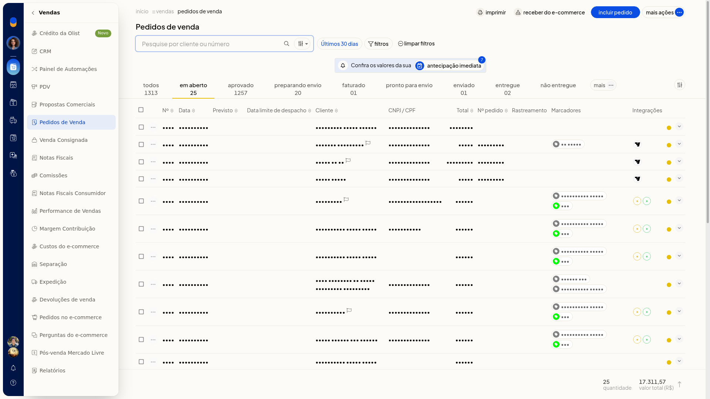

2. Na linha do pedido, abra **•••** e clique em **Gerar nota fiscal**.

   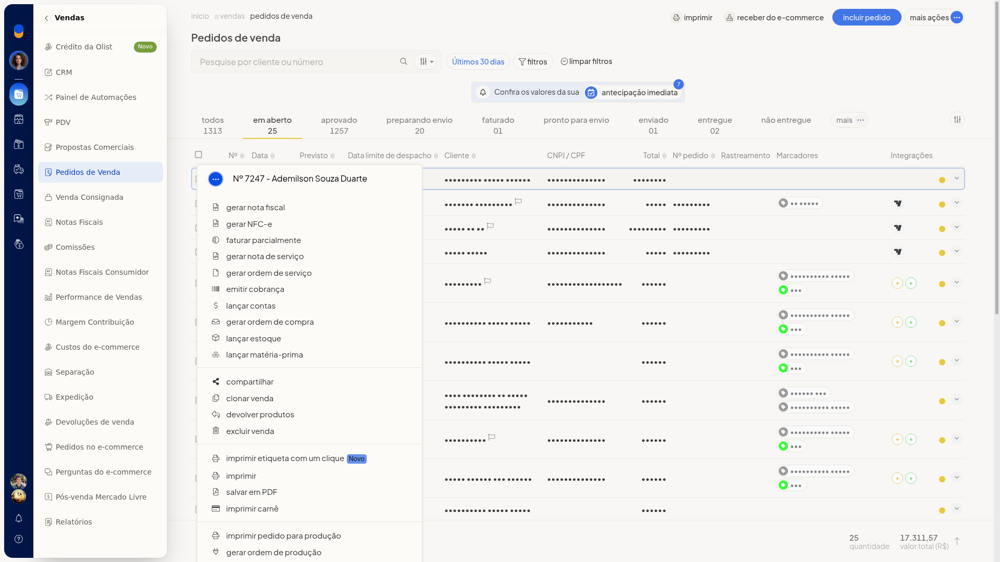

3. Confira a NF-e aberta, ainda não salva, com tipo de saída, finalidade, destinatário, frete, itens, cálculo do imposto e total da nota já preenchidos a partir do pedido.

   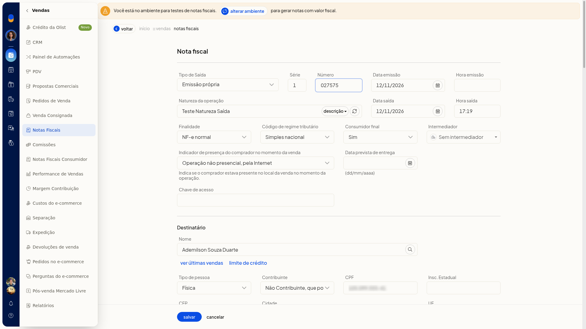

   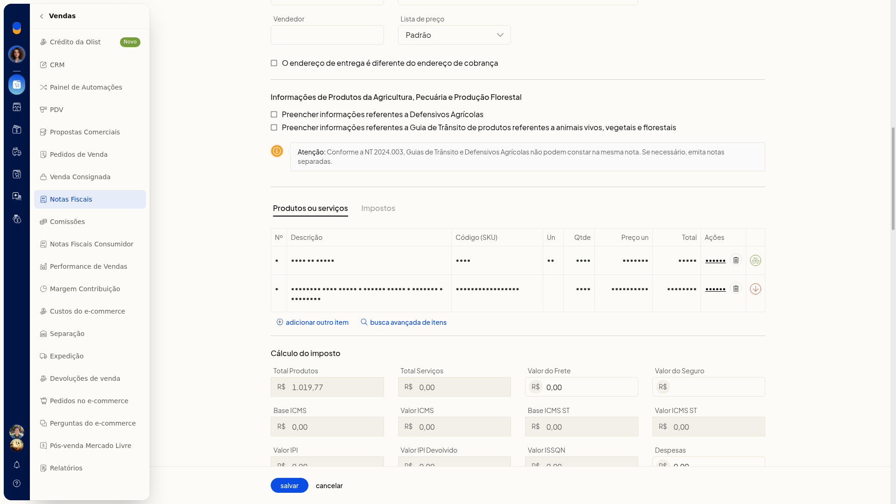

4. Confira os dados trazidos do pedido. **Salvar** grava a NF-e preenchida com os dados do pedido de venda.

### Deixar o lote pronto para autorização

1. Em **Vendas > Notas Fiscais**, clique em **Autorizar pendentes** ou em **Mais ações > Enviar notas pendentes**. Os dois caminhos abrem o mesmo painel.
2. Aguarde a mensagem de acesso ao dispositivo de segurança.
3. No painel **Lote de notas fiscais eletrônicas**, confira o ambiente de homologação. **Enviar notas fiscais por e-mail** e **Enviar notas fiscais rejeitadas anteriormente** vêm desmarcadas. Leia o aviso de que só notas emitidas após 13/10/2026 serão enviadas.

   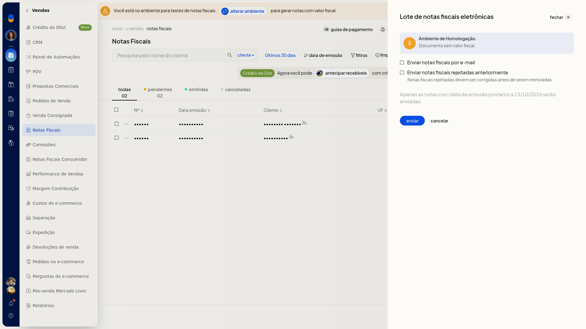

   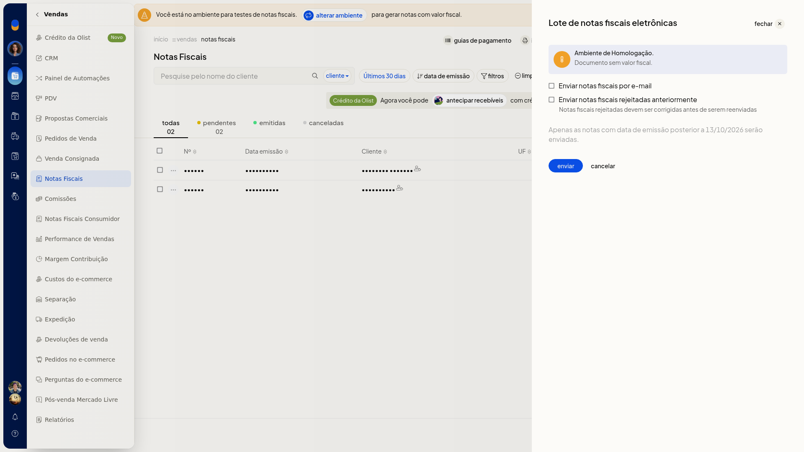

4. Confira o lote. **Enviar** dispara o envio em homologação. **Cancelar** fecha o painel sem enviar. O lote fica pronto para esse envio.

### Autorizar pela nota

1. Em **Vendas > Notas Fiscais**, abra **•••** na linha da nota.
2. Localize **Autorizar no SEFAZ**, junto de imprimir DANFE, compartilhar e salvar DANFE em PDF. Use **Autorizar no SEFAZ** quando quiser autorizar essa nota.

   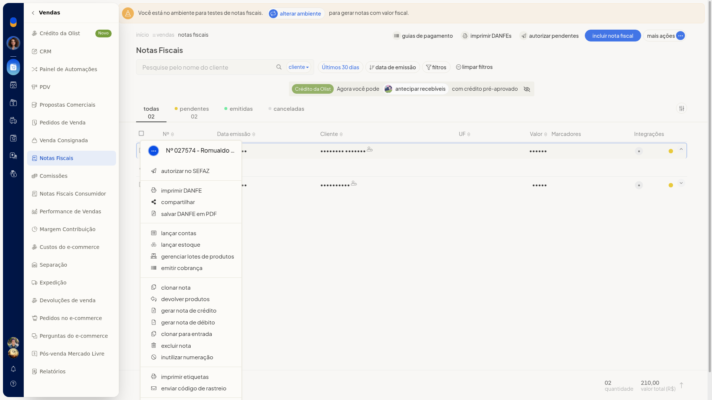

## Resultado
A jornada de configurar para faturar exibe a configuração concluída e a mensagem de que já é possível emitir as notas fiscais. A lista de **Notas Fiscais** abre no ambiente de testes, com as situações todas, pendentes, emitidas e canceladas. A NF-e de saída fica preenchida, pronta para salvar, e o painel **Lote de notas fiscais eletrônicas** fica em homologação, pronto para envio.
