# Cadastrar uma regra tributária da Reforma Tributária por NCM, produto e natureza

No ERP da Olist, a regra tributária específica define a classificação e as alíquotas de IBS e CBS para produtos que não devem seguir a regra geral da Reforma Tributária do Consumo. Você informa esses dados, o NCM e/ou o produto e as naturezas de operação em que a regra vale, para uso em NF-e e NFC-e.

O cadastro fica em **Configurações > Configurações ERP > Tributação (RTC)**, na seção **NFe e NFCe**, em **Cadastro de regras tributárias**.

## Pré-requisitos
- Naturezas de operação já cadastradas na empresa.
- NCM e/ou identificação do produto, quando a regra não for para qualquer NCM e produto.
- Se **Cadastro de regras tributárias** não aparecer, peça acesso ao administrador da conta.

## Importante
- **IBS Municipal** aparece como 0,00 e não pode ser editado. **IS** fica em branco e também não pode ser editado.
- Com **Aplicar para qualquer NCM e produto** ligado, a regra vale para todos os itens. Desligue o interruptor para informar um NCM e/ou um produto.
- **Voltar** sai do cadastro e retorna a **Tributação (RTC)** sem criar a regra.

## Instruções
1. Acesse **Configurações > Configurações ERP > Tributação (RTC)**.

   

2. Em **NFe e NFCe**, acesse **Cadastro de regras tributárias**.

A tela informa: defina a regra específica de tributação a ser aplicada quando o produto não seguir a regra geral.

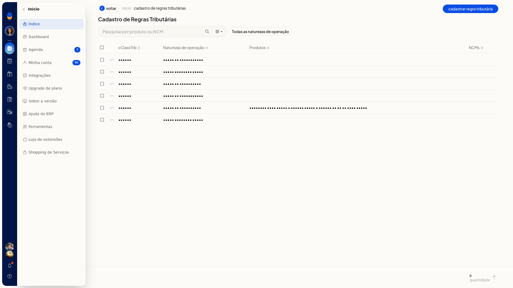

3. Clique em **Cadastrar regra tributária**.

O primeiro passo é **Dados do IBS/CBS**.

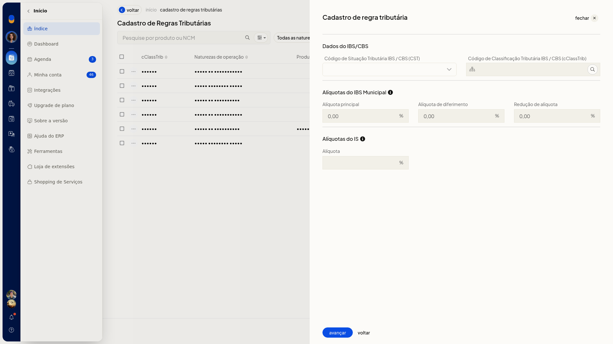

4. Selecione **CST**. O campo não é obrigatório. As opções são:

   - 000 - Tributação integral
   - 010 alíquotas uniformes
   - 011 alíquotas uniformes reduzidas
   - 200 Alíquota reduzida
   - 221 Alíquota fixa proporcional
   - 400 Isenção
   - 410 Imunidade e não incidência
   - 510 Diferimento
   - 515 Diferimento com redução de alíquota
   - 550 Suspensão
   - 620 Tributação Monofásica
   - 800 Transferência de crédito
   - 810 Ajuste de IBS na ZFM
   - 811 Ajustes
   - 820 Tributação em documento específico
   - 830 Exclusão da Base de Cálculo

5. Informe **cClassTrib**. O campo não é obrigatório. Clique em **Pesquisar**, escolha o código e clique em **Confirmar**. **Cancelar** fecha a pesquisa sem aplicar um código novo.

   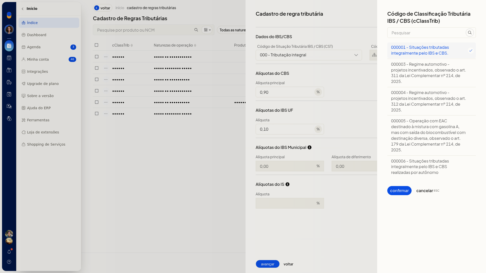

6. Informe **CBS** e **IBS UF**. Os dois campos não são obrigatórios. Use vírgula como separador decimal, como em 0,90 e 0,10.

   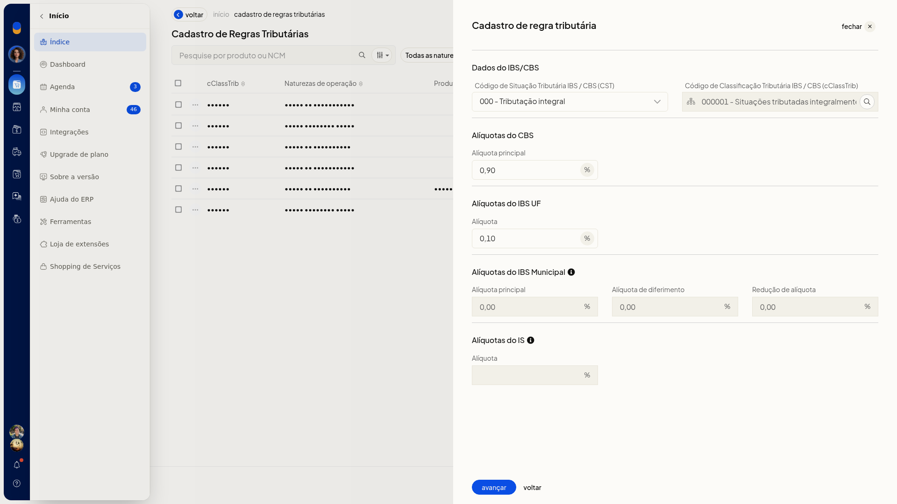

7. Clique em **Avançar**.

8. Mantenha **Aplicar para qualquer NCM e produto** ligado para cobrir todos os itens.

   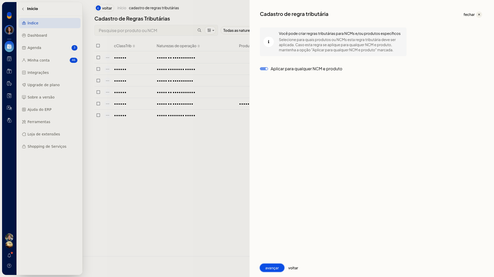

9. Desligue **Aplicar para qualquer NCM e produto** para informar um NCM e/ou um produto. O interruptor não é obrigatório.

   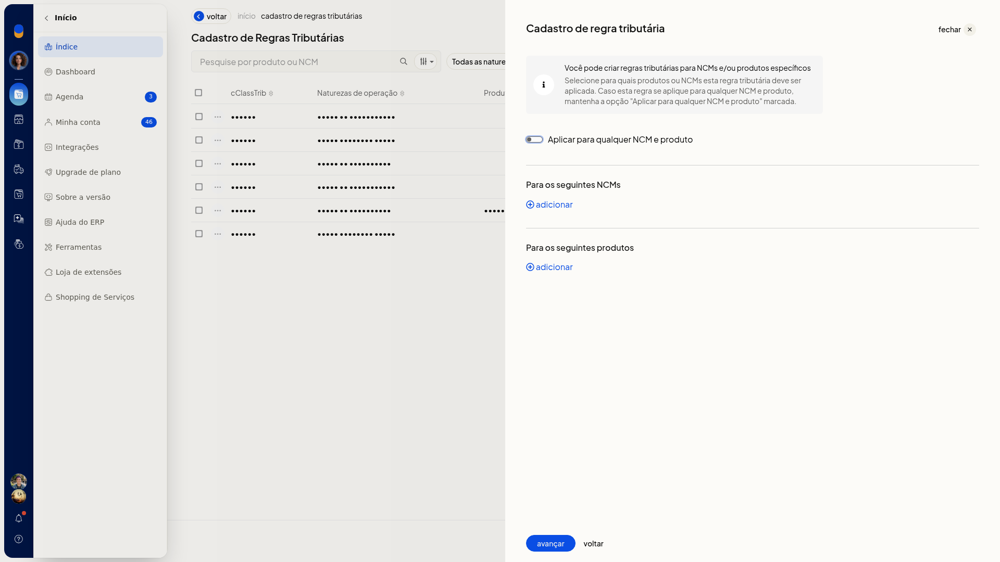

10. Informe o **NCM**. O campo não é obrigatório. O código completo fica no formato 0000.00.00. Use ? para um grupo, por exemplo 8471.??.??.

   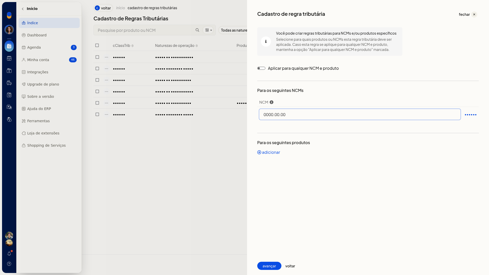

   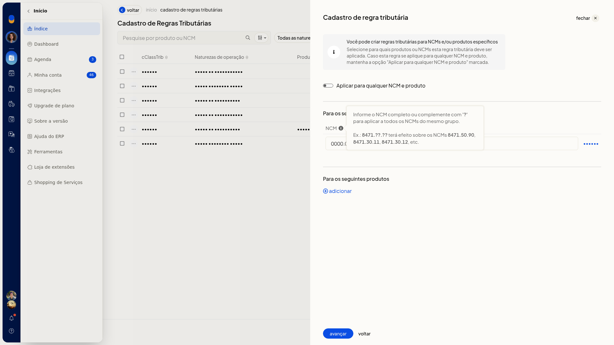

11. Adicione o produto pela busca de nome, SKU ou GTIN. **Produto** e **Código (SKU)** não são obrigatórios.

   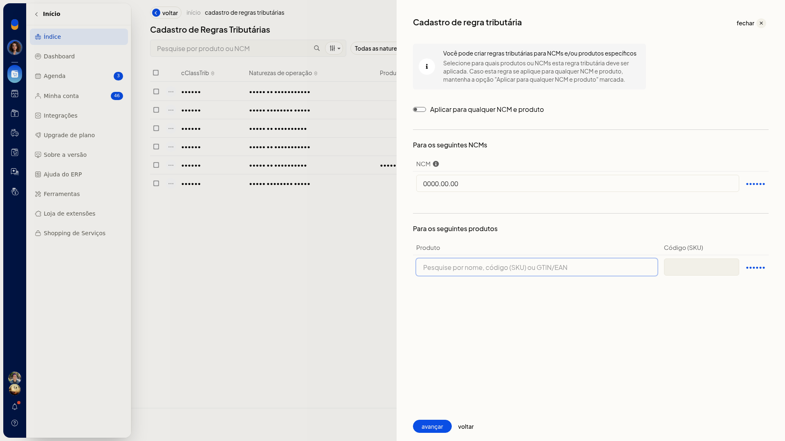

   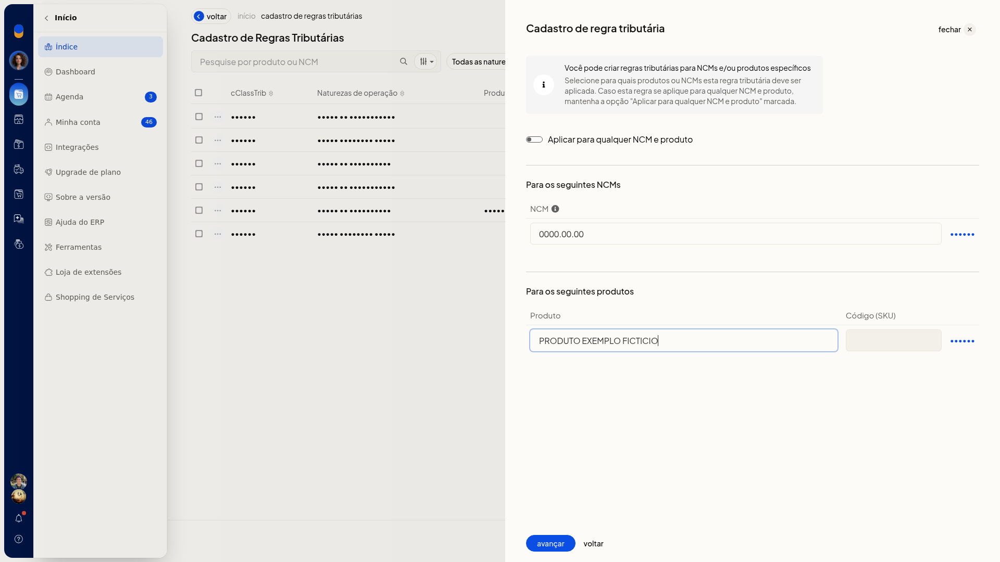

12. Clique em **Avançar**.

13. Marque as naturezas de operação que devem usar a regra. **Natureza de operação** não é obrigatória. Você pode marcar **Venda de mercadorias (Saída)**.

   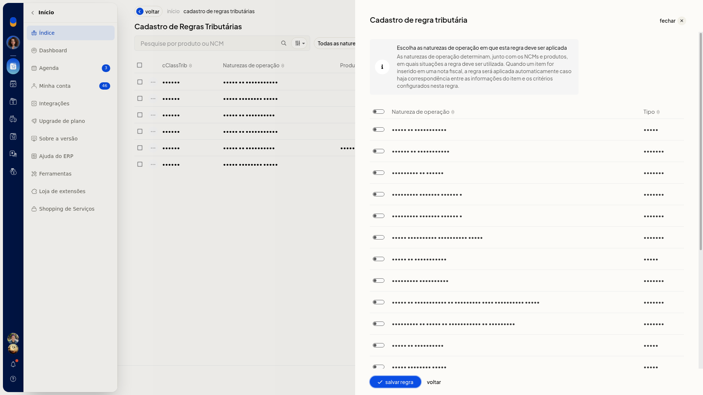

   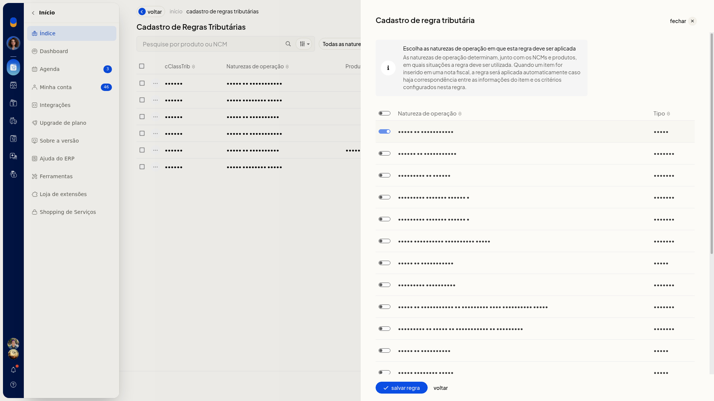

14. Clique em **Salvar regra**. A regra só é criada nesse clique.

## Resultado
A regra salva fica em **Cadastro de Regras Tributárias**, com as colunas **cClassTrib**, **Naturezas de operação**, **Produtos** e **NCMs**, e um contador de quantidade.

## Informações adicionais
- A lista de regras não oferece planilha, modelo nem importação.
- O cadastro de regras tributárias aparece em **NFe e NFCe**. A seção **NFSe** não tem esse cadastro.
