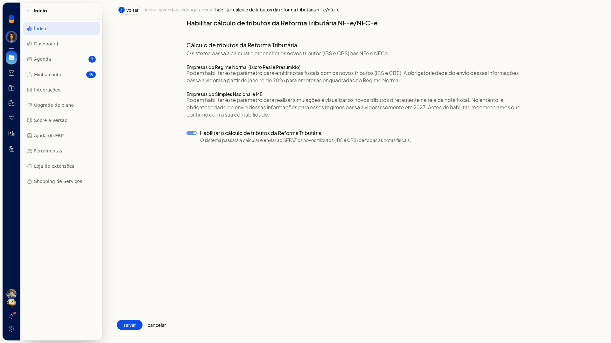
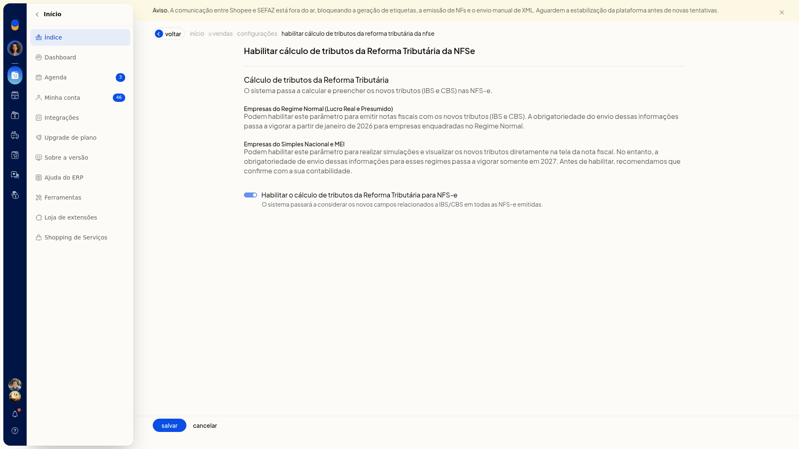

# Reforma Tributária: cálculo dos novos tributos

No ERP da Olist, **Tributação (RTC)** define como o IBS e a CBS da Reforma Tributária do Consumo entram na emissão da NF-e, da NFC-e e da NFS-e. Ao habilitar o cálculo, esses tributos passam a ser considerados nas notas.

## Importante
- No Regime Normal, o cálculo do IBS e da CBS na NF-e e na NFC-e torna-se obrigatório em janeiro de 2026.
- No Simples e no MEI, o cálculo na NF-e e na NFC-e permanece uma simulação até o uso obrigatório em 2027.

## Instruções
### Na NF-e e na NFC-e

1. Acesse **Configurações > Configurações ERP > Tributação (RTC)**.

   

2. Em **NFe e NFCe**, abra **Habilitar cálculo de tributos da Reforma Tributária**.
3. Marque **Habilitar o cálculo de tributos da Reforma Tributária**. Com a opção habilitada, o sistema calcula e envia o IBS e a CBS à SEFAZ nas notas.

   

### Na NFS-e

1. Acesse **Configurações > Configurações ERP > Tributação (RTC)**.
2. Em **NFSe**, abra **Habilitar cálculo de tributos da Reforma Tributária**.
3. Marque **Habilitar o cálculo de tributos da Reforma Tributária para NFS-e**. O sistema passa a considerar os novos campos de IBS/CBS em todas as NFS-e emitidas.

   

## Resultado
Na visão geral de **Tributação (RTC)**, os itens de cálculo de **NFe e NFCe** e de **NFSe** podem aparecer como habilitado. Com a opção marcada, a emissão da NF-e e da NFC-e calcula e envia o IBS e a CBS à SEFAZ, e a NFS-e emitida considera os novos campos de IBS/CBS.
