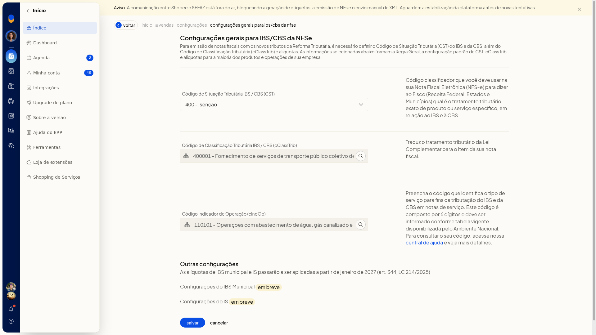
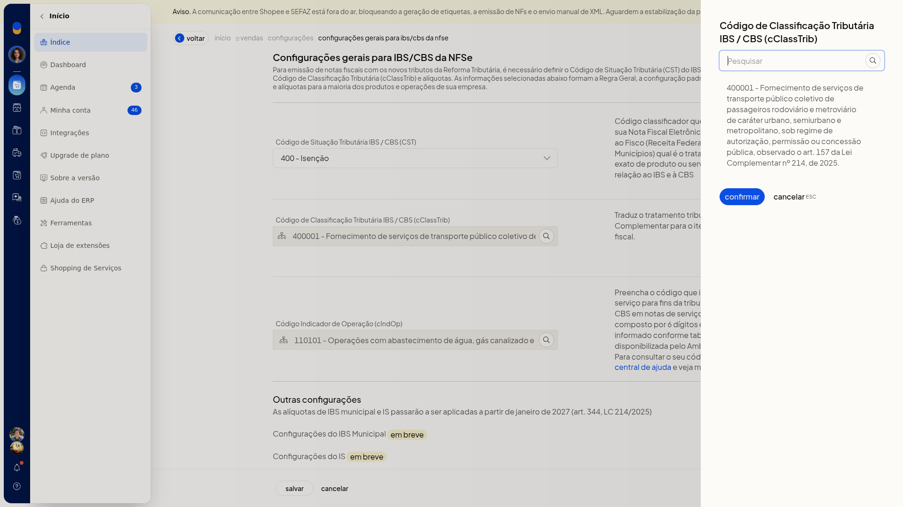
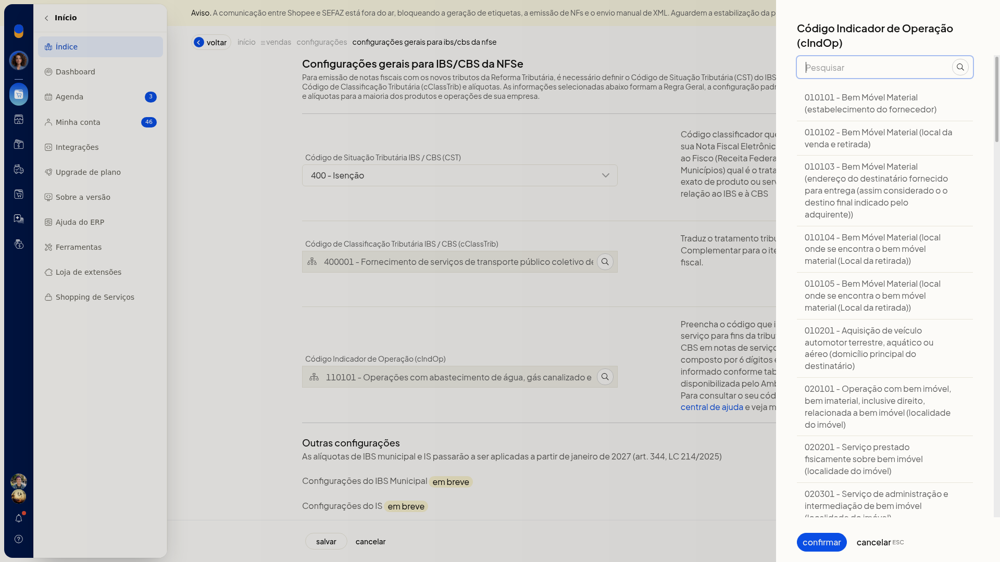
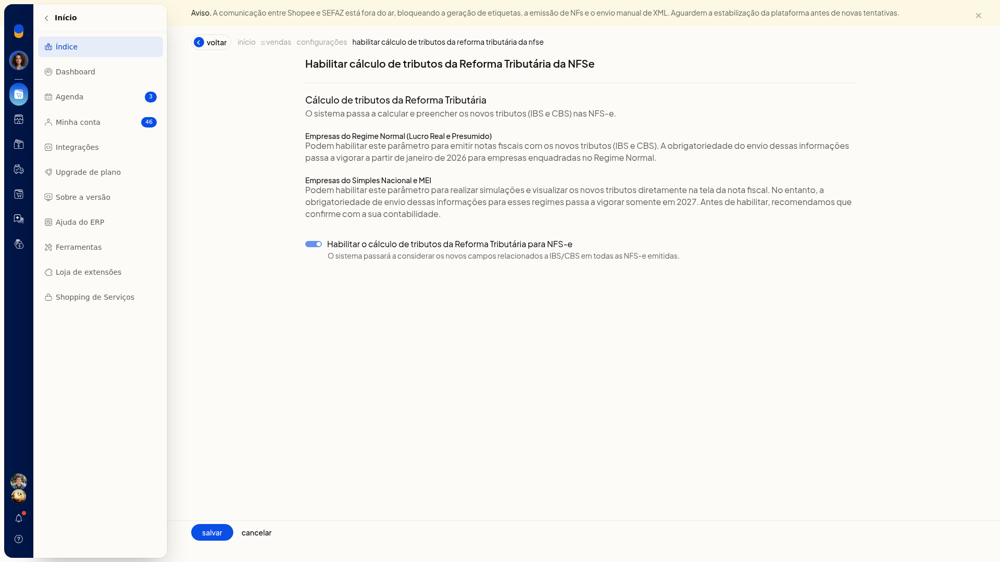

# Reforma Tributária: configurar e emitir NFS-e (padrão nacional)

## Importante
- **IBS Municipal** e **IS** aparecem como em breve, com efeito citado para janeiro de 2027.
- Na seção **NFSe** não há cadastro de regra específica. A configuração vale como padrão para os serviços.

## Instruções
### Configurar a classificação padrão

1. Acesse **Configurações > Configurações ERP > Tributação (RTC)**.

   

2. Em **NFSe**, clique em **Configuração dos tributos e códigos de classificação**.
3. Selecione o **CST**. O campo não é obrigatório. As opções são:
 - 000 - Tributação integral
 - 010 alíquotas uniformes
 - 011 alíquotas uniformes reduzidas
 - 200 Alíquota reduzida
 - 221 Alíquota fixa proporcional
 - 400 Isenção
 - 410 Imunidade e não incidência
 - 510 Diferimento
 - 515 Diferimento com redução de alíquota
 - 550 Suspensão
 - 620 Tributação Monofásica
 - 800 Transferência de crédito
 - 810 Ajuste de IBS na ZFM
 - 811 Ajustes
 - 820 Tributação em documento específico
 - 830 Exclusão da Base de Cálculo

   

4. Informe o **cClassTrib**. O campo não é obrigatório. Na pesquisa, clique em **Pesquisar**, escolha o código e clique em **Confirmar**. **Cancelar** fecha a pesquisa sem aplicar o código.

   

5. Informe o **cIndOp**. O campo não é obrigatório e vale só para a NFS-e. Na pesquisa, clique em **Pesquisar**, escolha o código e clique em **Confirmar**. **Cancelar** fecha a pesquisa sem confirmar.

   

6. Clique em **salvar**. A classificação geral, inclusive o **cIndOp**, passa a ser o padrão da NFS-e.

### Habilitar o cálculo na NFS-e

1. Em **NFSe**, clique em **Habilitar cálculo de tributos da Reforma Tributária**.
2. Marque **Habilitar o cálculo de tributos da Reforma Tributária para NFS-e**. Com a opção habilitada, o sistema passa a considerar os novos campos de IBS/CBS em todas as NFS-e emitidas.

   

## Resultado
Em **Tributação (RTC)**, o item de cálculo da **NFSe** pode aparecer como habilitado. A configuração geral mostra o **CST**, o **cClassTrib** e o **cIndOp** usados como padrão dos serviços.

## Informações adicionais
### A NFS-e usa só a regra geral

A seção **NFSe** tem a configuração dos tributos e a habilitação do cálculo. Ela não exibe **Cadastro de regras tributárias**.
