# Reforma Tributária: configurar NF-e e NFC-e

No ERP da Olist, **Tributação (RTC)** é onde você define a classificação, as alíquotas e o cálculo do IBS e da CBS da Reforma Tributária do Consumo na NF-e e na NFC-e.

Você grava a regra geral dos produtos, liga o cálculo para esses tributos entrarem na emissão e cadastra uma regra por NCM, produto e natureza de operação quando um produto não deve seguir a regra geral. Se a opção não aparecer para você, peça acesso ao administrador da conta.

## Pré-requisitos
- Naturezas de operação já cadastradas na empresa, para marcar a regra específica e filtrar a lista.
- NCM e identificação do produto, se a regra não valer para qualquer NCM e produto.

## Importante
- **IBS Municipal** e **IS** aparecem como em breve, com efeito citado para janeiro de 2027, e não ficam editáveis.
- No cálculo, o Regime Normal passa a ser obrigatório em janeiro de 2026. Simples e MEI permanecem como simulação até o uso obrigatório em 2027.
- A lista de regras não oferece planilha, modelo, importar nem envio de arquivo.
- Os campos abaixo não estão indicados como obrigatórios.

## Instruções
### Configurar a regra geral

1. Acesse **Configurações > Configurações ERP > Tributação (RTC)**.

   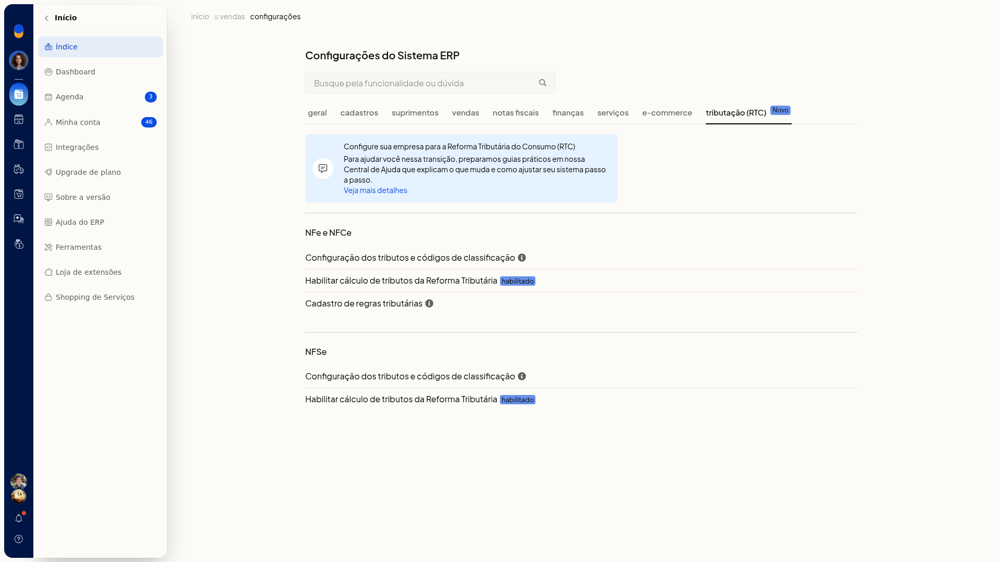

2. Em **NFe e NFCe**, abra **Configuração dos tributos e códigos de classificação**. Essa regra geral é o padrão aplicado aos produtos.

   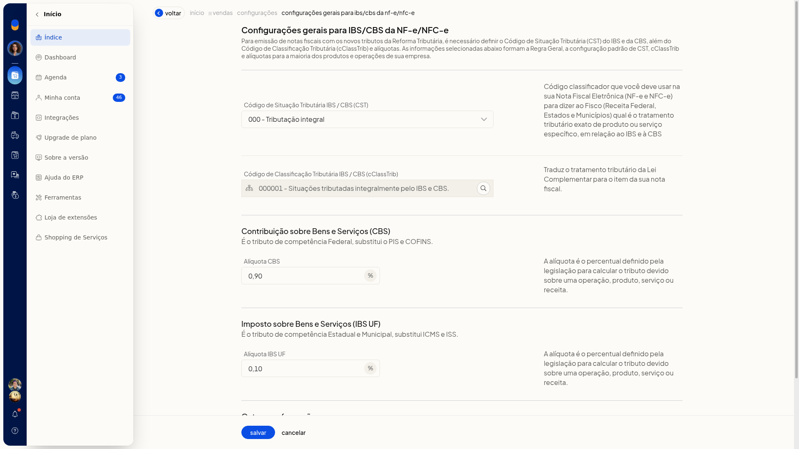

3. Selecione o **CST**:
 - 000 - Tributação integral
 - 010 alíquotas uniformes
 - 011 alíquotas uniformes reduzidas
 - 200 Alíquota reduzida
 - 221 Alíquota fixa proporcional
 - 400 Isenção
 - 410 Imunidade e não incidência
 - 510 Diferimento
 - 515 Diferimento com redução de alíquota
 - 550 Suspensão
 - 620 Tributação Monofásica
 - 800 Transferência de crédito
 - 810 Ajuste de IBS na ZFM
 - 811 Ajustes
 - 820 Tributação em documento específico
 - 830 Exclusão da Base de Cálculo

4. Informe o **cClassTrib**. Na consulta, use **Pesquisar** e clique em **Confirmar** para aplicar o código. **Cancelar** fecha a consulta sem aplicar um código novo. A consulta não lista todos os códigos da tabela oficial. No caso integral, os códigos vistos incluem 000001, 000003, 000004, 000005 e 000006.

   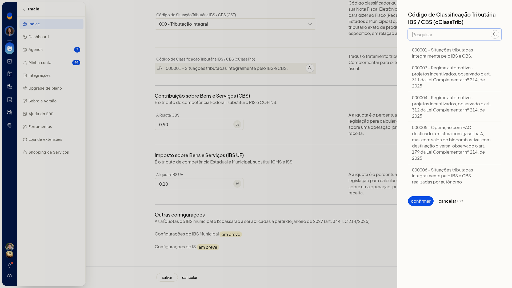

5. Informe **CBS** e **IBS UF** com vírgula no decimal, por exemplo 0,90 e 0,10. Essa classificação e essas alíquotas são o padrão usado na NF-e e na NFC-e.

### Habilitar o cálculo

1. Em **NFe e NFCe**, abra **Habilitar cálculo de tributos da Reforma Tributária**.
2. Marque **Habilitar o cálculo de tributos da Reforma Tributária**. Com a opção marcada, a emissão calcula e envia IBS e CBS à SEFAZ nas notas fiscais.

   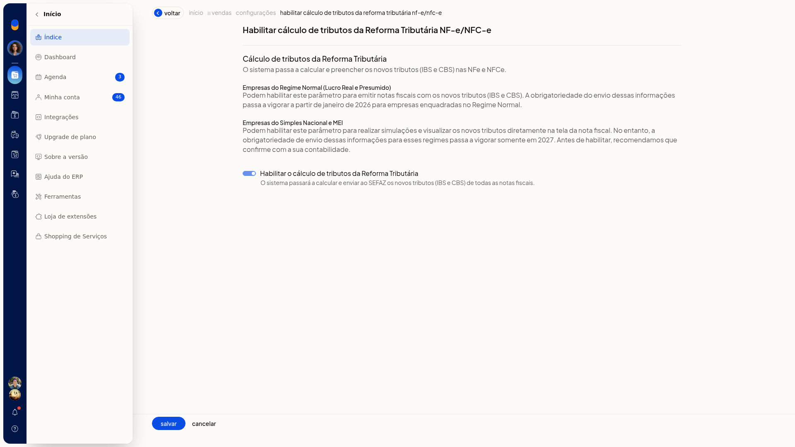

### Cadastrar uma regra específica

1. Em **NFe e NFCe**, abra **Cadastro de regras tributárias**. Use essa regra quando o produto não seguir a regra geral.

   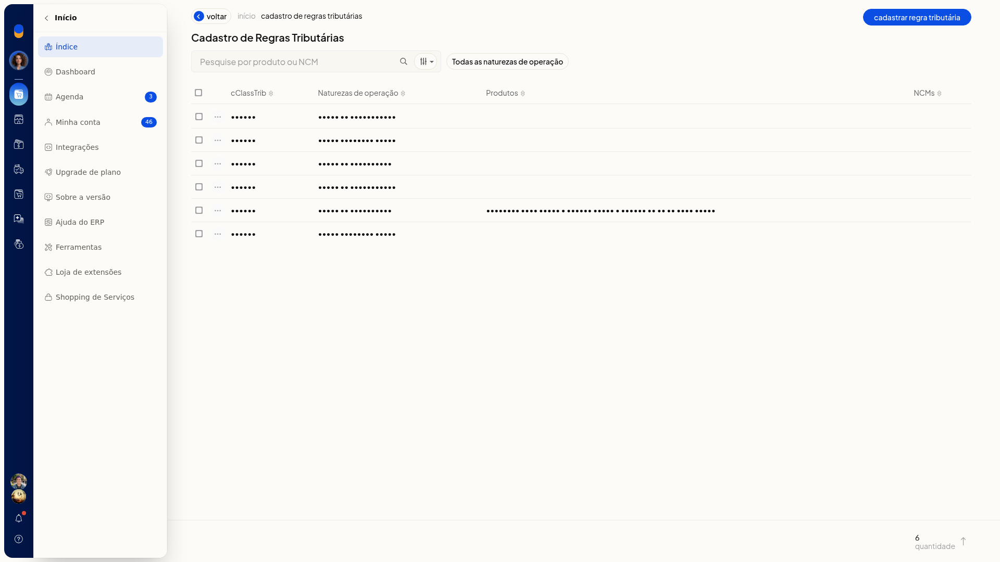

2. Clique em **Cadastrar regra tributária**. O primeiro passo é **Dados do IBS/CBS**.

   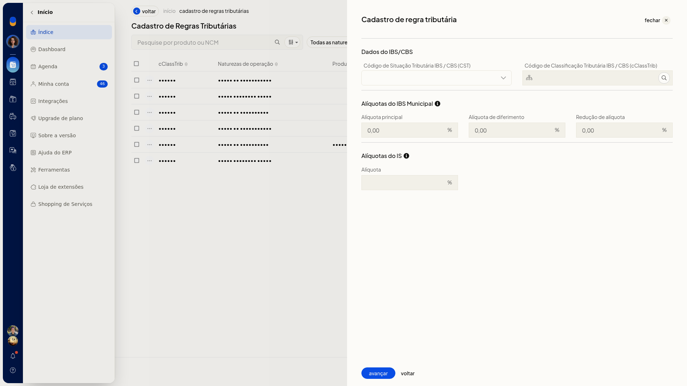

3. Selecione o **CST**, consulte o **cClassTrib** e clique em **Confirmar**.

   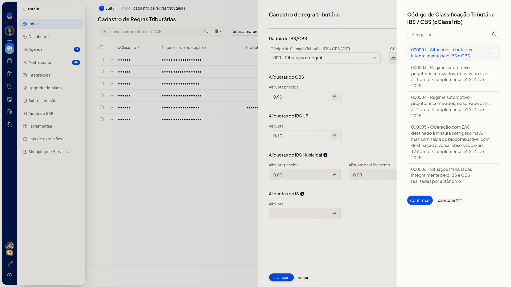

4. Informe **CBS** e **IBS UF** com vírgula no decimal. Um exemplo confirmado na tela é **CST** 000, **cClassTrib** 000001 - Situações tributadas integralmente, **CBS** 0,90 e **IBS UF** 0,10. **IBS Municipal** pode aparecer como 0,00 e **IS** vazio, sem edição.

   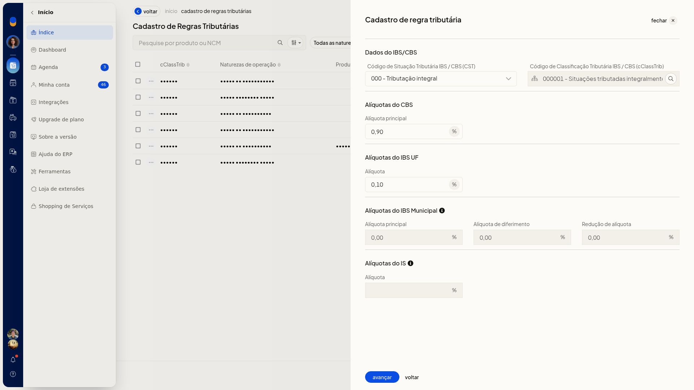

5. Clique em **Avançar**. Deixe **Aplicar para qualquer NCM e produto** ligado para valer para todos os itens.

   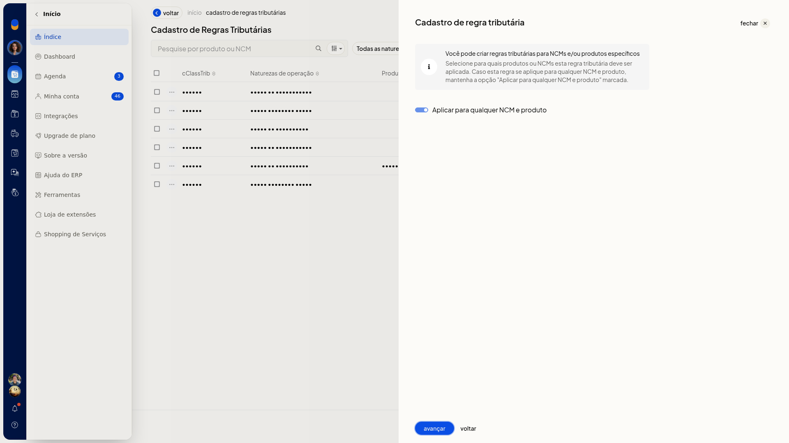

6. Desligue **Aplicar para qualquer NCM e produto** para informar um NCM, um produto ou os dois.

   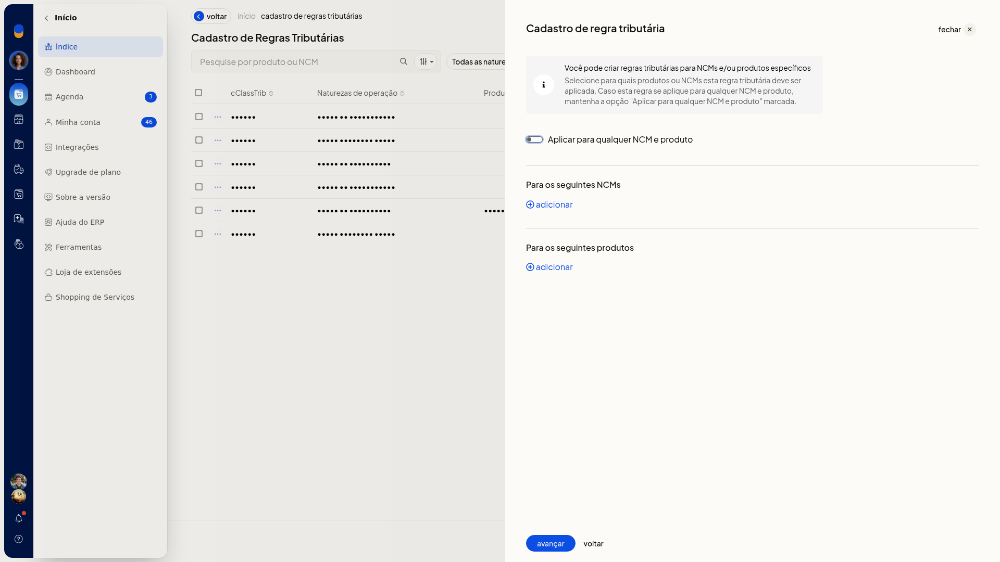

7. Informe o **NCM** completo no formato 0000.00.00, ou use ? para um grupo, por exemplo 8471.??.??. Clique em **salvar** na linha do NCM.

   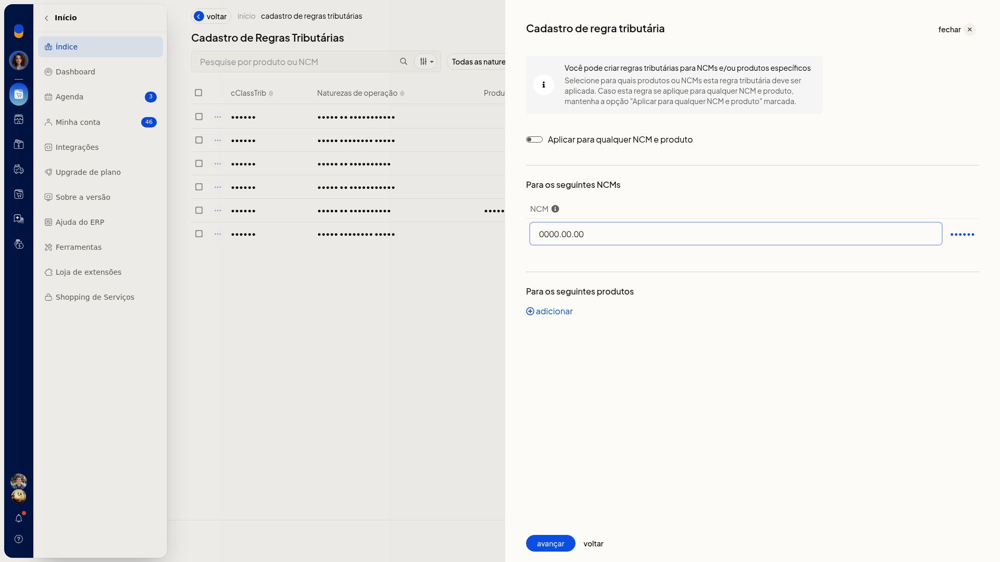

   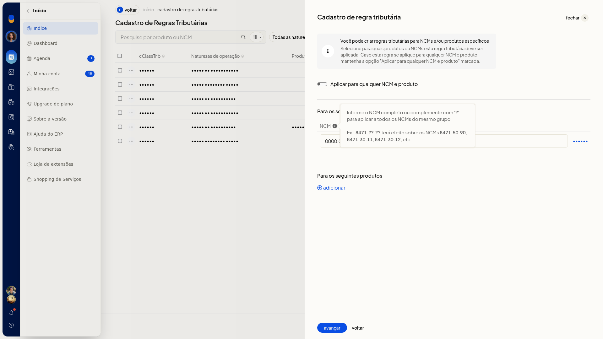

8. Para limitar por produto, pesquise por nome, SKU ou GTIN e use **Código (SKU)**.

   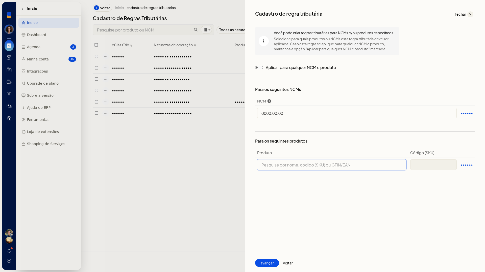

   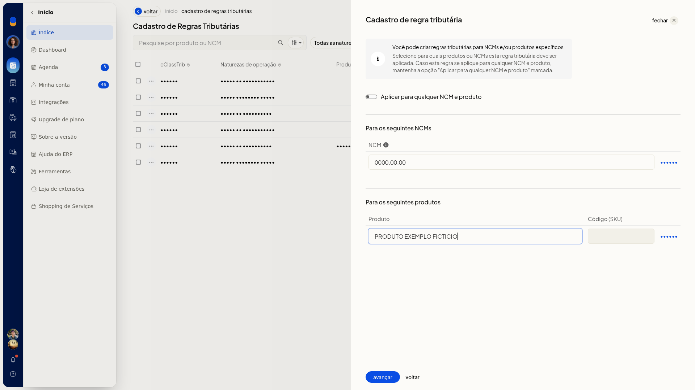

9. Clique em **Avançar** e marque as naturezas de operação que devem usar a regra. **Venda de mercadorias (Saída)** pode ser marcada.

   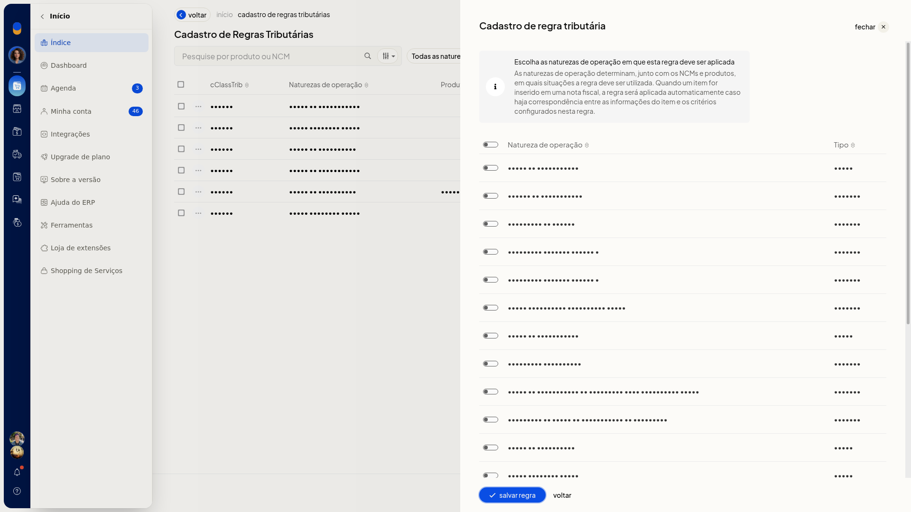

   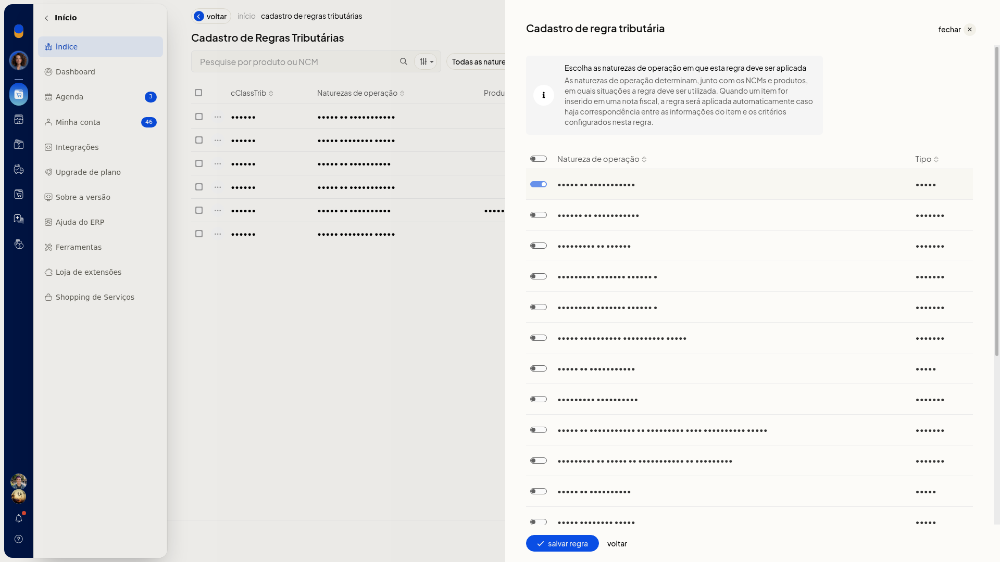

10. Clique em **Salvar regra**. A regra só é criada nesse clique. **Voltar** sai do cadastro e retorna a **Tributação (RTC)** sem criar a regra.

### Consultar e filtrar regras

1. Em **NFe e NFCe**, abra **Cadastro de regras tributárias**. A lista **Cadastro de Regras Tributárias** mostra **cClassTrib**, **Naturezas de operação**, **Produtos**, **NCMs** e um contador de quantidade.
2. Pesquise em **Pesquise por produto ou NCM**. No refinamento, escolha **produto**, **ncm** ou **Não refinar**.

   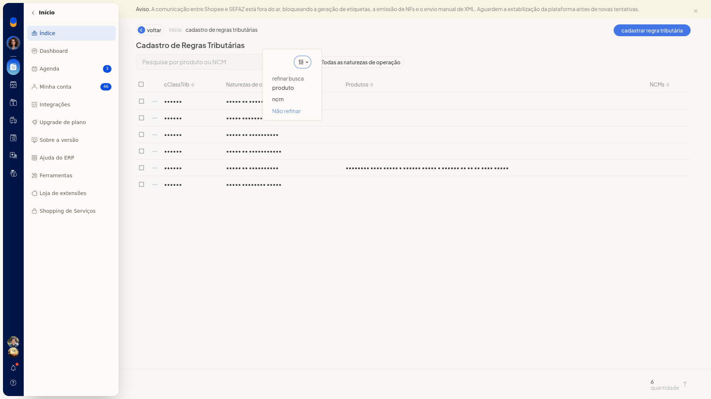

3. Abra **Todas as naturezas de operação**, escolha a **Natureza de operação** e clique em **aplicar**. **Cancelar** fecha o filtro sem aplicá-lo.

   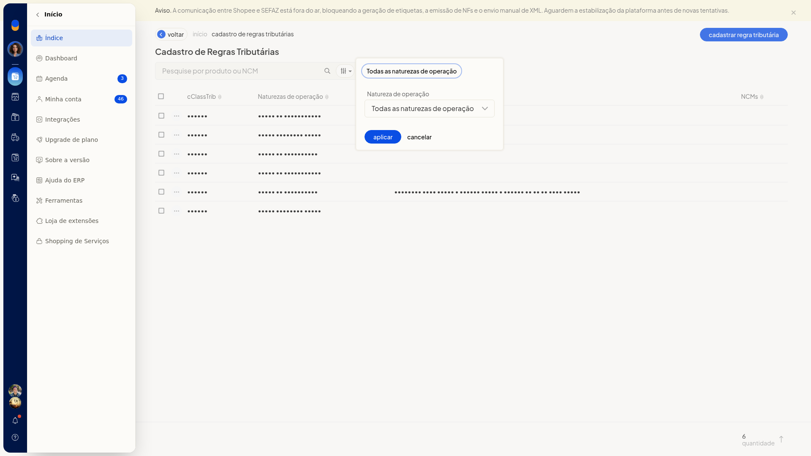

4. Abra o menu de ações da linha. A opção exibida é **excluir**. Não clique em **excluir** se a regra deve ser mantida.

   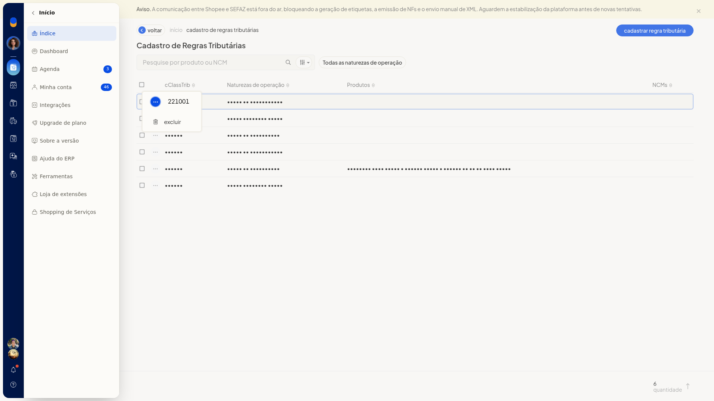

## Resultado
Em **Tributação (RTC)**, o item de habilitar o cálculo da NF-e e da NFC-e pode aparecer como habilitado. A configuração geral mostra o **CST**, o **cClassTrib** e as alíquotas atuais. As regras salvas ficam em **Cadastro de Regras Tributárias**, com **cClassTrib**, naturezas, produtos, NCMs e a quantidade.

## Informações adicionais
- A regra específica vale só para as naturezas de operação marcadas no cadastro.
- A pesquisa da lista refina por produto ou NCM e o filtro usa as naturezas já cadastradas na empresa.
