# Reforma Tributária: emitir NF-e e NFC-e (inclui débito e crédito)

Em **Tributação (RTC)**, no ERP da Olist, você define como o IBS e a CBS da Reforma Tributária do Consumo são classificados e calculados nas NF-e e NFC-e de produtos.

A regra geral vale como padrão. Com o cálculo habilitado, o ERP considera esses tributos e os envia à SEFAZ na emissão. Quando um produto não deve seguir a regra geral, você cadastra uma regra por NCM, produto e natureza de operação.

## Pré-requisitos
- Para a regra específica e para o filtro da lista, as naturezas de operação já precisam estar cadastradas na empresa.
- Se a regra não for para todos os itens, tenha o NCM e a identificação do produto.
- Se **Tributação (RTC)** não aparecer, peça acesso ao administrador da conta.

## Importante
- **IBS Municipal** e **IS** aparecem como em breve, com efeito citado para janeiro de 2027, e não são editáveis.
- No cálculo da NF-e e da NFC-e, o Regime Normal passa a ser obrigatório em janeiro de 2026. Simples e MEI seguem como simulação até o uso obrigatório em 2027.
- A regra específica só se aplica quando o produto não segue a regra geral.

## Instruções
Acesse **Configurações > Configurações ERP > Tributação (RTC)**.

**Regra geral dos produtos**

1. Em **NFe e NFCe**, abra **Configuração dos tributos e códigos de classificação**. O texto da tela informa que essa regra geral será o padrão dos produtos.
2. Selecione o **CST**. Nenhum campo desta configuração é obrigatório. As opções são: **000 - Tributação integral**, **010 alíquotas uniformes**, **011 alíquotas uniformes reduzidas**, **200 Alíquota reduzida**, **221 Alíquota fixa proporcional**, **400 Isenção**, **410 Imunidade e não incidência**, **510 Diferimento**, **515 Diferimento com redução de alíquota**, **550 Suspensão**, **620 Tributação Monofásica**, **800 Transferência de crédito**, **810 Ajuste de IBS na ZFM**, **811 Ajustes**, **820 Tributação em documento específico** e **830 Exclusão da Base de Cálculo**.

   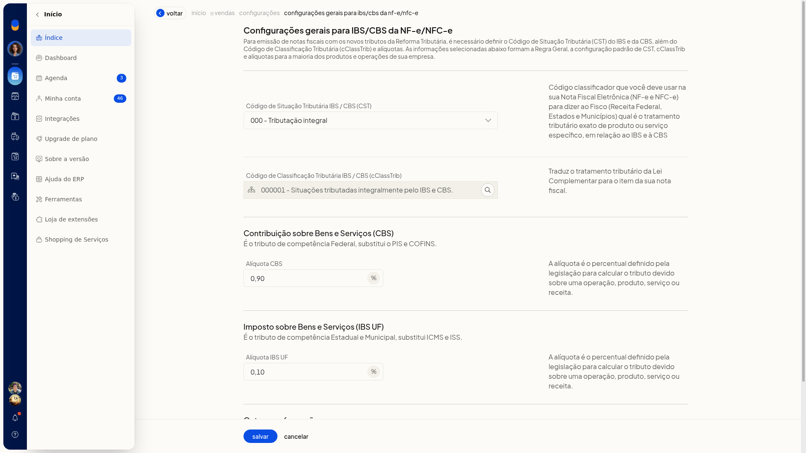

3. Informe o **cClassTrib**. Na consulta, use **Pesquisar**, confirme com **Confirmar** ou feche com **Cancelar** sem aplicar um código novo.

   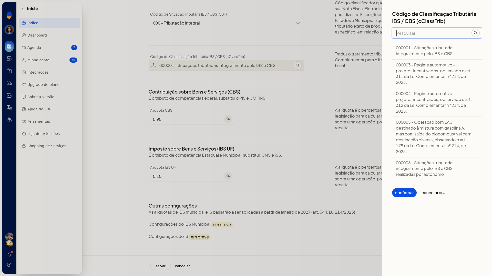

4. Informe **CBS** e **IBS UF** com vírgula como separador decimal, por exemplo 0,90 e 0,10. Essa classificação e essas alíquotas passam a ser o padrão das NF-e e NFC-e.

**Cálculo na emissão**

1. Em **NFe e NFCe**, abra **Habilitar cálculo de tributos da Reforma Tributária**.
2. Marque **Habilitar o cálculo de tributos da Reforma Tributária**. Com a opção habilitada, o ERP calcula e envia IBS e CBS à SEFAZ nas notas.

   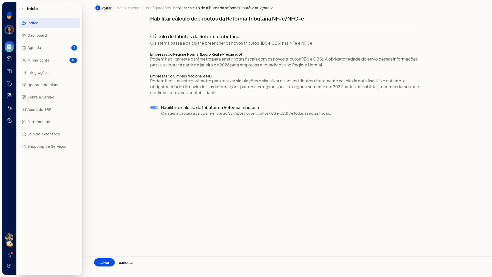

**Regra específica**

1. Em **NFe e NFCe**, abra **Cadastro de regras tributárias**. O texto informa que a regra específica vale quando o produto não segue a regra geral.

   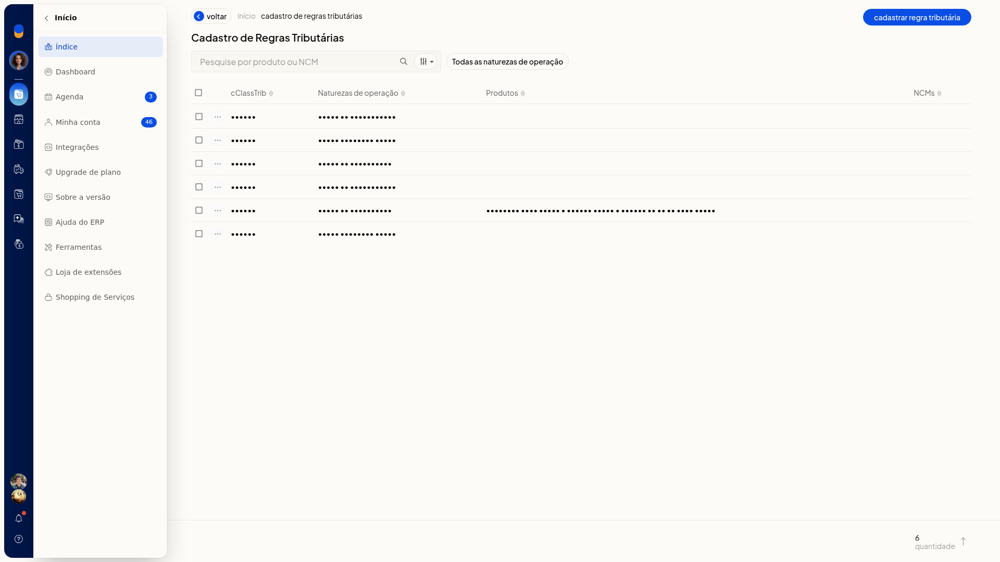

2. Clique em **Cadastrar regra tributária**. O primeiro passo é **Dados do IBS/CBS**.

   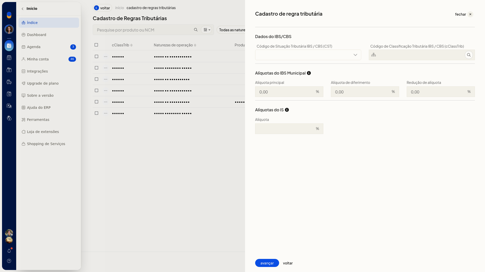

3. Selecione o **CST**, consulte o **cClassTrib** e confirme o código. Preencha **CBS** e **IBS UF** com vírgula decimal. **IBS Municipal** pode aparecer como 0,00 e não é editável. **IS** pode aparecer vazio e não é editável.

   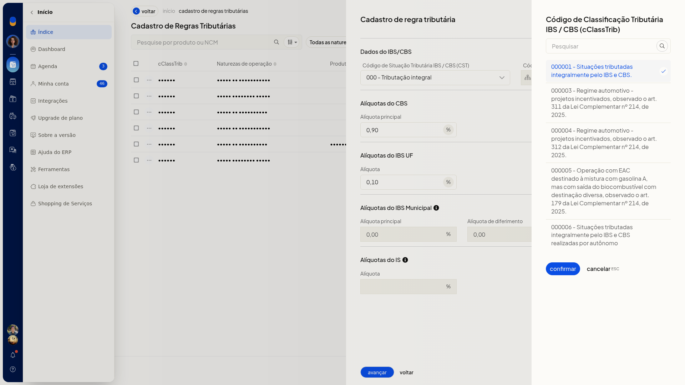

   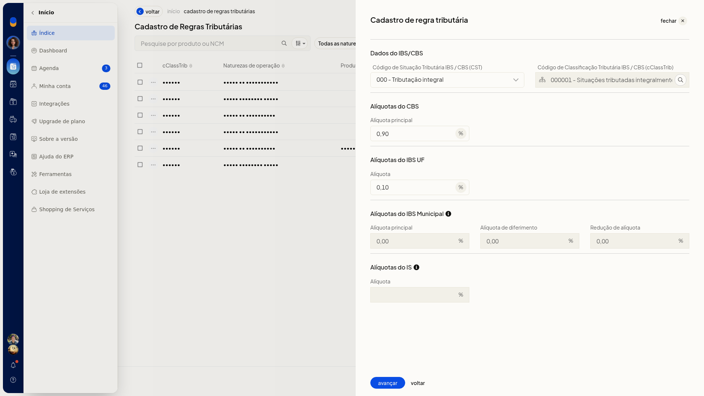

4. Clique em **Avançar**. Deixe **Aplicar para qualquer NCM e produto** ligado para abranger todos os itens, ou desligue para informar NCM e/ou produto.

   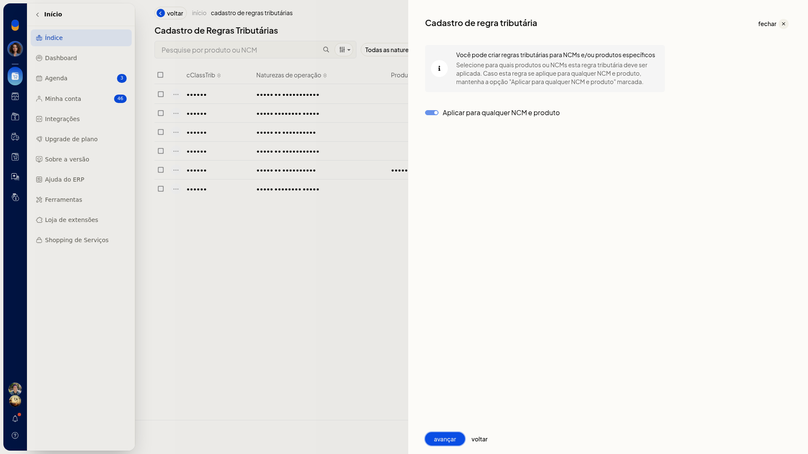

5. Com o interruptor desligado, informe o **NCM**. O código completo é reformatado como 0000.00.00. Use ? para um grupo, por exemplo 8471.??.??. Clique em **salvar** na linha do NCM.

   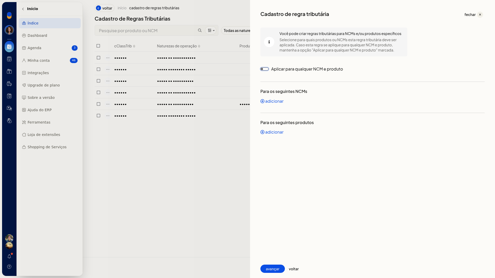

   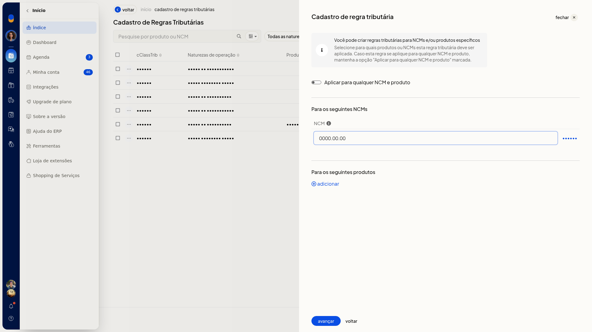

   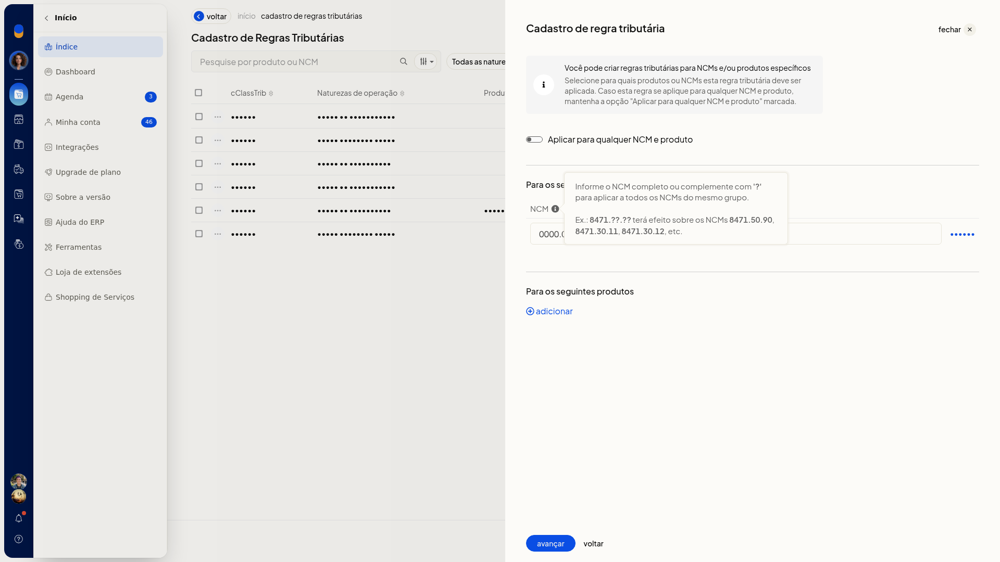

6. Adicione o produto pelo nome, SKU ou GTIN e preencha **Código (SKU)**.

   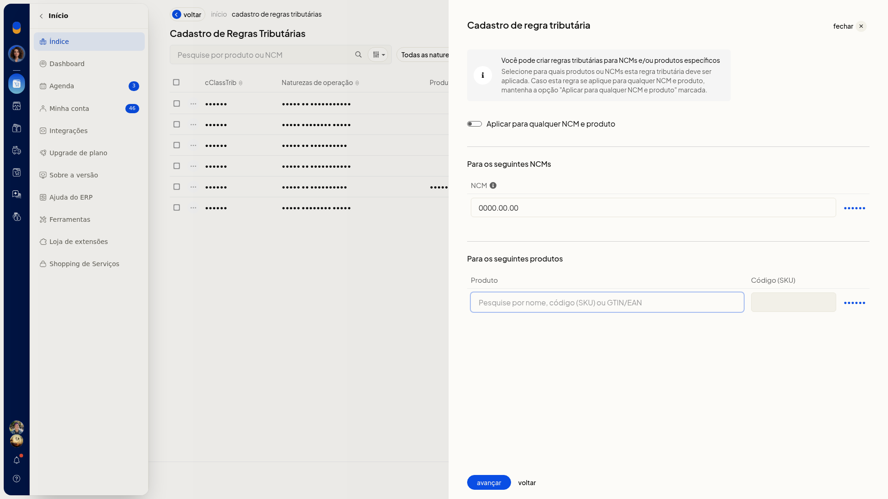

   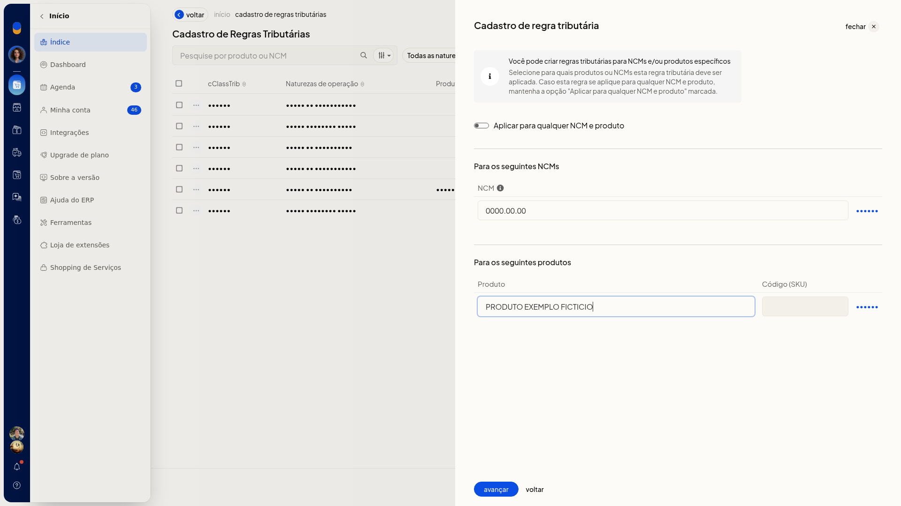

7. Clique em **Avançar** e marque as naturezas de operação que devem usar a regra, por exemplo **Venda de mercadorias (Saída)**.
8. Clique em **Salvar regra**. A regra não é criada até esse clique. **Voltar** sai do assistente e volta a **Tributação (RTC)** sem criar a regra.

   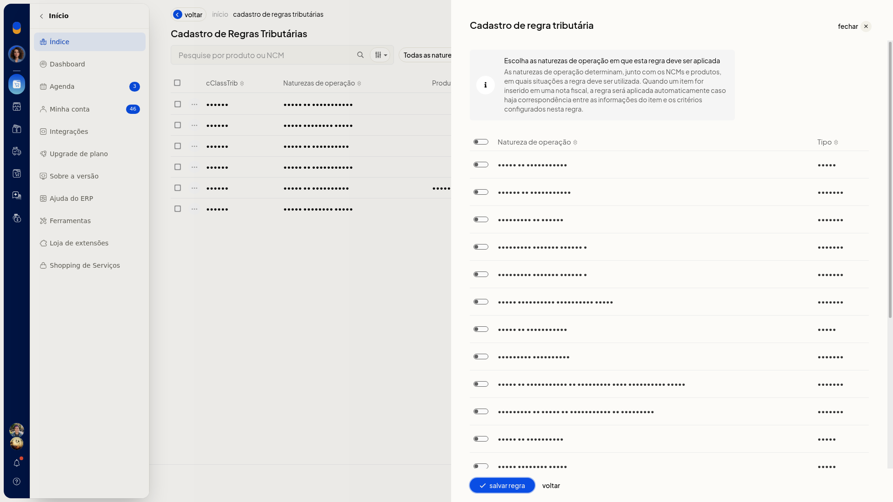

   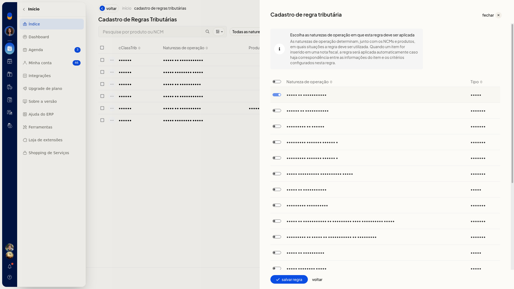

**Consulta das regras**

1. Abra **Cadastro de regras tributárias** em **NFe e NFCe**. A lista **Cadastro de Regras Tributárias** mostra **cClassTrib**, **Naturezas de operação**, **Produtos**, **NCMs** e um contador de quantidade.
2. Pesquise em **Pesquise por produto ou NCM**. O refinamento oferece **produto**, **ncm** e **Não refinar**.

   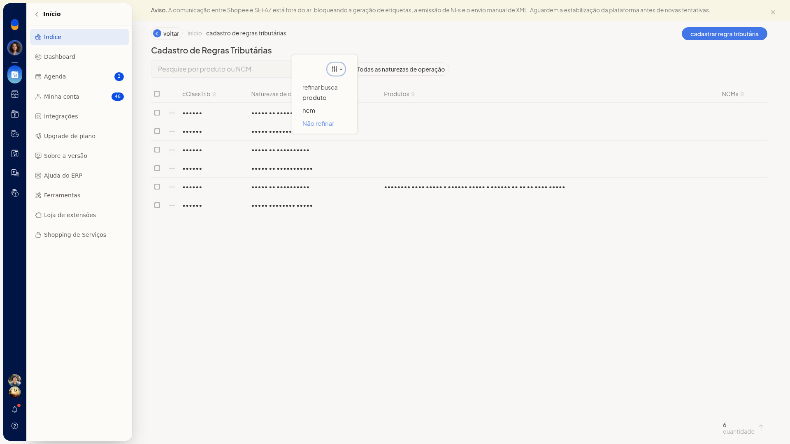

3. Abra **Todas as naturezas de operação**, escolha a natureza e clique em **aplicar**. **cancelar** fecha o filtro sem aplicá-lo.

   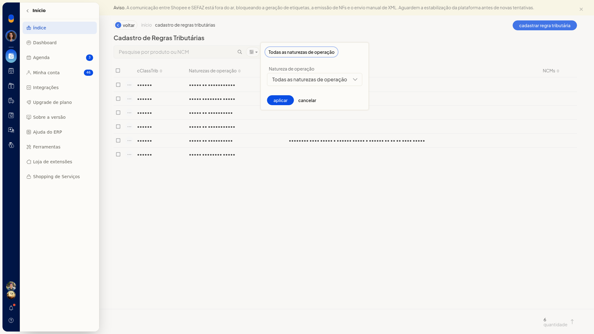

4. No menu da linha, a ação disponível é **excluir**. Use **excluir** somente se a regra não deve ser mantida.

   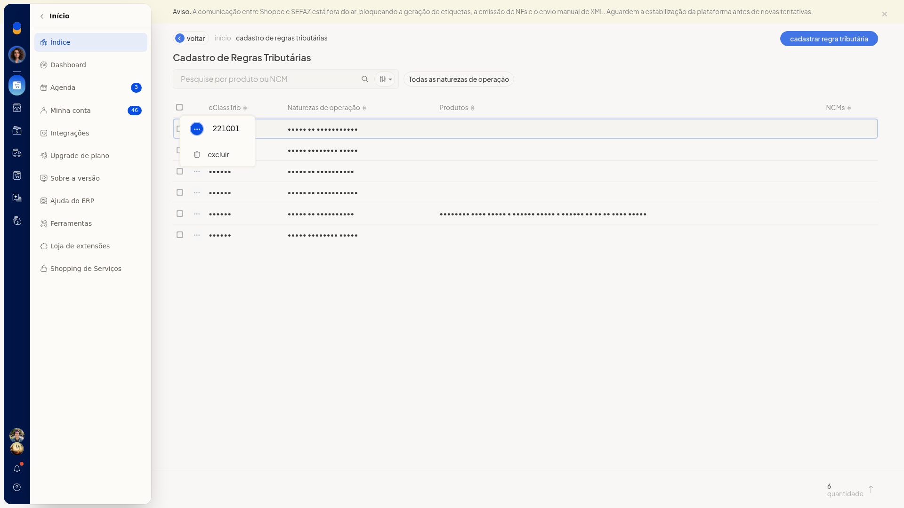

## Resultado
Com o cálculo habilitado, a emissão da NF-e e da NFC-e calcula e envia IBS e CBS à SEFAZ. A configuração geral mostra o **CST**, o **cClassTrib** e as alíquotas em uso. As regras salvas aparecem em **Cadastro de Regras Tributárias**.

## Informações adicionais
- O cadastro de regras não oferece planilha, modelo nem importação.
- A pesquisa refina apenas por **produto**, **ncm** ou **Não refinar**.
- A única ação da linha é **excluir**.
