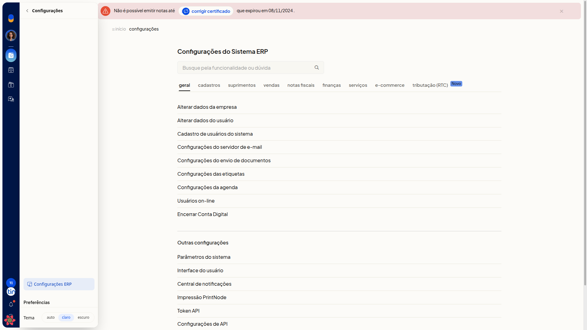
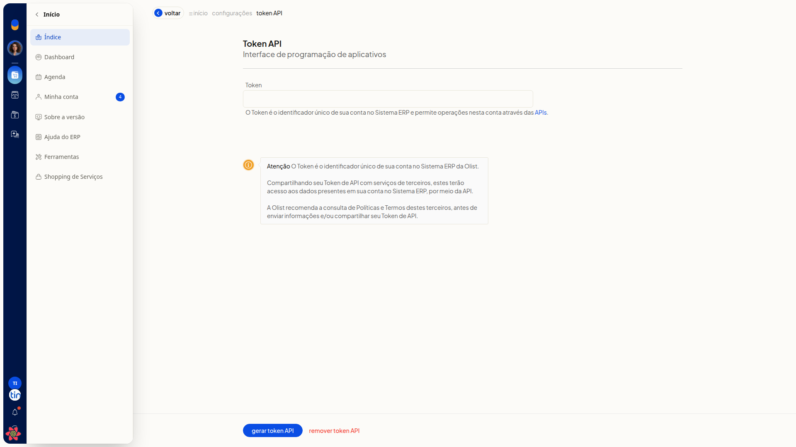

# Atualizar custos de produtos em massa pela API

## Pré-requisitos
- Token da conta para autenticar as chamadas em HTTP Bearer.
- Identificador numérico (**idProduto**) dos produtos já cadastrados.

## Importante
- Essas operações usam caminhos próprios de custo, separados da atualização de produto, kit, fabricado ou variação.

## Instruções
Confirme o token da conta antes das chamadas.

1. Acesse **Configurações > Configurações ERP**.

   

2. Na seção **Outras configurações**, abra **Token API**.

   

3. Leia o campo **Token** para autenticar as chamadas.
4. Se o campo **Token** estiver vazio, clique em **Gerar Token API**.

### Incluir custos de produtos distintos

Esta chamada inclui o custo de produtos diferentes de uma só vez.

1. Autentique a chamada enviando o token da conta como HTTP Bearer (bearerAuth).
2. Na chamada **POST /produtos/custos**, informe os campos abaixo.

#### Campos obrigatórios

- **idProduto**: inteiro do produto, por exemplo 501
- **precoCusto**: número do preço de custo, por exemplo 15.90
- **custoMedio**: número do custo médio, por exemplo 14.20

#### Campos opcionais

- **data**
- **saldoAtual**: número do saldo atual, por exemplo 10
- **saldoAnterior**: número do saldo anterior, por exemplo 8
- **impostosRecuperaveis**: número de impostos recuperáveis, por exemplo 1.50
- **precoVenda**: número do preço de venda, por exemplo 29.90

3. Envie a chamada. A resposta documentada é 201 Created.

### Incluir custo em todas as variações

Esta chamada lança o mesmo preço de custo e o mesmo custo médio em todas as variações de um produto.

1. Autentique a chamada enviando o token da conta como HTTP Bearer (bearerAuth).
2. Monte **POST /produtos/{idProduto}/variacoes/custos** e substitua **idProduto** pelo identificador inteiro do produto, por exemplo 501.
3. Informe **precoCusto** e **custoMedio**. Os dois são obrigatórios e numéricos, por exemplo 15.90 e 14.20.
4. Envie a chamada. A resposta documentada é 201 Created.

## Resultado
A inclusão de custos de produtos distintos e a inclusão do mesmo custo em todas as variações respondem 201 Created.
