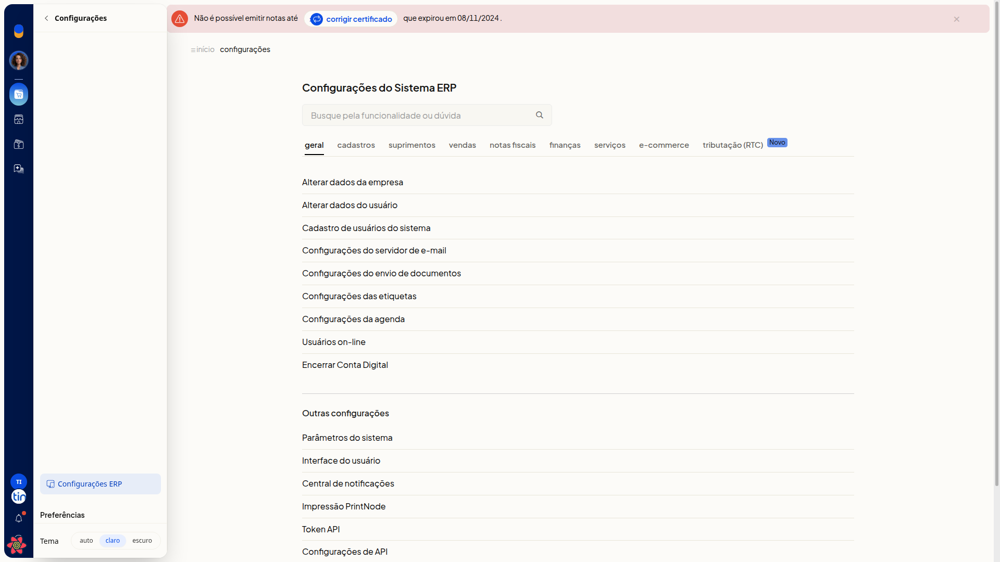
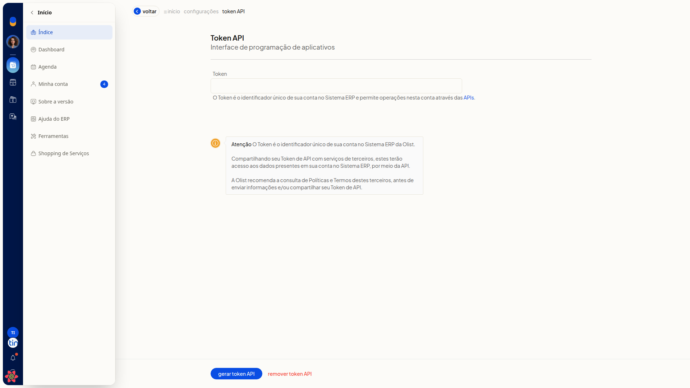
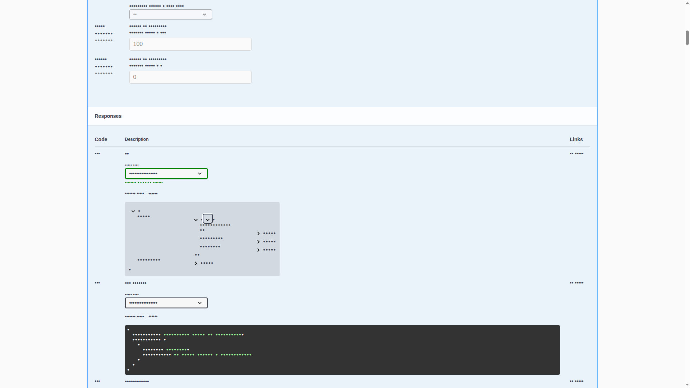

# Consultar o saldo das contas financeiras pela API

Pela API pública v3 do ERP da Olist, você lista as contas financeiras e pode filtrar a consulta por descrição, situação, ordenação e paginação.

A resposta não inclui saldo atual nem saldo conciliado.

## Instruções
1. Acesse **Configurações > Configurações ERP**.

   

2. Na seção **Outras configurações**, clique em **Token API**.

3. Se o campo **Token** estiver vazio, clique em **Gerar Token API**.

4. Autentique a chamada com bearerAuth (HTTP Bearer), usando o valor do campo **Token**. O token é o identificador único da sua conta no ERP e permite operações nesta conta pelas APIs.

   

5. Envie **GET /contas-financeiras**. A resposta 200 devolve cada conta somente com **id**, **descricao** e **situacao**, sem saldo atual nem saldo conciliado. Para filtrar a lista, informe os parâmetros opcionais:

   - **descricao**: pesquisa pela descrição da conta financeira
   - **situacao**: informe A (Ativa) ou I (Inativa)
   - **orderBy**: informe asc (Crescente) ou desc (Decrescente)
   - **limit** e **offset**: paginam o resultado

   
