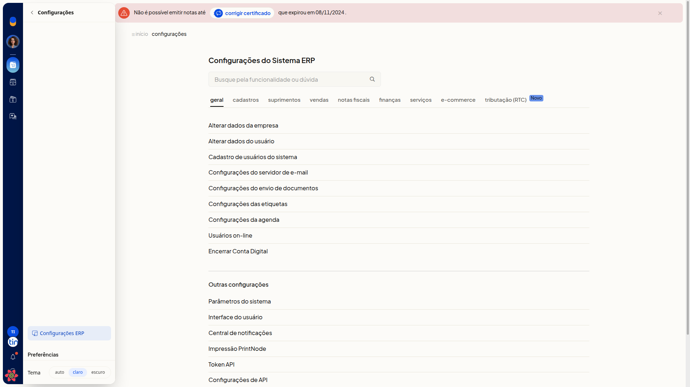
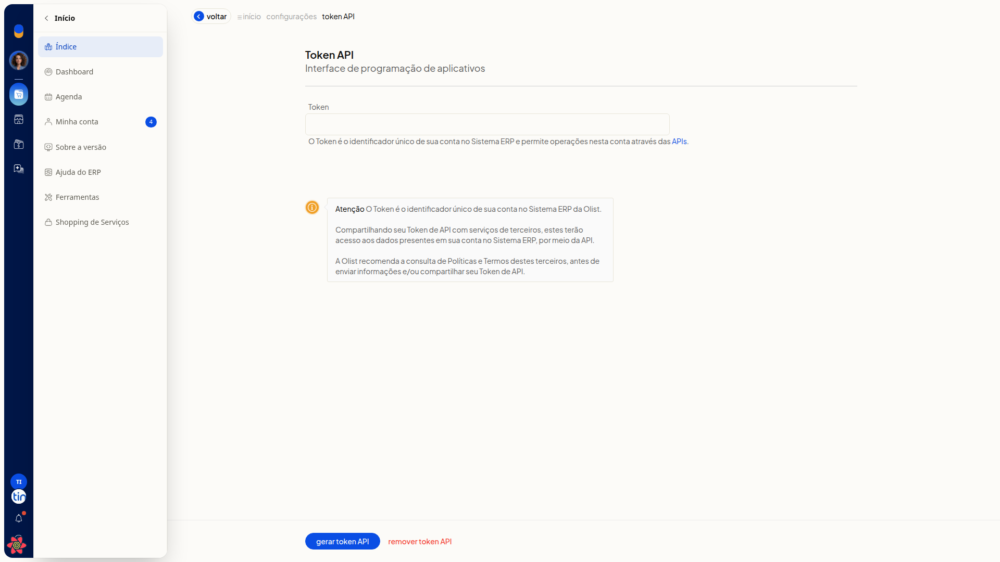
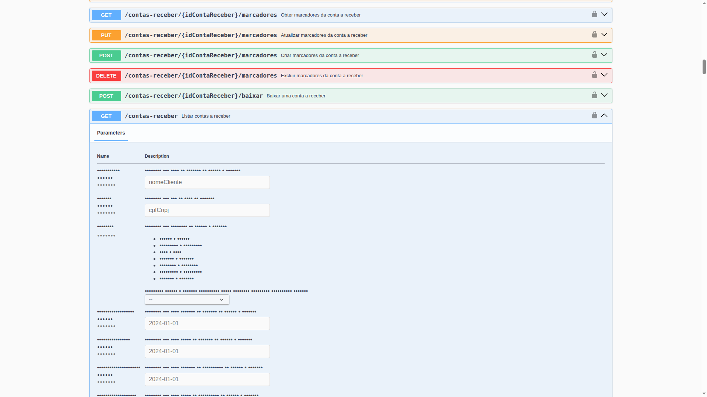
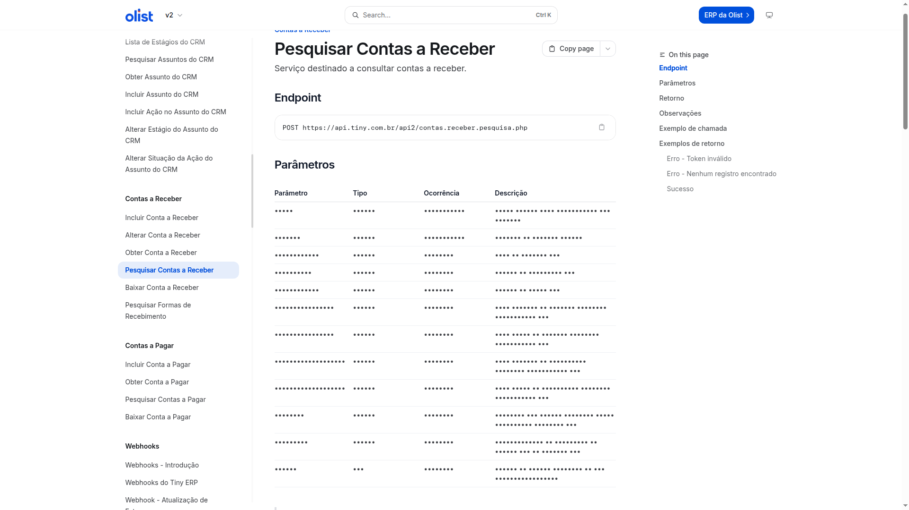

# Filtrar contas a receber por CPF ou CNPJ pela API

## Importante
- A listagem não tem o parâmetro **idContato**. Para filtrar pelo cliente, informe o CPF ou CNPJ em **cpfCnpj**.

## Instruções
1. Acesse **Configurações > Configurações ERP**.
2. Na seção **Outras configurações**, abra **Token API**.

   

3. Copie o valor do campo **Token**. Ele é o identificador único da conta e permite operações por API. Se o campo estiver vazio, clique em **Gerar Token API**.

   

4. Autentique a chamada com o token no formato Bearer.
5. Envie **GET /contas-receber** e informe o parâmetro opcional **cpfCnpj** com o CPF ou CNPJ do cliente. A API devolve a listagem de contas a receber filtrada por esse documento.

   

## Informações adicionais
### Outros filtros da mesma listagem

Na chamada **GET /contas-receber**, estes parâmetros também são opcionais: **nomeCliente**, **situacao**, datas de emissão e vencimento, **numeroDocumento**, **numeroBanco**, **idNota**, **idVenda**, **marcadores**, **dataAtualizacao**, **orderBy**, **limit** e **offset**.

### A API v2 não filtra por CPF ou CNPJ

Na operação **Pesquisar Contas a Receber** da API v2, **token** e **formato** são obrigatórios. Informe ao menos um destes filtros: **nome_cliente**, **numero_doc**, **numero_banco**, data de emissão, data de vencimento, **situacao** (aberto, pago, cancelada, parcial) ou **id_origem**. O parâmetro **pagina** também existe. Essa pesquisa não filtra por CPF, CNPJ nem por id do contato.

