# Filtrar o dashboard de Finanças por período

No Dashboard de finanças (**Início > Dashboard**, aba **Finanças**), você consulta a situação financeira e filtra por período somente depois de abrir o detalhe de **Fluxo de caixa** ou de **Contas a receber e a pagar**. O filtro oferece **do mês**, **até o mes** ou **do intervalo**.

Os cards resumidos não têm esse seletor. **Visão geral** e **Saldo atual de contas** mostram a posição atual. O card **Contas a receber e a pagar** usa faixas fixas em relação a hoje.

## Importante
- No **Fluxo de caixa**, um intervalo anterior à data atual não é mantido. O aviso **Limite atingido** informa que o período deve ser maior do que a data atual e que a data da consulta é ajustada.
- A data final do período precisa ser igual ou posterior à data inicial.
- As contas a pagar e a receber do período escolhido só aparecem quando a data inicial é informada.

## Instruções
### Filtrar o Fluxo de caixa

1. Acesse **Início > Dashboard** e selecione a aba **Finanças**.
2. No card **Fluxo de caixa**, clique em **expandir detalhes**.
3. Clique no período ao lado de **atualizado agora**. Na abertura, o rótulo é **do mês**.

   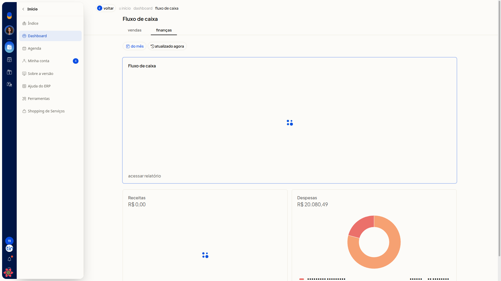

4. Escolha **do mês**, **até o mes** ou **do intervalo**.
 - **do mês**: o mês aparece no formato MM/AAAA.
 - **até o mes**: o mês aparece no formato MM/AAAA.
 - **do intervalo**: preencha **De** e **Até** no formato DD/MM/AAAA. Os campos não são obrigatórios.

   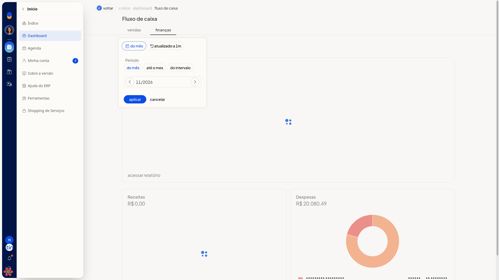

   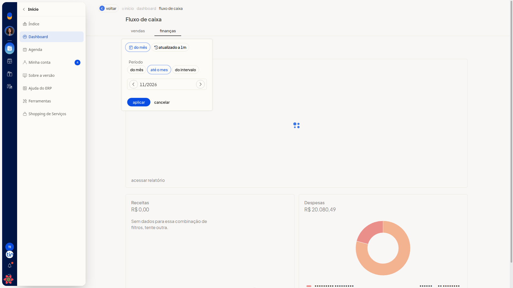

   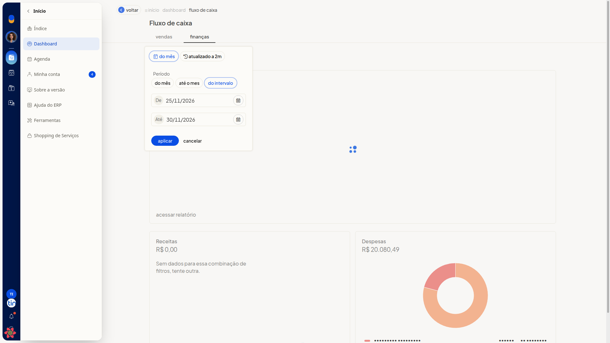

   

5. Clique em **Aplicar**. O gráfico de receitas e despesas é recalculado e o rótulo do período passa a mostrar a escolha. Um intervalo anterior à data atual exibe o aviso **Limite atingido** e a consulta é ajustada.

   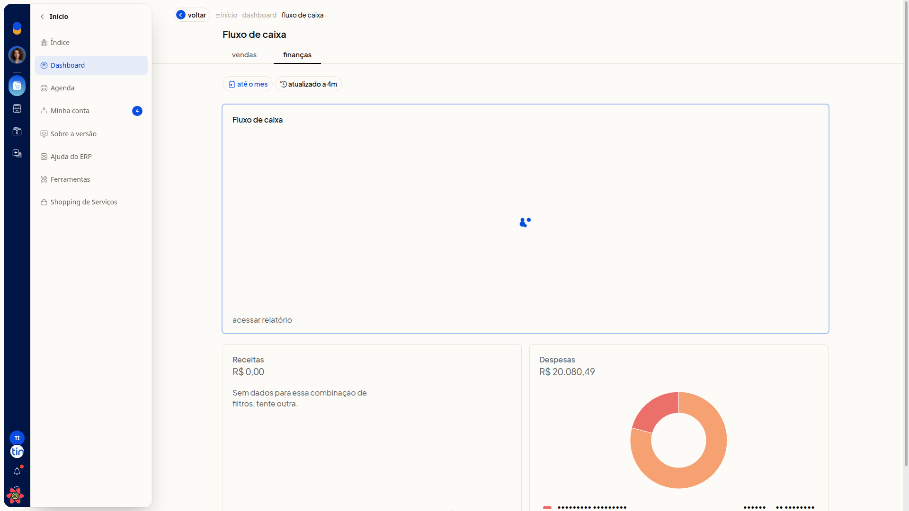

   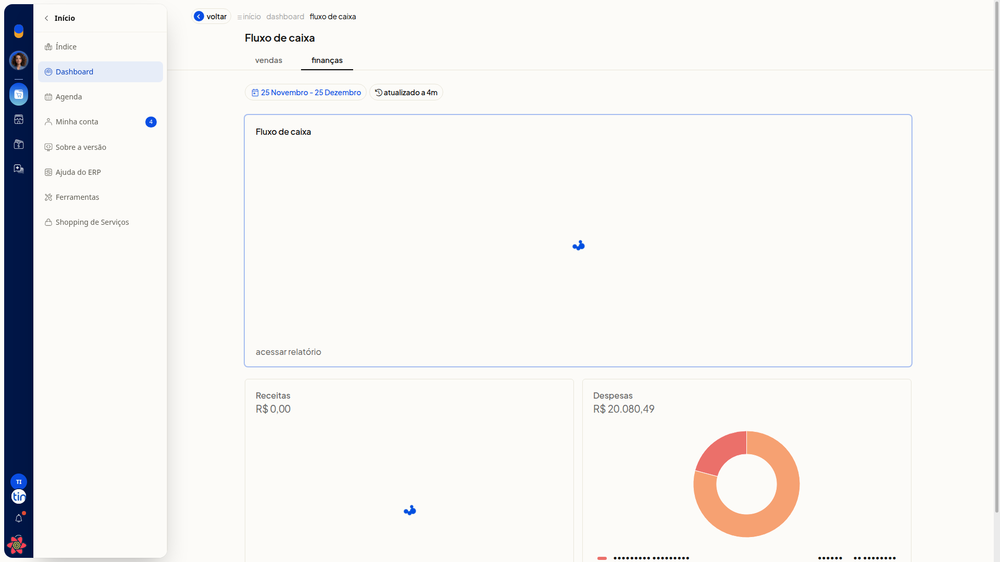

   

### Filtrar Contas a receber e a pagar

1. Acesse **Início > Dashboard** e selecione a aba **Finanças**.
2. No card **Contas a receber e a pagar**, clique em **expandir detalhes**.
3. Clique no período ao lado de **atualizado agora**. Na abertura, o rótulo é **do mês**. Se não houver lançamentos, os totais aparecem zerados, com a mensagem **Sem dados para essa combinação de filtros** e os links **acessar relatório**.

   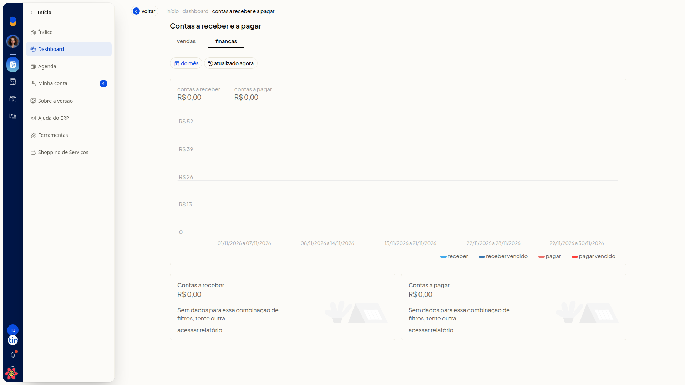

4. Escolha **do mês**, **até o mes** ou **do intervalo**.
 - **do mês**: o mês aparece no formato MM/AAAA.
 - **até o mes**: o mês aparece no formato MM/AAAA.
 - **do intervalo**: preencha **De** e **Até** no formato DD/MM/AAAA. Os campos não são obrigatórios.

   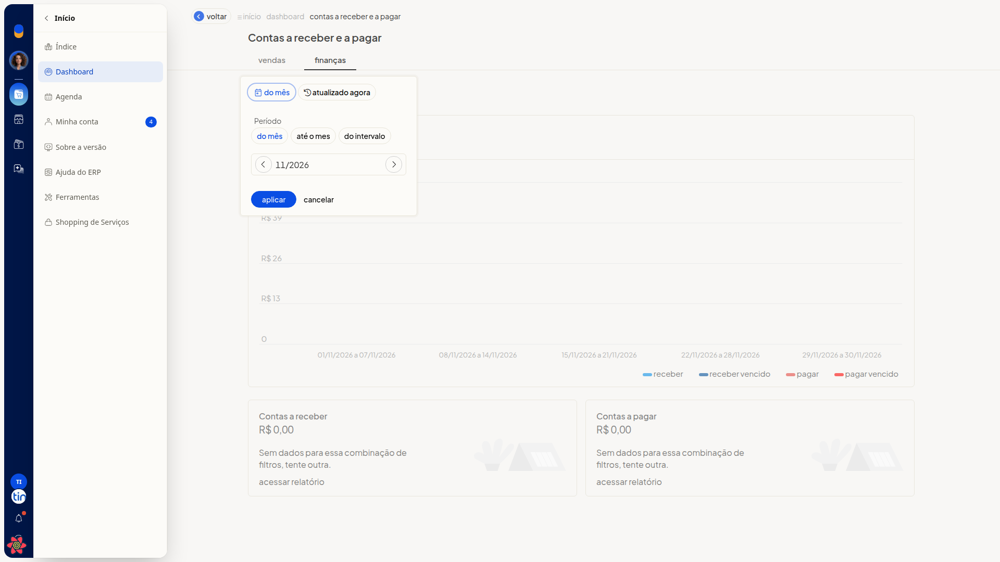

   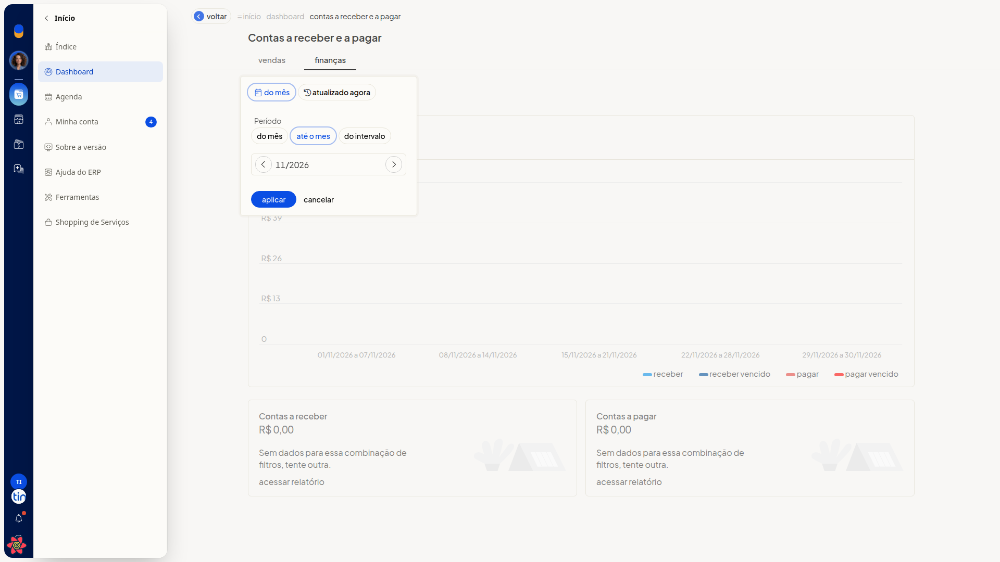

   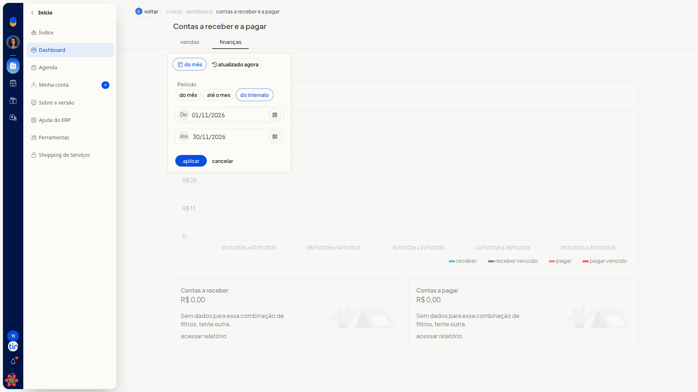

   

5. Clique em **Aplicar**. O gráfico e os totais de contas a receber e a pagar passam a refletir o período, e o rótulo ao lado de **atualizado agora** mostra a escolha.

   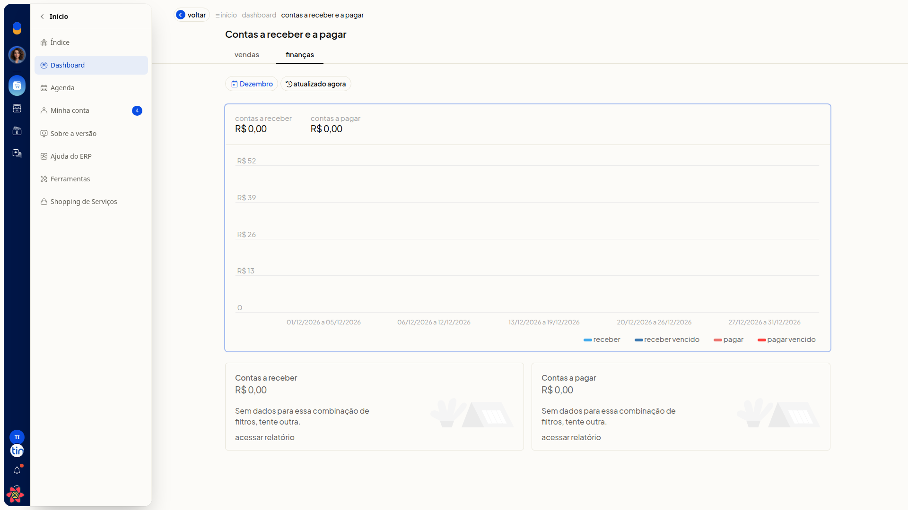

## Resultado
O controle ao lado de **atualizado agora** mostra o período aplicado, como **do mês**, **até o mes**, o nome do mês ou o intervalo. O gráfico do detalhe é recalculado para esse período.

## Informações adicionais
### Os cards resumidos mostram a posição atual

Na **Visão geral**, você consulta **Contas vencendo hoje** e os totais atuais. Em **Saldo atual de contas**, você consulta o saldo atual e pode usar o link **acessar caixa**.

No card resumido **Contas a receber e a pagar**, as faixas são relativas a **Hoje**:

- + 30 dias atrás
- 30 dias atrás
- 15 dias atrás
- 7 dias atrás
- Hoje
- 7 dias
- 15 dias
- 30 dias
- + 30 dias

O filtro por mês ou intervalo só existe em **expandir detalhes**.

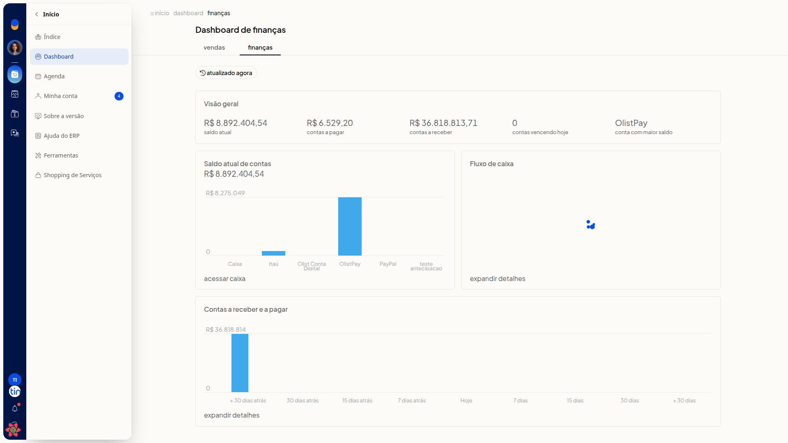

### O último período do Fluxo de caixa permanece na mesma visita

Ao reabrir **Fluxo de caixa** na mesma visita, o último período aplicado continua selecionado.
