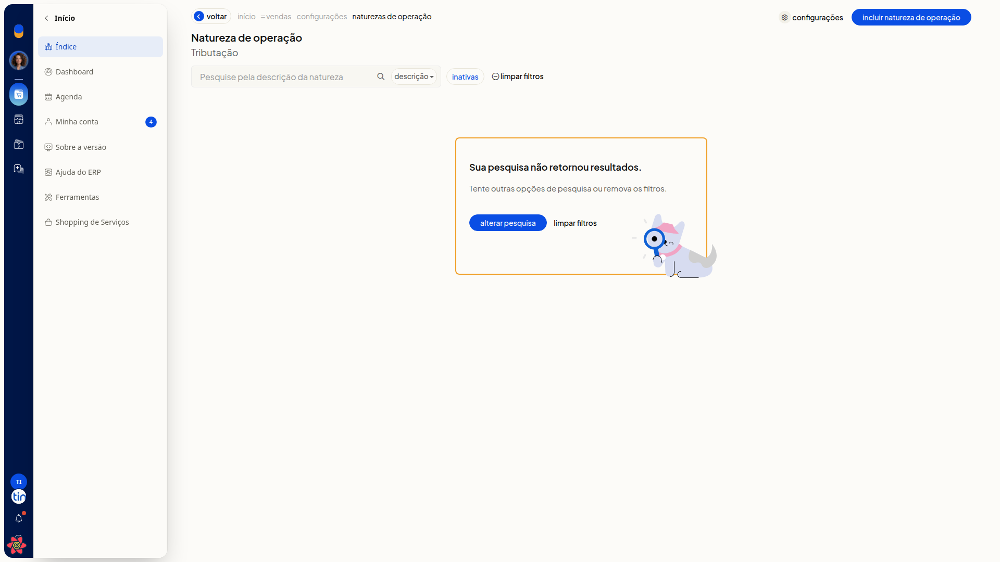
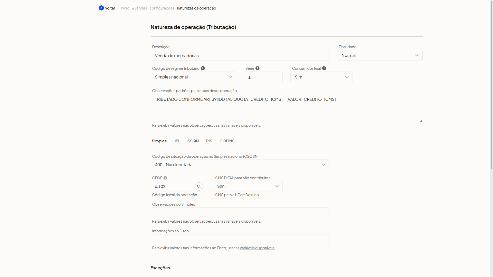
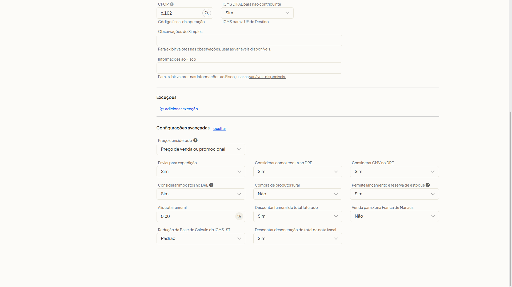
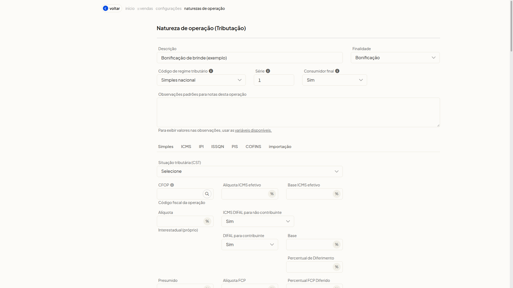
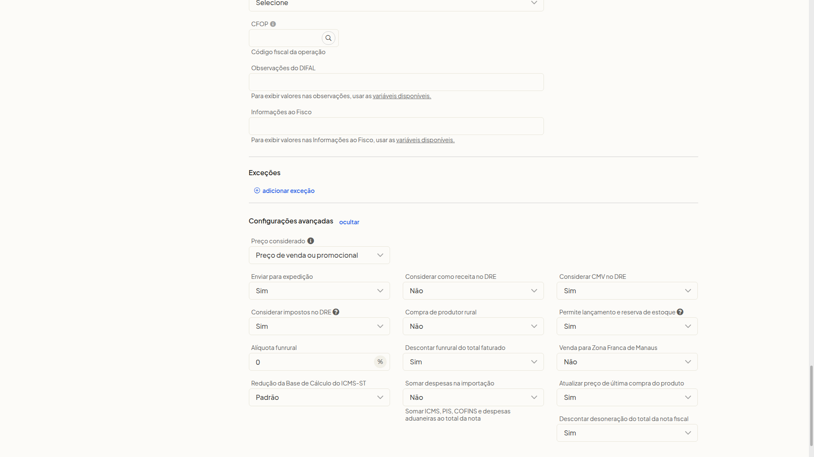
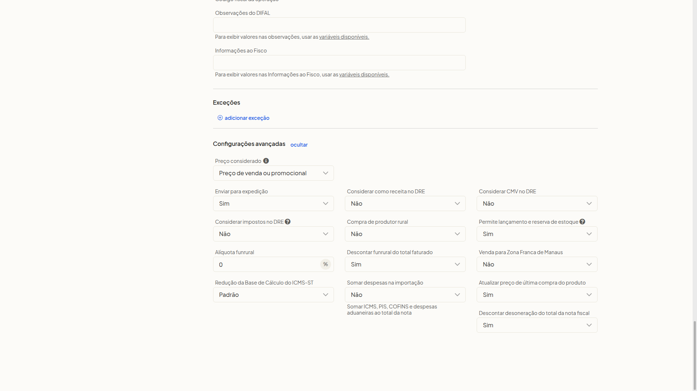

# Definir se os impostos da natureza de operação entram na DRE

No ERP da Olist, o campo **Considerar impostos no DRE** define se os impostos das notas e dos pedidos de uma natureza de operação de saída entram nas deduções do DRE, mesmo quando a operação não é tratada como receita.

Ele fica em **Configurações avançadas**, separado de **Considerar como receita no DRE**, que controla só a receita bruta, e de **Considerar CMV no DRE**. Você define esse valor na natureza já cadastrada ou ao incluir uma natureza, em **Configurações > Configurações ERP > Notas Fiscais > Naturezas de operação de saída (tributação)**.

## Importante
- Em bonificação, doação ou brinde, use **Sim** em **Considerar impostos no DRE** para incluir os impostos nas deduções.
- Meses de DRE já salvos só passam a refletir a alteração depois que os valores forem recalculados.

## Instruções
### Na natureza já cadastrada

1. Acesse **Configurações > Configurações ERP > Notas Fiscais > Naturezas de operação de saída (tributação)**.

   
2. Clique na natureza de saída.

   

3. Em **Configurações avançadas**, clique em **exibir** se a seção estiver recolhida.
4. Em **Considerar impostos no DRE**, selecione **Sim** ou **Não**. O campo não é obrigatório.

   

5. Clique em **Salvar**.

### Ao incluir uma natureza

1. Acesse **Configurações > Configurações ERP > Notas Fiscais > Naturezas de operação de saída (tributação)**.
2. Clique em **Incluir natureza de operação**.
3. Informe a **Descrição** e selecione a **Finalidade** (**Normal**, **Devolução**, **Bonificação** ou **Remessa**). Os dois campos não são obrigatórios.

   

4. Em **Configurações avançadas**, clique em **exibir** se a seção estiver recolhida.
5. Confira **Considerar impostos no DRE** e selecione **Sim** ou **Não** se o padrão não servir. O campo não é obrigatório. A **Finalidade** preenche os três campos, e você pode alterar cada um antes de salvar.
 - **Normal** deixa os três campos em **Sim**.
 - **Bonificação** deixa **Considerar como receita no DRE** em **Não** e deixa **Considerar CMV no DRE** e **Considerar impostos no DRE** em **Sim**.
 - **Remessa** e **Devolução** deixam os três campos em **Não**.

   

   

   

6. Clique em **Salvar**.

## Informações adicionais
### Impostos e estorno seguem o campo

Os impostos da nota fiscal, do pedido de venda e o estorno das devoluções entram nas deduções do DRE conforme **Considerar impostos no DRE**.

### Nota de bonificação com o campo em Sim

Em uma nota de bonificação de R$ 1.000,00, com ICMS de R$ 180,00 e custo de R$ 600,00, **Considerar impostos no DRE** em **Sim** deixa as deduções em R$ 180,00, o CMV em R$ 600,00 e o resultado em -R$ 780,00.
