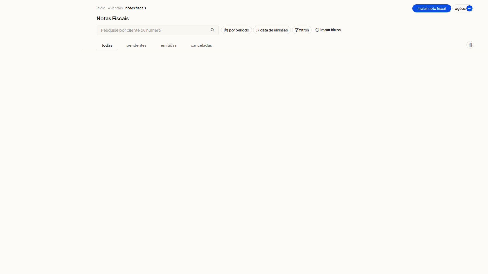
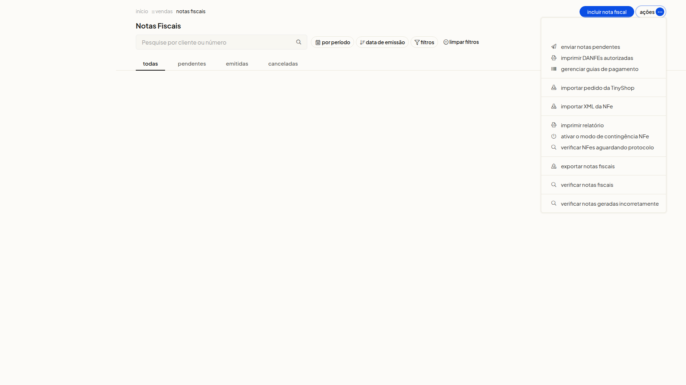
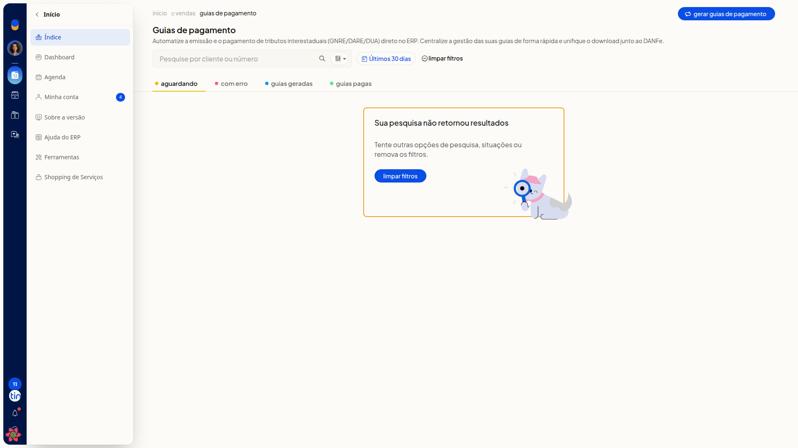
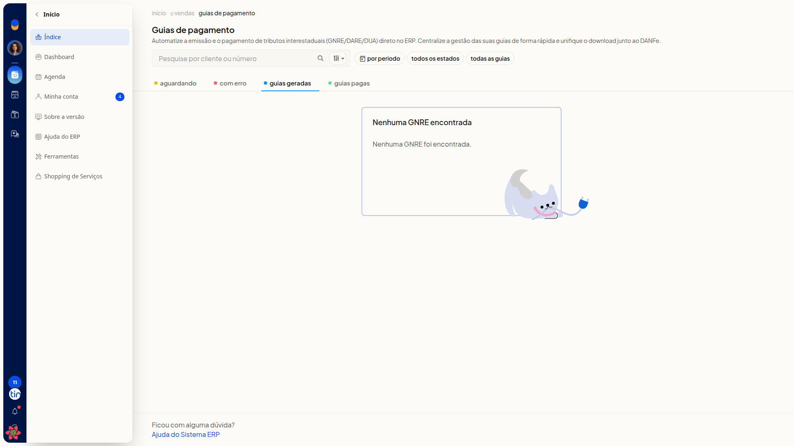
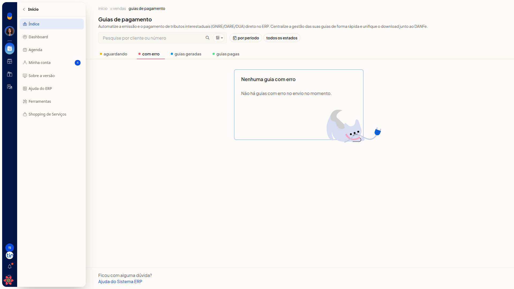
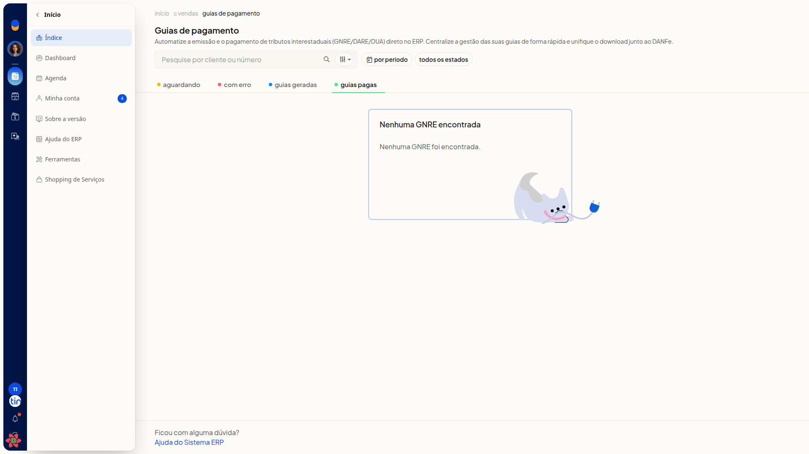

# Pagar guias GNRE com a conta digital ou marcá-las como pagas manualmente

A tela **Guias de pagamento** consulta as guias GNRE por situação. Você acompanha cada guia e pode pagá-la com a Conta Digital da Olist ou marcá-la como paga manualmente.

## Importante
- A guia só pode ser paga com a Conta Digital.
- **Marcar como pago manualmente** não movimenta a Conta Digital.
- Na janela de guias de pagamento não há seletor de meio de pagamento.
- Sem guias, as ações de pagamento não aparecem.

## Instruções
1. Acesse **Vendas > Notas Fiscais**.

   

2. Clique em **Ações**.

   

3. Clique em **gerenciar guias de pagamento**.

   

4. Consulte as abas **Aguardando**, **Com erro**, **Guias geradas** e **Guias pagas**.

   

   

   

5. Se precisar, filtre por período (**Sem filtro**, **Período**, **Mês**, **Últimos 30 dias** ou **Data**) ou por estado. Para remover o filtro, clique em **Limpar filtros**.
6. Se precisar, busque com as opções **número**, **cliente** ou **Não refinar**.
7. Clique em **Pagar com conta digital** ou em **Marcar como pago manualmente**. As duas ações abrem o modal de pagamento de **Contas a Pagar**.

## Informações adicionais
### A aba sem guias exibe uma mensagem

- Na aba **Aguardando**, a pesquisa sem resultados mostra **Sua pesquisa não retornou resultados**. Depois de **Limpar filtros**, a mensagem é **Nenhuma GNRE encontrada**.
- Nas abas **Guias geradas** e **Guias pagas**, a mensagem é **Nenhuma GNRE encontrada**.
- Na aba **Com erro**, a mensagem é **Nenhuma guia com erro**.
