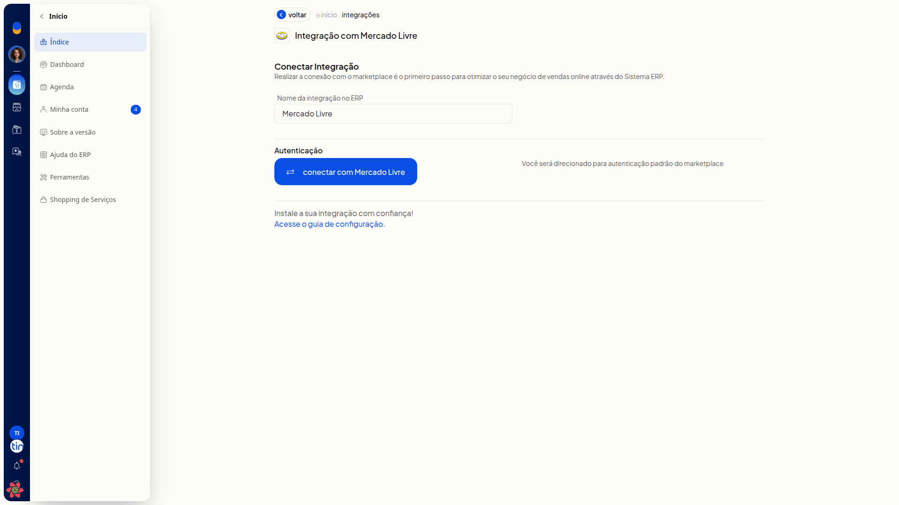
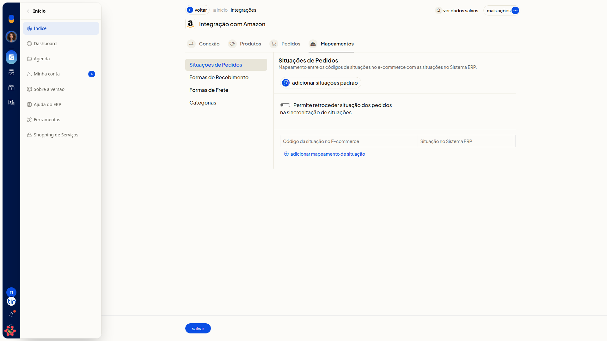
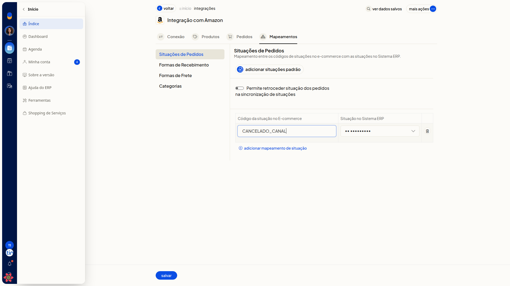

# Configurar o status Em devolução e o estorno de estoque em pedidos cancelados

No mapeamento de situações de pedidos, você associa o código de situação do ecommerce a uma situação do ERP da Olist. Você pode apontar esse código para **Em devolução**.

O mapeamento fica na integração já cadastrada, em **Mapeamentos > Situações de Pedidos**.

## Pré-requisitos
- A integração já precisa estar na lista de **Integrações**.
- Em uma instalação nova de canal do Hub da Olist, a tela para em **Conectar Integração** e o mapeamento de situações não aparece antes da autenticação.

## Instruções
1. Acesse **Integrações** e clique em **gerenciar** na integração já cadastrada.
2. Se a tela abrir em **Conectar Integração**, clique em **Mais ações** e selecione **Ignorar auth check**.
3. Acesse **Mapeamentos > Situações de Pedidos**.

   

4. Clique em **Adicionar mapeamento de situação**.
5. Digite o código da situação do ecommerce em **Código da situação no E-commerce**. O campo não é obrigatório.
6. Selecione **Em devolução** em **Situação no Sistema ERP**. O campo não é obrigatório. A linha nova começa em **Em aberto**. A linha exibe o código digitado e **Em devolução**.

As opções de **Situação no Sistema ERP** são:

- **Selecione**
- **Em aberto**
- **Faturado**
- **Cancelado**
- **Aprovado**
- **Preparando envio**
- **Enviado**
- **Entregue**
- **Pronto para envio**
- **Dados incompletos**
- **Não entregue**
- **Em devolução**

7. Clique em **Salvar**.

## Informações adicionais
### O estoque não é estornado antes da devolução chegar

Enquanto o envio não foi entregue e a devolução ainda não chegou, o ERP aplica o mapeamento e não estorna o estoque.

### O estoque é estornado quando o produto é devolvido

Quando o produto é devolvido, o ERP considera a situação do pedido e estorna o estoque.
