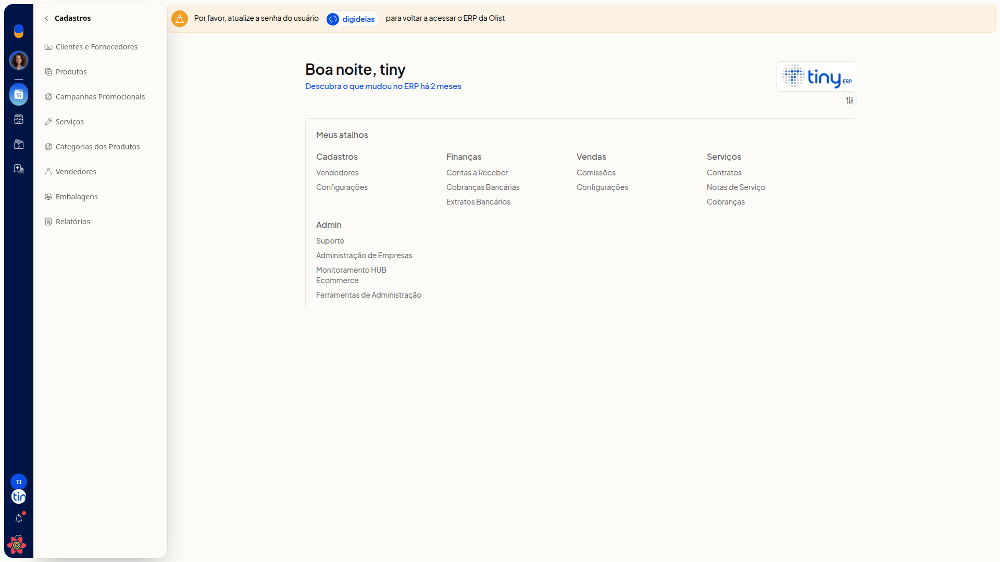
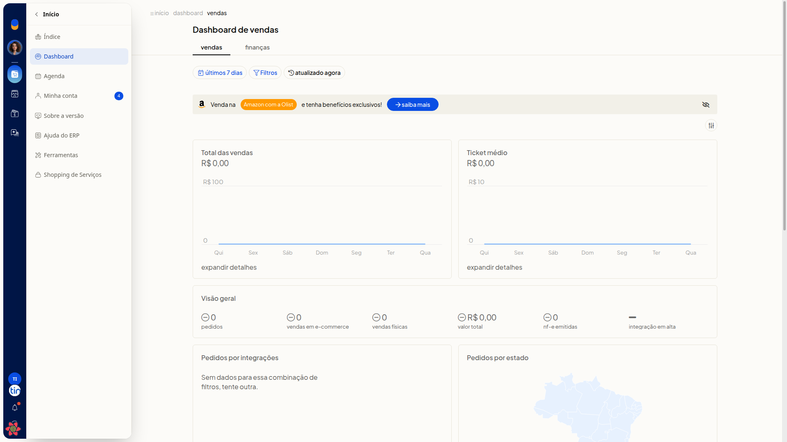

# Encontrar o gerenciador de preços e a calculadora de preços do Hub

## Pré-requisitos
- A tela só abre para empresas com anúncios liberados.

## Importante
- Na barra de produtos à esquerda aparecem **Olist**, **Lis**, **ERP**, **PDV** e **Conta Digital**. O Hub não aparece: ele está entre os produtos ocultos, e o atalho não abre o Hub.

## Instruções
1. No menu superior do ERP, clique em **Cadastros**.
2. Confira a lista do submenu. Os itens são **Clientes e Fornecedores**, **Produtos**, **Campanhas Promocionais**, **Serviços**, **Categorias dos Produtos**, **Vendedores**, **Embalagens** e **Relatórios**. Não há **Anúncios** nem **Gerenciador de preços**.

   

3. No menu superior, clique em **Vendas**.
4. Confira a lista do submenu. Não há **Anúncios**, **Gerenciador de preços** nem item de calculadora. **Pedidos de Venda** aparece entre os itens de vendas.

   

5. Acesse **Início > Dashboard**.
6. Confira o **Dashboard de vendas**. O único banner com texto é o promocional da Amazon. Não há texto de descontinuação nem menção a Pedidos Hub, Dashboard Hub, **Anúncios**, **Gerenciador de preços**, calculadora ou Mercado Livre.

   

## Resultado
O submenu **Cadastros** não oferece **Anúncios** nem **Gerenciador de preços**. A calculadora de preços não é alcançada por **Cadastros**, por **Vendas** nem pelo **Dashboard de vendas**.
