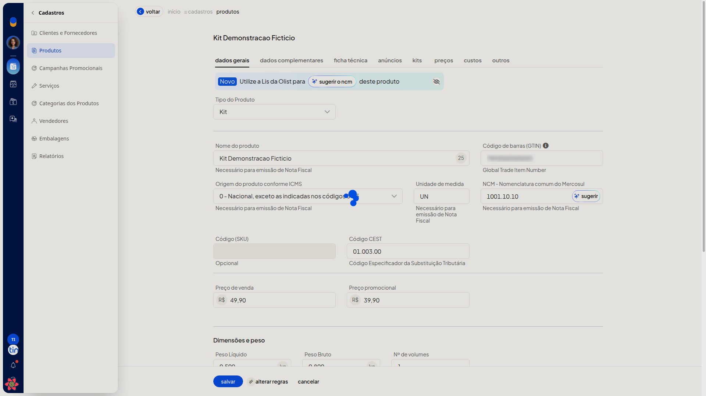
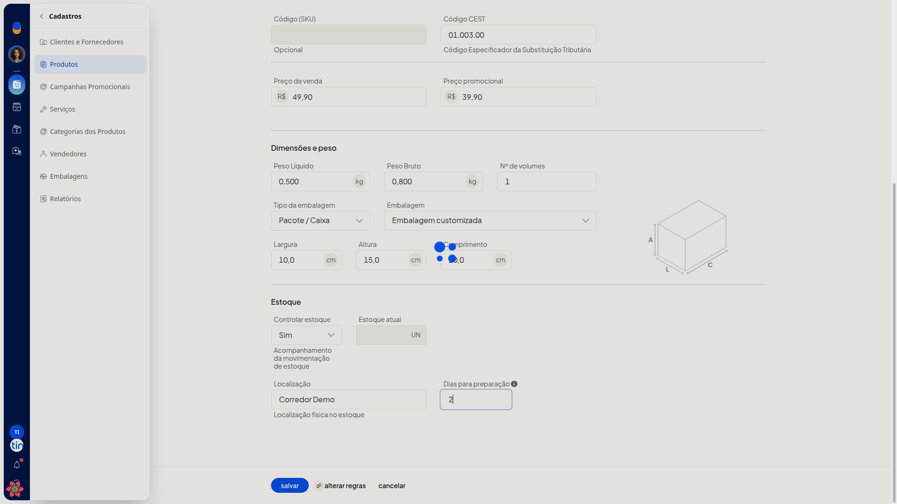
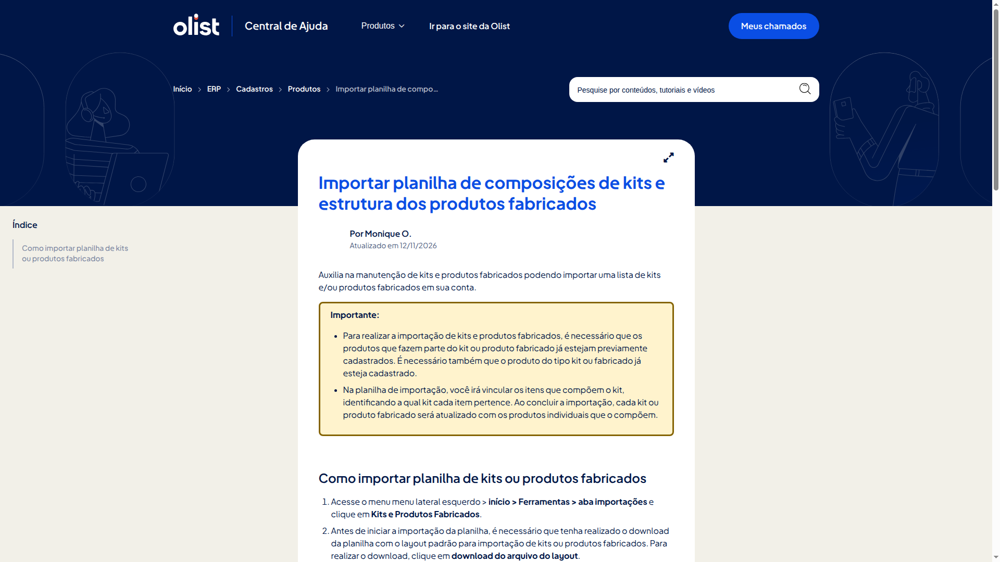
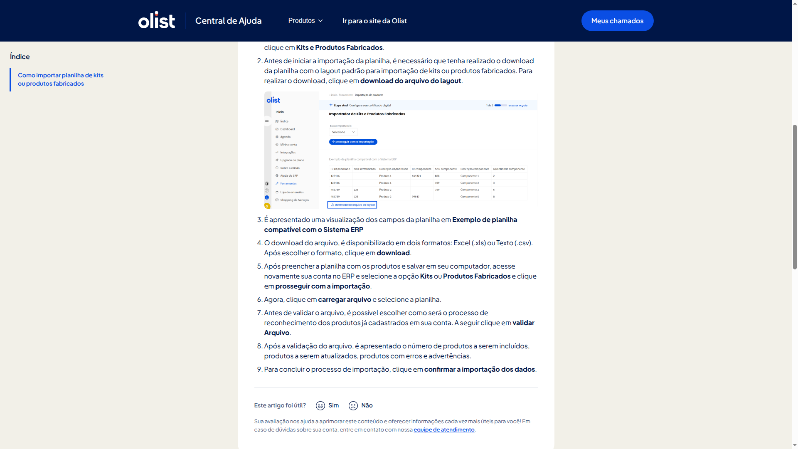

# Calcular o saldo do kit pelos componentes sem usar a multiempresa

O saldo do kit é calculado pelo menor saldo entre os componentes. Esse cálculo é o padrão e não exige ativar a multiempresa. Vender um componente baixa o saldo disponível do kit automaticamente.

A ficha do kit e a planilha de composição não têm um campo para ligar ou desligar esse cálculo. Você cadastra o kit, informa o estoque do próprio kit e vincula os componentes pela aba **Kits** ou pela planilha de composição.

## Importante
- Para importar a composição, o produto do tipo kit ou fabricado e os componentes já precisam estar cadastrados.

## Instruções
### Pela tela do kit

1. Na listagem de produtos, clique em **Incluir produto**.
2. Em **Tipo do Produto**, selecione **Kit**.

   

3. Na seção **Estoque** de **Dados Gerais**, informe o estoque do próprio kit.
 - **Controlar estoque**: não obrigatório. Selecione **Sim** ou **Não**.
 - **Estoque atual**: não obrigatório.
 - **Localização**: não obrigatório.
 - **Dias para preparação**: não obrigatório. Informe um número inteiro de dias.

   

4. Na aba **Kits**, informe cada componente.
 - **Produto ou SKU**: não obrigatório. Use um produto já cadastrado. Um código inexistente exibe **Produto não encontrado no sistema**.
 - **Quantidade**: não obrigatório. Informe a quantidade e a unidade, por exemplo 1 UN.
5. Clique em **Salvar**.

### Por planilha de composição

1. No menu lateral esquerdo, acesse **início > Ferramentas > aba importações** e clique em **Kits e Produtos Fabricados**.

   

2. Baixe o layout padrão em Excel (.xls) ou texto (.csv).
3. Na planilha de produtos, informe a letra **K** na coluna **Tipo de Produto** para cada item vendido como kit. A letra **K** é obrigatória. A composição vai em planilha separada.
4. Na planilha de composição, preencha as colunas abaixo. Nenhuma é obrigatória. Essa planilha vincula os produtos que compõem cada kit e a quantidade de cada um.
 - **ID kit/fabricado**
 - **SKU kit/fabricado**
 - **Descrição kit/fabricado**
 - **ID componente**
 - **SKU componente**: o componente precisa já estar cadastrado
 - **Descrição componente**
 - **Quantidade componente**

   

## Informações adicionais
### Criação e atualização do kit por canal

- Interface/Tela: criar sim, atualizar sim
- Lote (Planilha): criar não, atualizar sim
- API V3: criar não, atualizar sim
- Lis: criar não, atualizar sim
