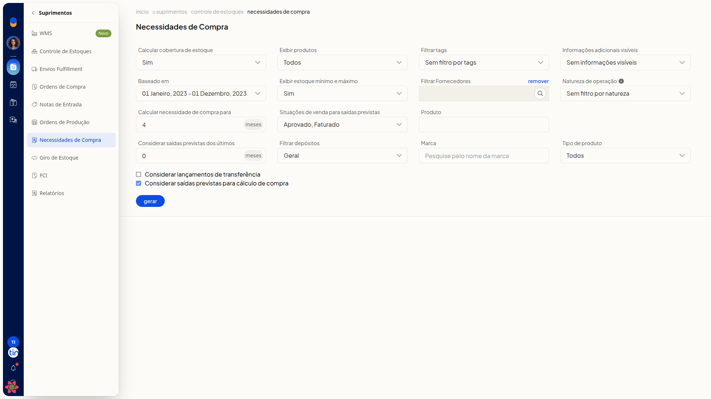
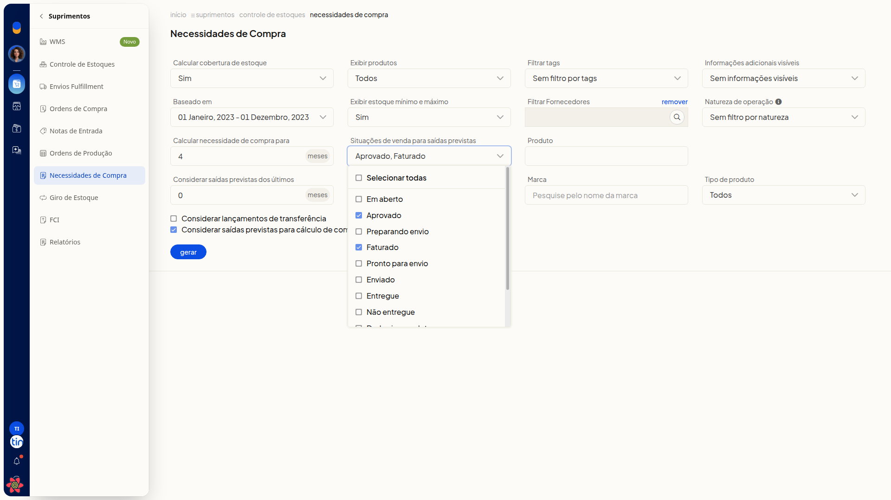
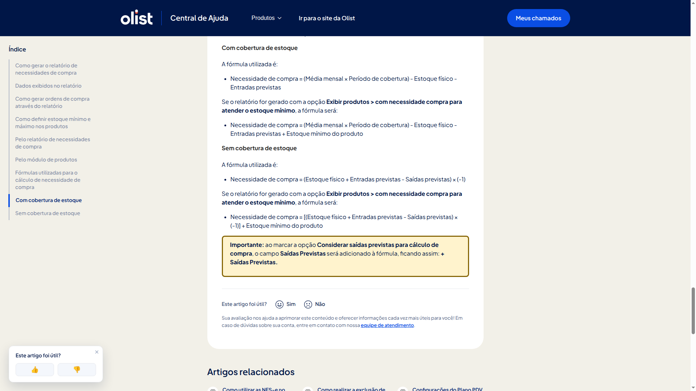
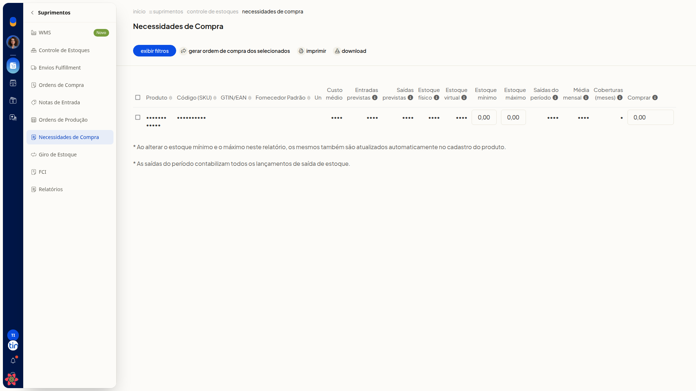
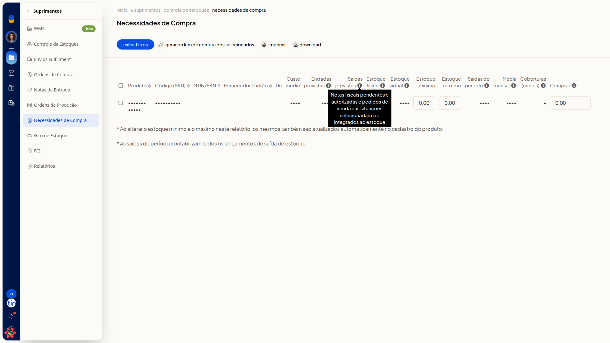
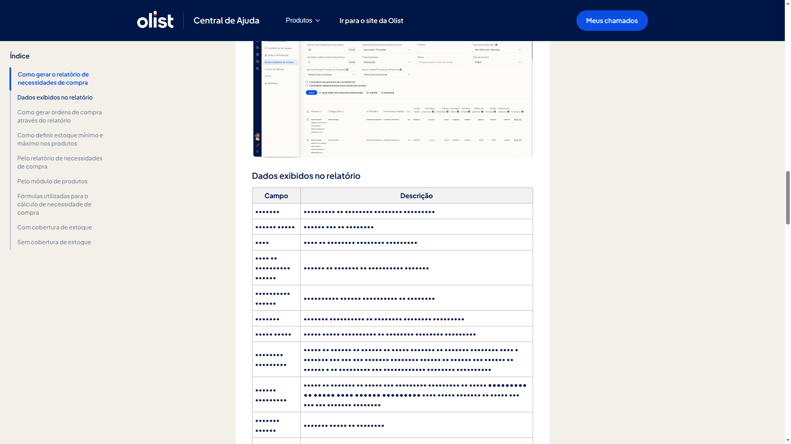

# Entender as saídas previstas no relatório de necessidade de compra

No relatório de Necessidades de Compra do ERP da Olist, a coluna **Saídas previstas** mostra, por produto, as saídas que ainda não entraram no estoque. Você pode usar esse valor para decidir a compra.

A coluna reúne os pedidos de venda das situações marcadas no filtro e as notas fiscais pendentes e autorizadas ainda não integradas ao estoque. Você escolhe essas situações, limita a quantidade de meses e pode incluir as saídas previstas no cálculo de compra. O relatório fica em **Suprimentos > Necessidades de Compra**.

## Importante
- Não há filtro separado de situação da nota nesta tela.
- Notas fiscais com estoque estornado não entram nas saídas previstas.
- Alterar o estoque mínimo ou o estoque máximo neste relatório também atualiza o cadastro do produto. Consultar a coluna **Saídas previstas** não exige editar esses campos.

## Instruções
1. No menu lateral, acesse **Suprimentos > Necessidades de Compra**.
2. Confira o filtro **Situações de venda para saídas previstas**. O filtro não é obrigatório e exibe as situações marcadas.

   

3. Abra a lista e marque as situações de venda que devem entrar como pedidos. Só as situações marcadas entram na coluna. Deixe **Cancelado** desmarcado se não quiser considerar pedidos cancelados. Marque **Cancelado** se quiser incluí-los.

A lista traz:

- **Selecionar todas**
- **Em aberto**
- **Aprovado**
- **Preparando envio**
- **Faturado**
- **Pronto para envio**
- **Enviado**
- **Entregue**
- **Não entregue**
- **Dados incompletos**
- **Em devolução**
- **Cancelado**

4. Para limitar o período, digite a quantidade de meses em **Considerar saídas previstas dos últimos**. O campo não é obrigatório.
5. Mantenha ou desmarque **Considerar saídas previstas para cálculo de compra**. A opção não é obrigatória. Com a opção marcada, o ERP inclui a saída prevista no cálculo de compra, para considerar pedidos que ainda não tiveram saída efetiva do estoque.

   

6. Clique em **Gerar**.
7. Leia a coluna **Saídas previstas**. A coluna mostra um valor numérico por produto, com as saídas ainda não integradas ao estoque. Você pode usar esse valor no cálculo de compra.

   

8. Veja o ícone de informação ao lado de **Saídas previstas**. O texto informa: Notas fiscais pendentes e autorizadas e pedidos de venda nas situações selecionadas não integrados ao estoque.

   

   

9. Para reabrir os filtros, clique em **Exibir filtros**.
10. Para levar o relatório já gerado para fora da tela, clique em **Imprimir** ou em **Download**.

## Resultado
Depois de gerar, a tabela mostra **Saídas previstas** com um valor numérico por produto, ao lado de **Entradas previstas**, **Estoque físico** e **Estoque virtual**. O valor reúne os pedidos nas situações de venda escolhidas e as notas fiscais pendentes e autorizadas ainda não integradas ao estoque.

## Informações adicionais
### Saídas do período contabilizam os lançamentos de saída de estoque

A coluna **Saídas do período** é outra coluna do relatório e contabiliza todos os lançamentos de saída de estoque.
