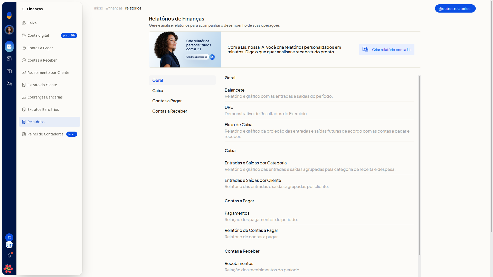
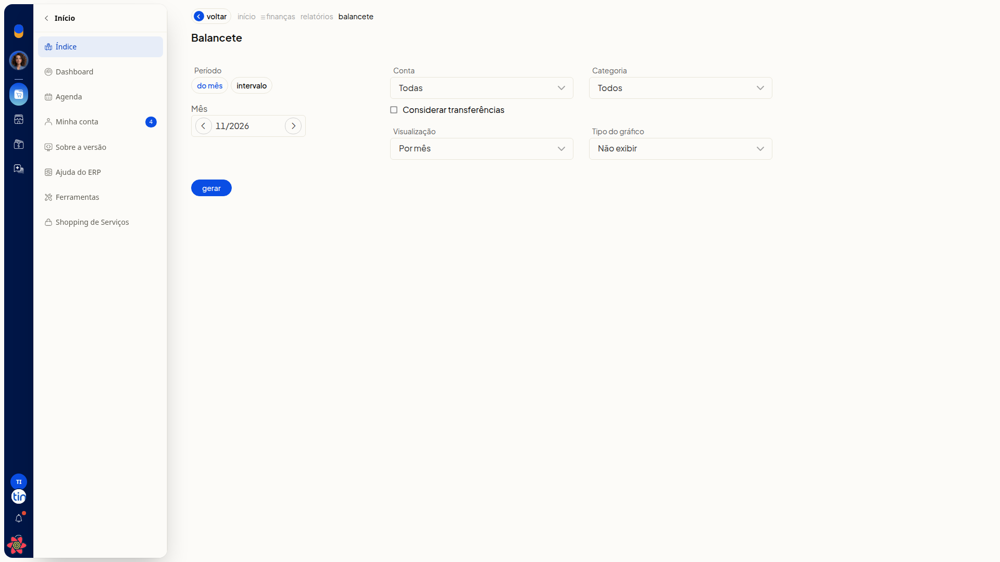
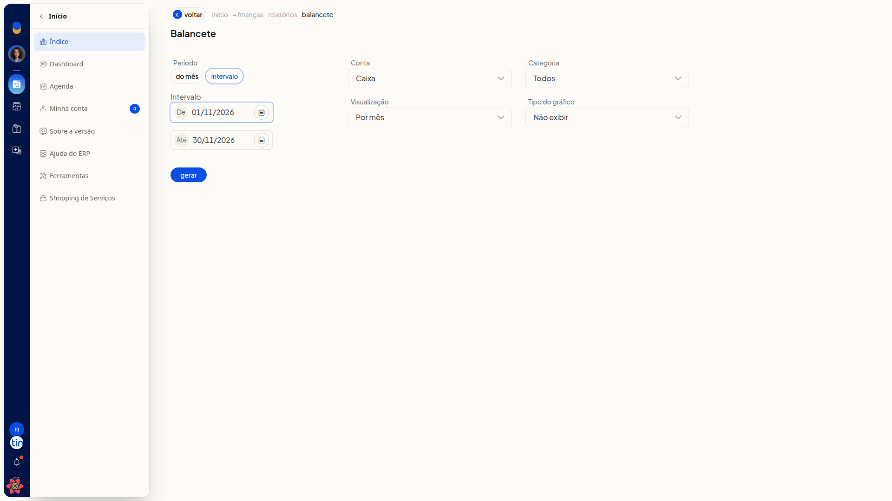
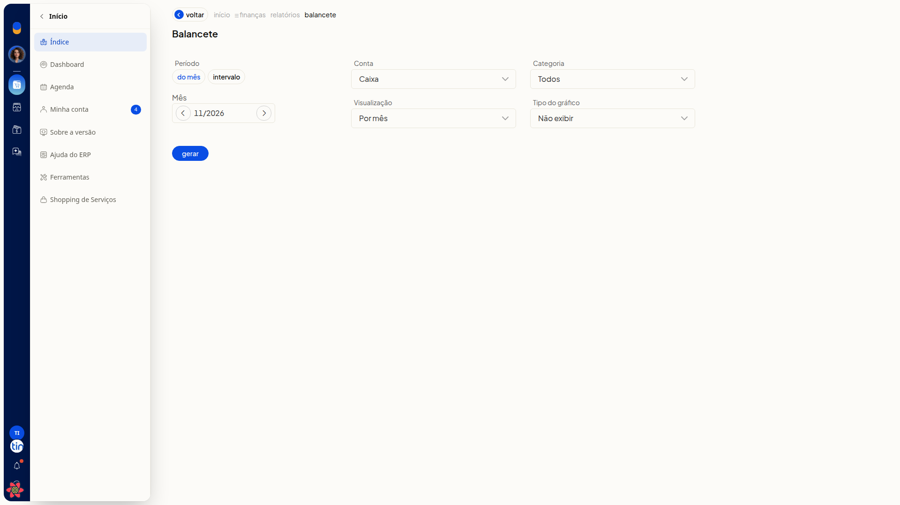

# Filtrar o Balancete por mais de uma conta financeira

No Balancete, em **Finanças > Relatórios**, você vê as entradas e saídas de um mês ou de um intervalo. Você prepara o relatório para todas as contas financeiras ou para uma única conta.

## Importante
- Não é possível filtrar por mais de uma conta ao mesmo tempo. Em **Conta**, a lista aceita só **Todas** ou uma conta financeira.
- **Considerar transferências** só aparece quando **Conta** está em **Todas**.

## Instruções
1. Acesse **Finanças > Relatórios**.

   

2. Abra **Balancete**.

   

3. Em **Período**, mantenha **do mês** e confira **Mês**. O campo não é obrigatório. Use o formato MM/AAAA.

4. Para um intervalo, clique em **intervalo** e informe **De** e **Até**. Os campos não são obrigatórios. Use o formato DD/MM/AAAA.

   

5. Em **Conta**, escolha **Todas** ou uma conta financeira. Com uma conta específica, **Conta** mostra só essa conta.

   

6. Se **Conta** estiver em **Todas**, marque ou desmarque **Considerar transferências** para incluir ou não as transferências.

7. Clique em **gerar** para montar o balancete com todas as contas ou com a conta escolhida.
