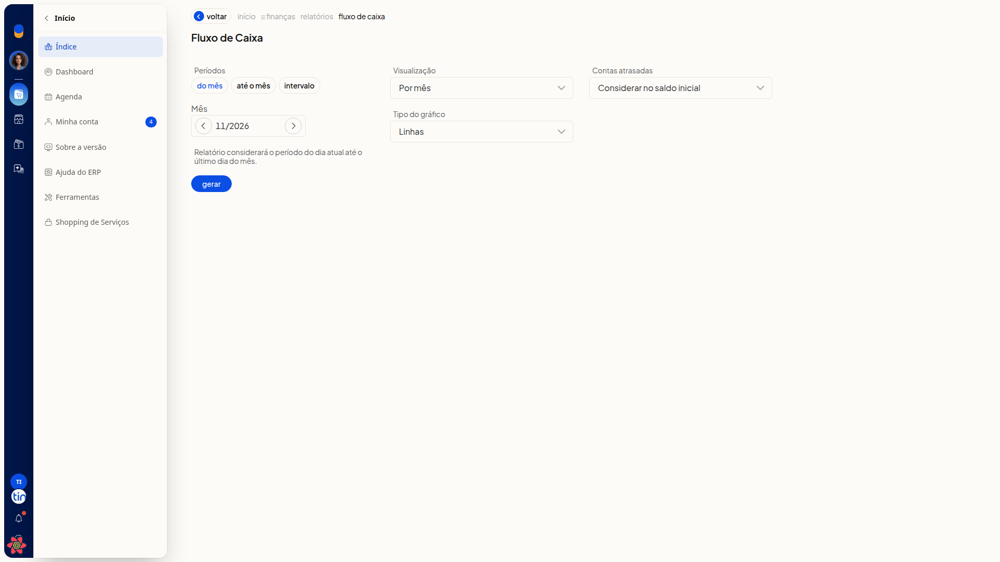
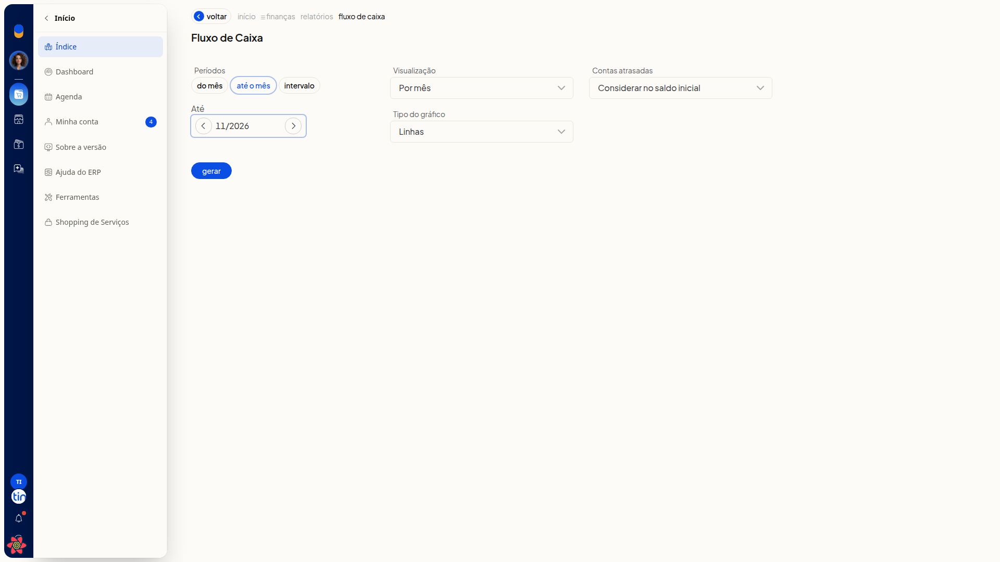
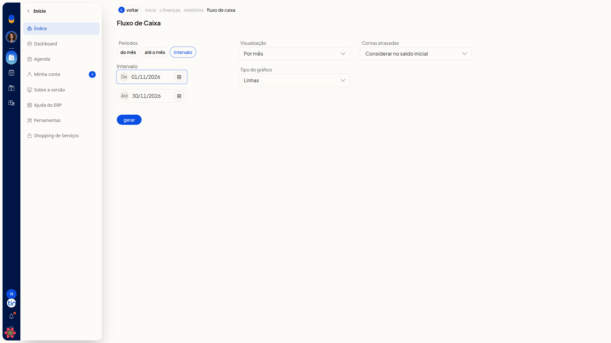

# Gerar o fluxo de caixa de contas financeiras específicas

No ERP da Olist, o **Fluxo de Caixa** prepara a projeção de um mês, até um mês ou de um intervalo. Você escolhe a visualização, o tipo de gráfico e se contas atrasadas entram no saldo inicial.

Em **Finanças > Relatórios**, a tela não tem filtro de conta financeira. Você não consegue limitar o fluxo a uma conta ou a várias contas específicas.

## Importante
- Para gerar com **Visualização** em **Por dia**, o intervalo não pode ser maior que 2 meses.
- Para gerar com **Visualização** em **Por semana**, o intervalo não pode ser maior que 6 meses.
- **Contas atrasadas** trata lançamentos em atraso no saldo inicial. Não substitui um filtro de conta financeira.

## Instruções
1. Acesse **Finanças > Relatórios**.
2. Na lista de relatórios, abra **Fluxo de Caixa**.

   

3. Em **Período**, selecione **do mês**, **até o mês** ou **intervalo** e informe a data. Os campos de data não são obrigatórios.
 - Em **do mês**, preencha **Mês** no formato MM/AAAA.
 - Em **até o mês**, preencha o mês em **Até**.
 - Em **intervalo**, preencha **De** e **Até** no formato DD/MM/AAAA.

   

   

4. Ajuste **Visualização**, **Tipo do gráfico** e **Contas atrasadas**. Nenhum desses campos é obrigatório.
 - Em **Visualização**, selecione **Automática**, **Por dia**, **Por semana** ou **Por mês**.
 - Em **Tipo do gráfico**, selecione **Não exibir**, **Linhas** ou **Barras**.
 - Em **Contas atrasadas**, selecione **Considerar no saldo inicial** ou **Não considerar**.
5. Clique em **gerar** para concluir a geração no período escolhido, sem restrição a contas financeiras específicas.
