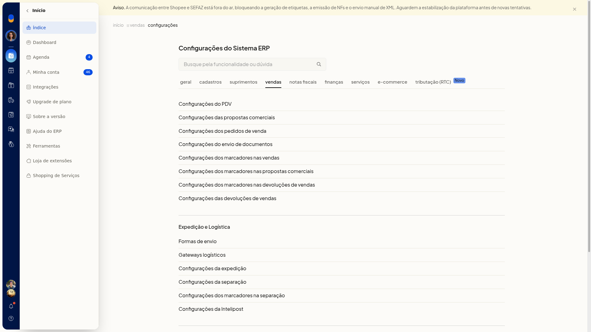
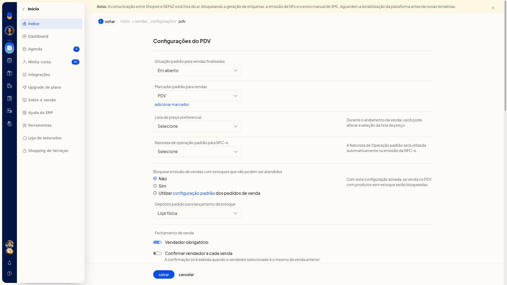
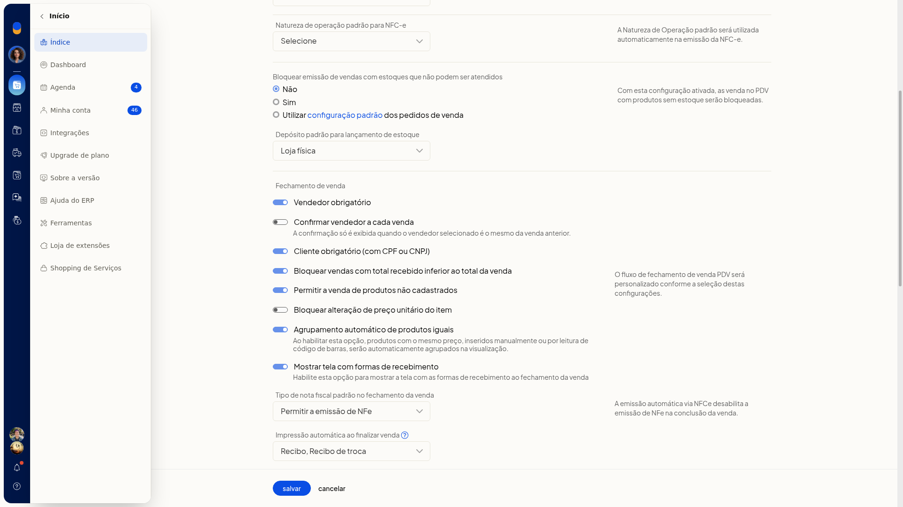
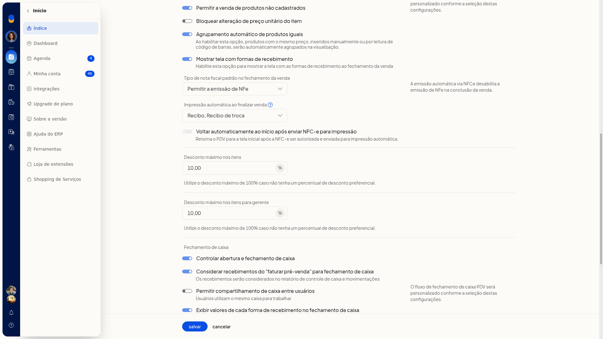
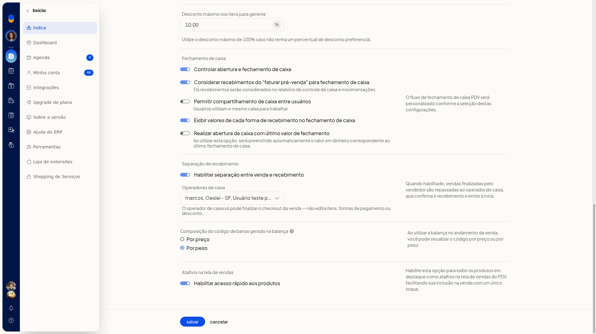

# Configurar o PDV

No PDV da Olist, você define as regras da loja física numa única tela: a natureza de operação usada automaticamente na NFC-e, o depósito padrão do estoque e o fechamento da venda e do caixa. Também é possível escolher situação, marcador, lista de preço, impressão, desconto, separação de recebimento, balança e atalhos de produtos.

A tela fica em **Configurações > Configurações ERP**, na categoria **Vendas**.

## Importante
- Natureza de operação, depósito, lista de preço, marcador e operadores de caixa não são criados nesta tela. As listas mostram registros já cadastrados. Para incluir um marcador, use o link **adicionar marcador**, ao lado de **Marcador padrão para vendas**.
- Com **Vendedor obrigatório**, a venda só é concluída se o vendedor for informado. A confirmação do vendedor só aparece quando o vendedor selecionado é o mesmo da venda anterior.
- Com **Cliente obrigatório (com CPF ou CNPJ)**, o cliente precisa ter CPF ou CNPJ informado para concluir a venda.
- A emissão automática pela NFCe desabilita a emissão de NFe na conclusão da venda.
- Com **Habilitar separação entre venda e recebimento**, a venda finalizada pelo vendedor é repassada ao operador de caixa, que confirma o recebimento e emite a nota. O operador de caixa não edita itens, formas de pagamento nem desconto.

## Instruções
Os campos desta tela não são obrigatórios.

1. Acesse **Configurações > Configurações ERP**.
2. Na categoria **Vendas**, clique em **Configurações do PDV**.

   

#### Venda, nota e estoque

3. Em **Situação padrão para vendas finalizadas**, escolha **Em aberto**, **Aprovado**, **Preparando envio**, **Faturado**, **Pronto para envio**, **Enviado** ou **Entregue**.
4. Em **Marcador padrão para vendas**, escolha **Sem marcador** ou um marcador já cadastrado.
5. Em **Lista de preço preferencial**, escolha **Selecione** ou uma lista já cadastrada. A lista pode ser alterada durante a venda. Esta opção não aparece para empresas com PAF-NFC-e.
6. Em **Natureza de operação padrão para NFC-e**, escolha uma natureza já cadastrada ou deixe **Selecione**. A natureza padrão é usada automaticamente na emissão da NFC-e.
7. Em **Depósito padrão para lançamento de estoque**, escolha o depósito das movimentações do PDV.
8. Em **Bloquear emissão de vendas com estoques que não podem ser atendidos**, escolha **Não**, **Sim** ou **Utilizar configuração padrão dos pedidos de venda**. Com **Sim**, a venda no PDV de produtos sem estoque é bloqueada.

   

#### Fechamento de venda

9. Marque as regras de fechamento que deseja usar. O fluxo de fechamento de venda do PDV segue essa seleção.
 - **Vendedor obrigatório**
 - **Confirmar vendedor a cada venda**
 - **Cliente obrigatório (com CPF ou CNPJ)**
 - **Bloquear vendas com total recebido inferior ao total da venda**
 - **Permitir a venda de produtos não cadastrados**
 - **Bloquear alteração de preço unitário do item**
 - **Agrupamento automático de produtos iguais**: produtos com o mesmo preço, inseridos manualmente ou por código de barras, são agrupados na visualização
 - **Mostrar tela com formas de recebimento**: exibe as formas de recebimento ao fechar a venda

   

10. Em **Tipo de nota fiscal padrão no fechamento da venda**, escolha **Emitir automaticamente a NFCe** ou **Permitir a emissão de NFe**.
11. Em **Impressão automática ao finalizar venda**, marque **Recibo**, **NFCe** e **Recibo de troca**. Use **Selecionar todas as opções** para marcar as três.
12. Marque **Voltar automaticamente ao início após enviar NFC-e para impressão** se quiser que o PDV volte à tela inicial depois que a NFC-e for autorizada e enviada para impressão automática.
13. Em **Desconto máximo nos itens** e em **Desconto máximo nos itens para gerente**, digite o percentual com vírgula decimal. Use 100% se não houver percentual preferencial.

   

#### Fechamento de caixa

14. Marque como o caixa deve funcionar. O fluxo de fechamento de caixa do PDV segue essa seleção.
 - **Controlar abertura e fechamento de caixa**
 - **Considerar recebimentos do "faturar pré-venda" para fechamento de caixa**: esses recebimentos entram no relatório de controle de caixa e movimentações. A opção não aparece para empresas com PAF-NFC-e. Se ela não aparecer para você, peça acesso ao administrador da conta.
 - **Permitir compartilhamento de caixa entre usuários**: quem opera o PDV usa o mesmo caixa
 - **Exibir valores de cada forma de recebimento no fechamento de caixa**
 - **Realizar abertura de caixa com último valor de fechamento**: preenche o dinheiro do último fechamento de caixa

#### Separação, balança e atalhos

15. Marque **Habilitar separação entre venda e recebimento** se a venda e o recebimento forem feitos por pessoas diferentes.
16. Em **Operadores de caixa**, marque quem já está cadastrado na conta. Use **Selecionar todos** para marcar toda a lista.
17. Em **Composição do código de barras gerado na balança**, escolha **Por preço** ou **Por peso**.
18. Marque **Habilitar acesso rápido aos produtos** para exibir produtos em destaque como atalhos na tela de vendas do PDV. A seção se chama **Atalhos na tela de vendas**.

   

19. Clique em **Salvar** para gravar as regras do PDV ou em **Cancelar** para sair sem gravar.
