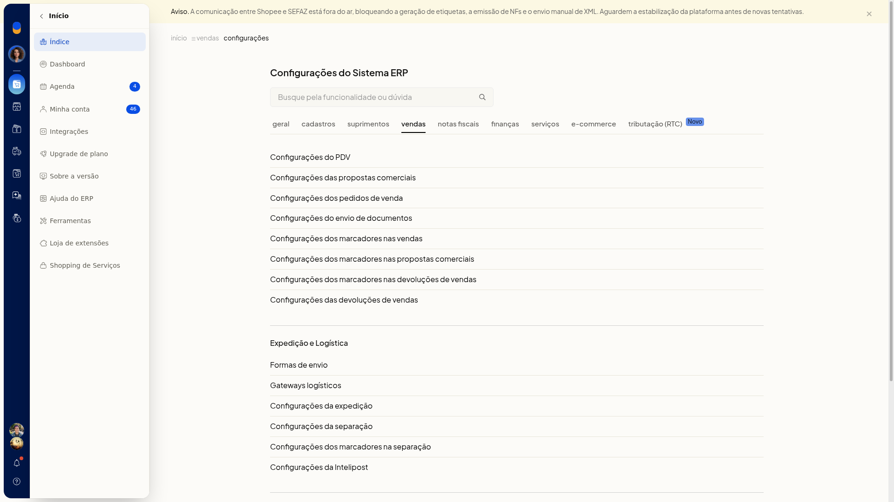
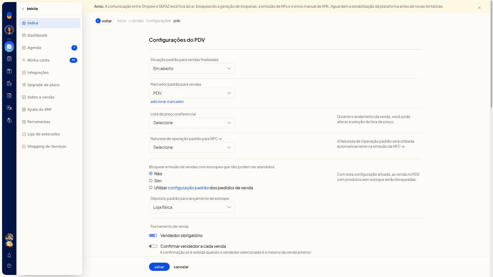
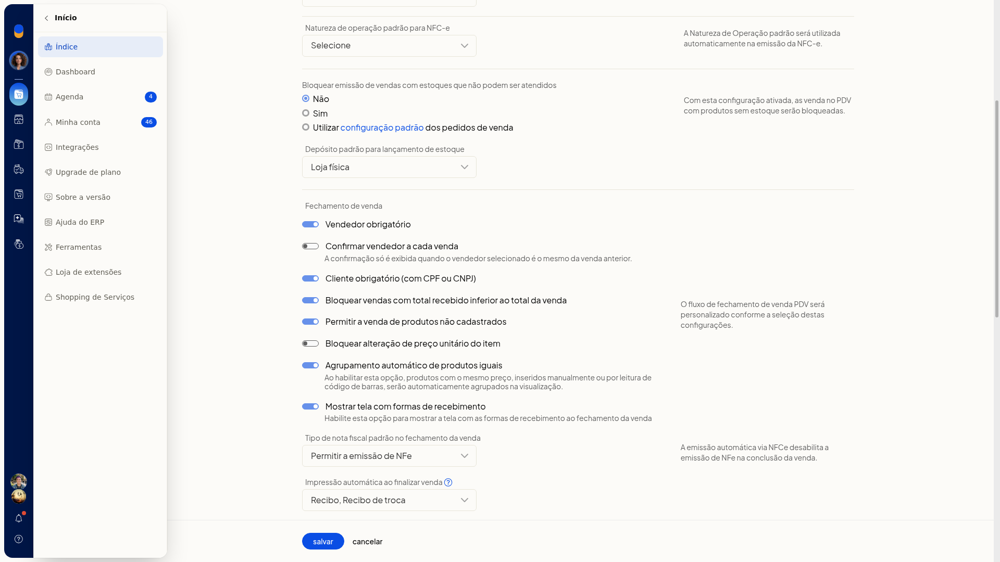
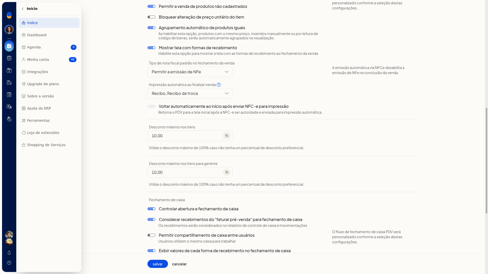
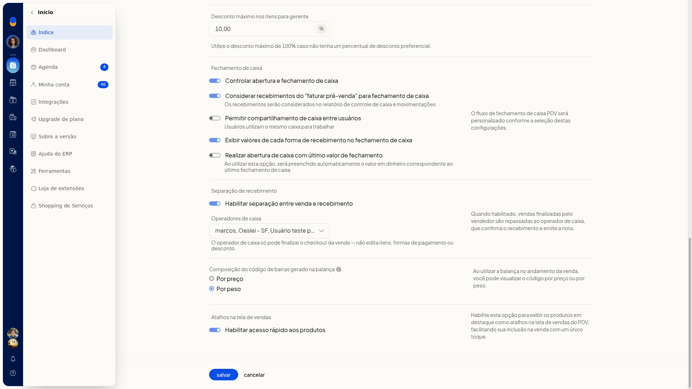

# Guia de implantação: loja física

No PDV da Olist, você define as regras da loja física numa única tela: a natureza de operação usada automaticamente na NFC-e, o depósito padrão do estoque e o fechamento da venda e do caixa.

Também é possível ajustar situação, marcador, lista de preço, impressão, desconto, separação de recebimento, balança e atalhos de produtos na tela de vendas. A configuração fica em **Configurações > Configurações ERP**, na categoria **Vendas**, no item **Configurações do PDV**.

## Pré-requisitos
- Naturezas de operação e depósitos já cadastrados. As listas só mostram registros existentes, além de **Selecione**.
- Listas de preço, marcadores e pessoas já cadastradas na conta, se for preciso escolhê-los. Ao lado de **Marcador padrão para vendas** há o link **adicionar marcador**.

## Importante
- A natureza padrão é utilizada automaticamente na emissão da NFC-e.
- Com **Bloquear emissão de vendas com estoques que não podem ser atendidos** em **Sim**, a venda no PDV com produtos sem estoque é bloqueada.
- A emissão automática via NFCe desabilita a emissão de NFe na conclusão da venda.
- O operador de caixa só finaliza o checkout da venda: não edita itens, formas de pagamento ou desconto.
- Com a separação habilitada, a venda finalizada pelo vendedor é repassada ao operador de caixa, que confirma o recebimento e emite a nota.
- A confirmação de vendedor só aparece quando o vendedor selecionado é o mesmo da venda anterior.
- Com a exigência ativa, a venda só é concluída se o vendedor for informado.
- Com a exigência ativa, o cliente precisa ter documento informado para concluir a venda.
- Natureza, depósito, lista de preço, marcador e operadores não são criados nesta tela. O atalho para incluir item é o link **adicionar marcador**.
- A opção de selecionar lista de preços não aparece para empresas com PAF-NFC-e.
- Faturar pré-venda não aparece para empresas com PAF-NFC-e e exige permissão para editar vendas. Se a opção não aparecer para você, peça acesso ao administrador da conta.

## Instruções
Nenhum campo desta tela é obrigatório.

1. No menu lateral, clique em **Configurações** e depois em **Configurações ERP**.
2. Na categoria **Vendas**, clique em **Configurações do PDV**.

   

3. Em **Natureza de operação padrão para NFC-e**, escolha uma natureza já cadastrada ou deixe **Selecione**.
4. Em **Depósito padrão para lançamento de estoque**, escolha o depósito das movimentações do PDV.

   

5. Em **Bloquear emissão de vendas com estoques que não podem ser atendidos**, escolha **Não**, **Sim** ou **Utilizar configuração padrão dos pedidos de venda**.
6. Em **Fechamento de venda**, marque as regras da loja. O fluxo de fechamento de venda do PDV é personalizado conforme a seleção.

#### Preferências da venda

- Em **Situação padrão para vendas finalizadas**, escolha **Em aberto**, **Aprovado**, **Preparando envio**, **Faturado**, **Pronto para envio**, **Enviado** ou **Entregue**.
- Em **Marcador padrão para vendas**, escolha **Sem marcador** ou um marcador já cadastrado. Para incluir um marcador, acesse o link **adicionar marcador**.
- Em **Lista de preço preferencial**, escolha **Selecione** ou uma lista já cadastrada. A lista pode ser alterada durante a venda.

#### Regras do fechamento

- Marque **Vendedor obrigatório** para exigir o vendedor na venda.
- Marque **Confirmar vendedor a cada venda** para pedir a confirmação quando o vendedor for o mesmo da venda anterior.
- Marque **Cliente obrigatório (com CPF ou CNPJ)** para exigir cliente com documento.
- Marque **Bloquear vendas com total recebido inferior ao total da venda** para impedir o fechamento com recebimento menor que o total.
- Marque **Permitir a venda de produtos não cadastrados** para aceitar produto que não está no cadastro.
- Marque **Bloquear alteração de preço unitário do item** para impedir a mudança do preço unitário.
- Marque **Agrupamento automático de produtos iguais** para agrupar, na visualização, produtos com o mesmo preço inseridos manualmente ou por código de barras.
- Marque **Mostrar tela com formas de recebimento** para exibir as formas de recebimento ao fechar a venda.
- Em **Tipo de nota fiscal padrão no fechamento da venda**, escolha **Emitir automaticamente a NFCe** ou **Permitir a emissão de NFe**.
- Em **Impressão automática ao finalizar venda**, selecione **Recibo**, **NFCe** e **Recibo de troca**. Use **Selecionar todas as opções** para marcar todas.
- Marque **Voltar automaticamente ao início após enviar NFC-e para impressão** para o PDV voltar à tela inicial depois que a NFC-e for autorizada e enviada para impressão automática.
- Em **Desconto máximo nos itens** e em **Desconto máximo nos itens para gerente**, digite o percentual com vírgula decimal. Use 100% se não houver percentual preferencial.

7. Em **Fechamento de caixa**, marque como o caixa é controlado. O fluxo de fechamento de caixa do PDV é personalizado conforme a seleção.

   - Marque **Controlar abertura e fechamento de caixa** para controlar a abertura e o fechamento.
   - Marque **Considerar recebimentos do "faturar pré-venda" para fechamento de caixa** para esses recebimentos entrarem no relatório de controle de caixa e movimentações.
   - Marque **Permitir compartilhamento de caixa entre usuários** para as pessoas da conta usarem o mesmo caixa.
   - Marque **Exibir valores de cada forma de recebimento no fechamento de caixa** para mostrar o valor de cada forma no fechamento.
   - Marque **Realizar abertura de caixa com último valor de fechamento** para preencher o dinheiro do último fechamento de caixa.
   - Marque **Habilitar separação entre venda e recebimento** para separar a venda do recebimento.
   - Em **Operadores de caixa**, selecione as pessoas já cadastradas. Use **Selecionar todos** para marcar todas.
   - Em **Composição do código de barras gerado na balança**, escolha **Por preço** ou **Por peso**.
   - Em **Atalhos na tela de vendas**, marque **Habilitar acesso rápido aos produtos** para exibir produtos em destaque como atalhos na tela de vendas do PDV.

   

8. Clique em **Salvar** para gravar a configuração ou em **Cancelar** para sair sem gravar.

## Informações adicionais
- A lista de preço preferencial pode ser alterada durante a venda.
- Com o bloqueio de estoque ativado, a venda no PDV com produtos sem estoque é bloqueada.
- Produtos iguais, com o mesmo preço e inseridos manualmente ou por código de barras, são agrupados na visualização quando o agrupamento automático está marcado.
