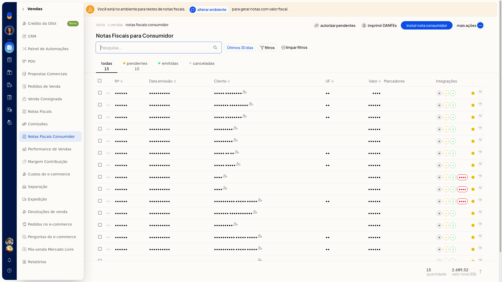
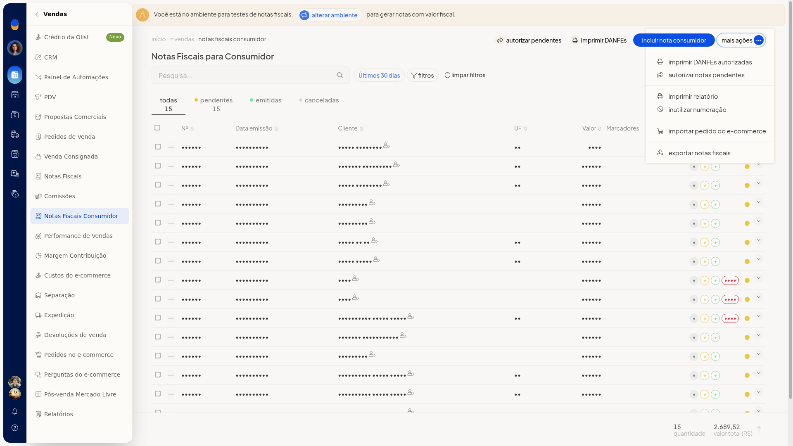
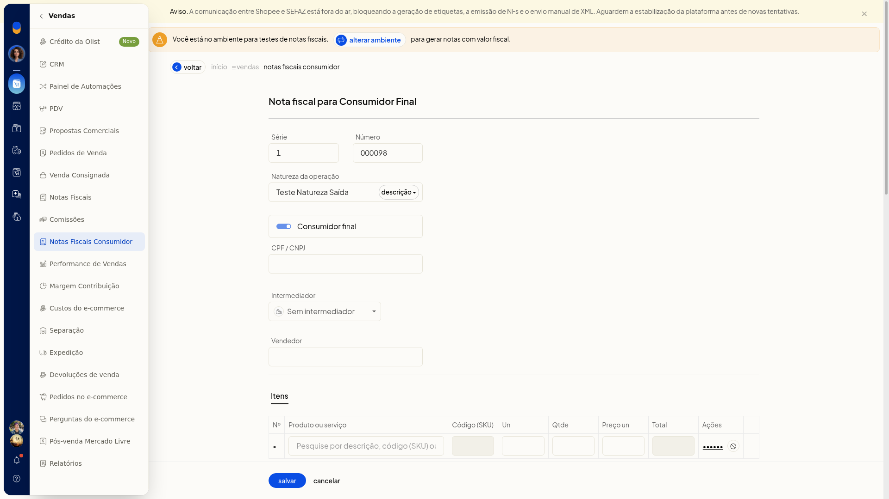
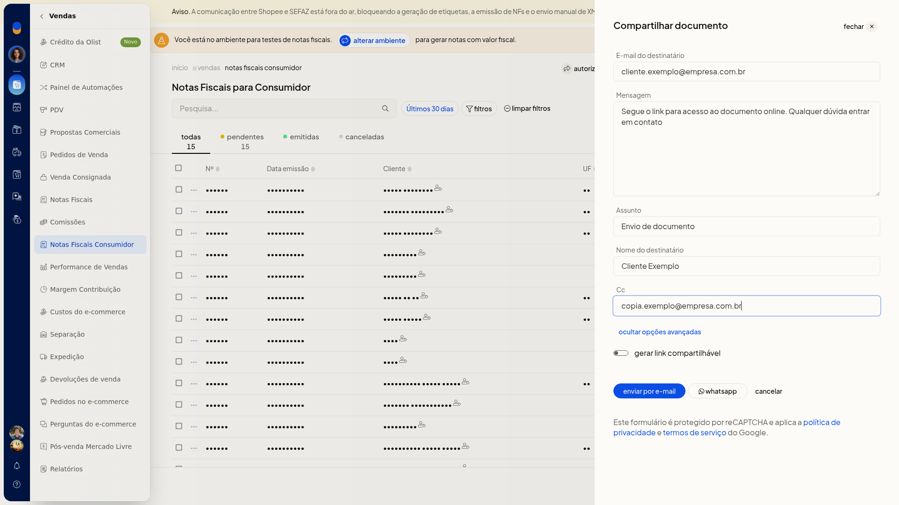
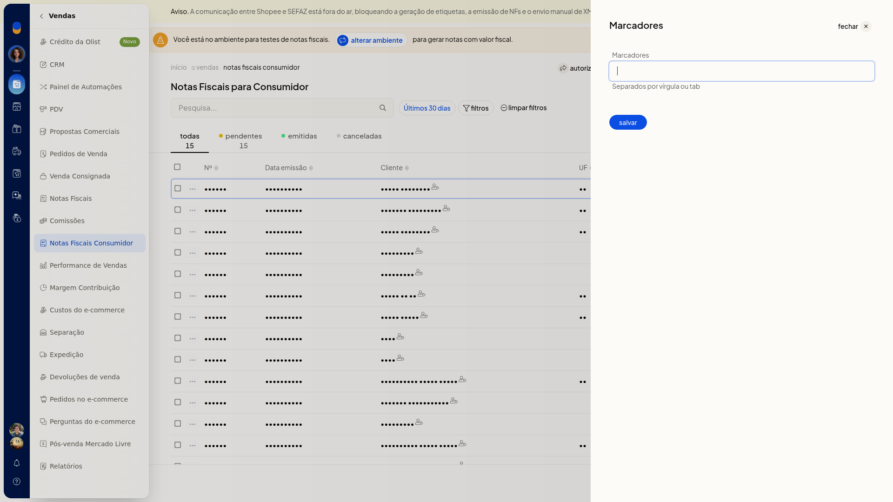

# Notas Fiscais Consumidor: lista e ações

## Importante
- A lista pode exibir um aviso de ambiente de testes fiscais.

## Instruções
### Consultar a lista por situação

1. Acesse **Vendas > Notas Fiscais Consumidor**.
   
2. Use as abas **Todas**, **Pendentes**, **Emitidas** e **Canceladas**. A aba **Pendentes** mostra a contagem.

### Usar as ações do topo

1. No topo da lista, use **Autorizar pendentes**, **Imprimir DANFEs** ou **Incluir nota consumidor**.
2. Abra **Mais ações** para **Imprimir DANFEs autorizadas**, **Autorizar notas pendentes**, **Imprimir relatório**, **Inutilizar numeração**, **Importar pedido do e-commerce** e **Exportar**.
   

### Abrir a inclusão da nota

1. Clique em **Incluir nota consumidor**.
   
2. Confira a **Série**, o **Número** e a **Natureza da operação**, que já vêm preenchidos. **Consumidor final** inicia ligado e o intermediador mostra **Sem intermediador**.

### Importar pedido do ecommerce

1. Abra **Mais ações**.
2. Clique em **Importar pedido do e-commerce**. A busca de pedido abre para você localizar o pedido antes de importar.

### Exportar notas

1. Abra **Mais ações**.
2. Clique em **Exportar** e escolha **XML** ou **planilha**.

### Compartilhar uma nota

1. No menu da linha, abra o compartilhamento.
2. Informe o email. No modo avançado, preencha **Assunto**, **Nome do destinatário** e **Cc**.
   

### Incluir marcadores

1. No menu da linha, clique em **Marcadores**.
   
2. Digite as tags. A ajuda da tela indica **Separados por vírgula ou tab**. As tags aparecem como chips.
   
3. Clique em **Salvar e fechar** para gravar. Se fechar sem **Salvar**, os chips somem.

### Abrir o rastreio

1. No menu da linha, abra o rastreio. O formulário de rastreio da nota abre para preenchimento.

O menu da linha também traz **Outras Opções**.

## Resultado
A lista separa as NFC-e em **Todas**, **Pendentes**, **Emitidas** e **Canceladas**. A partir dela ficam disponíveis a inclusão, a importação, a exportação, o compartilhamento, os marcadores e o rastreio.

## Informações adicionais
- Marcadores digitados aparecem como chips e são descartados se o painel for fechado sem **Salvar**.
