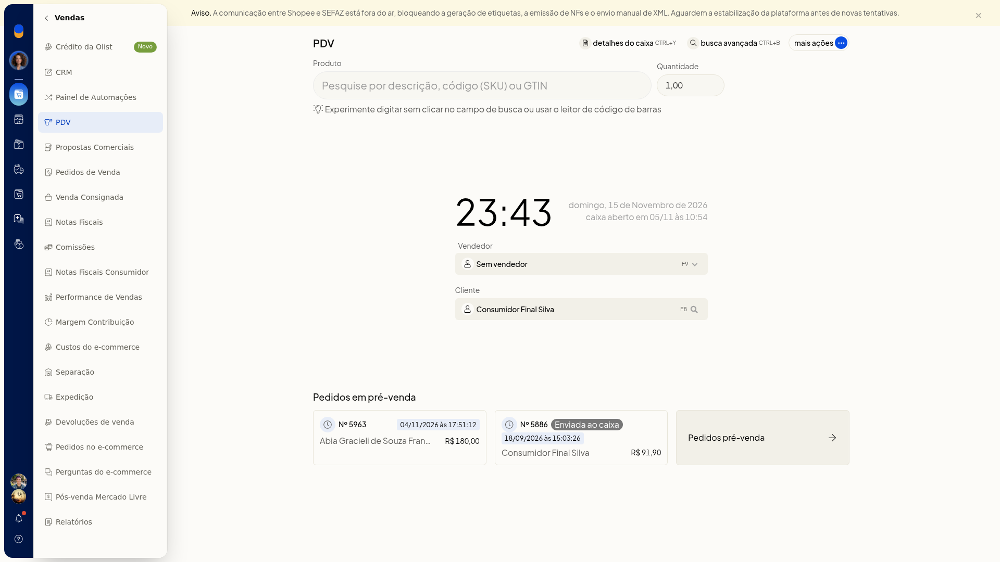
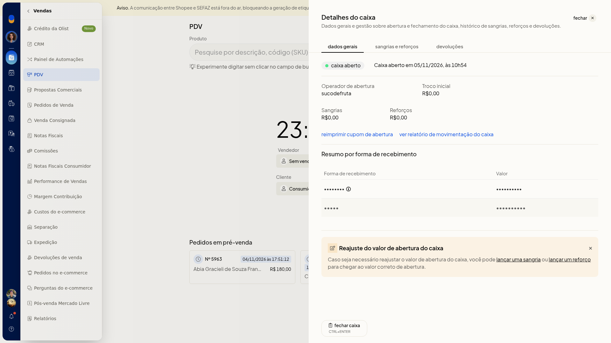
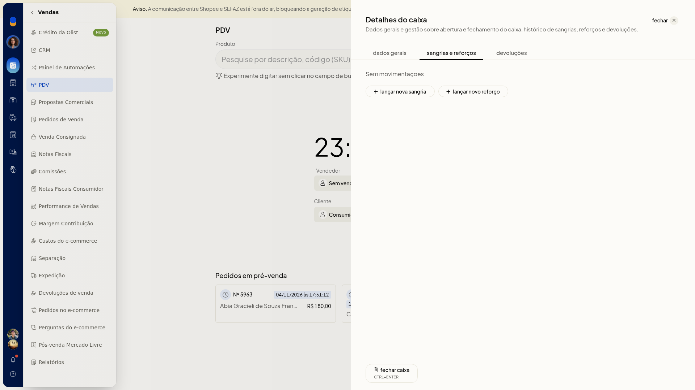
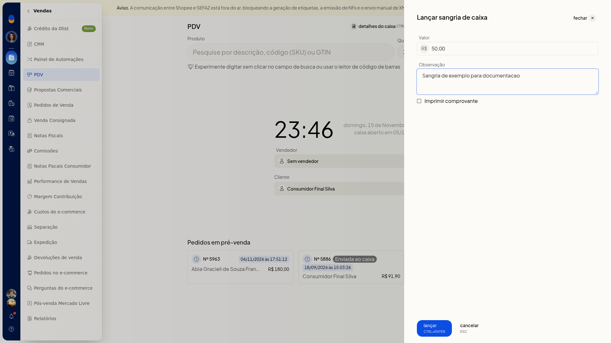
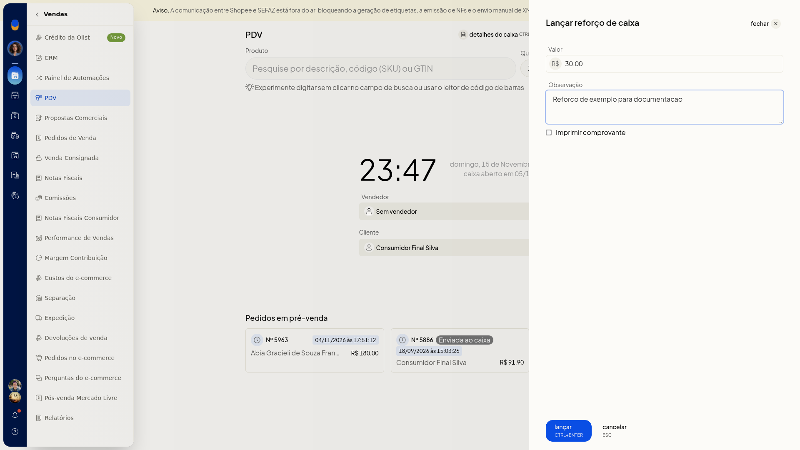
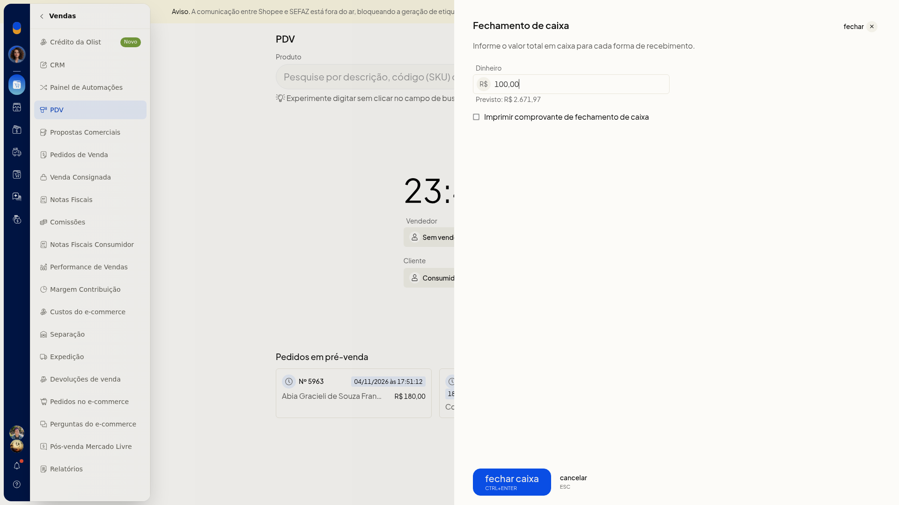

# PDV: abrir, movimentar e fechar o caixa

## Pré-requisitos
- Sangria, reforço e fechamento de caixa exigem o módulo de controle de caixa do PDV. Sem esse módulo, as opções ficam bloqueadas e o sistema pede upgrade de plano.

## Importante
- Cancelar a sangria, o reforço ou o fechamento antes de concluir não altera o caixa.

## Instruções
1. Acesse **Vendas > PDV**.

   

2. Clique em **Mais ações**. Ali estão **Detalhes do caixa**, **Lançar sangria de caixa**, **Lançar reforço de caixa** e **Fechar caixa**.

   

3. Clique em **Detalhes do caixa** ou use CTRL+Y. Confira o operador, o troco inicial, as sangrias, os reforços e desde quando o caixa está aberto.

   

4. Abra a lista de sangrias para ver os lançamentos. A lista pode estar vazia.

   

5. Clique em **Lançar sangria de caixa** e informe o valor em reais.

   

6. Clique em **Lançar reforço de caixa** e informe o valor em reais.

   

7. Clique em **Fechar caixa**. Confira **Dinheiro Previsto**, informe o valor contado e marque **Imprimir** se quiser imprimir. O caixa só muda depois que você conclui o fechamento.

   

## Resultado
Em **Detalhes do caixa** você confere o movimento do caixa aberto, com operador, troco inicial, sangrias e reforços. Sangria, reforço e fechamento ficam preenchidos até você concluir ou cancelar.
