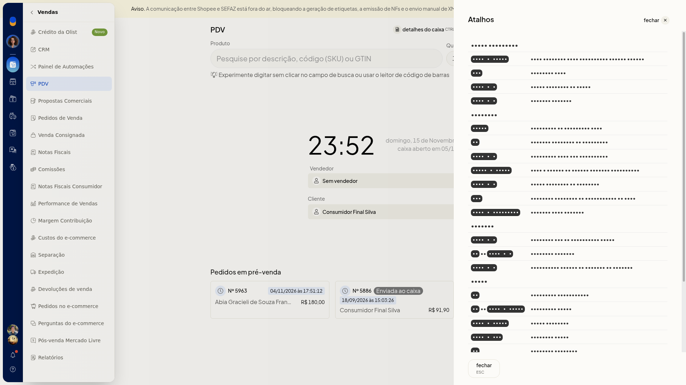

# PDV: atalhos

No PDV da Olist, os atalhos de teclado levam direto às ações da venda, do preço e da finalização. Você consulta a lista completa sem precisar memorizar cada tecla e sem disparar a ação.

## Instruções
1. Acesse **Vendas > PDV**.
2. Clique em **Mais ações**.

   

3. Clique em **Mostrar atalhos** (ctrl+?). O painel lista os atalhos de venda, caixa, preço e finalização, sem executar a ação.

   

## Resultado
Você localiza os atalhos e pode usá-los na tela correspondente, sem concluir a venda.

## Informações adicionais
### Atalhos da tela inicial

- **F8**: informar o cliente
- **F9**: informar o vendedor

### Atalhos da venda e do preço

- **F10**: salvar a venda para depois
- **F7**: enviar a venda ao caixa
- **F3**: devolver a venda ao vendedor
- **CTRL+G**: lista de preços
- **CTRL+J**: POS
- **Shift+Enter**: editar o último item

### Atalhos da finalização

- **ESC**: voltar
- **F4**: adicionar recebimento
- **CTRL+ENTER** ou **F2**: finalizar
- **CTRL+DEL**: cancelar
- **CTRL+L**: CPF
