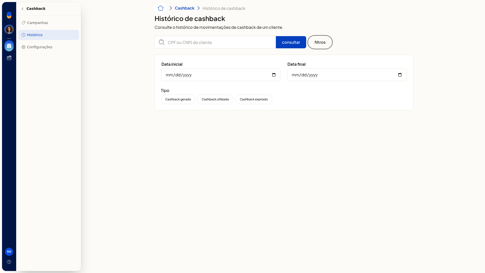
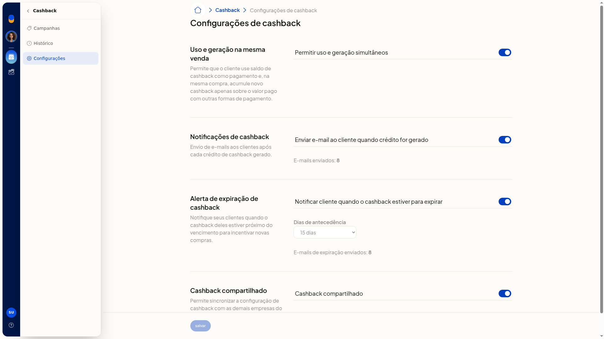
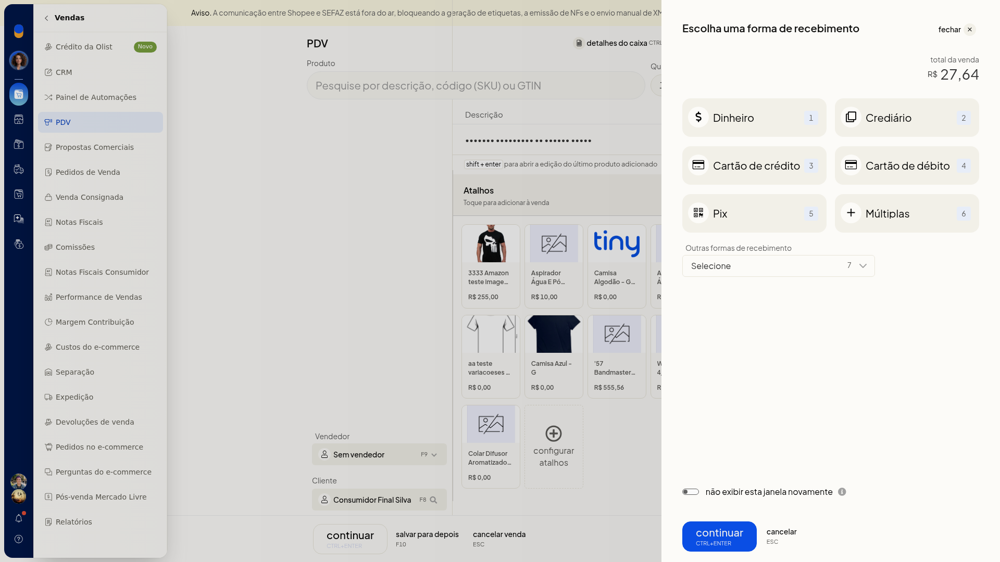

# PDV: cashback

No PDV da Olist, você consulta as campanhas de cashback, o histórico e a configuração de geração, uso e aviso. Também pode usar o cashback como forma de recebimento da venda.

## Pré-requisitos
- A opção **Campanhas de cashback** só aparece para quem tem o módulo de cashback.

## Importante
- **Campanhas de cashback** aparece em **Mais ações** na tela inicial do PDV e some enquanto um item está sendo lançado.

## Instruções
### Consultar campanhas e configuração

1. Acesse **Vendas > PDV**.
2. Abra **Mais ações > Campanhas de cashback**.

   

3. No histórico, filtre por **Data inicial**, **Data final** e **Tipo**. Em **Tipo**, as opções são gerado, utilizado e expirado.

   

4. Na configuração, confira o uso e a geração simultâneos, o email ao gerar crédito, a notificação de expiração e o cashback compartilhado. Em **Antecedência da notificação de cashback**, as opções são **Selecione**, **1**, **3**, **7** e **15 dias**. O texto de ajuda informa a quantidade de emails de expiração já enviados. Não salve se quiser apenas consultar.

   

### Receber a venda com cashback

1. Acesse **Vendas > PDV** e monte a venda até a janela de recebimento.
2. Em **Outras**, selecione **Cashback**. A venda permanece pronta para finalizar, sem concluir o recebimento.

   

## Resultado
Você consulta campanhas e histórico e vê as opções de geração, uso e aviso do cashback, sem gravar a configuração.

## Informações adicionais
- O histórico de cashback não tem busca por cliente.
