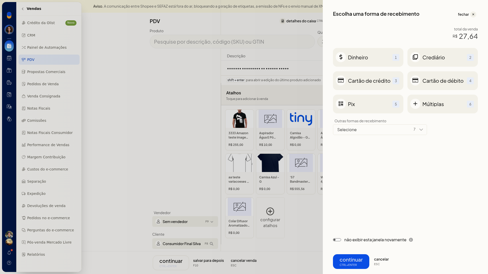

# PDV: crediário e repasse de juros

No PDV da Olist você recebe crediário e também pode receber uma venda nessa forma.

O recebimento de crediário fica em **Mais ações**, na tela inicial. Na venda, **Crediário** é uma das formas numeradas da janela de recebimento.

## Importante
- **Receber crediário** aparece em **Mais ações** da tela inicial do PDV. Durante o lançamento do item, essa opção não aparece.

## Instruções
### Receber crediário pela tela inicial

1. Acesse **Vendas > PDV**.
2. Abra **Mais ações**.

   

3. Clique em **Receber crediário**. Você chega à tela de recebimento de crediário.

### Usar crediário no recebimento da venda

1. Na janela de recebimento da venda, selecione **Crediário**.

   

## Resultado
O recebimento de crediário fica disponível pelo PDV, e a venda pode ser recebida na forma **Crediário**.
