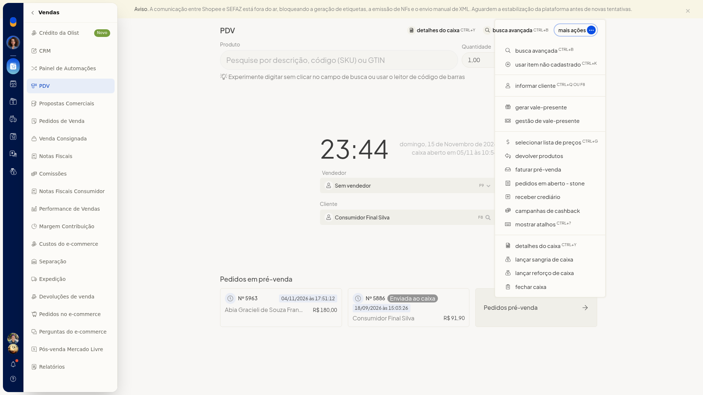
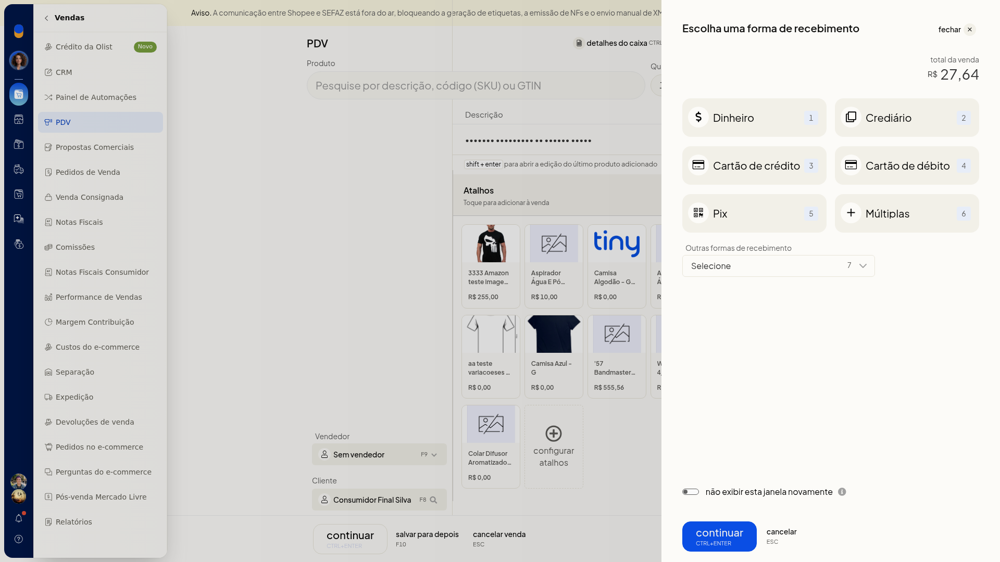
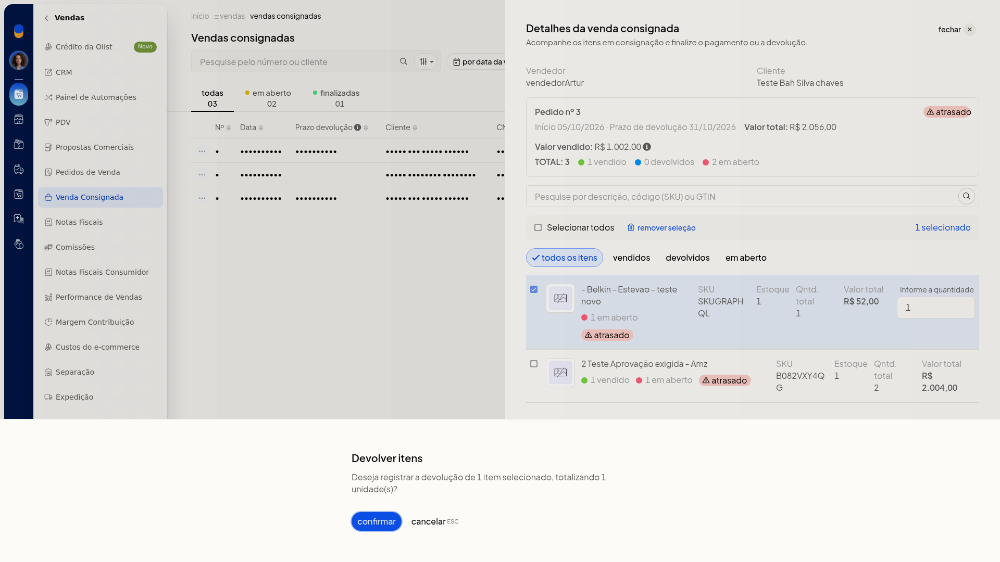

# PDV: devoluções e vale-troca

No PDV da Olist você inicia a devolução de produtos e pode receber a venda com vale-troca. A devolução também pode ser aberta em uma venda consignada.

## Pré-requisitos
- Sem o módulo de devolução de vendas, a opção **Devolver produtos** fica bloqueada e o sistema pede atualização do plano.

## Importante
- **Devolver produtos** aparece em **Mais ações** da tela inicial do PDV. Durante o lançamento do item, essa opção não aparece.
- Na venda consignada, selecione ao menos um item antes de devolver. Sem seleção, aparece **Selecione ao menos um item**.

## Instruções
### Devolver produtos no PDV

1. Acesse **Vendas > PDV**.
2. Na tela inicial, clique em **Mais ações**.

   

3. Clique em **Devolver produtos**.

### Usar vale-troca no recebimento

1. No recebimento da venda no PDV, abra **Outras**.
2. Selecione **Vale-troca**.

   

### Devolver itens da venda consignada

1. Acesse **Vendas > Venda Consignada**.
2. Abra a venda e selecione ao menos um item.
3. Clique em **Devolver**. A confirmação **Devolver itens** mostra o item e a quantidade selecionada.

   

## Resultado
A devolução começa pelo PDV ou pela venda consignada. No recebimento da venda, vale-troca fica em **Outras**.
