# PDV: realizar vendas (inclui pré-venda e descontos)

No PDV da Olist você monta a venda com produto do catálogo ou item não cadastrado, informa cliente e vendedor, escolhe a lista de preços e aplica desconto, acréscimo ou frete. O recebimento pode ser em dinheiro, cartão, Pix, crediário, cashback, vale-troca, vale-presente ou outras formas da tela.

Você também guarda a venda para depois, envia ao caixa ou abre o faturamento de uma pré-venda. O caminho é **Vendas > PDV**, no ERP da Olist.

## Importante
- Para concluir a venda, informe o vendedor quando essa exigência estiver ativa no PDV.
- Para concluir a venda, o cliente precisa ter CPF ou CNPJ quando essa exigência estiver ativa no PDV.
- Para faturar uma pré-venda, cancele antes a venda em andamento. A tela avisa quando isso for necessário.
- Para faturar a pré-venda, você precisa poder editar vendas. Se a opção não aparecer, peça acesso ao administrador da conta.

## Instruções
### Montar a venda

1. Acesse **Vendas > PDV**.

   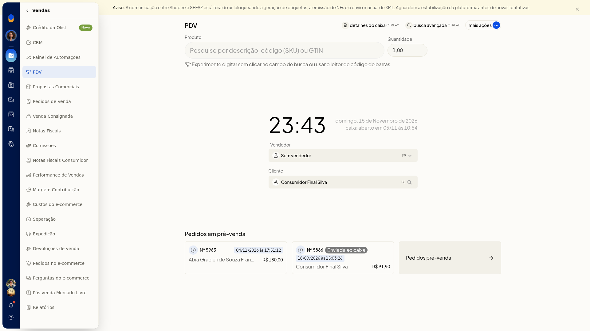

2. Informe o produto na busca e a **Quantidade**, com vírgula decimal. A linha passa a exibir unidade, preço unitário e total. **Quantidade**, **Cliente** e **Vendedor** não são obrigatórios.

   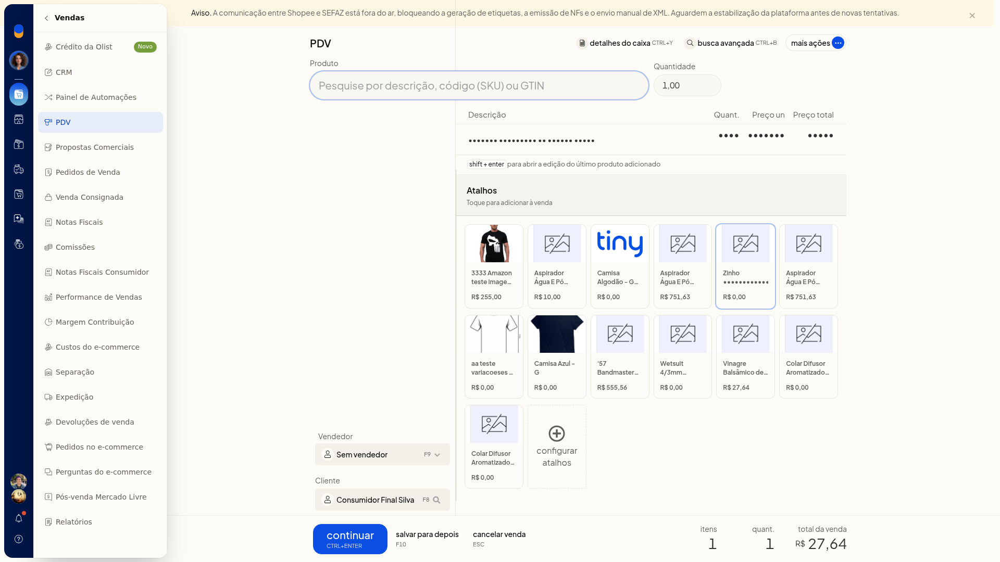

3. Informe o **Cliente** com F8 e o **Vendedor** com F9. Em **Vendedor**, há a opção **Sem vendedor**.
4. Abra **Mais ações** para **Usar item não cadastrado**, **Informar cliente**, **Selecionar lista de preços** e **Faturar pré-venda**.

   

5. No recebimento, escolha a forma. As formas numeradas são **Dinheiro**, **Crediário**, crédito, débito, **Pix** e **Múltiplas**. Em **Outras** aparecem **Boleto**, **Cheque**, **Depósito**, **Vale-troca**, **Meli**, **Crypto - Bitcoin**, **Mercado pago**, **Cashback** e **Vale-presente**.

   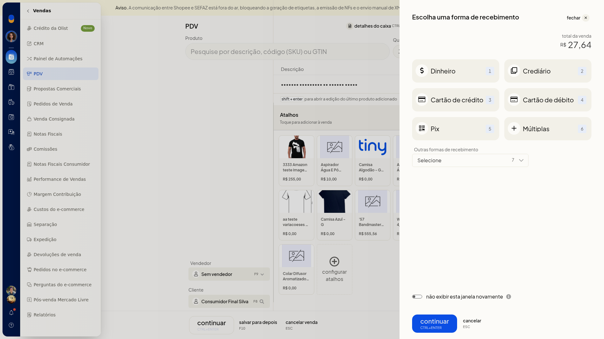

6. Na finalização em dinheiro, informe o CPF com CTRL+L, se quiser. Escolha o **Depósito** e a categoria. Preencha **Desconto** e **Frete** em reais: os dois não são obrigatórios e alteram o total, o troco e o saldo. Um desconto de R$ 3,00 reduz o total e pode gerar troco; um frete de R$ 5,00 aumenta o total e pode deixar saldo.
7. Clique em **finalizar** (CTRL+ENTER ou F2). A venda mostra o item, o recebimento escolhido e os totais com desconto, frete, troco ou saldo. Para voltar, use ESC. Para incluir outro recebimento, use **adicionar recebimento** (F4).

   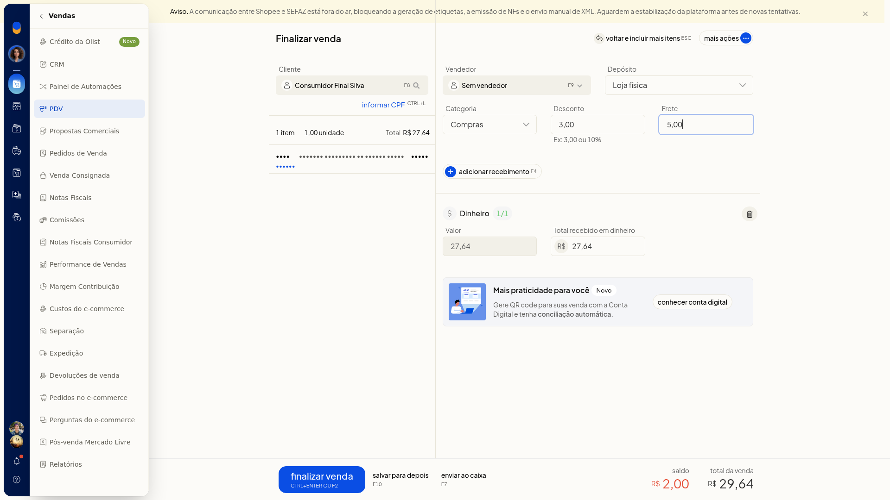

### Buscar o produto e selecionar a lista de preços

1. No PDV, abra **Busca avançada** (CTRL+B), também em **Mais ações**.
2. Use **Código**, **Código (parcial)**, **Código no fornecedor**, **GTIN/EAN**, **Descrição** ou **Palavras-chave**. Esses critérios não são obrigatórios. Use **Não refinar** quando não quiser restringir a busca.

   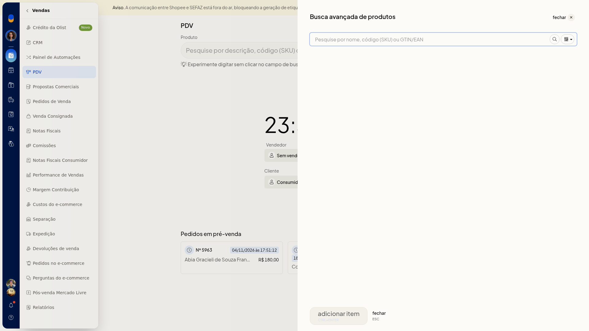

3. Na etapa do item, abra **Mais ações > Selecionar lista de preços** (CTRL+G). Escolha **Nenhuma lista** ou uma lista cadastrada.

   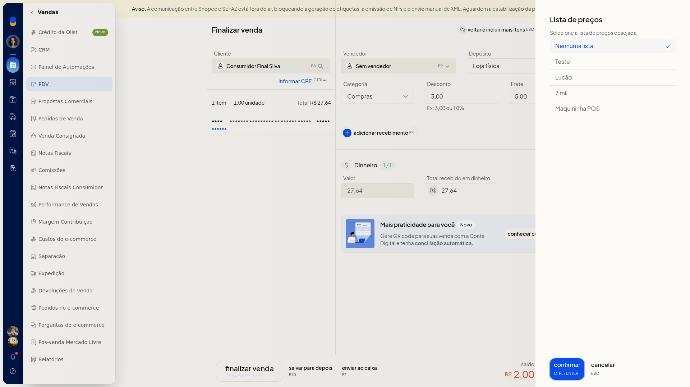

### Aplicar desconto ou acréscimo

1. Na linha do item, edite o último item com Shift+Enter.
2. Ajuste **Quantidade**, o valor em R$ ou **Desconto ou Acréscimo**. Escolha **Valor fixo** (CTRL+B) ou **Porcentagem** (CTRL+A). O campo não é obrigatório.

   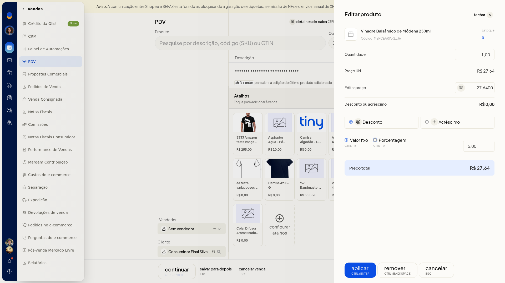

3. Na finalização, preencha **Desconto** e **Frete** e confira total, troco e saldo antes de clicar em **finalizar** (CTRL+ENTER ou F2).

### Salvar a pré-venda e faturar

1. Na venda em andamento, clique em **salvar** (F10) para guardar para depois ou em **enviar ao caixa** (F7). A pré-venda fica salva ou enviada ao caixa.
2. Abra **Pedidos pré-venda**. As abas são **Pedidos de Venda**, **Propostas Comerciais** e **Enviadas ao Caixa**.

   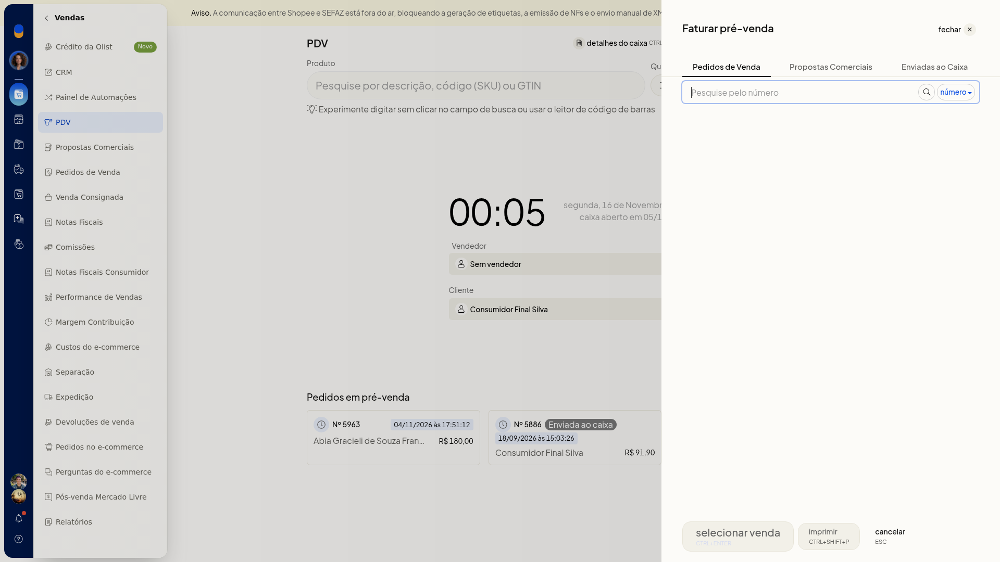

3. Filtre por **Número**, **Nome**, **CPF/CNPJ**, **Telefone** ou **Item**.

   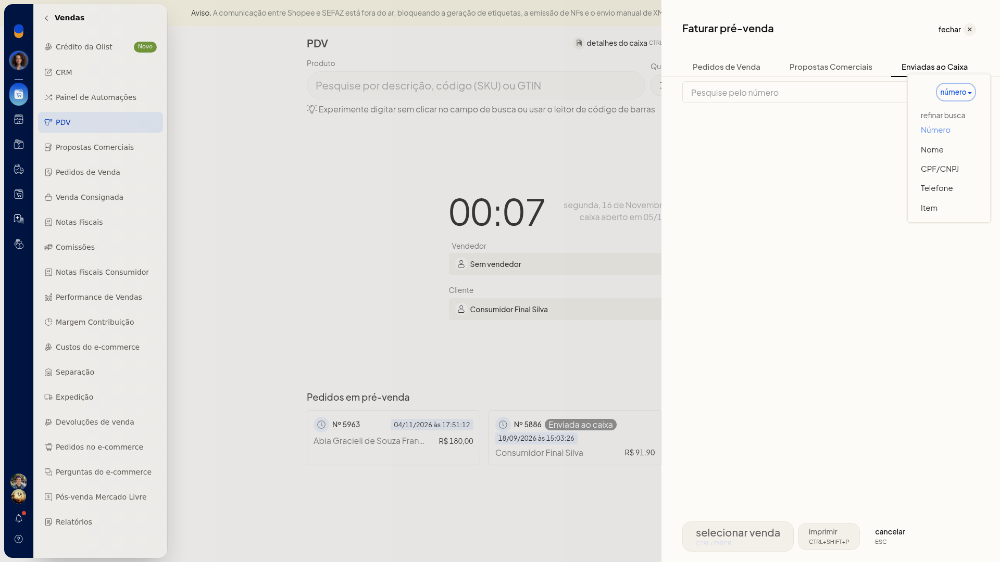

4. Para faturar, abra **Mais ações > Faturar pré-venda** somente depois de cancelar a venda em andamento. Se a venda ainda estiver aberta, a tela pede o cancelamento do rascunho antes de seguir.

   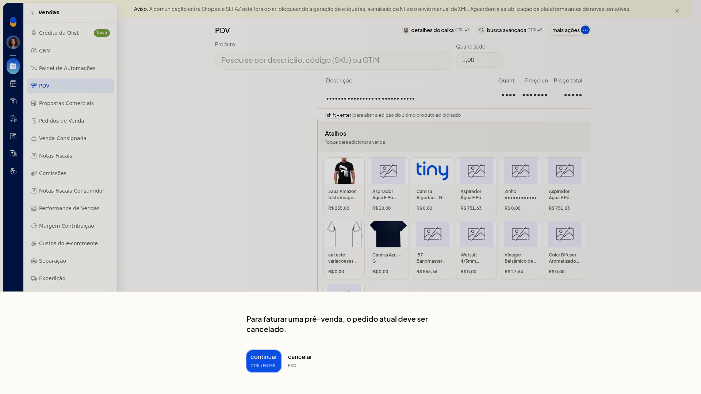

## Resultado
A venda fica com a linha do item, o recebimento escolhido e os totais atualizados por desconto, frete, troco ou saldo. A pré-venda salva ou enviada ao caixa aparece nas abas de **Pedidos pré-venda**.

## Informações adicionais
### Atalhos da venda

Abra **Mais ações > Mostrar atalhos** (ctrl+?).

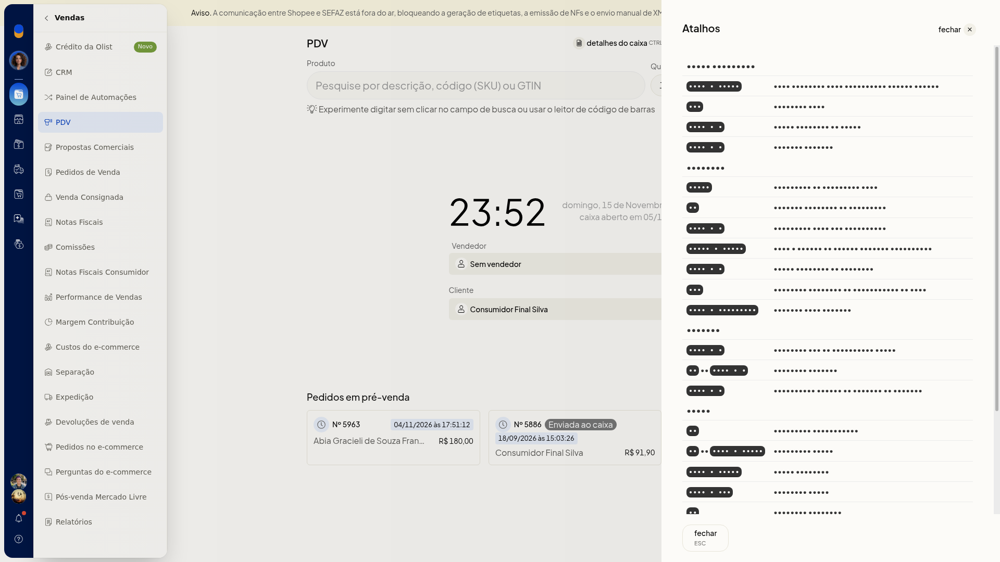

- F8 informa o cliente e F9 o vendedor, na tela inicial.
- F10 salva a venda para depois e F7 envia a venda ao caixa.
- CTRL+G abre a lista de preços e Shift+Enter edita o último item.
- Na finalização: ESC volta, F4 adiciona recebimento, CTRL+ENTER ou F2 finaliza, CTRL+DEL cancela e CTRL+L informa o CPF.
- F3 devolve a venda ao vendedor.
