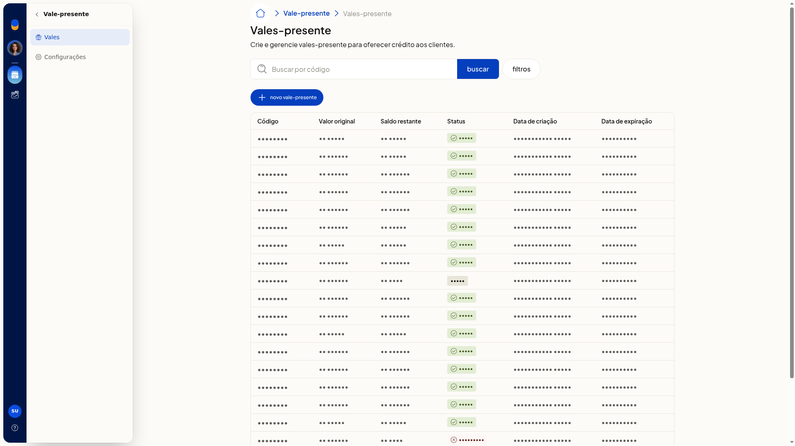
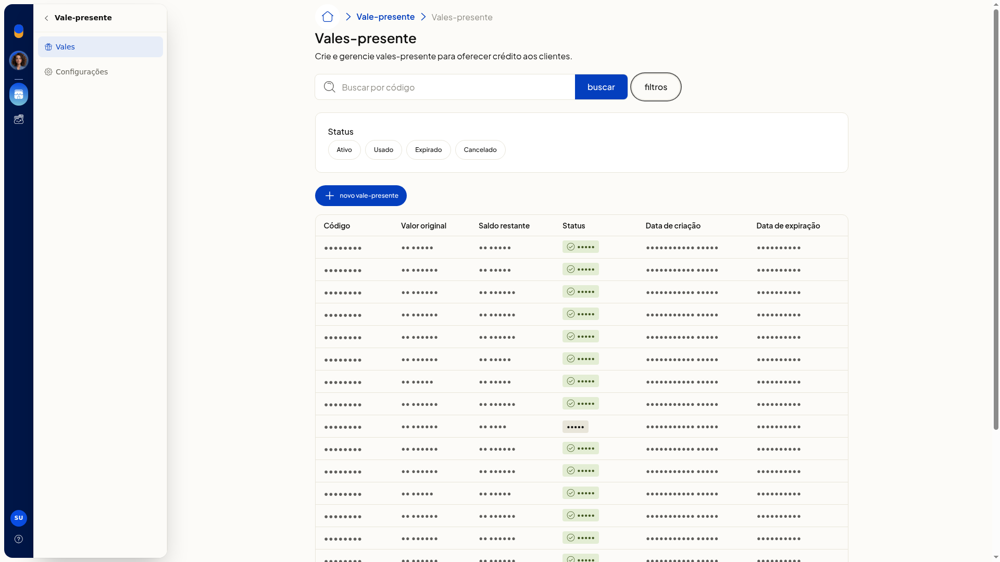
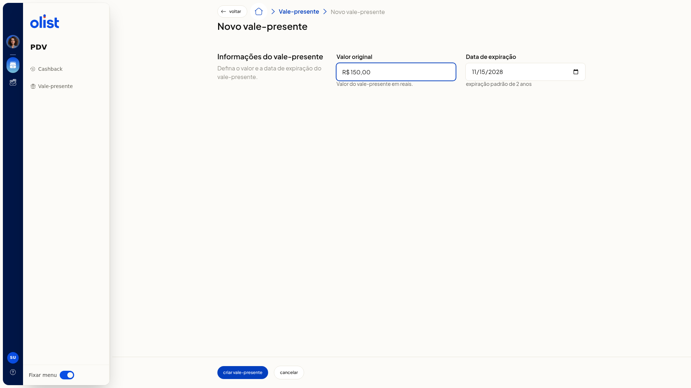
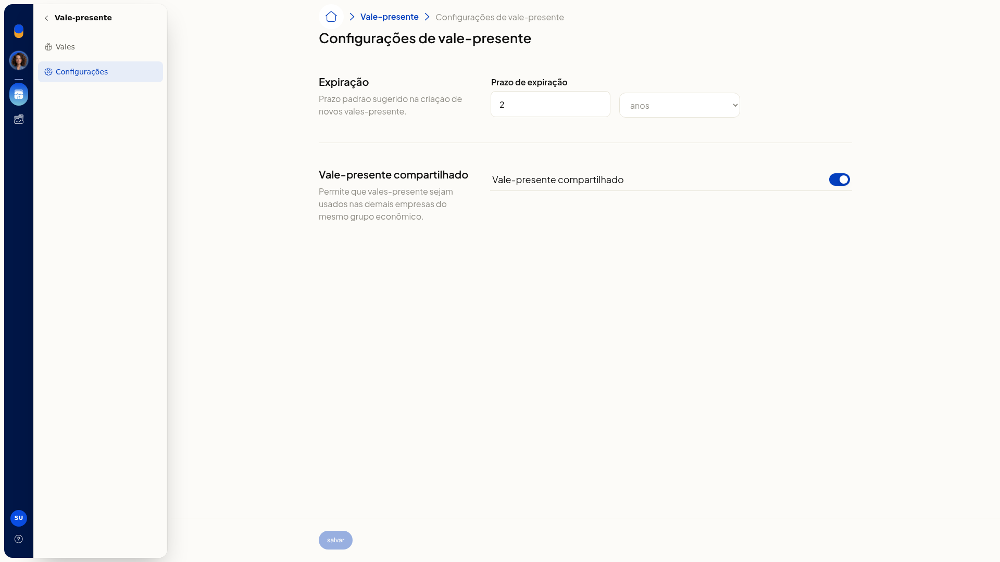
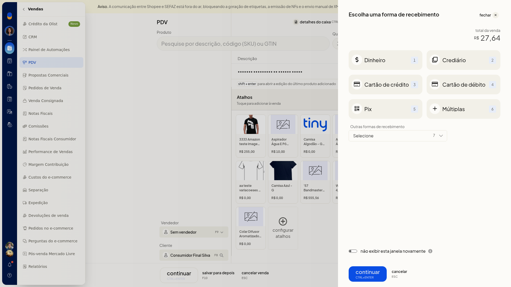

# PDV: vale-presente

No PDV da Olist você gera vale-presente, consulta o saldo e a validade e usa o vale como forma de recebimento da venda.

As opções ficam em **Mais ações**, na tela inicial do PDV.

## Pré-requisitos
- **Gerar vale-presente** e **Gestão de vale-presente** só aparecem quando a empresa tem o módulo de vale-presente.

## Importante
- A ajuda do novo vale indica prazo padrão de 2 anos.
- Na configuração, o prazo usa as unidades dias, meses ou anos.
- **Vale-presente** também aparece em **Outras**, na janela de recebimento da venda.

## Instruções
### Consultar e filtrar vales

1. Acesse **Vendas > PDV**.
2. Clique em **Mais ações**.

   

3. Clique em **Gestão de vale-presente**.
4. Busque pelo código ou aplique os filtros de status.

   

   

A lista mostra **Código**, **Valor original**, **Saldo restante**, **Status**, **Data de criação** e **Data de expiração**. Os status vistos são **Ativo**, **Usado** e **Cancelado**. Os filtros incluem **Ativo**, **Usado**, **Expirado** e **Cancelado**.

### Gerar um vale-presente

1. Em **Mais ações**, clique em **Gerar vale-presente**. Na gestão, use **novo vale-presente**.
2. Informe o valor. O campo não é obrigatório e aceita valor em reais.
3. Informe a expiração. O campo não é obrigatório e aceita data. A ajuda indica prazo padrão de 2 anos.
4. Clique em **criar vale-presente**. Para sair sem gerar, use **voltar** ou **cancelar**.

   

### Ajustar o prazo padrão

1. Abra a configuração do vale-presente.
2. Informe o prazo em número e escolha a unidade: dias, meses ou anos.
3. Deixe o vale compartilhado ligado ou desligado, conforme a regra da loja.
4. Clique em salvar para gravar. Se não quiser alterar, saia sem salvar.

   

### Receber com vale-presente

1. Na venda, abra a janela de recebimento.
2. Em **Outras**, selecione **Vale-presente**.
3. Conclua o recebimento com essa forma.

   

## Resultado
Na gestão, você encontra cada vale pelo código, com valor original, saldo restante, status e datas de criação e de expiração. No novo vale, valor e expiração ficam prontos para **criar vale-presente**. Na configuração, o prazo padrão fica em 2 anos, com unidade em dias, meses ou anos.

## Informações adicionais
### O prazo padrão é de 2 anos

A ajuda do novo vale indica prazo padrão de 2 anos. Na configuração, o prazo visto estava em 2 anos, com unidade dias, meses ou anos.

### O vale compartilhado pode ficar ligado

Na configuração, o vale compartilhado pode permanecer ligado.

### A lista separa vales ativos, usados e cancelados

Os status da lista são **Ativo**, **Usado** e **Cancelado**. O filtro também inclui **Expirado**.
