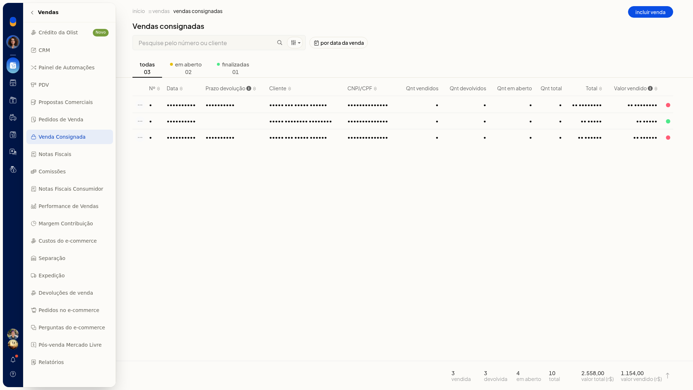
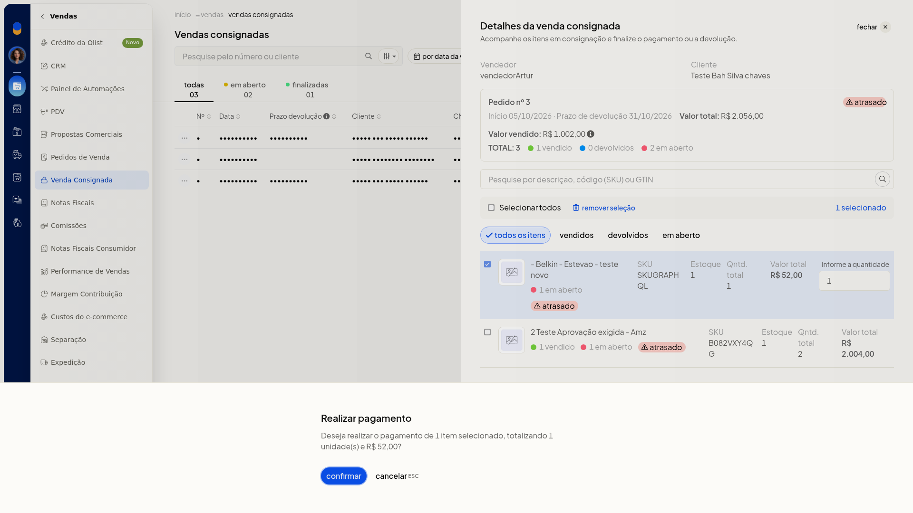

# PDV: venda consignada

Em **Vendas > Venda Consignada** você lista as vendas consignadas, inclui uma nova venda e abre as confirmações de pagamento e de devolução de itens.

A lista traz busca por número ou cliente, filtro por data da venda e as abas **Todas**, **Em aberto** e **Finalizadas**, cada uma com a contagem.

## Importante
- Para **Realizar pagamento** ou **Devolver**, selecione ao menos um item. Sem seleção, a tela mostra **Selecione ao menos um item**.

## Instruções
1. Acesse **Vendas > Venda Consignada**.
2. Consulte a lista pela busca, pelo filtro de data da venda ou pelas abas **Todas**, **Em aberto** e **Finalizadas**.

   

3. Clique em **incluir venda**.
4. Preencha os campos, que não são obrigatórios: **Número**, **Data**, **Prazo**, **Cliente**, **Vendedor**, **Depósito**, **item**, **SKU**, **quantidade**, **Preço un** e **observações**. Em **Data** e **Prazo**, informe a data. Em **Preço un**, use preço com quatro casas, como 25,0000.
5. No detalhe da venda, marque ao menos um item e clique em **Realizar pagamento**. A confirmação resume a quantidade e o valor do item selecionado.

   

6. Para devolver, marque o item e a quantidade e clique em **Devolver**. A confirmação **Devolver itens** mostra o item e a quantidade selecionados. **Cancelar (ESC)** fecha a confirmação sem devolver.

   

## Resultado
A venda consignada fica disponível na lista para consulta e pronta para incluir, receber o pagamento ou devolver itens. As abas **Todas**, **Em aberto** e **Finalizadas** separam as vendas e mostram a contagem de cada situação.
