# Maquininha Stone no ERP e no PDV

No ERP da Olist, você consulta as maquininhas, vincula a conta Stone, acompanha a instalação e configura o gateway Stone POS. Também dá para ver o que o plano libera de frente de caixa, controle de caixa e maquininhas integradas.

No PDV da Olist, você consulta pedidos em aberto da Stone e registra a sangria de caixa. A lista de maquininhas fica em **Configurações > Configurações ERP > Finanças > Configurações das maquininhas de cartão**.

## Pré-requisitos
- Para cadastrar a maquininha Stone pela tela, a área **Integração Stone** precisa estar instalada.
- Para usar a Stone no PDV, é preciso ter um meio de pagamento **Stone POS** habilitado.

## Importante
- Se o limite do plano aparecer como **01/01**, **adicionar maquininha** não abre um cadastro em branco. A tela mostra a extensão de mais uma maquininha, a **Integração Stone** e o upgrade de plano.
- A instalação pendente não continua na hora. A equipe vincula a conta em até 3 dias úteis e avisa quando a configuração puder seguir.
- Quem já é cliente Stone, na página de nova conta, vê a orientação **Já é cliente Stone e deseja ativar a solução? Entre em contato com o suporte.**
- O que pode ser contratado depende do plano atual exibido na tela de upgrade.

## Instruções
### Consultar as maquininhas

1. Acesse **Configurações > Configurações ERP > Finanças > Configurações das maquininhas de cartão**.

   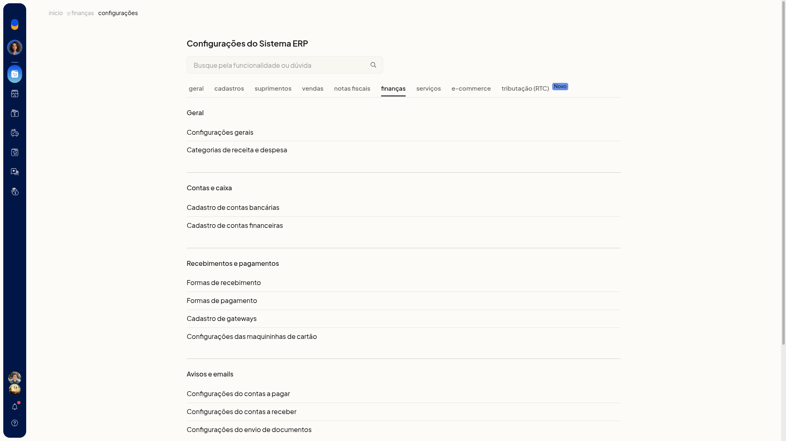

2. Veja um card por maquininha, com o gateway e o status da instalação. No card **Stone POS** com **Instalação concluída**, a ação é **Detalhes**. Nos cards com **Instalação pendente**, a ação é **Continuar configuração**. **adicionar maquininha** fica na mesma lista.

   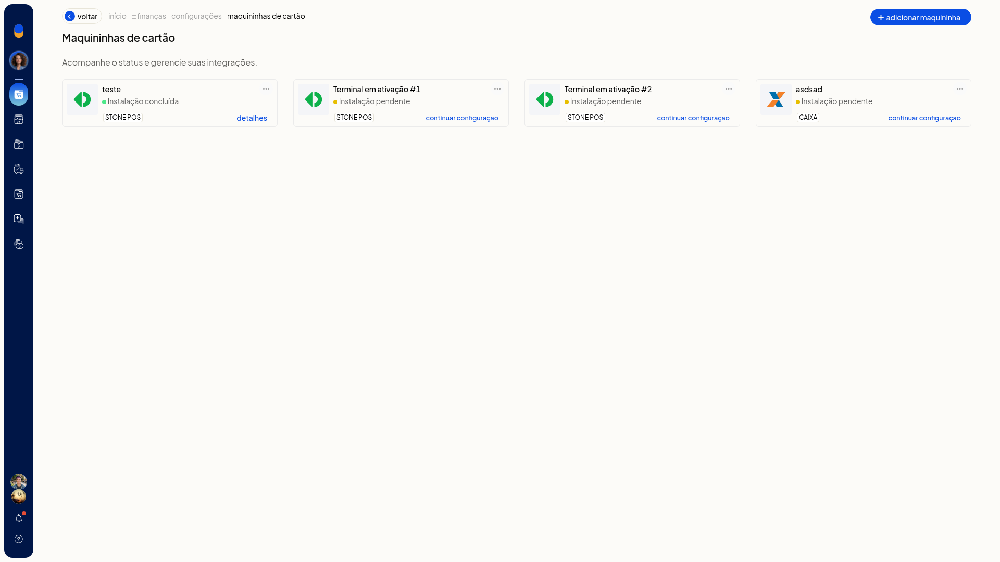

### Cadastrar a maquininha Stone

Use este caminho quando a **Integração Stone** estiver instalada. Na tela, o status visto é **PREMIUM INSTALADA**.

1. Na lista de maquininhas, clique em **adicionar maquininha**.
2. Com o limite em **01/01**, confira a extensão, a **Integração Stone** e o upgrade de plano.

   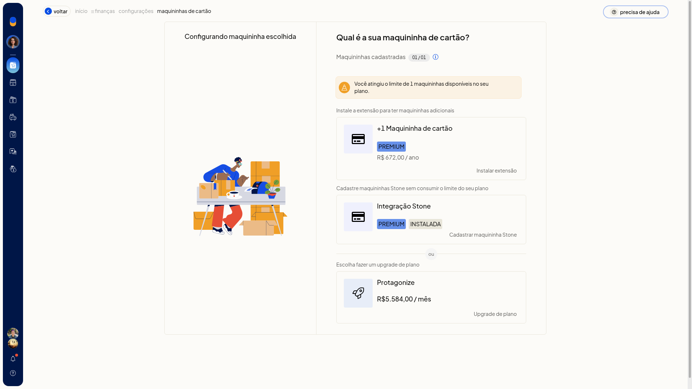

3. Na área **Integração Stone**, clique em **Cadastrar maquininha Stone**.

   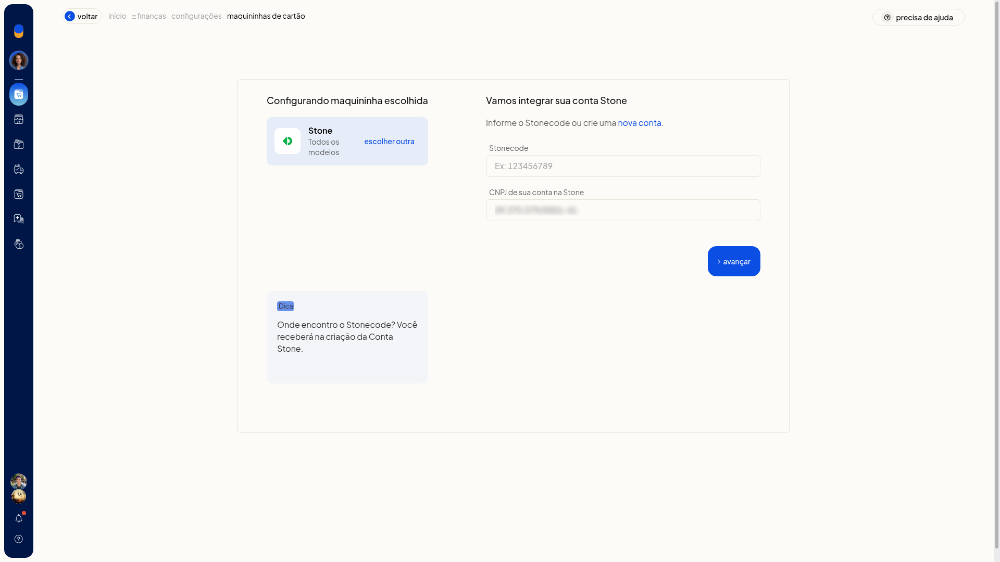

4. Informe **Stonecode** e **CNPJ de sua conta na Stone**. A tela mostra um exemplo de Stonecode, como 123456789. **Escolher outra** volta à tela de limite, sem avançar. O link **nova conta** abre o pedido de quem ainda não tem conta.

   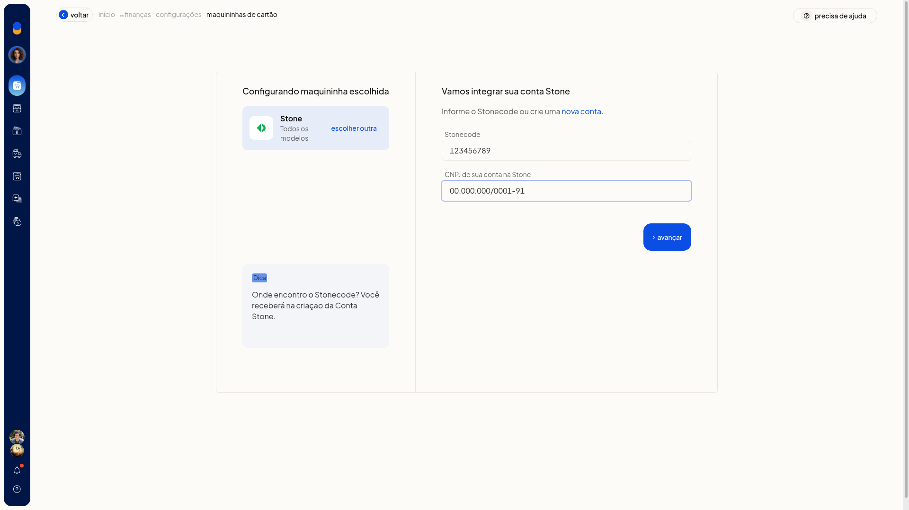

5. Clique em **Avançar** para seguir o vínculo da conta Stone.

### Pedir uma conta Stone

1. No formulário **Cadastrar maquininha Stone**, clique em **nova conta**.
2. Na página da Stone, confira as condições comerciais, o vídeo **Integração para Pagamentos no PDV com o POS da Stone** e o aviso para quem já é cliente Stone.

   

3. Em **Deseja ser cliente Stone? Preencha seus dados**, escolha **Pessoa Jurídica** ou **Pessoa Física**.
4. Preencha **CNPJ**, **Nome fantasia**, **Faturamento Mensal Médio**, **Nome completo**, **Contato**, **Email** e **Observação**. Em **Faturamento Mensal Médio**, escolha a faixa da lista.
5. Marque **Ao marcar a caixa, você concorda em receber chamadas e mensagens por meio do número de telefone fornecido acima.**

   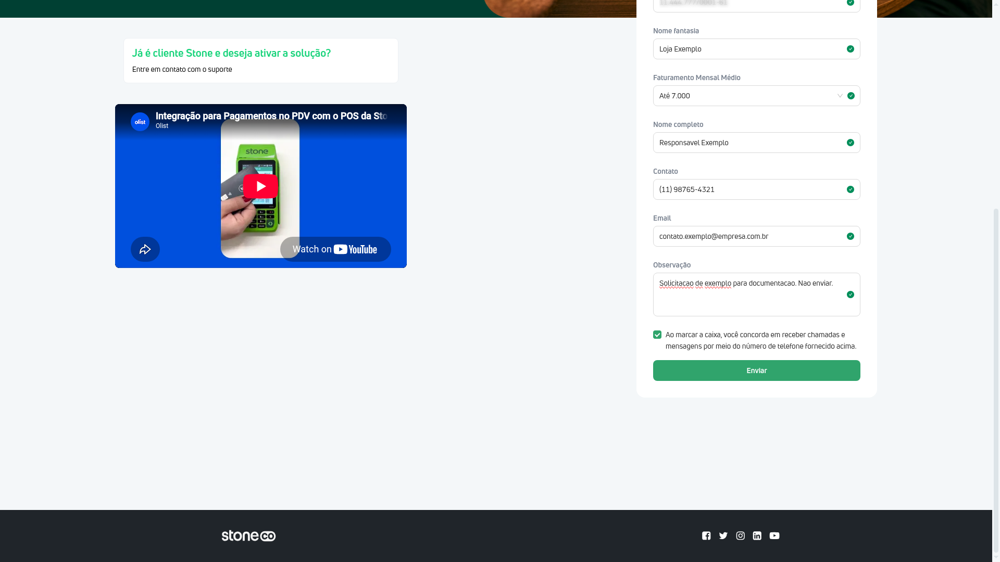

6. Clique em **Enviar** para enviar o pedido de nova conta.

### Acompanhar uma instalação pendente

1. Na lista, no card **Stone POS** com **Instalação pendente**, clique em **Continuar configuração**.
2. Leia a orientação da tela: acompanhe o email e as notificações do ERP. A equipe vincula a conta em até 3 dias úteis e avisa quando a configuração puder continuar. A tela identifica **Stone** e **Todos os modelos**.

   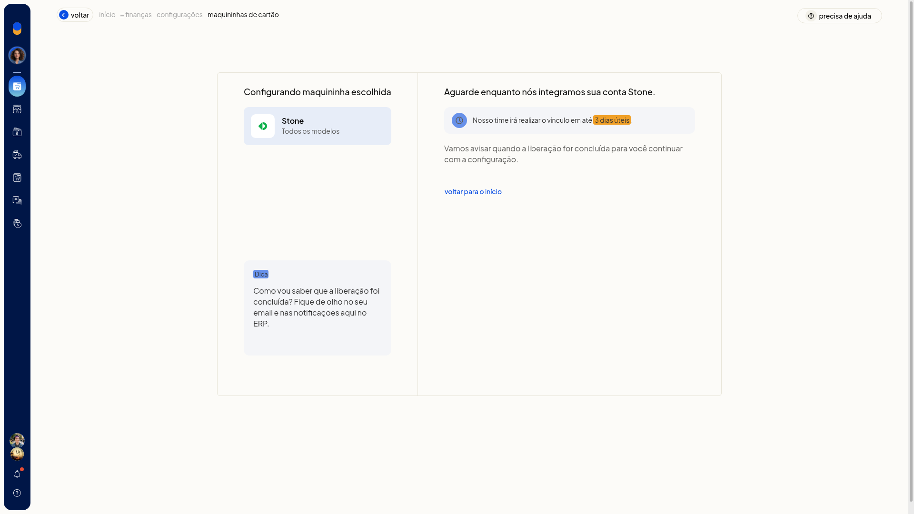

3. Clique em **Voltar para o início** para retornar à lista, sem confirmar nada.

### Configurar o gateway Stone POS

Só configure o gateway quando a maquininha **Stone POS** estiver com **Instalação concluída**.

1. Na lista, abra **Detalhes** da maquininha **Stone POS** com **Instalação concluída**.
2. Confira **Nome da maquininha**, **Gateway** **Stone POS** e **Terminal (Serial POS)**.

   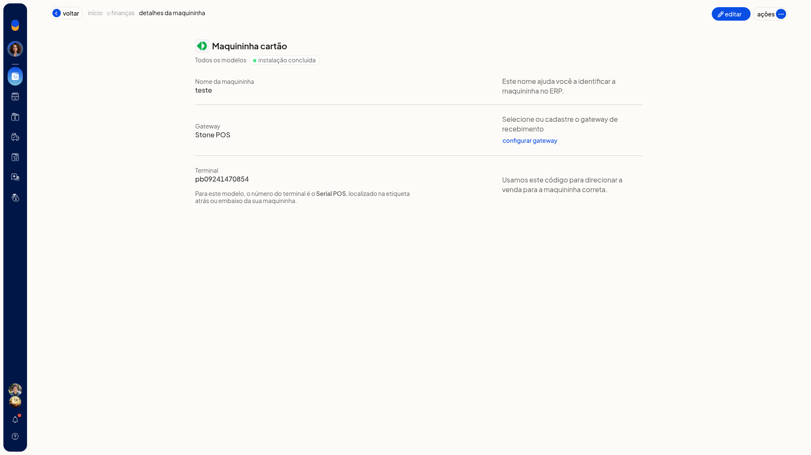

3. Clique em **Configurar gateway**.
4. Confira os dados do gateway. **Cancelar** descarta as alterações e volta à lista de gateways. No fim do formulário há o link **Gerenciar maquininhas cartão**.

   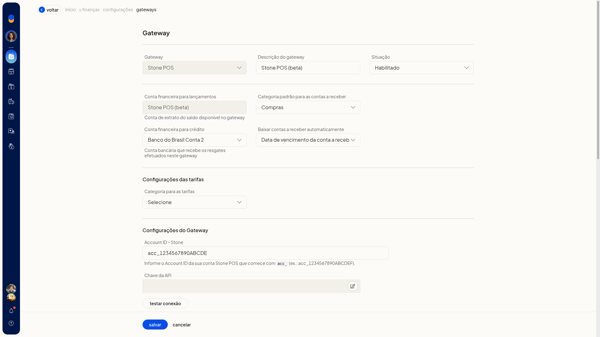

   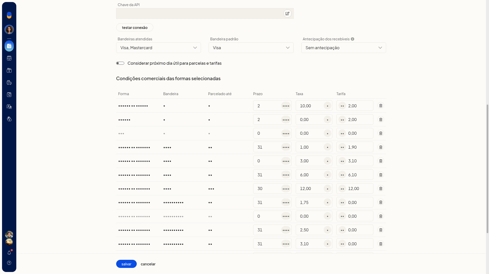

   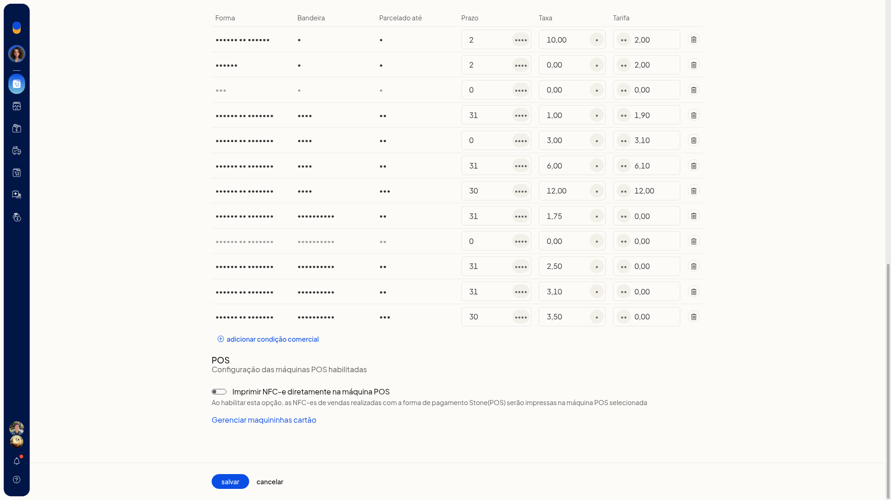

#### Identificação

- **Gateway**: **Selecione**, **Pagar.me**, **Pagar.me 2.0**, **Wirecard**, **Stone POS**, **Cielo**, **Rede**, **Getnet**, **SafraPay**, **PagBank**, **Vero**, **Bin**, **Sicredi**, **Caixa**, **Sipag**, **PicPay**, **Redeflex** ou **Outro**. Na maquininha concluída, o valor é **Stone POS**.
- **Descrição do gateway**: texto livre.
- **Situação**: **Habilitado** ou **Desabilitado**.

#### Contas e categorias

- **Conta financeira para lançamentos**: conta de extrato do saldo disponível no gateway. A lista é das contas da empresa.
- **Categoria padrão para as contas a receber**: categorias financeiras da empresa, com a opção **Selecione**.
- **Conta financeira para crédito**: conta bancária que recebe os resgates efetuados neste gateway. A lista traz as contas da empresa, **Stone POS** e **Criar nova conta**.
- **Baixar contas a receber automaticamente**: **Manual**, **Data de vencimento da conta a receber** ou **Data da efetivação da venda**.
- **Categoria para as tarifas**: categorias financeiras da empresa.

#### Stone, bandeiras e condições

- **Account ID - Stone**: informe o Account ID da conta Stone POS que comece com acc_.
- **Chave da API**: há dois campos com o mesmo rótulo.
- **Bandeiras atendidas**: **Visa**, **Mastercard**, **American Express**, **Dinners Club**, **Elo**, **Hipercard**, **BNDES** ou **Outro**.
- **Bandeira padrão**: **Selecione**, **Visa** ou **Mastercard**.
- **Antecipação dos recebíveis**: **Sem antecipação** ou **Antecipado**.
- **Considerar próximo dia útil para parcelas e tarifas**: caixa de seleção.
- **Condições comerciais**: tabela com **Forma**, **Bandeira**, **Parcelado até**, **Prazo**, **Taxa** e **Tarifa**. Clique em **adicionar condição comercial** para incluir outra linha.
- **Imprimir NFC-e diretamente na máquina POS**: ao habilitar, as NFC-e de vendas com a forma de pagamento Stone (POS) são impressas na máquina POS selecionada.

5. Para testar antes de gravar, clique em **testar conexão**.
6. Clique em **Salvar** para gravar o gateway. **Cancelar** descarta as alterações e volta à lista de gateways.

### Editar o nome da maquininha

1. Em **Detalhes** da maquininha com instalação concluída, clique em **Editar**.
2. Altere **Nome da maquininha**. **Gateway** e **Terminal (Serial POS)** também aparecem no formulário.

   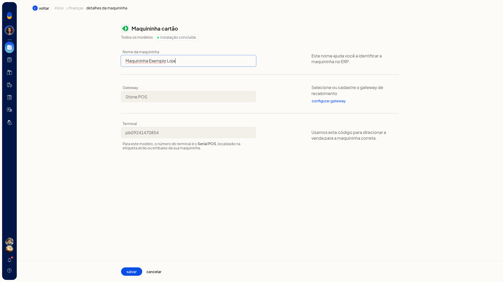

3. Clique em **salvar** para gravar a alteração. **cancelar** descarta e restaura o nome anterior.
4. Em **Ações**, clique em **Excluir maquininha** para iniciar a exclusão. A única opção desse menu é **Excluir maquininha**.

   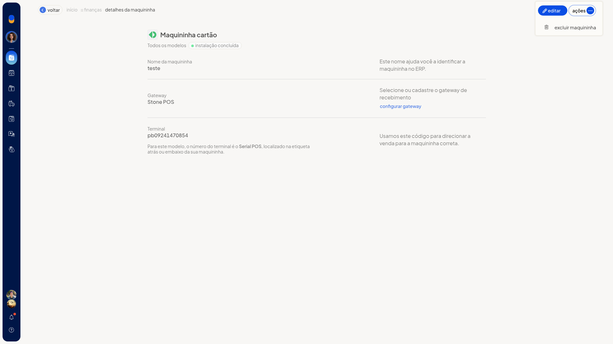

### Instalar a extensão de mais uma maquininha

1. Na lista, clique em **adicionar maquininha**.
2. Na oferta **+1 Maquininha PREMIUM**, clique em **Instalar extensão**.
3. No painel **Instalar Extensão**, confira **+1 Maquininha de cartão** e o valor anual. A extensão adiciona uma integração extra de maquininha ao plano atual. Feche o painel para voltar à tela de limite sem contratar.

   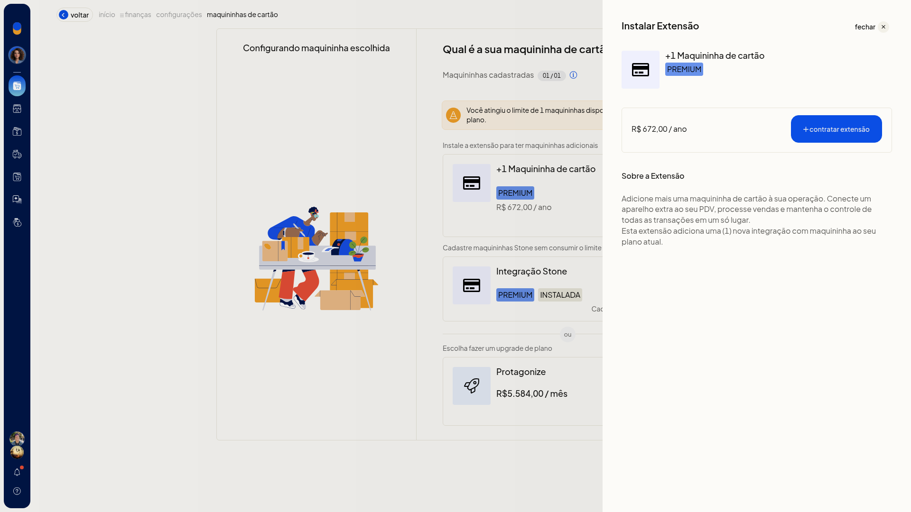

4. Clique em **contratar extensão** para confirmar a compra.

### Comparar o que o plano libera no PDV

1. Na tela de limite do plano, abra **Upgrade de plano**.
2. Confira o plano atual, a forma de cobrança e os cards **Avance**, **Construa**, **Impulsione** e **Domine**. Alterne entre mensal e anual se quiser. No card **Avance**, o PDV aparece como frente de caixa. No card **Construa**, o PDV inclui abertura e fechamento de caixa e também desconto para gerente e fechamento de caixa.

   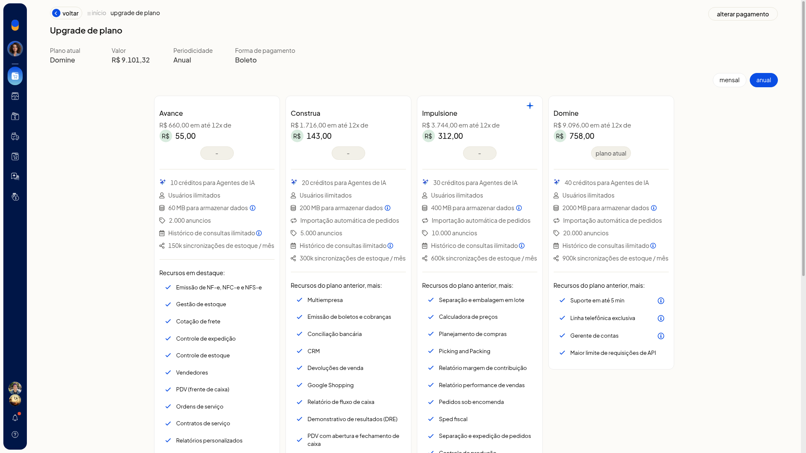

3. Abra **Compare os planos**. A tabela abre na categoria **Vendas**.
4. Na categoria **Vendas**, confira o que cada plano inclui:
 - **PDV (frente de caixa)** e **Maquininhas integradas ao PDV** aparecem em todos os planos.
 - **Controle de caixa do PDV** e **Desconto para gerente e fechamento de caixa** começam em **Construa**.
 - **Relatório de performance de vendas** começa em **Impulsione**.
 - **Nº de Maquininhas gratuitas**: **Avance** não inclui; **Construa**, **Impulsione** e **Domine** incluem 1 integração gratuita; **Protagonize** é **Personalizado**.

   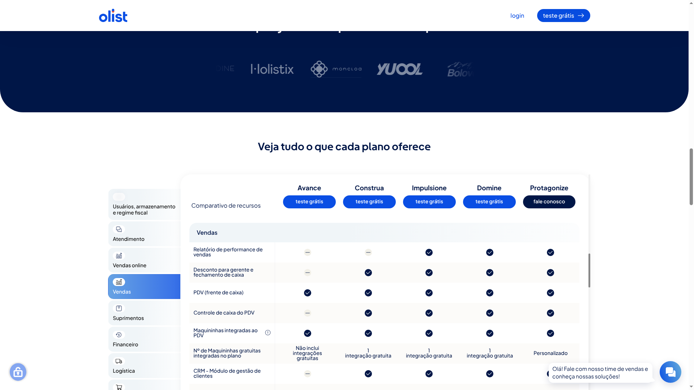

5. No rodapé da troca de plano, veja também **Plano Protagonize** e **agendar com especialista**. Use essa tela para localizar a frente de caixa, o controle de caixa e as maquininhas integradas antes de contratar.

   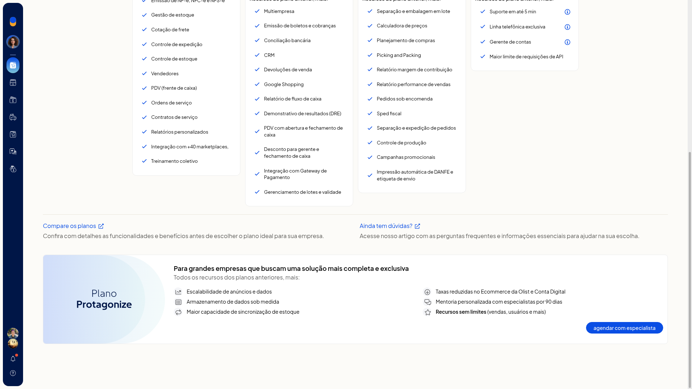

### Consultar a Stone e a sangria no PDV

1. Acesse **Vendas > PDV**.

   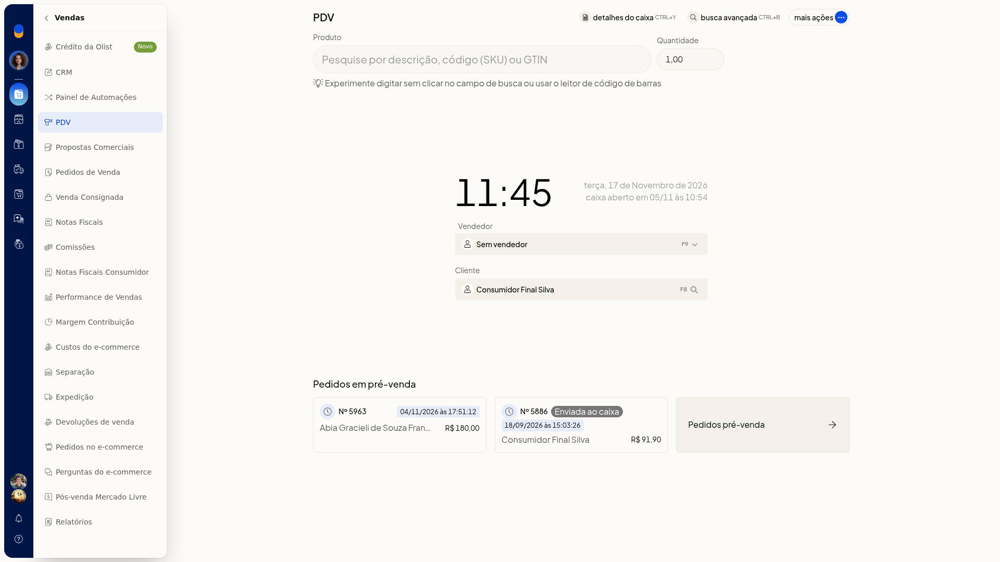

2. Em **Mais ações**, abra **pedidos em aberto - Stone**. No mesmo menu estão as rotinas de sangria, reforço e fechar caixa.

   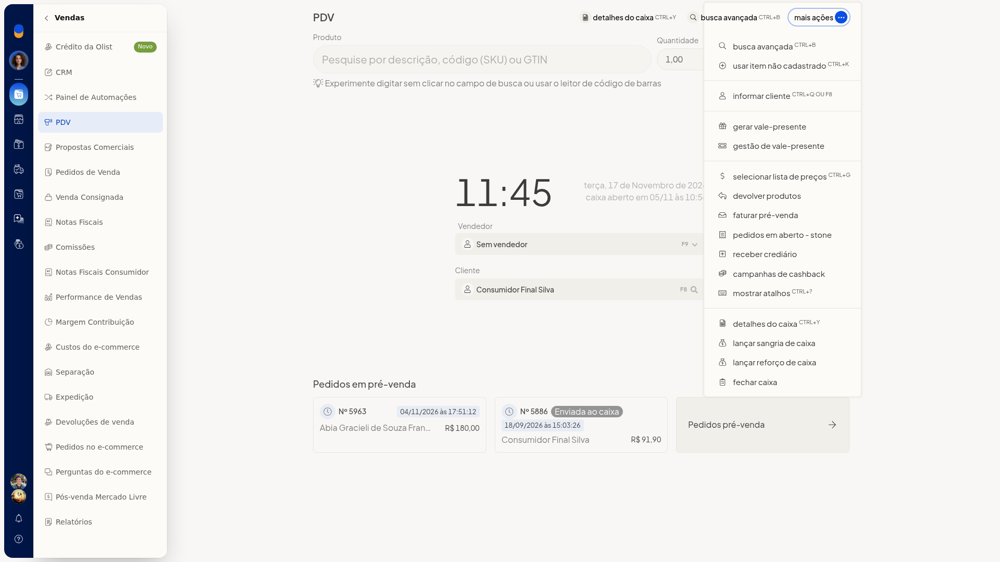

3. Se não houver pendência, a tela informa **Não há transações pendentes para esta Empresa**. Há ações para cancelar as selecionadas e para sair. Clique em **sair** para fechar sem alterar nada.

   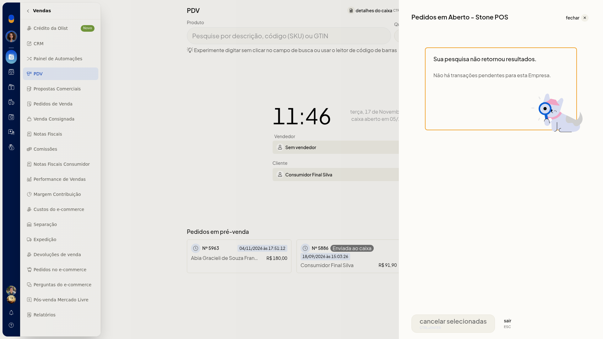

4. Ainda em **Mais ações**, abra a sangria.
5. Informe **Valor (R$)** e **Observação**. Se quiser, marque **Imprimir comprovante**.

   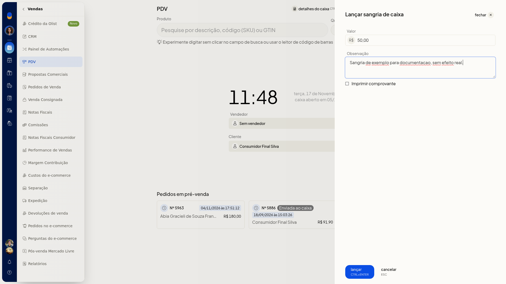

6. Clique em **Lançar** para confirmar a sangria. O atalho é CTRL+ENTER. **cancelar** descarta o lançamento, com o atalho ESC.

## Resultado
Na lista, o card com **Instalação concluída** oferece **Detalhes** e o card com **Instalação pendente** oferece **Continuar configuração**. No PDV, **pedidos em aberto - Stone** informa quando não há transações pendentes para a empresa.
