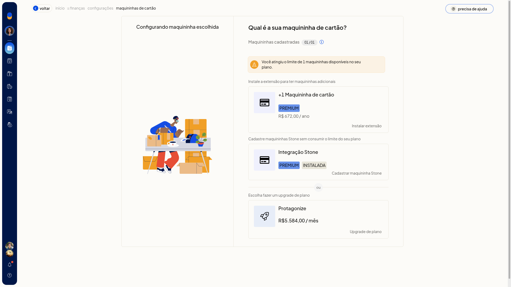
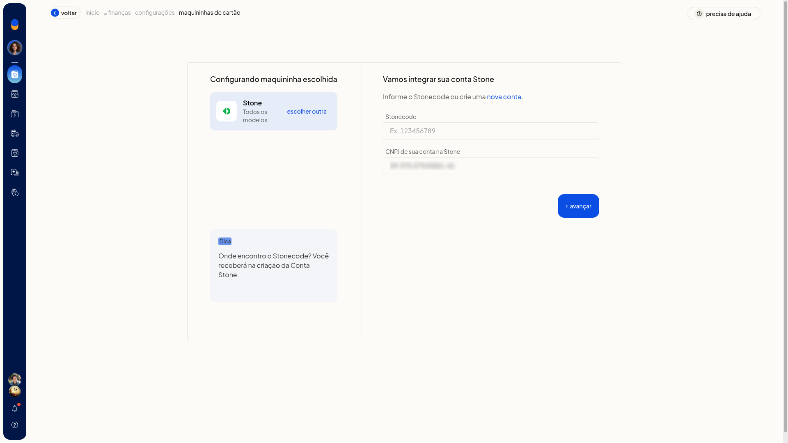
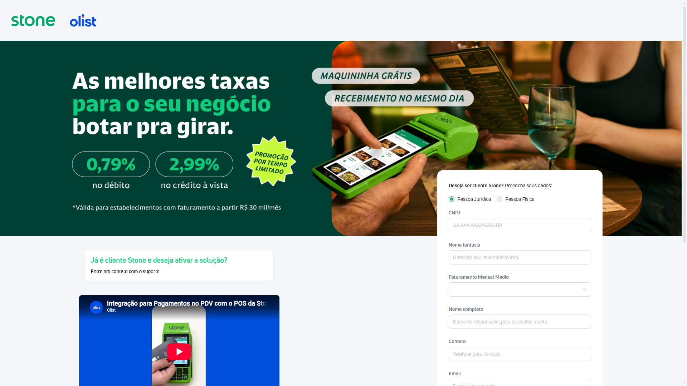
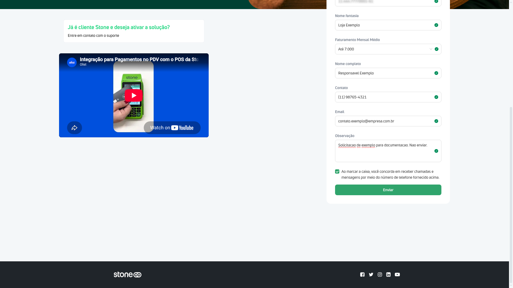

# Solicitar uma nova conta Stone pelo cadastro da maquininha

Pelo cadastro da maquininha Stone no ERP da Olist, você pede uma conta Stone se ainda não é cliente. O link **nova conta** abre a página da Stone para informar os dados do estabelecimento e enviar a solicitação.

## Pré-requisitos
- A área **Integração Stone** precisa estar instalada para abrir **Cadastrar maquininha Stone**. Na tela, ela pode aparecer como **PREMIUM INSTALADA**.

## Importante
- Quem já é cliente Stone vê na página o aviso **Já é cliente Stone e deseja ativar a solução? Entre em contato com o suporte.**

## Instruções
1. Acesse **Configurações > Configurações ERP > Finanças > Configurações das maquininhas de cartão**.
2. Clique em **adicionar maquininha**.
   
3. Na área **Integração Stone**, clique em **Cadastrar maquininha Stone**.
   
4. Clique em **nova conta**.
   
5. Em **Deseja ser cliente Stone?**, selecione **Pessoa Jurídica** ou **Pessoa Física**.
6. Preencha **CNPJ**, **Nome fantasia**, **Faturamento Mensal Médio**, **Nome completo**, **Contato**, **Email** e **Observação**. Em **Faturamento Mensal Médio**, selecione uma faixa da lista. Nenhum desses campos aparece marcado como obrigatório.
7. Marque **Ao marcar a caixa, você concorda em receber chamadas e mensagens por meio do número de telefone fornecido acima.**
   
8. Clique em **Enviar**.

## Informações adicionais
- A página mostra condições comerciais e o vídeo **Integração para Pagamentos no PDV com o POS da Stone**.
- **Pessoa Jurídica** pode já vir selecionada no formulário.
