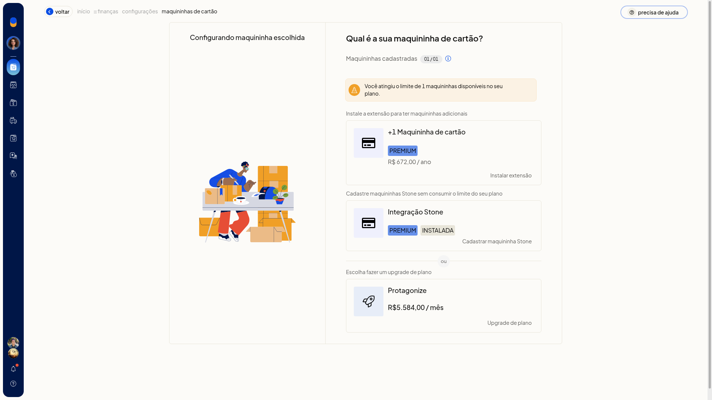
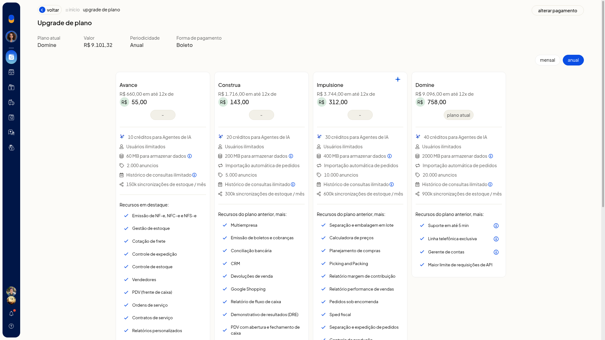
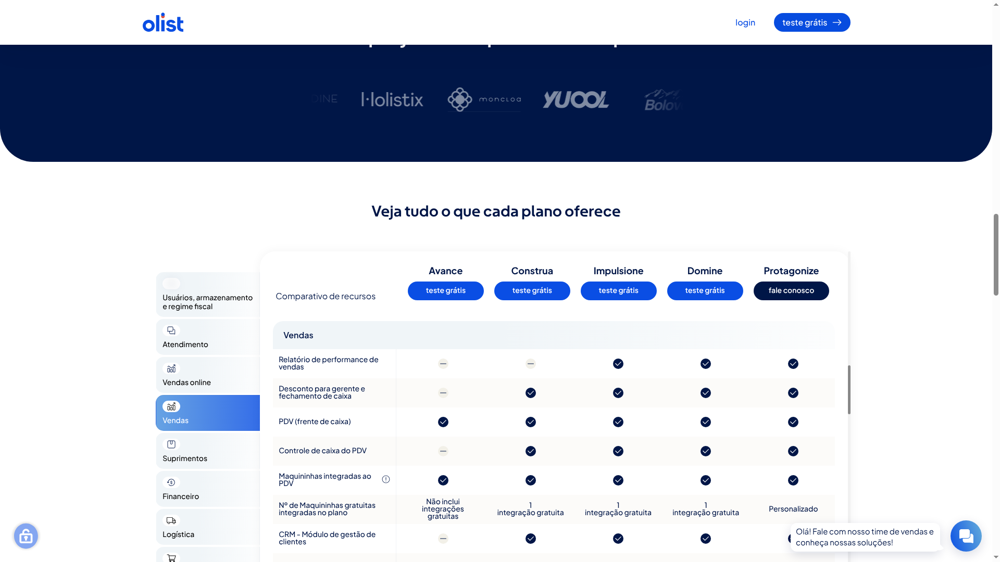
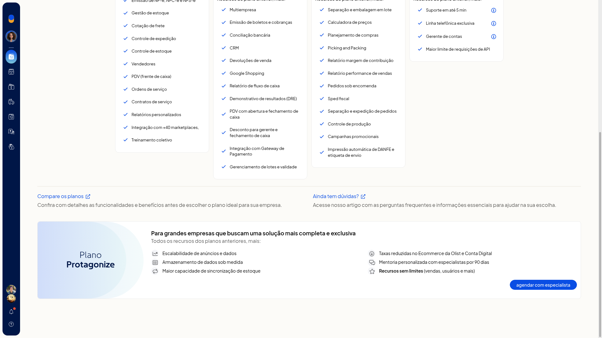

# Usar e configurar o Plano PDV

No ERP da Olist, o plano define o que a frente de caixa libera: PDV, controle de caixa e maquininhas integradas. Você consulta esses itens na troca de plano e na comparação pública, antes de contratar um upgrade.

Quando o limite de maquininhas está esgotado, a mesma tela de inclusão mostra o upgrade de plano, ao lado da extensão de mais uma maquininha.

## Importante
- Com o limite em **01/01**, **adicionar maquininha** não abre um cadastro em branco. A tela oferece a extensão de mais uma maquininha, a **Integração Stone** e o **Upgrade de plano**.
- O que pode ser contratado depende do plano atual exibido na tela de upgrade.

## Instruções
1. Acesse **Configurações > Configurações ERP > Finanças > Configurações das maquininhas de cartão**.
2. Clique em **adicionar maquininha**.
3. Na tela de limite, clique em **Upgrade de plano**.

   

4. Confira o plano atual, a forma de cobrança e os cards **Avance**, **Construa**, **Impulsione** e **Domine**. Alterne a cobrança entre mensal e anual para comparar.

   

5. No card **Avance**, o PDV aparece como frente de caixa. No card **Construa**, o PDV inclui abertura e fechamento de caixa e também desconto para gerente e fechamento de caixa.
6. Clique em **Compare os planos**. A tabela abre na categoria **Vendas**. Confira o que cada plano inclui:
 - **PDV (frente de caixa)** e **Maquininhas integradas ao PDV** aparecem em todos os planos.
 - **Controle de caixa do PDV** e **Desconto para gerente e fechamento de caixa** começam em **Construa**.
 - **Relatório de performance de vendas** começa em **Impulsione**.
 - Em **Nº de Maquininhas gratuitas**, **Avance** não inclui. **Construa**, **Impulsione** e **Domine** incluem 1 integração gratuita. **Protagonize** é Personalizado.

No rodapé da troca de plano também aparecem **Plano Protagonize** e **agendar com especialista**.

## Resultado
Você identifica em qual plano estão a frente de caixa, o controle de caixa e as maquininhas integradas, antes de contratar.

## Informações adicionais
- A tela de limite também oferece **Instalar extensão** para adicionar uma integração extra de maquininha ao plano atual. O painel mostra o que a extensão adiciona e o valor antes da contratação.
- **Escolher outra**, no vínculo da maquininha, volta à tela de limite do plano, sem avançar o cadastro.
