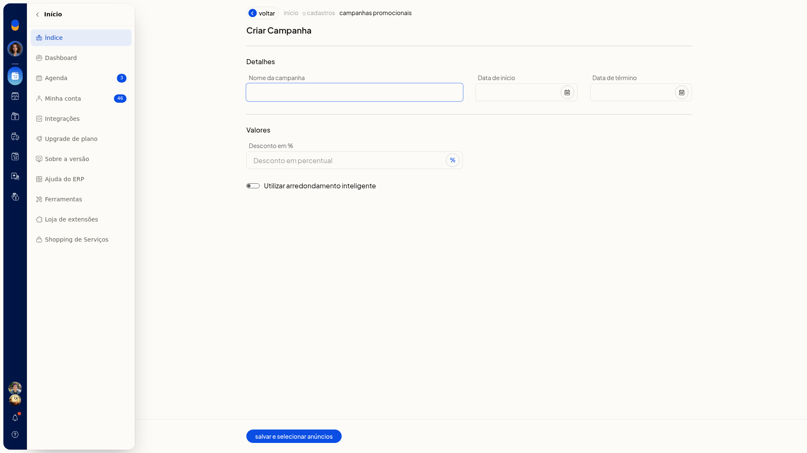
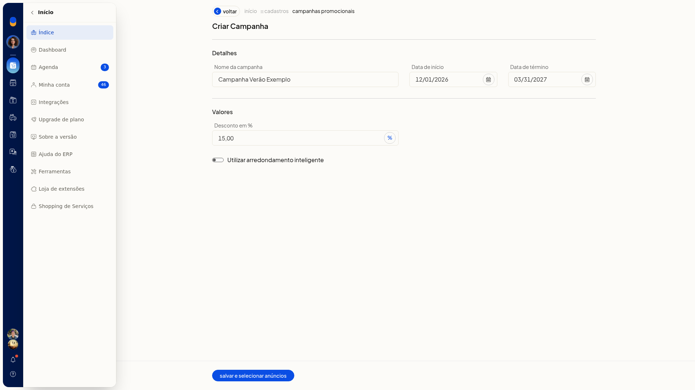
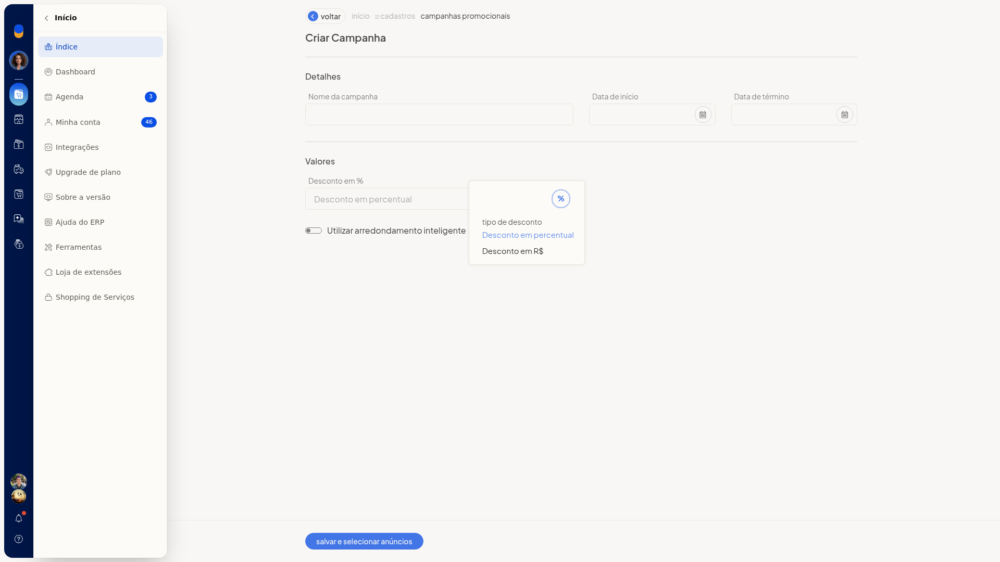
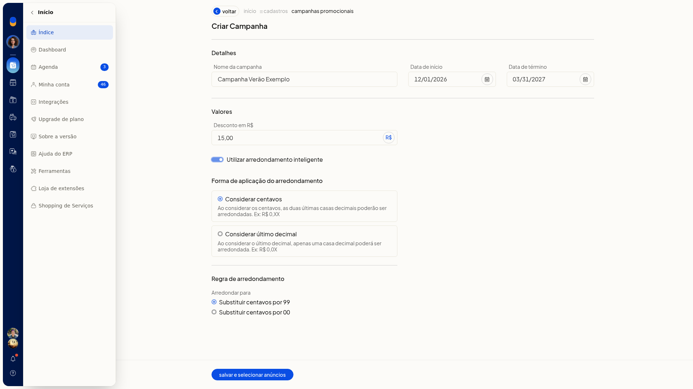
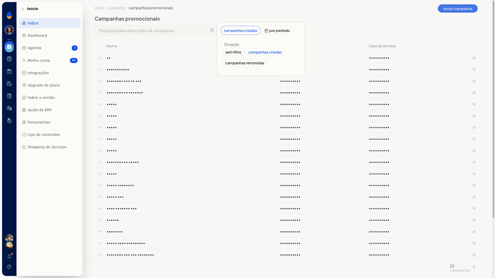
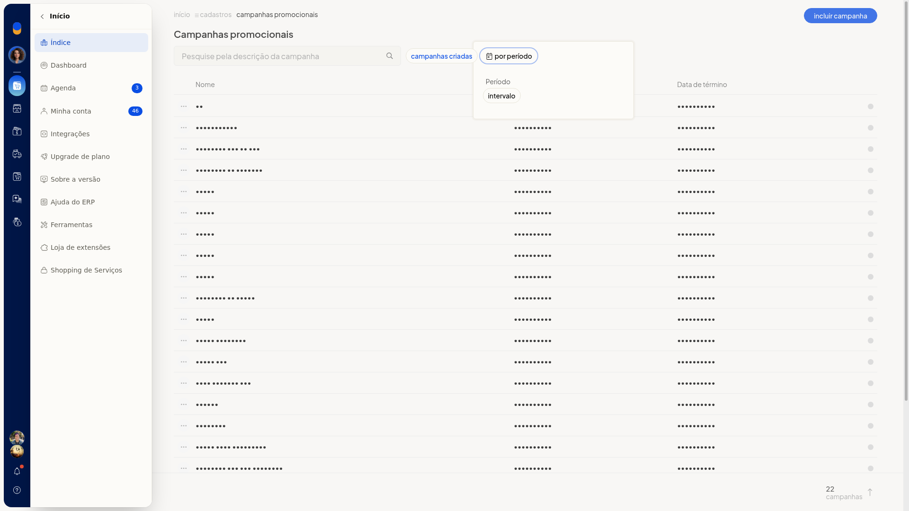
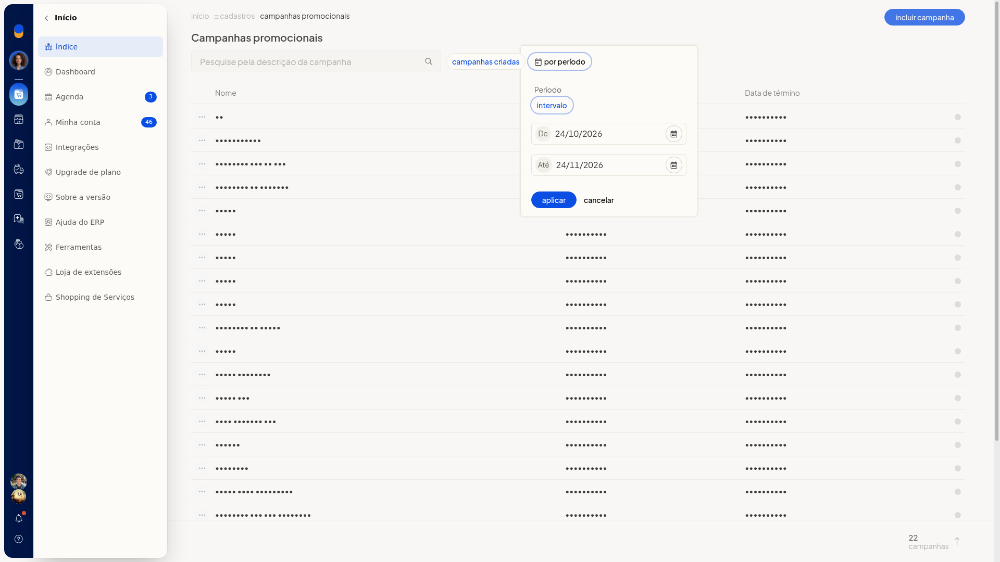
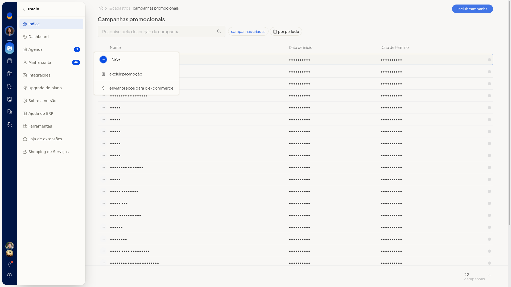

# Campanhas promocionais

No ERP da Olist, campanhas promocionais servem para cadastrar uma promoção com nome, período e desconto, em percentual ou em reais. Você também pode ativar o arredondamento inteligente e definir como os centavos do preço serão tratados.

Na lista você pesquisa campanhas pela descrição e filtra por situação e por período. O cadastro fica em **Cadastros > Campanhas Promocionais**, no botão **Incluir campanha**.

## Importante
- Nenhum campo do formulário **Criar Campanha** aparece como obrigatório.
- Nesta tela não há opção para criar campanha por planilha.
- Para sair sem gravar, use **Voltar**. A lista retorna e a campanha preenchida não é incluída.

## Instruções
1. Acesse **Cadastros > Campanhas Promocionais**. A lista mostra as campanhas já cadastradas, com as colunas **Nome**, **Data de início** e **Data de término**.

   

2. Clique em **Incluir campanha**.

   

3. Informe **Nome da campanha**, **Data de início** e **Data de término**. As datas seguem o formato mm/dd/yyyy.

   

4. No controle ao lado do valor, escolha **Desconto em percentual** ou **Desconto em R$** e informe o desconto. A escolha altera o rótulo do campo de valor para **Desconto em %** ou **Desconto em R$**.

   

   

5. Se quiser, ative **Utilizar arredondamento inteligente**. Informe **Forma de aplicação do arredondamento**: **Considerar centavos (Ex R$ 0,XX)** ou **Considerar último decimal (Ex R$ 0,0X)**. Em **Arredondar para**, escolha **Substituir centavos por 99** ou **Substituir centavos por 00**.

   

6. Clique em **Salvar e selecionar anúncios** para salvar a campanha e seguir para a seleção de anúncios.

## Informações adicionais
### Pesquisa e filtros da lista

- Use **Pesquise pela descrição da campanha** para localizar uma campanha pelo nome.
- O filtro **campanhas criadas** abre **Situação**, com **sem filtro**, **campanhas criadas** e **campanhas removidas**.

- O filtro **por período** abre **Período**. Em **Intervalo**, informe **De** e **Até** e clique em **Aplicar**. Para fechar sem aplicar, clique em **Cancelar**.

### Ações de cada campanha

No menu da linha de cada campanha aparecem **Excluir promoção** e **Enviar preços para o e-commerce**.

