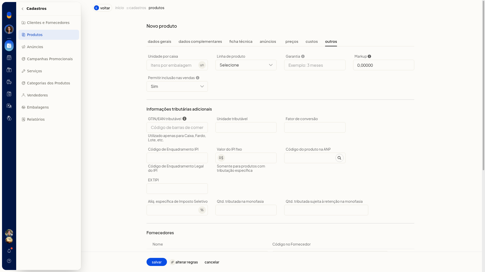
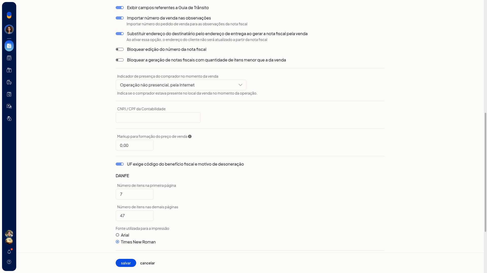

# Formação de preço e markup

A formação de preço no ERP da Olist usa o markup do produto. Se esse markup estiver zerado, o ERP usa o markup geral da nota fiscal.

Você informa a alíquota no cadastro do produto e define o markup geral para os produtos sem markup individual.

## Importante
- A alíquota do **Markup** entra na formação de preço.
- Com o **Markup** do produto em zero, a formação de preço usa o markup geral.

## Instruções
1. Acesse **Cadastros > Produtos > Incluir produto**.
2. Abra a aba **Outros** e localize **Markup**.

   

3. Informe a alíquota em percentual, com vírgula. O campo não é obrigatório.
4. Acesse **Configurações > Configurações ERP** e busque markup.
5. Abra **Markup para formação do preço de venda**, em **Vendas > Configuração da Nota Fiscal Eletrônica**, e expanda as configurações adicionais.

   

6. Informe a alíquota geral. O campo não é obrigatório. Esta alíquota será considerada na formação de preço dos produtos sem markup individual informado.

## Resultado
O produto usa o markup individual. Os produtos sem markup próprio usam o markup geral da nota fiscal.
